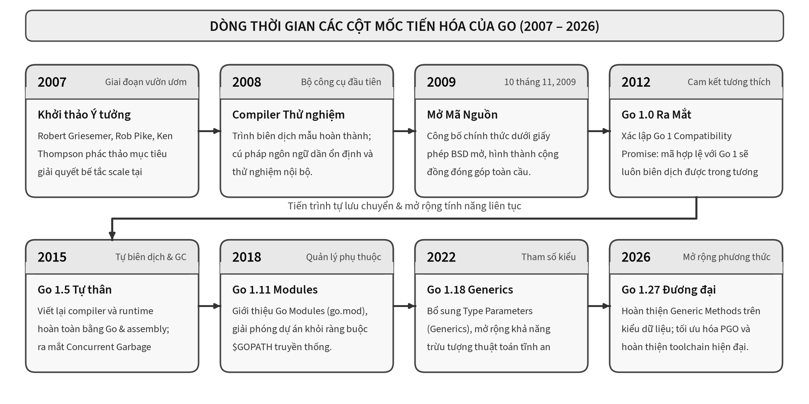
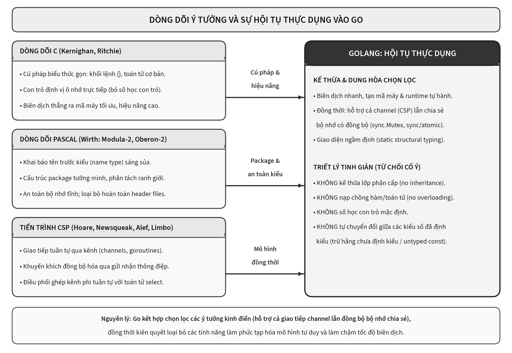

<!-- BOOK_ROLE: FOUNDATION_CORE -->

# Trước khi viết dòng Go đầu tiên

Go không bắt đầu bằng câu hỏi “cú pháp nào còn thiếu?”. Ngôn ngữ bắt đầu từ một vấn đề kỹ thuật rất cụ thể: đến năm 2007, phần cứng máy tính đã phát triển nhanh hơn rất nhiều, nhưng công việc xây dựng và bảo trì một hệ sinh thái phần mềm quy mô lớn vẫn bị kéo chậm bởi ngôn ngữ, hệ thống đóng gói biên dịch và khối lượng công việc quản trị ghi chép mà lập trình viên phải mang theo.

Tại Google khi ấy, các kỹ sư Robert Griesemer, Rob Pike và Ken Thompson làm việc giữa những kho mã nguồn quy mô lớn, hệ thống nối mạng phân tán và phần cứng đang chuyển dịch mạnh mẽ sang kiến trúc đa lõi. C++ và Java là những lựa chọn phổ biến cho các dịch vụ máy chủ; chúng đem lại những năng lực quan trọng, đồng thời tạo ra một lượng phức tạp đáng kể trong quá trình đóng gói biên dịch, quản lý các gói phụ thuộc và tổ chức cấu trúc chương trình. Ở chiều ngược lại, các ngôn ngữ động mang lại cảm giác phát triển nhanh chóng hơn, nhưng phải đánh đổi một phần khâu kiểm tra kiểu dữ liệu tĩnh và hiệu năng thực thi. Bài toán không phải là lựa chọn một bên để lấn át bên còn lại. Bài toán là liệu một ngôn ngữ có thể kết hợp hiệu quả biên dịch, hiệu năng vận hành và tính an toàn kiểu vào cùng một quy trình làm việc tinh gọn hơn hay không.

Ngày 21 tháng 9 năm 2007, ba người bắt đầu phác thảo mục tiêu của một ngôn ngữ mới trên bảng trắng. Vài ngày sau, ngày 25 tháng 9, Pike đề xuất cái tên Go. Thiết kế ban đầu diễn ra song song với công việc khác; đầu năm 2008, Thompson đã có trình biên dịch thử nghiệm sinh mã C để thử các ý tưởng. Đến giữa năm, dự án đủ rõ để hướng tới trình biên dịch dùng trong thực tế. Ian Lance Taylor bắt đầu xây dựng phần đầu trình biên dịch GCC (`front end`) vào tháng 5 năm 2008; Russ Cox gia nhập vào cuối năm ấy và giúp đưa bản mẫu thử nghiệm (`prototype`), thư viện chuẩn cùng bộ công cụ tiến gần hơn tới một ngôn ngữ sẵn sàng ứng dụng vào thực tế sản xuất.

@figure Dòng thời gian không liệt kê mọi bản phát hành. Sơ đồ chỉ lưu giữ các bước làm thay đổi cam kết của Go với người phát triển phần mềm: công khai mã nguồn, ổn định lâu dài, tái thiết kế nền tảng thực thi, minh bạch phụ thuộc và hỗ trợ kiểu tổng quát tương thích ngược.

Go được công bố mã nguồn mở vào ngày 10 tháng 11 năm 2009. Ba năm đầu là giai đoạn ngôn ngữ biến chuyển nhanh chóng: nhóm thiết kế cùng cộng đồng thử nghiệm, loại bỏ và tinh chỉnh, trước khi chốt lại một nền tảng ổn định. Phiên bản Go 1 phát hành ngày 28 tháng 3 năm 2012. Từ thời điểm này, Lời hứa tương thích Go 1 (`Go 1 Compatibility Promise`) trở thành một phần bản sắc văn hóa của dự án: mã nguồn viết cho Go 1 được cam kết tiếp tục biên dịch và vận hành chính xác trong các bản Go 1 kế tiếp, với những ngoại lệ được nêu rõ. Cam kết đó làm thay đổi cách một tính năng mới được cân nhắc. Một bổ sung không chỉ cần hữu ích hôm nay; tính năng đó phải sống bền bỉ cùng hệ sinh thái trong nhiều năm dài.

Phiên bản Go 1.5 là một cột mốc lịch sử về hiện thực hóa nền tảng. Bộ công cụ biên dịch chuyển dịch từ C sang Go, môi trường thực thi (`runtime`) cũng trở thành mã nguồn Go đi kèm một phần mã hợp ngữ (`assembly`). Bộ thu gom rác (`garbage collector`) được thiết kế lại để vận hành phần lớn công việc đồng thời với chương trình; bộ lập lịch (`scheduler`) cho phép giá trị mặc định của biến `GOMAXPROCS` chuyển từ 1 sang đúng số lượng vi xử lý luận lý của máy tính. Đó là những thay đổi nằm sâu dưới tầng bề mặt ngôn ngữ, làm sáng tỏ mục tiêu ban đầu: một chương trình Go cần vận hành hài hòa với phần cứng đa lõi mà không ép buộc người viết phải tự gánh vác mọi chi tiết phức tạp của môi trường thực thi.

Những thay đổi lớn sau đó cũng đi theo nhịp tiến hóa thận trọng thay vì phá bỏ làm lại từ đầu. Phiên bản Go 1.11 giới thiệu mô-đun (`modules`) như một lựa chọn thay thế cho biến môi trường `GOPATH`, với cơ chế quản lý phiên bản và phân phối gói tích hợp trực tiếp vào bộ công cụ; mô hình này dần trở thành quy chuẩn quản lý phụ thuộc quen thuộc. Phiên bản Go 1.18, phát hành năm 2022, chính thức đưa tham số kiểu vào ngôn ngữ. Đến phiên bản Go 1.27 năm 2026, các phương thức tổng quát (`generic methods`) nối mảnh ghép còn thiếu vào bức tranh: phương thức có thể tự khai báo tham số kiểu riêng biệt. Vì vậy, “Go 2” không trở thành một nhánh viết lại tách rời; nhiều ý tưởng được thử nghiệm, thảo luận phản biện và đưa dần vào dòng phiên bản Go 1.x khi chứng minh được giá trị thực tiễn vững chắc.

## Một dòng họ ý tưởng, không phải một cây sao chép

Ngôn ngữ Go kế thừa nhiều dòng tư tưởng học thuật cùng lúc. Cú pháp cơ bản đặt Go gần gũi với họ ngôn ngữ C. Cách nhìn nhận về việc khai báo, tổ chức gói mã nguồn và sự tường minh trong cấu trúc chịu ảnh hưởng đáng kể từ các ngôn ngữ Pascal, Modula và Oberon. Lĩnh vực xử lý đồng thời (`concurrency`) có một lịch sử phát triển dài hơn: mô hình tiến trình giao tiếp tuần tự (`CSP`) của Tony Hoare đi qua Newsqueak, Alef và Limbo trước khi các kênh truyền thông tin trở thành một phần của Go. Những cội nguồn này giải thích vì sao một số ý tưởng nghe có vẻ quen thuộc, chứ hoàn toàn không biến Go thành bản sao thụ động của bất kỳ ngôn ngữ nào trong số đó.

@figure Nhánh CSP giải thích lịch sử của các kênh truyền dữ liệu; nhánh C và Pascal/Modula/Oberon làm sáng tỏ những điểm xuất phát khác nhau. Thiết kế hoàn thiện vẫn phục vụ cho đúng bài toán kỹ thuật mà Go hướng tới giải quyết.

Một ngôn ngữ được sinh ra cho các kho mã nguồn quy mô lớn không chỉ cần cú pháp tinh gọn. Ngôn ngữ đòi hỏi một quy trình làm việc chuẩn mực bao quanh cú pháp: tốc độ biên dịch nhanh, công cụ định dạng tự động (`formatter`), cấu trúc gói và quản trị phụ thuộc minh bạch, trình biên dịch đưa ra phản hồi tức thời và bộ công cụ có khả năng phân tích mã nguồn. Lý do là vì Go thường được nói đến cùng `gofmt`, `go test` và công cụ dòng lệnh `go`, thay vì chỉ thuần túy là một danh sách các tính năng cú pháp.

## Thiết kế bằng cách từ chối

Trong giai đoạn đầu, nhóm sáng lập đặt nặng sự đồng thuận: một tính năng mới chỉ được triển khai khi cả nhóm nhìn nhận rõ sự cần thiết. Câu hỏi không dừng ở việc “có thể thêm gì?”, mà còn là “có thể tinh giản gì để hệ thống vẫn vận hành hiệu quả?”. Kết quả mang lại là một tập hợp các quyết định đánh đổi (`trade-offs`) có chủ ý sâu sắc.

> **Một điều đáng nhớ:** Sự vắng mặt của cây phân cấp kế thừa, nạp chồng toán tử, cơ chế xử lý lỗi theo kiểu ném ngoại lệ hay kiểu tổng quát trong giai đoạn đầu không phải bản tuyên ngôn rằng các cơ chế ấy luôn tồi tệ. Mỗi cơ chế phát huy tác dụng trong những ngữ cảnh riêng biệt. Go ưu tiên một mô hình dễ đọc, dễ phân tích, biên dịch nhanh và duy trì sự ổn định dài hạn; cái giá phải trả là một số cách diễn đạt quen thuộc sẽ vắng mặt hoặc xuất hiện muộn hơn.

Việc không có cây phân cấp kiểu dữ liệu giải phóng người đọc khỏi việc lần theo cây kế thừa; thay vào đó, giao diện và cơ chế hợp thành (`composition`) sẽ được phân tích kỹ lưỡng khi chúng ta đã nắm vững mã nguồn cơ bản. Việc không nạp chồng toán tử bảo đảm ý nghĩa của các toán tử không bị thay đổi tùy tiện theo từng kiểu dữ liệu. Lỗi được trả về trực tiếp dưới dạng giá trị thông thường thay vì chuyển qua cơ chế ném ngoại lệ. Và kiểu tổng quát được chủ động trì hoãn cho đến khi thiết kế chứng minh mang lại giá trị thực tế lớn hơn hẳn so với mức độ phức tạp đưa vào hệ thống kiểu và bộ công cụ. Đây là các lựa chọn kỹ thuật hoàn toàn có thể thảo luận và đối chiếu, không phải là những giáo điều đạo đức.

Nhìn lịch sử theo cách này giúp lý giải cảm nhận đầu tiên khi tiếp cận Go. Ta sẽ nhận thấy nhiều câu lệnh ngắn gọn, ít từ khóa rườm rà, khai báo rõ ràng và bộ công cụ hiện diện từ rất sớm. Những đặc điểm ấy là dấu vết của một mục tiêu nhất quán: giảm thiểu ma sát cho các kỹ sư cùng hợp tác xây dựng, đọc hiểu và bảo trì phần mềm qua nhiều năm tháng.

Sau gần hai thập kỷ tiến hóa, cách tiếp cận các quyết định thiết kế này không phải là đọc thêm những trang lịch sử. Hãy đặt chúng ngay trước mắt trong một tệp mã nguồn `.go` tinh gọn.

## Ghi chú kiểm chứng

@references
1. Go Team. Frequently Asked Questions: Origins and Design. go.dev/doc/faq
2. Cox, Russ. Toward Go 2. 13 July 2017. go.dev/blog/toward-go2
3. Go Team. Go 1 and the Future of Go Programs. March 2012. go.dev/doc/go1compat
4. Gerrand, Andrew. Go 1.5 is released. 19 August 2015. go.dev/blog/go1.5
5. Bonventre, Andrew. Go 1.11 is released. 24 August 2018. go.dev/blog/go1.11
6. Go Team. Go 1.18 is released! 15 March 2022. go.dev/blog/go1.18
7. Go Team. Go 1.27 Release Notes. 2026. go.dev/doc/go1.27
