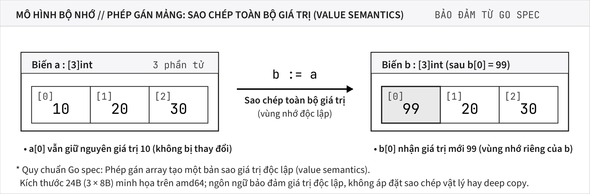
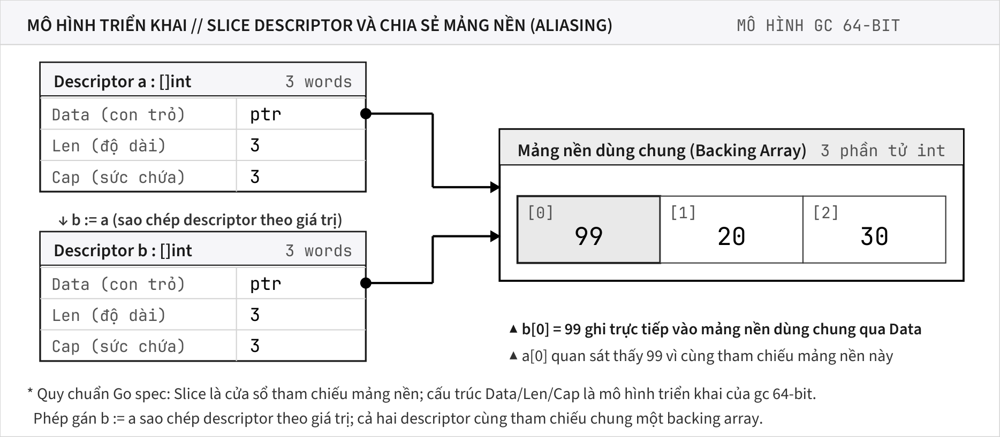
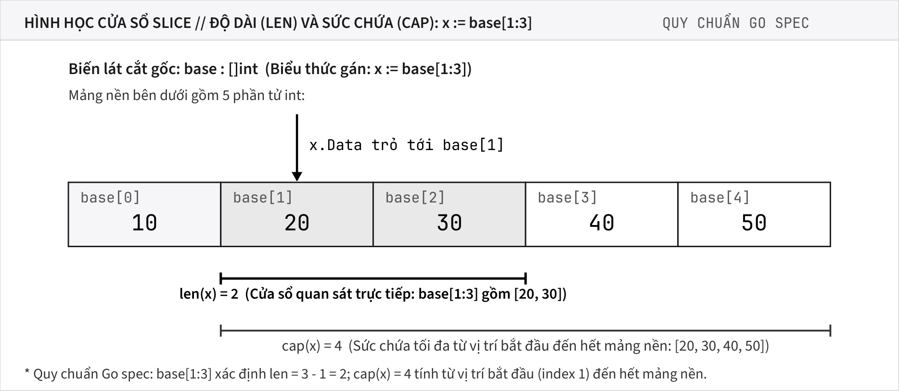
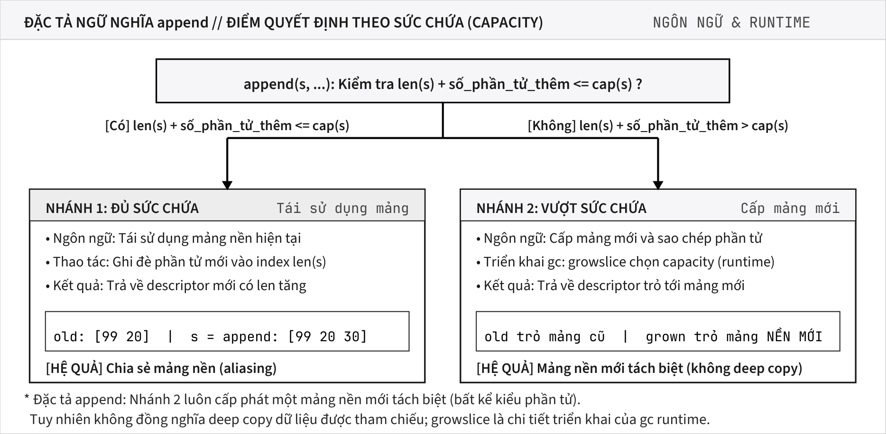

<!-- BOOK_ROLE: FOUNDATION_CORE -->

# Chương 2 — Khi một bản sao vẫn chia sẻ dữ liệu

Chạy đoạn này trước khi cố giải thích nó. Nếu bạn đoán a và b khác nhau sau dòng b[0] = 99, đó là một dự đoán rất hợp lý - và cũng là cánh cửa vào phần này.

~~~go
a := []int{10, 20, 30}
b := a
b[0] = 99

fmt.Println(a)
fmt.Println(b)
~~~

Kết quả từ lab part2-values là:

~~~text
[99 20 30]
[99 20 30]
~~~

Đừng ghi nhớ riêng một câu “slice nguy hiểm”. Thay vào đó, ta sẽ lần ngược từ kết quả: Go đã copy cái gì khi chạy `b := a`, và dữ liệu nào không được copy?

## Một baseline để dự đoán

Với kiểu `int`, phép gán tạo ra một giá trị độc lập. Cả `a` và `b` đều có giá trị riêng.

~~~go
a := 10
b := a
b = 99

fmt.Println(a, b) // 10 99
~~~

Go đã sao chép giá trị của `a` sang `b`. Sau đó `b` nhận giá trị mới; `a` không đổi. Phép gán sao chép giá trị; khi gọi hàm, đối số cũng được truyền theo giá trị. Cả hai quy tắc đều không hứa rằng mọi dữ liệu được tham chiếu bên trong giá trị ấy sẽ được sao chép. Ta cần biết chính xác giá trị đang chứa gì.

Array giúp ta kiểm tra quy tắc ấy với nhiều phần tử. Độ dài là một phần của type, nên [3]int và [4]int là hai array type khác nhau. Khi array được gán, toàn bộ array value được copy.

~~~go
a := [3]int{10, 20, 30}
b := a
b[0] = 99

fmt.Println(a) // [10 20 30]
fmt.Println(b) // [99 20 30]
~~~

@figure Phép gán của mảng sao chép toàn bộ các phần tử. Việc thay đổi b[0] chỉ tác động vào mảng b riêng biệt.

Đến đây, trực giác “copy nghĩa là độc lập” vẫn đúng. Sự thay đổi xuất hiện chỉ khi ta bỏ một ký tự trong type: [3]int trở thành []int.

## Khoảnh khắc slice đổi kết quả

~~~go
a := []int{10, 20, 30}
b := a
b[0] = 99
~~~

Kiểu `[]int` không phải là một mảng bỏ quên độ dài. Nó là kiểu slice: một giá trị slice mô tả một đoạn liên tục của mảng bên dưới.

Runtime Go 1.27.1 biểu diễn slice bằng ba trường: con trỏ dữ liệu, `len int` và `cap int` (`src/runtime/slice.go`). Với toolchain này trên amd64, giá trị slice chiếm 24 byte; số đó không bao gồm mảng được tham chiếu. Đây là chi tiết triển khai, không phải cam kết bố cục bộ nhớ của đặc tả Go. Đặc tả bảo đảm slice chia sẻ mảng bên dưới và có độ dài, dung lượng riêng; ta không cần một kích thước header cố định để suy luận về aliasing.

Chạy `TestSliceDescriptorImplementationMeasurement` trong `labs/part2-values` để đo bằng `unsafe.Sizeof` và ghi kèm Go version, hệ điều hành, kiến trúc. Thử nghiệm chỉ đo giá trị slice trên toolchain đang chạy, không đo toàn bộ bộ nhớ nó giữ sống và không chứng minh mọi compiler phải dùng cùng bố cục.

Khi phép gán `b := a` diễn ra, ngôn ngữ thực hiện sao chép giá trị theo ngữ nghĩa (copy by value). Trong mô hình ba từ máy, các thành phần của descriptor được sao chép sang `b` với cùng con trỏ dữ liệu, cùng `len` và cùng `cap`. Trình tối ưu hóa có thể giữ các trường này trên thanh ghi mà không bắt buộc phải phát sinh một lệnh chép 24 byte vật lý ở bộ nhớ. Biến `b` sở hữu một bản sao giá trị riêng biệt về cửa sổ nhìn (`len` và `cap`), nhưng con trỏ bên trong vẫn dẫn về cùng mảng nền ban đầu.

@figure Phép gán `b := a` sao chép giá trị lát cắt, bao gồm con trỏ dữ liệu, `len` và `cap`. Cả hai tiêu đề vẫn trỏ tới cùng mảng bên dưới, nên `b[0]` làm thay đổi phần tử mà `a` cũng quan sát được.

Vì vậy hai câu sau cùng đúng, và không mâu thuẫn:

@table Copy value và chia sẻ storage là hai tầng khác nhau của cùng một phép gán.

| Câu nói | Đúng ở đâu? |
| --- | --- |
| Assignment copy value. | b nhận một slice descriptor riêng: đổi len của b bằng reslice không tự đổi len của a. |
| Hai slice có thể cùng đổi dữ liệu. | Slice descriptor cùng tham chiếu một backing array; mutation một element hiện ra qua mọi slice cùng nhìn element đó. |

Từ aliasing dùng cho tình huống nhiều đường tham chiếu đến cùng dữ liệu. Nó không phải lỗi tự thân. Aliasing giúp cắt một cửa sổ trên buffer mà không copy cả buffer. Nó thành bug khi một người đọc tưởng mình có dữ liệu riêng nhưng thực tế lại đang sửa vùng dùng chung.

## Cửa sổ, length và capacity

Đặt một slice lên một slice khác để thấy descriptor thực sự đang mô tả gì.

~~~go
base := []int{10, 20, 30, 40, 50}
x := base[1:3]

fmt.Println(x)      // [20 30]
fmt.Println(len(x)) // 2
fmt.Println(cap(x)) // 4
~~~

x bắt đầu ở phần tử 20 của base và kết thúc trước 40. Vì thế length là 2. Capacity đếm số phần tử từ điểm bắt đầu của x đến cuối backing array mà x hiện có thể mở rộng tới; ở đây là 20, 30, 40, 50, nên là 4.

@figure `x` nhìn thấy hai phần tử đầu của cửa sổ. `cap(x)` không biểu thị `x` đang có bốn phần tử; nó chỉ ra rằng `x` có thể được cắt lát lại (`reslice`) hoặc nối thêm (`append`) trong phạm vi mảng bên dưới (*backing array*) hiện tại.

Hãy tự dự đoán trước khi chạy:

~~~go
base := []int{1, 2, 3, 4}
a := base[:2]
b := base[1:3]
a[1] = 99

fmt.Println(base)
fmt.Println(a)
fmt.Println(b)
~~~

Kết quả là [1 99 3 4], [1 99], [99 3]. a[1] và b[0] đều chỉ vào phần tử base[1]. Hình vẽ không thay thế được việc lần index: nó chỉ cho biết vì sao có thể có một phần tử chung để lần.

## append là một phép thử về capacity

Hàm `append` trả về lát cắt kết quả. Đặc tả Go phân biệt hai trường hợp: nếu dung lượng (*capacity*) hiện tại đủ chỗ cho các phần tử được thêm vào, `append` sẽ tái sử dụng mảng bên dưới (*underlying array*); nếu không đủ chỗ, `append` sẽ cấp phát một mảng bên dưới mới đủ lớn cho kết quả. Vì lát cắt trả về có thể thay đổi độ dài hoặc trỏ sang mảng nền mới, cách viết thông thường luôn là `s = append(s, value)`. Quy tắc tái sử dụng mảng nền là ngữ nghĩa cốt lõi của ngôn ngữ; trong khi cách thức tính toán dung lượng mới khi phải mở rộng mảng là chi tiết triển khai nội bộ.

~~~go
s := make([]int, 2, 4)
s[0], s[1] = 10, 20
old := s

s = append(s, 30)
s[0] = 99

fmt.Println(old) // [99 20]
fmt.Println(s)   // [99 20 30]
~~~

Ở đây `s` vẫn còn dung lượng dự phòng. Hai biến `old` và `s` có độ dài khác nhau, nhưng vẫn cùng trỏ vào hai phần tử đầu tiên của mảng nền (*backing array*). Không bao giờ dựa vào chuỗi dung lượng tình cờ đo được để thiết kế quyền sở hữu. Trong Go 1.27.1, hàm `nextslicecap` tại `runtime/slice.go` tính toán dung lượng mới dựa trên cả độ dài cần có và dung lượng cũ; nếu độ dài mới vượt quá hai lần dung lượng cũ, nó có thể chọn thẳng độ dài mới. Nhánh thông thường sẽ tăng gấp đôi khi dưới ngưỡng 256 phần tử, rồi chuyển dần về mức tăng thoải hơn; hàm `growslice` còn tính toán kích thước phần tử và làm tròn kích thước cấp phát bộ nhớ. Đây là thuật toán triển khai, không phải quy tắc bất biến để dự đoán mọi lời gọi `append` hay vội vã kết luận dữ liệu nhất thiết phải nằm trên heap.

Để chủ động phòng vệ, Go cung cấp cú pháp lát cắt ba chỉ số đầy đủ `s[low:high:max]` (Full Slice Expression). Cú pháp này giới hạn sức chứa của lát cắt mới ở mức `max - low`. Khi ta đặt `max = high` (như `s[:n:n]`), capacity của lát cắt mới bị giới hạn đúng bằng độ dài nhìn thấy; thao tác `append` thêm phần tử vào lát cắt này sẽ không thể dùng tiếp phần capacity nằm ngoài phạm vi quan sát của lát cắt cũ, loại bỏ nguy cơ vô tình ghi đè lên các phần tử phía sau của mảng nền chung:

~~~go
old := []int{10, 20}
s := old[:2:2]
grown := append(s, 30)
grown[0] = 99

fmt.Println(old)   // [10 20]
fmt.Println(grown) // [99 20 30]
~~~

@figure Hình mô tả hai nhánh ngữ nghĩa mà mã nguồn phải đáp ứng. Đừng suy đoán việc cấp phát bộ nhớ từ một dung lượng tình cờ; nếu mã nguồn đòi hỏi một kết quả độc lập, hãy chủ động sao chép dữ liệu.

## Một aliasing bug có người dùng thật

Một function “chỉ chuẩn bị preview” đôi khi phá dữ liệu của caller.

~~~go
func redactPreview(fields []string) {
	fields[0] = "***"
}

requestFields := []string{"api-key", "region"}
redactPreview(requestFields)
fmt.Println(requestFields) // [*** region]
~~~

Tham số `fields` tiếp nhận một giá trị lát cắt mới, nhưng tiêu đề lát cắt ấy vẫn tham chiếu tới vùng nhớ của `requestFields`. Việc sửa đổi phần tử là thao tác làm biến đổi vùng lưu trữ dùng chung. Nếu mục tiêu thực sự là tạo ra bản xem trước độc lập, hãy sao chép các phần tử sang một lát cắt mới trước khi chỉnh sửa:

~~~go
func redactedCopy(fields []string) []string {
	preview := make([]string, len(fields))
	copy(preview, fields)
	if len(preview) > 0 {
		preview[0] = "***"
	}
	return preview
}
~~~

Hàm `copy` sao chép tối đa số phần tử vừa với đích và trả về số phần tử đã chép. Với `[]string` này, `make` tạo vùng chứa phần tử riêng; gán lại `preview[i]` không sửa `fields[i]`. Đầu vào `nil` hoặc rỗng trả về slice có độ dài 0; contract không yêu cầu giữ nguyên tính `nil`. Kiểm tra độ dài trước khi truy cập phần tử 0 tránh panic. Chi phí cấp phát và sao chép là cái giá của quyền sửa dữ liệu riêng, không phải lý do để bỏ contract.

### Bài thực hành: Phát hiện việc sửa vùng nhớ dùng chung

Mở thư mục `labs/part2-values` trong trình soạn thảo và chạy riêng ca kiểm thử `TestRedactedCopyDoesNotMutateInput` trước khi sửa mã nguồn. Sau đó tạm thay phần tạo `preview` bằng phép gán `preview := fields`. Đừng suy đoán cảm tính bằng mắt: hãy chạy lại kiểm thử để thấy công cụ báo lỗi dữ liệu đầu vào đã bị biến đổi ngoài ý muốn. Khôi phục lại mã nguồn, xóa phần thân của `redactedCopy`, rồi tự hoàn thiện lại hàm từ giao ước của ca kiểm thử mà không nhìn vào bản cài đặt cũ. Đây là bước thực hành nhỏ nhưng bắt buộc mô hình tư duy “sao chép giá trị lát cắt vẫn có thể chia sẻ vùng nhớ nền” phải trải qua một thất bại thực tế.

---

#### Gợi ý giải pháp (chỉ đọc sau khi đã tự làm)

Phép gán `preview := fields` chỉ sao chép tiêu đề lát cắt (*slice header / descriptor*), nên thao tác `preview[0]` vẫn chỉnh sửa phần tử chung với `requestFields`. Bản sửa đúng đắn bắt buộc phải khởi tạo một mảng nền mới, chẳng hạn kết hợp giữa `make` và `copy`. Ca kiểm thử phải duy trì đồng thời cả hai khẳng định kiểm thử: bản xem trước đã được che dấu thông tin và dữ liệu đầu vào không bị biến đổi; việc bỏ qua khẳng định thứ hai sẽ làm đánh mất hoàn toàn giao ước về quyền sở hữu dữ liệu.

Đừng chỉ thử đầu vào có hai phần tử. `TestRedactedCopyEmptyInput` kiểm tra `nil` và slice rỗng; `TestRedactedCopyOwnsElements` sửa phần tử từ cả hai phía để kiểm tra tính độc lập. Một bản sửa chỉ che phần tử đầu nhưng làm mất phần còn lại cũng chưa đáp ứng contract.

Một cách tránh copy dễ bị hiểu nhầm là giới hạn capacity. Hãy dự đoán hai dòng in sau trước khi chạy `TestCapacityLimitDoesNotIsolateExistingElements`:

~~~go
base := []int{10, 20, 30}
view := base[:2:2]
view[0] = 99
fmt.Println(base) // [99 20 30]: phần tử cũ vẫn dùng chung

grown := append(view, 40)
grown[0] = 77
fmt.Println(base) // [99 20 30]: append đã cần mảng mới
~~~

Giới hạn capacity ngăn lần `append` này ghi vào phần đuôi của `base`; nó không cô lập các phần tử đã nằm trong cửa sổ. Ngược lại, `copy` cô lập vùng chứa phần tử nhưng không sao chép đệ quy đối tượng được trỏ tới. `TestPointerElementsRemainSharedAfterCopy` chép một `[]*int`: sửa `*clone[0]` vẫn đổi số nguyên chung, còn gán một con trỏ khác vào `clone[0]` chỉ đổi phần tử của bản sao. Quyền sở hữu phải được xét ở đúng tầng dữ liệu, không suy ra từ chữ “copy”.

## Một cửa sổ nhỏ giữ cả căn phòng

Tính độc lập khi chỉnh sửa dữ liệu chưa phải là câu hỏi cuối cùng về quyền sở hữu (*ownership*). Giả sử dịch vụ nhận một vùng đệm (*buffer*) lớn 4 MB, trích xuất 16 byte đầu làm mã định danh rồi lưu giữ trong nhật ký vận hành. Vùng đệm gốc không còn cần cho nghiệp vụ nữa.

> **Dừng để dự đoán:** Liệu thao tác giới hạn cả chiều dài (*length*) lẫn dung lượng (*capacity*) xuống 16 có giúp bộ thu gom rác (*garbage collector - GC*) giải phóng phần vùng nhớ còn lại không?

~~~go
buf := make([]byte, 4<<20)
preview := buf[:16:16]
fmt.Println(len(preview), cap(preview)) // 16 16
~~~

Cần phân biệt rõ ba câu hỏi kỹ thuật. Độ dài `len` cho biết số lượng phần tử hiện hữu trong góc nhìn; dung lượng `cap` giới hạn phạm vi góc nhìn có thể mở rộng thông qua thao tác cắt lại lát cắt (*reslice*) hoặc tái sử dụng vùng lưu trữ khi gọi `append`. Trong khi đó, bộ thu gom rác GC chỉ quan tâm đối tượng nào trên bộ nhớ heap còn vết tham chiếu. Lát cắt `preview` vẫn tham chiếu tới toàn bộ mảng nền (*underlying array*) của `buf`. Đối với vùng nhớ được cấp phát lớn trong thí nghiệm này, việc còn giữ góc nhìn đồng nghĩa với việc giữ lại toàn bộ khối bộ nhớ gốc, chứ không riêng 16 byte đầu. Biểu thức cắt ba chỉ số (*full slice expression*) chỉ khống chế quyền mở rộng dung lượng, hoàn toàn không chuyển quyền sở hữu sang một vùng cấp phát độc lập.

Ngay cả khi gán `buf = nil`, chừng nào chương trình còn sử dụng `preview`, nhánh tham chiếu tới mảng nền vẫn tồn tại nguyên vẹn. Ngược lại, việc một biến còn nằm trong phạm vi từ vựng (*lexical scope*) cũng không đảm bảo trình biên dịch (*compiler*) coi nó còn sống đến cuối khối lệnh. Khi đo đạc, chúng ta cần bảo đảm kết quả thực sự được sử dụng; bài thực hành ở Chương 10 dùng `runtime.KeepAlive` để bảo vệ mục đích thí nghiệm. Đừng suy diễn số byte heap chỉ dựa trên cú pháp `make`: vị trí cấp phát bộ nhớ và khả năng tối ưu hóa của trình biên dịch luôn đòi hỏi quan sát trên chính bộ công cụ (*toolchain*) thực tế.

Hãy mở `labs/part10-resource-retention/baseline/retention.go`, đọc hàm `Prefix`, nhưng chưa xem bản sửa lỗi. Viết ca kiểm thử với hai ràng buộc: chỉnh sửa tiền tố không được làm đổi dữ liệu đầu vào (*input*), và tiền tố không được dùng chung byte đầu với dữ liệu gốc khi độ dài khác 0. Cách cắt ba chỉ số sẽ thất bại trước cả hai yêu cầu dù `cap(prefix) == len(prefix)`. Ca kiểm thử này chứng minh hiện tượng chia sẻ bộ nhớ; chỉ có hồ sơ định lượng tài nguyên (*memory profile*) sau nhiều chu kỳ chạy mới phơi bày toàn bộ hệ quả rò rỉ dung lượng.

Nếu contract là trả về dữ liệu độc lập, lời giải trực tiếp đã nằm trong thao tác copy mà ta vừa học:

~~~go
func Prefix(buf []byte, n int) []byte {
    out := make([]byte, n)
    copy(out, buf[:n])
    return out
}
~~~

Tiền điều kiện ở đây là `0 <= n && n <= len(buf)`. Với tiền tố 16 byte, hàm giữ 16 phần tử byte trong vùng lưu trữ riêng biệt thay vì kéo dài tuổi thọ của toàn bộ vùng đệm đầu vào. Đây là hành vi sao chép các byte dữ liệu, không phải lời hứa giải phóng tức thì vùng nhớ cũ: nếu một biệt danh (*alias*) khác vẫn giữ tham chiếu tới vùng đệm, mảng nền đó vẫn tồn tại cho tới khi GC hoạt động. Chi phí cấp phát bộ nhớ cũng thay đổi tương ứng, do đó chỉ nên sao chép tại các ranh giới kiến trúc thật sự đòi hỏi quyền sở hữu độc lập, tránh sao chép tùy tiện để che giấu các khiếm khuyết thiết kế.

Hàm `bytes.Clone(buf[:n])` là lựa chọn chuẩn tắc khi giao diện làm việc với lát cắt byte. Trong khi đó, `slices.Clone` áp dụng cho lát cắt tổng quát nhưng là thao tác sao chép nông (*shallow copy*): việc nhân bản một `[]*Record` chỉ tạo vùng nhớ mới cho danh sách con trỏ (*pointers*), chứ không hề sao chép các cấu trúc `Record` mà con trỏ tham chiếu tới. Cả hai hàm đều có giao ước rõ ràng về bản sao; không nên dùng dung lượng quan sát được làm bằng chứng cho kích thước cấp phát thực tế. Cách viết kết hợp `make` và `copy` trong bài thực hành giữ cho mô hình tư duy tập trung vào quyền sở hữu mà không bị phân tâm bởi cú pháp tổng quát (*generics*).

Một góc nhìn (*view*) lớn có vòng đời dài hoàn toàn hợp lệ nếu bên gọi (*caller*) thực sự cần toàn bộ dữ liệu. Tình huống lỗi nguy hiểm là khi vòng đời thực tế vượt xa nhu cầu nghiệp vụ: hệ thống chỉ cần lưu một chuỗi mã ngắn nhưng bản hiện thực lại vô tình giữ trọn cả vùng đệm megabyte. Hiện tượng này được gọi là lưu giữ bộ nhớ ngoài ý muốn (*memory retention*). Bộ thu gom rác GC không gặp lỗi; chính giao ước về thời gian tồn tại của dữ liệu đã bị bản hiện thực nới rộng ngoài tầm kiểm soát.

## Chuỗi ký tự: byte trước, văn bản sau (*string*)

Kiểu chuỗi (*string*) trong Go cũng là một giá trị, nhưng tuân theo quy tắc đặc thù: chuỗi là một chuỗi byte bất biến (*immutable sequence of bytes*). Hàm `len` đếm số lượng byte; chỉ số truy cập trả về giá trị từng byte. Văn bản thông thường được mã hóa bằng chuẩn UTF-8, song Go không bắt buộc mọi chuỗi đều phải chứa dữ liệu UTF-8 hợp lệ.

~~~go
text := "Việt"
fmt.Println(len(text)) // 6

for index, value := range text {
	fmt.Println(index, value)
}
~~~

Lab chạy đoạn này với kết quả:

~~~text
6
0 86
1 105
2 7879
5 116
~~~

Hai ký tự `V` và `i` mỗi ký tự chiếm đúng 1 byte. Ký tự `ệ` được mã hóa bằng 3 byte UTF-8, do đó điểm mã tiếp theo bắt đầu tại chỉ số byte 5. Vòng lặp `range` duyệt chuỗi sẽ giải mã UTF-8: giá trị thứ hai nhận được là một `rune`, dùng để biểu diễn một điểm mã Unicode (*code point*). Trong Go, `byte` là biệt danh kiểu của `uint8`, còn `rune` là biệt danh của `int32`. Cần lưu ý một điểm mã vẫn không đồng nghĩa với “một ký tự đồ họa hiển thị trước mắt người dùng”: một cụm ký tự hiển thị (*grapheme cluster*) có thể kết hợp từ nhiều điểm mã. Chúng ta chưa cần xử lý phân đoạn văn bản phức tạp ở đây; điều tối quan trọng là không đánh đồng hàm `len` với số lượng ký tự hiển thị.

Chuỗi ký tự không cho phép thao tác gán trực tiếp như `text[0] = 'v'`. Với các thao tác theo byte, chuyển đổi chuỗi sang `[]byte`, biến đổi nội dung lát cắt rồi khởi tạo chuỗi mới là cách tiếp cận tường minh. Đây không phải con đường duy nhất: biến đổi theo điểm mã có thể dùng `[]rune`, còn nối ghép chuỗi tuần tự nên dùng `strings.Builder`. Hãy xác định đúng đơn vị dữ liệu trước khi lựa chọn công cụ biến đổi.

Thao tác chuyển đổi kiểu (*conversion*) giữa chuỗi và lát cắt byte phải bảo toàn trọn vẹn ngữ nghĩa giá trị (*value semantics*): biến đổi lát cắt byte tạo ra từ chuỗi không được phép làm thay đổi chuỗi ban đầu; ngược lại, chuỗi sinh ra từ lát cắt phải bất biến dù lát cắt sau đó tiếp tục bị sửa đổi. Đặc tả ngôn ngữ Go không bắt buộc mọi phép chuyển đổi đều phải kích hoạt một lần sao chép vật lý. Trình biên dịch có thể lược bỏ cấp phát bộ nhớ khi chứng minh được hành vi quan sát bên ngoài không thay đổi. Khi muốn khẳng định một biểu thức có tiêu tốn bộ nhớ heap hay không, hãy đo lường và kiểm tra chỉ dẫn tối ưu của trình biên dịch trên đúng phiên bản đang dùng thay vì suy đoán cảm tính từ cú pháp.

## Con trỏ là một bài toán khác (*pointer*)

Sau lát cắt, con trỏ (*pointer*) thường bị ngộ nhận như một dạng “lát cắt tường minh hơn”. Con trỏ là một giá trị tham chiếu trực tiếp tới một biến khác (*variable*); trong khi lát cắt là một tiêu đề mô tả một phân đoạn trên mảng nền. Cả hai đều có thể dẫn tới hành vi chia sẻ dữ liệu, nhưng phục vụ hai bài toán kiến trúc hoàn toàn khác nhau.

~~~go
count := 10
p := &count
*p = 99
fmt.Println(count) // 99
~~~

Cú pháp `&count` tạo ra một con trỏ tham chiếu tới biến `count`, còn `*p` dùng để giải tham chiếu (*dereference*) và thao tác trực tiếp trên biến đó. Con trỏ sẽ được phân tích toàn diện trong chương riêng khi chúng ta thiết kế giao diện lập trình xoay quanh việc biến đổi trạng thái trực tiếp và xử lý giá trị `nil`. Trước khi đi tới đó, hãy ghi nhớ mô hình tư duy cốt lõi: luôn xác định rõ giá trị nào đang được sao chép, và giá trị đó có tham chiếu tới vùng nhớ hoặc biến nào khác hay không.

Nếu câu trả lời là “không”, phép gán (*assignment*) sẽ thiết lập sự độc lập hoàn toàn như đối với kiểu `int` hay mảng thuần túy. Nếu câu trả lời là “có”, hiện tượng trùng tên bộ nhớ (*aliasing*) có thể là kỹ thuật tối ưu mạnh mẽ hoặc là mầm mống lỗi nghiêm trọng, hoàn toàn phụ thuộc vào việc bạn có định nghĩa rành mạch quyền sở hữu và quyền biến đổi trạng thái hay không.

## Quyết định thiết kế tại ranh giới API

Khi một hàm tiếp nhận hoặc trả về lát cắt, câu hỏi thiết kế không phải là “Go có sao chép hay không?” mà là: thực thể nào được quyền thay đổi vùng lưu trữ này, và trong khoảng thời gian nào? Một hàm lọc dữ liệu có thể trả về một góc nhìn (*view*) để triệt tiêu chi phí cấp phát bộ nhớ; khi đó bên gọi (*caller*) phải được thông báo rằng góc nhìn này vẫn dùng chung vùng đệm dữ liệu. Một hàm tạo phản hồi (*response*) hoặc bản xem trước (*preview*) cần trả về một khối dữ liệu độc lập, bởi bên gọi không có lý do để dự đoán một thay đổi tiếp theo lại làm biến dạng dữ liệu đầu vào.

Không có lựa chọn nào là miễn phí. Thao tác sao chép tiêu tốn tài nguyên cấp phát bộ nhớ và thời gian tính toán; chia sẻ vùng nhớ tiết kiệm chi phí nhưng đòi hỏi khế ước về quyền sở hữu phải nghiêm ngặt. Trước khi tối ưu hóa, hãy thiết lập ca kiểm thử khẳng định rõ hành vi biến đổi dữ liệu mà giao diện API cam kết. Sau đó, khi điều tra một lỗi bất thường, hãy tuần tự lần theo ba câu hỏi: giá trị nào được gán, giá trị đó tham chiếu tới vùng lưu trữ nào, và những luồng thực thi nào còn có thể chạm tới vùng nhớ ấy. Đó là phương pháp biến hiện tượng “lát cắt khó lường” thành một quy trình điều tra kỹ thuật có thể kiểm chứng được.

@references
1. Go Team. Go Specification, Slice types và Full slice expressions. go.dev/ref/spec#Slice_types; go.dev/ref/spec#Full_slice_expressions
2. Go Team. Package `bytes`, `Clone`, Go 1.27.1. pkg.go.dev/bytes@go1.27.1#Clone
3. Go Team. Package `slices`, `Clone`, Go 1.27.1. pkg.go.dev/slices@go1.27.1#Clone
4. Go Team. Go Garbage Collector Guide, Tracing Garbage Collection. go.dev/doc/gc-guide#Tracing_Garbage_Collection
