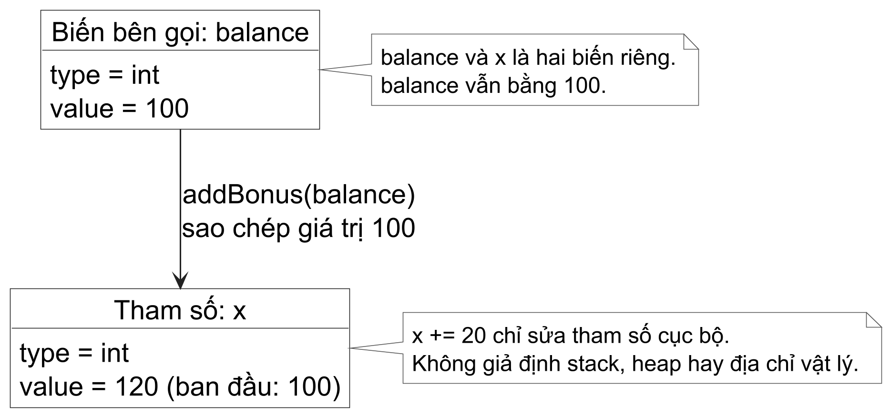
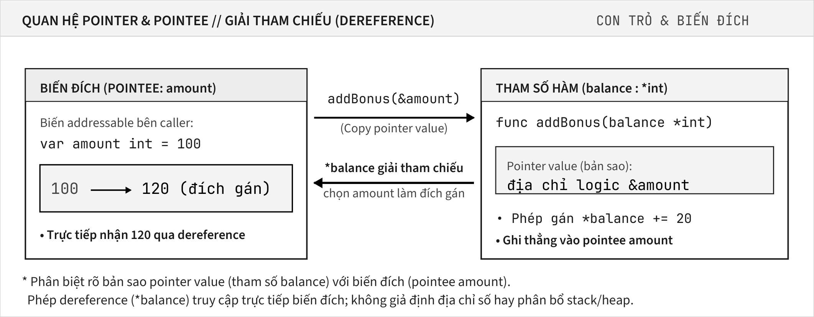
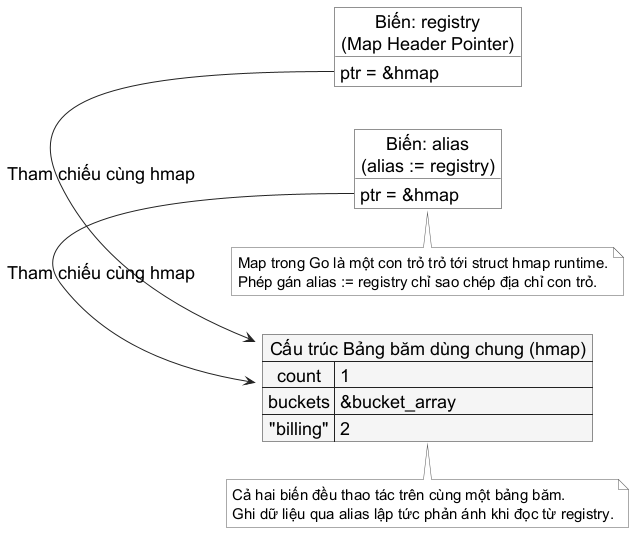
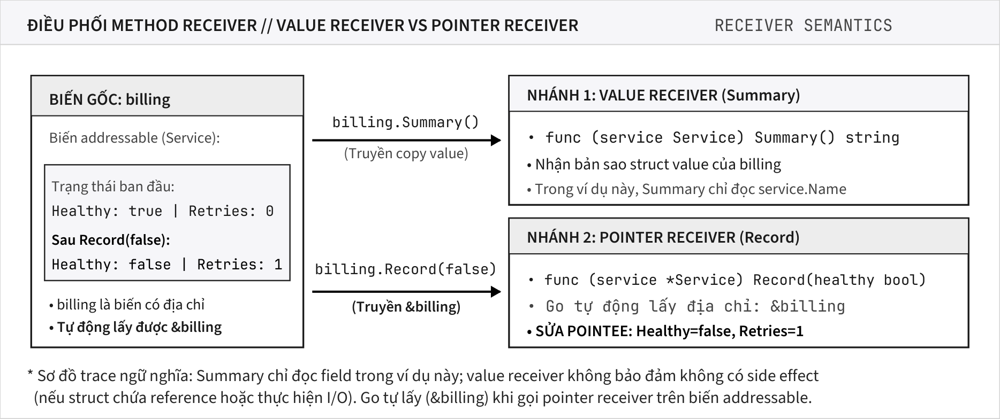
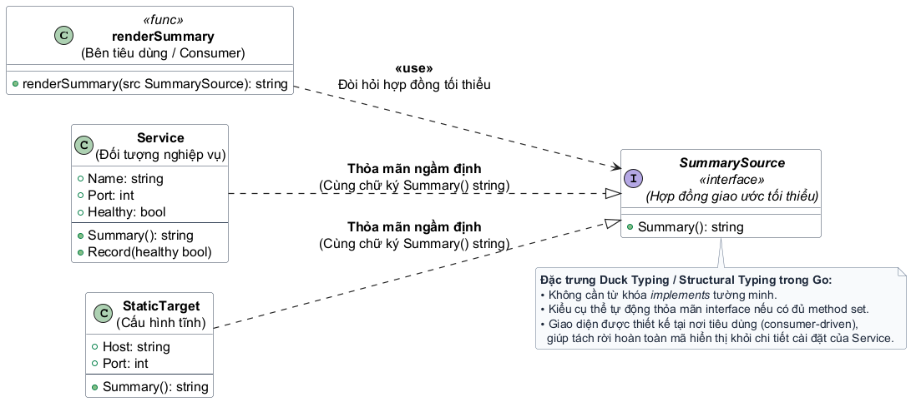

<!-- BOOK_ROLE: FOUNDATION_CORE -->

# Chương 3 — Mô hình dữ liệu và trách nhiệm thay đổi

`opsprobe` sẽ dần trở thành một CLI kiểm tra trạng thái dependency. Trước khi nó gọi HTTP hay đọc file config, nó đã có một bài toán nhỏ hơn: làm sao để biểu diễn trạng thái của một service mà người đọc không phải tự ghép bốn biến rời rạc trong đầu?

~~~go
serviceName := "billing"
port := 8080
healthy := true
retries := 0
~~~

Bốn biến này đi cùng nhau. Chúng mô tả một dịch vụ, nhưng trình biên dịch chưa thể nhận biết mối liên kết đó. Càng nhiều hàm nhận các biến này một cách rời rạc, lập trình viên càng dễ đổi nhầm thứ tự, quên truyền một trường dữ liệu (*field*), hoặc cập nhật trên một bản sao cục bộ mà lầm tưởng đã thay đổi trạng thái chung. Chúng ta sẽ từng bước tái cấu trúc mô hình này. Mỗi lần thay đổi, ta dừng lại ở cùng một câu hỏi cốt lõi: hàm tiếp nhận giá trị nào, và giá trị ấy mở đường tới vùng dữ liệu nào?

## Bug đầu tiên: bonus đi đâu mất?

Hãy tạm quên service. Một ví dụ nhỏ hơn cho thấy vấn đề rõ nhất:

~~~go
balance := 100

func addBonus(x int) {
	x += 20
}

addBonus(balance)
fmt.Println(balance) // 100
~~~

Biến `balance` không đổi vì lời gọi hàm trong Go tuân thủ ngữ nghĩa truyền giá trị (*pass-by-value*). Khi gọi `addBonus(balance)`, hàm tiếp nhận một tham số `x` mang giá trị bản sao `100`. Phép tính `x += 20` chỉ thay đổi giá trị của biến cục bộ `x`; nó không thể tác động ngược lại biến `balance` ở phía bên gọi. Đây không phải là ngoại lệ của riêng kiểu `int`, mà là nền tảng chi phối mọi chữ ký hàm xuyên suốt chương này.

@figure Lời gọi `addBonus(balance)` sao chép giá trị 100 vào tham số `x`. Sơ đồ biểu diễn ngữ nghĩa của biến và giá trị, không khẳng định vị trí vật lý của chúng trong bộ nhớ RAM.

Nếu hàm cần tạo một giá trị mới, cách tiếp cận trên rất rõ ràng: giá trị đầu vào được tiếp nhận, kết quả mới trả ra qua lệnh `return`. Ví dụ, `withBonus(balance)` có thể trả về `120`, và bên gọi tự quyết định việc có gán kết quả đó trở lại `balance` hay không. Tuy nhiên, một số thao tác có mục đích trực tiếp biến đổi biến gốc do bên gọi cung cấp. Khi đó, mã nguồn cần thể hiện rõ ràng con đường dẫn tới biến đó.

## Con trỏ: con đường dẫn tới một biến

| Khái niệm trong Go Semantics | Định nghĩa kỹ thuật chuẩn xác | Ví dụ tương ứng |
| :--- | :--- | :--- |
| **Variable** | Vị trí lưu trữ dữ liệu được cấp phát, có thể đọc hoặc gán giá trị mới. | Biến `balance` |
| **Value** | Dữ liệu thuộc một kiểu; chưa cần giả định representation vật lý. | Giá trị số nguyên `100` |
| **Address** | Kết quả của phép toán trích xuất địa chỉ ô nhớ bằng toán tử `&`. | Biểu thức `&balance` |
| **Pointer value** | Giá trị mang kiểu con trỏ (như `*int`), chứa địa chỉ của một biến hoặc `nil`. | Biến con trỏ `p` |
| **Pointee** | Biến đích tại ô nhớ mà con trỏ đang trỏ tới. | Ô nhớ chứa `balance` |

Ta không cần suy đoán biến đó nằm cố định trên vùng nhớ ngăn xếp (*stack*) hay vùng nhớ động (*heap*). Đó là chi tiết hiện thực của trình biên dịch có thể thay đổi qua từng phiên bản. Điều cốt lõi khi đọc mã nguồn là mối quan hệ ngôn ngữ: giá trị con trỏ có đang trỏ tới một biến hợp lệ hay không.

~~~go
func addBonus(balance *int) {
	*balance += 20
}

amount := 100
addBonus(&amount)
fmt.Println(amount) // 120
~~~

Ở phía bên gọi, `&amount` trích xuất con trỏ dẫn tới biến `amount`. Tham số `balance` vẫn là một giá trị được sao chép vào hàm, chỉ có điều giá trị sao chép đó là một địa chỉ con trỏ. Khi biểu thức `*balance += 20` thực thi, thao tác giải tham chiếu (*dereference*) `*balance` chọn chính biến `amount` làm đích gán dữ liệu. Bản sao của con trỏ không hề tạo ra bản sao của biến đích (*pointee*).

@figure Tham số `balance` trong hàm là giá trị con trỏ được truyền theo cơ chế sao chép giá trị. Thao tác `*balance` truy cập biến đích (*pointee*); sơ đồ cố ý không dùng địa chỉ số hay phân chia ngăn xếp/vùng nhớ heap để giữ đúng mô hình tinh thần ở tầng ngữ nghĩa.

Phép toán lấy địa chỉ `&` không áp dụng được cho mọi biểu thức. Thông thường, toán hạng của `&` bắt buộc phải là đối tượng có thể lấy địa chỉ (*addressable*): biến số, phép giải tham chiếu con trỏ, chỉ mục của lát cắt, trường của một cấu trúc có thể lấy địa chỉ, hoặc chỉ mục của mảng có thể lấy địa chỉ là những trường hợp then chốt ở giai đoạn này. Đặc tả ngôn ngữ Go cung cấp một ngoại lệ thực tế: cho phép lấy địa chỉ của hằng cấu trúc phức hợp (*composite literal*), chẳng hạn `&Service{Name: "billing"}`. Không cần gượng ép gọi composite literal là “addressable” để áp dụng đúng quy tắc; hãy phân biệt rõ hai bản chất: `&x` thông thường đòi hỏi một ô nhớ có thể gán, còn hằng cấu trúc phức hợp có cơ chế đặc biệt cho phép cấp phát giá trị rồi trích xuất ngay địa chỉ của nó. Chỉ mục của bảng băm (*map index*) không thể lấy địa chỉ; chúng ta sẽ tìm hiểu lý do thực tiễn của giới hạn này khi đưa bảng băm vào mô hình dịch vụ.

### Giá trị nil là thiếu biến đích, không phải “con trỏ rỗng vô hại”

Giá trị mặc định (*zero value*) của kiểu con trỏ là `nil`. Giá trị `nil` không trỏ tới bất kỳ biến nào, do đó thao tác giải tham chiếu trên nó sẽ lập tức gây hoảng loạn khi chạy (`panic`).

~~~go
var bonus *int

if bonus == nil {
	fmt.Println("chưa có bonus")
	return
}
*bonus += 20
~~~

Thao tác giải tham chiếu `*bonus` đòi hỏi một biến đích để làm nơi gán giá trị; giá trị `nil` không có biến đích nào, do đó thao tác giải tham chiếu sẽ gây hoảng loạn (`panic`). Việc kiểm tra `nil` là một phần trong giao ước của hàm: hàm này có chấp nhận tham số rỗng hay bên gọi bắt buộc phải luôn truyền vào một con trỏ hợp lệ? Không nên thêm các phép kiểm tra `nil` một cách máy móc theo quán tính. Hãy xác lập rõ ràng và thể hiện điều đó qua giao diện lập trình, ca kiểm thử hoặc mã lỗi trả về khi có lý do chính đáng.

## Gom trạng thái thành một giá trị có tên

Quay lại bốn biến rời rạc. Một struct gom chúng thành một value mà domain có thể gọi tên:

~~~go
type Service struct {
	Name    string
	Port    int
	Healthy bool
	Retries int
}

billing := Service{
	Name:    "billing",
	Port:    8080,
	Healthy: true,
}
~~~

Cú pháp `type Service` khai báo một kiểu có tên; phần thân cấu trúc khai báo các trường và kiểu dữ liệu tương ứng của chúng. Hằng cấu trúc gán giá trị cho các trường được liệt kê. Trường `Retries` không xuất hiện trong hằng cấu trúc nên tự động nhận giá trị mặc định của kiểu `int` là `0`. Giá trị mặc định không thể thay thế cho khâu kiểm tra tính hợp lệ: một cấu trúc `Service{}` hợp lệ về mặt kiểu dữ liệu nhưng chưa chắc đã hợp lệ cho một dịch vụ thực tế. Trong nghiệp vụ này, cổng mạng `0` có thể mang ý nghĩa “chưa được cấu hình”.

Cấu trúc (*struct*) không phải là một lớp đối tượng thiếu phương thức. Trước hết, nó là một giá trị phức hợp gồm nhiều thành phần mang chung một ý nghĩa nghiệp vụ. Phép truy xuất trường chỉ đơn thuần đọc hoặc gán một phần giá trị bên trong cấu trúc:

~~~go
billing.Retries++
fmt.Println(billing.Name, billing.Retries) // billing 1
~~~

Một struct cũng được copy khi gán hoặc truyền làm argument. Với các field trong `Service` hiện tại, copy tạo các field độc lập:

~~~go
candidate := billing
candidate.Healthy = false

fmt.Println(billing.Healthy)   // true
fmt.Println(candidate.Healthy) // false
~~~

@figure Phép gán sao chép giá trị cấu trúc hiện tại theo từng trường dữ liệu. Nếu một trường về sau là lát cắt, bảng băm hoặc con trỏ, cấu trúc vẫn được sao chép nhưng trường đó có thể mang theo một tham chiếu chia sẻ; khi ấy lập trình viên phải phân tích tiếp giá trị của trường thay vì nhận định phiến diện rằng “cấu trúc luôn độc lập dữ liệu”.

Cấu trúc lồng nhau (*nested struct*) phát huy hiệu quả khi một phần của miền nghiệp vụ tự thân mang một ý nghĩa hoàn chỉnh. Ví dụ, máy chủ và cổng mạng thường đi liền với nhau thay vì khai báo thành hai trường độc lập trên cùng một mặt phẳng:

~~~go
type Endpoint struct {
	Host string
	Port int
}

type Service struct {
	Name     string
	Endpoint Endpoint
	Healthy  bool
	Retries  int
}
~~~

Việc nesting không tự động làm thiết kế tốt hơn. Nó có ích khi tạo ra một khái niệm đọc được, như `Endpoint`; gom chỉ để tránh thấy nhiều field thường làm model khó tìm hơn.

## Khi hàm biến đổi một bản sao cục bộ

Ta muốn `opsprobe` đánh dấu service không khỏe sau một lần probe thất bại. Phiên bản đầu tiên trông rất có lý:

~~~go
func markUnhealthy(service Service) {
	service.Healthy = false
	service.Retries++
}

markUnhealthy(billing)
fmt.Println(billing.Healthy, billing.Retries) // true 0
~~~

Không có lỗi ẩn giấu nào ở đây. Biến `billing` được sao chép nguyên vẹn vào tham số `service`; hàm thay đổi trên bản sao cấu trúc đó rồi kết thúc. Phía bên gọi vẫn giữ nguyên giá trị cũ. Nếu đây là một thao tác chuyển đổi thuần túy (*pure transform*), hàm có thể trả về một đối tượng `Service` mới qua lệnh `return`. Nếu ý định là thay đổi trực tiếp trạng thái mà bên gọi đang quản lý, chữ ký hàm bắt buộc phải thể hiện rõ điều đó:

~~~go
func markUnhealthy(service *Service) {
	service.Healthy = false
	service.Retries++
}

markUnhealthy(&billing)
fmt.Println(billing.Healthy, billing.Retries) // false 1
~~~

Kiểu giá trị `T` và kiểu con trỏ `*T` không đồng nghĩa với khái niệm “bất biến” và “có thể thay đổi”. Một biến cục bộ kiểu `Service` vẫn có thể được gán lại các trường; một tham số con trỏ hoàn toàn có thể chỉ được dùng để đọc dữ liệu. Khác biệt cốt lõi là tham số kiểu `T` tiếp nhận một bản sao giá trị độc lập, còn tham số kiểu `*T` mở ra khả năng truy cập trực tiếp biến đích (*pointee*) của bên gọi. Hãy chọn con trỏ khi hàm có nhiệm vụ biến đổi biến đích, khi việc biểu diễn trạng thái vắng mặt bằng `nil` là một phần tự nhiên của nghiệp vụ, hoặc khi thiết kế giao diện lập trình có lý do kỹ thuật rõ ràng. Hãy chọn truyền giá trị khi hàm chỉ cần ảnh chụp dữ liệu cục bộ, chuyển đổi rồi trả về bản mới, hoặc khi việc chia sẻ ô nhớ làm giao ước kỹ thuật trở nên phức tạp.

### Cùng một lời gọi, bảy value khác nhau

Đến đây chúng ta có thể đọc các chữ ký hàm bằng một quy tắc nhất quán: Go luôn truyền đối số theo giá trị (*pass-by-value*). Dù vậy, “theo giá trị” chưa giải đáp trọn vẹn bài toán; người đọc mã nguồn còn phải phân tích xem giá trị đó trực tiếp chứa dữ liệu hay đang giữ một tham chiếu trỏ tới vùng nhớ khác.

@table Mỗi lời gọi đều copy argument value vào parameter; khả năng chia sẻ nằm trong value được copy.

| Parameter | Value được copy khi gọi | Thay đổi từ function có hiện ra ở caller? |
| --- | --- | --- |
| `x int` | số nguyên | Không, trừ khi return và caller gán kết quả. |
| `a [3]int` | toàn bộ array value | Không, các element của bản copy bị sửa riêng. |
| `s []int` | slice value, gồm reference tới array nền | Sửa element có thể hiện ra; reslice parameter không tự đổi len caller. |
| `m map[string]int` | map value, có reference tới map data | Ghi/xóa entry hiện ra qua map value cùng map data. |
| `p *int` | pointer value | `*p = ...` sửa pointee của caller nếu pointer hợp lệ. |
| `v Service` | các field của struct value | Không với các field value; xem từng field nếu chúng chứa reference. |
| `p *Service` | pointer value | Sửa field qua `p` sửa pointee của caller nếu pointer hợp lệ. |

Bảng này không nhằm mục đích học thuộc lòng các kiểu dữ liệu. Nó cung cấp phương pháp luận để lần theo một lời gọi hàm: tham số mới tiếp nhận bản sao nào; bản sao ấy có dẫn tới vùng dữ liệu chung hay biến số chung hay không; biểu thức nào là đích gán cuối cùng? Đó cũng là lý do bộ tiếp nhận giá trị (*value receiver*) và bộ tiếp nhận con trỏ (*pointer receiver*) được giới thiệu song hành cùng phương thức, thay vì biến dấu hoa thị `*` thành một nghi thức cú pháp máy móc.

### Bài thực hành: Sửa đúng khế ước kỹ thuật

Viết `recordFailure(service Service)` sao cho bên gọi nhận được `Healthy == false` và `Retries` tăng một. Trước khi đối chiếu đáp án, hãy chọn một trong hai khế ước: hàm trả về một cấu trúc `Service` mới, hoặc hàm nhận `*Service` và trực tiếp biến đổi giá trị được trỏ tới.

#### Gợi ý giải pháp (chỉ đọc sau khi đã tự làm)

Nếu bên gọi cùng quản lý một trạng thái và hàm được đặt tên như một mệnh lệnh thực thi, con trỏ giúp thể hiện ý định kỹ thuật trực tiếp:

~~~go
func recordFailure(service *Service) {
	service.Healthy = false
	service.Retries++
}

recordFailure(&billing)
~~~

Một biến thể value vẫn đúng khi API diễn đạt transform:

~~~go
func failedCopy(service Service) Service {
	service.Healthy = false
	service.Retries++
	return service
}

billing = failedCopy(billing)
~~~

Hai phiên bản khác biệt ở sự phân định trách nhiệm của bên gọi. Phiên bản truyền con trỏ cho phép hàm tác động trực tiếp lên trạng thái đã tồn tại; phiên bản trả về giá trị giúp việc thay đổi trạng thái được thể hiện minh bạch qua câu lệnh gán của bên gọi. Không có “phiên bản chạy nhanh hơn” mặc định nào quan trọng hơn một giao ước kỹ thuật rõ ràng.

### Bài thực hành: Lỗi logic khi mã nguồn vẫn biên dịch thành công

Trong thư mục `labs/part3-data-models`, hãy mở tệp `main_test.go` trước. Trong hàm `recordProbe`, tạm thời lược bỏ câu lệnh `registry[name] = service`, rồi chạy riêng ca kiểm thử `TestRecordProbeUpdatesExistingMapEntry`. Mã nguồn vẫn biên dịch thành công vì bản sao cấu trúc cục bộ được sửa đổi hoàn toàn hợp lệ; tuy nhiên ca kiểm thử sẽ chỉ ra rằng phần tử trong bảng băm không hề nhận giá trị mới. Hãy khôi phục lại mã bằng đúng đường biến đổi dữ liệu mà bạn đã phân tích, thay vì sửa đổi kỳ vọng của bài kiểm thử. Sau đó, hãy xóa phần thân hàm `recordFailure` và tự viết lại dựa trên yêu cầu của `TestRecordFailureMutatesPointee`.

---

#### Gợi ý giải pháp (chỉ đọc sau khi đã tự làm)

Thao tác tra cứu bảng băm trả về một giá trị `Service` độc lập. Việc chỉnh sửa biến cục bộ `service` chưa hề tác động đến dữ liệu của bảng băm; phép gán ngược trở lại `registry[name]` mới là thao tác biến đổi dữ liệu thực sự trên bảng băm. Hàm `recordFailure` cần tiếp nhận con trỏ `*Service` và chỉnh sửa trực tiếp biến đích, nhằm đáp ứng giao ước kiểm thử đòi hỏi bên gọi phải quan sát thấy sự thay đổi trên cùng một trạng thái.

## Quản lý nhiều dịch vụ qua bảng băm, không tạo thêm biến rời rạc

Cấu trúc `Service` mô hình hóa một dịch vụ đơn lẻ. Khi công cụ `opsprobe` cần quản lý đồng thời nhiều dịch vụ theo tên, ta không thể để `billing`, `search`, `checkout` thành các biến số rời rạc. Kiểu bảng băm (*map*) thể hiện mối quan hệ ánh xạ giữa khóa (*key*) và giá trị (*value*):

~~~go
services := map[string]Service{
	"billing": {
		Name:    "billing",
		Port:    8080,
		Healthy: true,
	},
}

billing, found := services["billing"]
fmt.Println(found, billing.Port) // true 8080
~~~

Kiểu `string` là kiểu của khóa; `Service` là kiểu của phần tử. Biến `found` là kết quả thứ hai của phép tra cứu bảng băm, thường được gọi là cơ chế *comma-ok*. Nó giúp phân biệt rõ giữa trường hợp khóa không tồn tại với trường hợp phần tử mang giá trị mặc định. Phép tra cứu nhận một kết quả vẫn hợp lệ về cú pháp: biểu thức `services["missing"].Retries` sẽ đọc trường `Retries` của cấu trúc rỗng `Service{}`, và cho kết quả `0`. Tuy nhiên con số `0` lúc đó có thể mang ý nghĩa “chưa có dịch vụ” hoặc “dịch vụ đã có nhưng số lần thử lại bằng 0”; đó là lý do bắt buộc phải sử dụng cơ chế *comma-ok* khi sự hiện diện thực tế của phần tử mang tính quyết định.

~~~go
attempts := map[string]int{"billing": 0}

count, found := attempts["billing"]
fmt.Println(count, found) // 0 true

count, found = attempts["search"]
fmt.Println(count, found) // 0 false
~~~

Hằng bảng băm (*map literal*) tạo ra bảng băm đã sẵn sàng ghi dữ liệu. Lệnh `make(map[string]Service)` cũng khởi tạo một bảng băm sẵn sàng tiếp nhận phần tử. Ngược lại, giá trị mặc định của bảng băm là `nil`: thao tác đọc từ bảng băm `nil` sẽ trả về giá trị mặc định của kiểu phần tử, duyệt qua nó bằng vòng lặp `for range` sẽ lặp 0 lần mà không báo lỗi, nhưng việc gán phần tử mới vào bảng băm `nil` sẽ lập tức gây hoảng loạn (`panic`). Do đó, một bảng băm tiếp nhận từ bên gọi đòi hỏi một giao ước kỹ thuật rõ ràng tương tự như con trỏ: bên gọi có luôn khởi tạo bảng băm trước hay hàm có trách nhiệm tự khởi tạo nó trước khi ghi?

~~~go
var services map[string]Service
fmt.Println(services["billing"].Name) // ""

// services["billing"] = billing
// panic: assignment to entry in nil map
services = make(map[string]Service)
services["billing"] = billing
~~~

Lệnh `delete(services, "billing")` xóa một phần tử khỏi bảng băm; việc xóa một khóa không tồn tại hoàn toàn an toàn và không gây lỗi. Tuy nhiên, vòng lặp `for range` trên bảng băm không có thứ tự lặp cố định theo đặc tả ngôn ngữ. Nếu công cụ dòng lệnh cần xuất kết quả theo thứ tự ổn định, lập trình viên cần thu thập danh sách các khóa, sắp xếp chúng theo quy tắc định sẵn rồi mới in ra; tuyệt đối không xem thứ tự ngẫu nhiên trong một lần chạy là giao ước cố định của bảng băm.

### Bảng băm sao chép giá trị tiêu đề, chia sẻ dữ liệu lưu trữ

Bảng băm không phải là con trỏ và ta không cần đi sâu vào cấu trúc bên trong của bảng băm để sử dụng nó một cách chuẩn xác. Phép gán và lời gọi hàm thực hiện sao chép giá trị tiêu đề của bảng băm. Khi hai giá trị tiêu đề cùng tham chiếu tới một vùng dữ liệu chung, thao tác ghi qua một biến sẽ lập tức phản ánh khi đọc qua biến còn lại:

~~~go
registry := map[string]int{"billing": 1}
alias := registry
alias["billing"]++

fmt.Println(registry["billing"]) // 2
~~~

@figure Phép gán sao chép giá trị tiêu đề bảng băm. Khi giá trị đó cùng tham chiếu tới một vùng dữ liệu nền tảng, việc biến đổi phần tử qua `alias` sẽ hiện diện khi đọc từ `registry`; hình vẽ là sơ đồ khái niệm, không mô tả chi tiết cài đặt bảng băm trong bộ nhớ.

Một đặc điểm khiến bảng băm khác biệt với lát cắt và mảng khi cập nhật giá trị cấu trúc: phần tử truy xuất qua chỉ mục bảng băm (*map index*) không thể lấy địa chỉ ô nhớ (*not addressable*). Vì vậy đoạn mã sau sẽ không thể biên dịch:

~~~go
// services["billing"].Healthy = false // không hợp lệ
~~~

Biểu thức `services["billing"]` trả về một giá trị bản sao `Service` để đọc; nó không trả về một biến ô nhớ để ta có thể lấy địa chỉ của trường dữ liệu hay gán trực tiếp vào trường đó. Giải pháp theo định hướng truyền giá trị là: đọc giá trị ra biến cục bộ, chỉnh sửa trường dữ liệu, rồi gán ngược bản sao đã sửa trở lại bảng băm:

~~~go
service := services["billing"]
service.Healthy = false
services["billing"] = service
~~~

Nếu miền nghiệp vụ đòi hỏi sổ đăng ký phải quản lý các con trỏ `*Service`, việc biến đổi dữ liệu qua con trỏ đích có thể trực tiếp hơn, nhưng đổi lại sổ đăng ký có nguy cơ chứa con trỏ `nil` và quyền sở hữu tài nguyên cần được quy định rõ ràng:

~~~go
services := map[string]*Service{
	"billing": {
		Name:    "billing",
		Port:    8080,
		Healthy: true,
	},
}

services["billing"].Healthy = false
~~~

Đây không phải là lời khuyến khích chọn `map[string]*Service` theo quán tính. Với cấu trúc dung lượng nhỏ như `Service` hiện tại, mô hình `map[string]Service` kết hợp quy trình “lấy ra, sửa đổi, gán lại” giúp các điểm biến đổi trạng thái trở nên minh bạch và an toàn hơn. Con trỏ bên trong bảng băm chỉ thực sự đáng dùng khi giải quyết một giao ước kỹ thuật xác thực: danh tính đối tượng dùng chung, biến đổi cần phản ánh đồng thời ở nhiều nơi, hoặc dữ liệu có dung lượng lớn đi kèm số liệu đo đạc thực tế.

### Bài thực hành: Nhận diện giá trị mặc định của bảng băm

Một lần thăm dò trả về bảng băm độ trễ `latencyByService map[string]int`. Viết đoạn mã phân biệt giữa hai trường hợp: dịch vụ `billing` có độ trễ bằng `0` và `billing` chưa hề có kết quả thăm dò. Sau đó, thực hiện xóa kết quả của `billing` mà không cần kiểm tra khóa có tồn tại hay không.

#### Gợi ý giải pháp (chỉ đọc sau khi đã tự làm)

Cơ chế kiểm tra hai giá trị trả về (*comma-ok*) cung cấp thông tin về sự hiện diện thực tế của phần tử; hàm tích hợp sẵn `delete` tự động xử lý an toàn khi khóa cần xóa không tồn tại trong bảng băm:

~~~go
latency, found := latencyByService["billing"]
if !found {
	fmt.Println("chưa có kết quả")
} else {
	fmt.Println(latency)
}

delete(latencyByService, "billing")
~~~

## Quyền hạn và trách nhiệm lưu giữ phần tử trong bộ nhớ

Sổ đăng ký vừa giúp tra cứu dịch vụ theo tên. Nhưng nếu tên không còn thuộc một tập hữu hạn mà mỗi yêu cầu gửi đến lại thêm một khóa mới, quyền chỉnh sửa bảng băm sẽ đi kèm một trách nhiệm hệ trọng: quyết định thời điểm loại bỏ dữ liệu. Hãy xét một bộ nhớ đệm (*cache*) tồn tại suốt vòng đời tiến trình. Mỗi lần trượt bộ đệm, hệ thống thêm `cache[key] = payload`; không có lệnh `delete`, không giới hạn số lượng khóa và không có thời hạn hết hạn (*TTL*). Vì bên sở hữu vẫn giữ bảng băm, các giá trị bên trong vẫn luôn trong trạng thái có thể tiếp cận được. Bộ thu gom rác (GC) không thể tự đoán rằng kết quả của yêu cầu từ ngày hôm qua đã hết giá trị nghiệp vụ để tự động xóa giúp.

Chưa thể vội vã kết luận rằng “bảng băm toàn cục luôn là rò rỉ bộ nhớ”. Một bảng cấu hình có số phần tử hữu hạn sống suốt vòng đời tiến trình là một thiết kế hoàn toàn bình thường. Một kho lưu trữ lịch sử có chính sách lưu giữ (*retention policy*), có dự báo tăng trưởng và hạn mức tài nguyên tương ứng cũng có thể tăng trưởng một cách hợp lệ. Bộ nhớ đệm hứa hẹn tiết kiệm tài nguyên nhưng nếu lưu giữ mọi khóa từng gặp mà không có điểm dừng sẽ trở thành thảm họa. Sai lầm nằm ở giao ước lưu giữ dữ liệu, chứ không nằm ở vị trí khai báo bảng băm. Rò rỉ bộ nhớ theo nghĩa vận hành là tài nguyên tiếp tục bị chiếm dụng sau khi nhu cầu sử dụng đã chấm dứt; trong Go, vùng nhớ đó thường vẫn ở trạng thái tiếp cận được (*reachable*), chứ không nhất thiết là việc mất dấu toàn bộ con trỏ như khái niệm rò rỉ trong các ngôn ngữ quản lý bộ nhớ thủ công.

Trước khi tham khảo thư mục `fixed` của bài thực hành `part10-resource-retention`, bạn hãy thiết kế giao ước cho một bộ nhớ đệm đơn chủ sở hữu: tối đa hai phần tử, mỗi giá trị tối đa 4 MiB, mỗi khóa tối đa 128 byte; khi thêm khóa thứ ba thì tự động loại bỏ phần tử được thêm sớm nhất. Việc cập nhật khóa cũ không làm mới tuổi thọ của nó. Dữ liệu đầu vào vượt quá giới hạn phải bị từ chối ngay trước khi thay đổi trạng thái bộ đệm. Phía bên gọi được phép chỉnh sửa lát cắt byte của mình sau khi gọi `Put` mà không làm biến đổi bản sao bộ đệm đã lưu trữ. Đây là chiến lược vào trước ra trước (FIFO), không phải loại bỏ theo tần suất truy cập gần nhất (LRU), và hoàn toàn không có cơ chế thời hạn ngầm định.

Chính sách ấy dẫn tới những ca kiểm thử không cần đo RAM. Sau chuỗi `a, b, a, c`, bộ nhớ đệm (*cache*) phải còn `b` và `c`; cập nhật `a` không tạo phần tử (*entry*) thứ ba và không cứu nó khỏi bị loại. Gửi giá trị (*value*) quá lớn phải trả về lỗi (*error*), không được đẩy một phần tử hợp lệ ra ngoài. Chạy nhiều vòng khóa (*key*) mới, `Len()` không vượt hai. Sửa dữ liệu đầu vào (*input*) sau `Put` không được đổi giá trị đã lưu. Các ca kiểm thử nằm trong `fixed/retention_test.go`; hãy làm bản `exercise` chạy được trước khi đối chiếu phần triển khai (*implementation*).

Giới hạn từng phần tử (*entry*) riêng lẻ chưa phải giới hạn byte: hai phần tử mỗi cái hàng gigabyte vẫn quá lớn. Ngược lại, kiểm tra `len(value)` rồi lưu thẳng một lát cắt (*slice*) nhỏ cũng chưa đủ, vì nó có thể giữ mảng bên dưới (*backing array*) lớn như Chương 2. Bản sửa sao chép các byte thực sự được nhận; nhân bản chuỗi khóa (*key string*) để một chuỗi con nhỏ không vô tình giữ vùng lưu trữ (*storage*) của chuỗi lớn. Với chính sách bài thực hành, tổng độ dài tải trọng (*payload*) được bộ nhớ đệm giữ không vượt `maxEntries * maxValueBytes`; khóa và siêu dữ liệu (*metadata*) có chi phí riêng. Đây không phải mức trần RSS hay lời hứa rằng bộ cấp phát (*allocator*) trả bộ nhớ ngay sau khi thu hồi (*eviction*).

Bảng ánh xạ (*map*) mất phần tử thì đường tham chiếu từ map tới giá trị cũ bị hủy bỏ; hiện tượng trùng tên (*alias*) ở nơi khác vẫn có thể giữ giá trị ấy. Các vị trí (*slot*) trong hàng đợi FIFO cũng phải giải phóng tham chiếu (*reference*) sau khi dịch chuyển, thay vì chỉ giảm độ dài (*length*) và để một chuỗi cũ nằm ở vùng dung lượng (*capacity*) chưa dùng. Bài thực hành có đúng một chủ sở hữu nên không cần khóa loại trừ tương hỗ (*mutex*); nếu cho nhiều luồng nhẹ (*goroutine*) gọi `Put`, ta phải thiết kế cơ chế đồng bộ hóa trước, không thể suy đoán map an toàn chỉ từ việc đã áp đặt giới hạn dung lượng (*capacity limit*).

Trong ca đo ở Chương 10, cùng chuỗi khóa mới làm phiên bản không giới hạn tăng từ hai lên tám phần tử, trong khi phiên bản sửa dừng lại ở hai. Bằng chứng kết thúc không phải “RAM trông đẹp hơn”, mà là giao ước (*contract*) hữu hạn được kiểm thử bảo toàn đúng đắn, cộng với hồ sơ phân tích (*profile*) xác nhận tải trọng bị loại bỏ không còn bị bộ nhớ đệm giữ lại. Nếu sản phẩm thật sự cần lưu tất cả khóa, hãy thay đổi yêu cầu và nơi lưu dữ liệu; đừng gọi việc mất lịch sử vì bị dọn dẹp (*eviction*) là một bản sửa thành công.

## Một thao tác cập nhật có trách nhiệm trong sổ đăng ký

`opsprobe` chưa cần đến mạng để hưởng lợi từ mô hình này. Một thao tác cập nhật hướng giá trị (*value-oriented update*) cho sổ đăng ký (*registry*) không cần con trỏ (*pointer*): lấy giá trị cấu trúc (*struct value*) ra khỏi map, sửa bản cục bộ, rồi gán nó trở lại phần tử trong map. Tham số map (*map parameter*) được truyền theo giá trị, nhưng giá trị map ấy vẫn dẫn tới dữ liệu map của bên gọi (*caller*); chính phép gán cuối là thao tác biến đổi có chủ ý lên sổ đăng ký chung.

~~~go
func recordProbe(
	registry map[string]Service,
	name string,
	healthy bool,
) bool {
	service, found := registry[name]
	if !found {
		return false
	}

	service.Healthy = healthy
	if !healthy {
		service.Retries++
	}
	registry[name] = service
	return true
}
~~~

Signature này nói rõ ba vai: `registry` là giá trị map dùng để tra cứu (*lookup*) và gán phần tử; `name` là ảnh chụp chuỗi ký tự (*string snapshot*); `healthy` là ảnh chụp kiểu boolean (*bool snapshot*). Biến `service` là bản sao cấu trúc (*struct copy*) lấy từ phần tử. Nếu khóa (*key*) không tồn tại, hàm không tự tiện tạo ra dịch vụ mới mà trả về `false`; nếu có, nó ghi giá trị đã sửa trở lại map. Khi công cụ bắt đầu đọc cấu hình (*config*) và thăm dò điểm cuối (*probe endpoint*) ở phần sau, cách đọc chữ ký hàm này sẽ giúp ta hiểu rõ dữ liệu nào được chia sẻ, dữ liệu nào được chụp lại, và thao tác biến đổi nào có thể truy vết.

Sau chương này, một chữ ký hàm (*signature*) không còn chỉ đơn thuần là tên kiểu dữ liệu. Nó cho biết ta đang đưa vào hàm một ảnh chụp dữ liệu (*snapshot*), một cửa sổ mở tới vùng lưu trữ (*storage*) dùng chung, một giá trị map dẫn tới dữ liệu map, hay một con trỏ mở đường tới biến của bên gọi (*caller variable*). Khi cần gỡ lỗi thao tác biến đổi, hãy viết rõ trạng thái trước và sau lời gọi: biến nào tồn tại ở bên gọi, tham số nào xuất hiện ở hàm, và biểu thức nào thực sự là đích tiếp nhận phép gán.

## Kiểu là ranh giới ý nghĩa, không chỉ cách chứa byte

Một cổng mạng (*port*) và một số lần thử lại đều có thể nằm trong `uint16`, nhưng đổi chỗ chúng là lỗi nghiệp vụ. Khai báo kiểu có tên đặt một ranh giới mà trình biên dịch (*compiler*) có thể kiểm tra:

~~~go
type Port uint16
type Attempts uint16
type PortAlias = uint16

var port Port = 80
// var attempts Attempts = port // không gán trực tiếp
var raw uint16 = uint16(port)
var alias PortAlias = raw
~~~

`Port` và `Attempts` là hai kiểu được định nghĩa (*defined type*) khác nhau; việc có cùng kiểu nền tảng (*underlying type*) `uint16` không làm chúng có cùng danh tính (*identity*). Kiểu `PortAlias` lại là bí danh khác của chính `uint16`, không tạo ra một kiểu mới. Bí danh (*alias*) hữu ích khi tái cấu trúc giao diện lập trình (*API*) sang gói (*package*) khác mà vẫn giữ nguyên danh tính cho bên gọi (*caller*), nhưng không có tác dụng nếu mục tiêu là ngăn chặn nhầm lẫn giữa hai đại lượng nghiệp vụ. Đừng đồng nhất khả năng gán (*assignability*) với khả năng chuyển đổi (*convertibility*): chuyển đổi kiểu tường minh (*conversion*) có thể hợp lệ khi phép gán trực tiếp bị cấm; sự thỏa mãn giao diện (*interface satisfaction*) còn dựa trên tập phương thức (*method set*) chứ không chỉ hình thức biểu diễn bộ nhớ.

Chuyển đổi kiểu (*conversion*) không phải là kiểm tra tính hợp lệ (*validation*). Với biến `wide := uint32(65537)`, biểu thức `Port(wide)` cho giá trị 1 do quy tắc cắt ngắn số nguyên sang kiểu có kích thước hẹp hơn. Ngược lại, cú pháp `Port(65537)` với hằng số bị trình biên dịch từ chối vì giá trị vượt quá phạm vi biểu diễn của kiểu đích. Hàm khởi tạo (*constructor*) tiếp nhận dữ liệu từ bên ngoài bắt buộc phải kiểm tra phạm vi trước khi chuyển đổi kiểu nếu giao ước (*contract*) quy định cổng hợp lệ nằm trong khoảng 1–65535. Việc đặt tên kiểu giúp phát hiện nhầm lẫn vai trò; nó không tự động ngăn chặn giá trị khởi tạo mặc định (*zero value*) hoặc giá trị nằm ngoài miền nghiệp vụ.

Để tự kiểm chứng, hãy mở `TestConstantsAndIdentity` và `testdata/incompatible` trong thư mục `labs/edition-contracts`. Ca kiểm thử biên dịch yêu cầu phép gán giữa hai kiểu được định nghĩa phải bị từ chối; không được chỉnh sửa mã mẫu (*fixture*) chỉ để dự án biên dịch thành công. Sau đó, hãy tự thiết kế hàm `NewPort(n uint32) (Port, error)` và viết ca kiểm thử cho các giá trị biên 0, 1, 65535, 65536 trước khi viết mã xử lý. Đây là bài học về giao ước tại ranh giới hệ thống, không phải bài học thuộc lòng cú pháp từ khóa `type`.

## Khi hành vi thuộc về service

`recordProbe(registry, name, healthy)` đã làm đúng việc, nhưng khi `opsprobe` có thêm nhiều thao tác quanh một dịch vụ (*service*), chữ ký hàm bắt đầu lặp lại cùng một chủ thể. Một hàm cần tạo nhãn cho dịch vụ, một hàm khác ghi kết quả thăm dò (*probe*), hàm nữa kiểm tra cấu hình. Lúc này phương thức (*method*) giúp đặt hành vi cạnh kiểu dữ liệu mà nó đọc hoặc thay đổi; nó không thay đổi quy tắc ngữ nghĩa giá trị (*value semantics*) đã xây.

~~~go
func (service Service) Summary() string {
	return service.Name
}

func (service *Service) Record(healthy bool) {
	service.Healthy = healthy
	if !healthy {
		service.Retries++
	}
}
~~~

Một phương thức (*method*) là hàm có bộ tiếp nhận (*receiver*): phần tham số đặc biệt đứng trước tên phương thức. `Summary` nhận giá trị `Service`, nên bộ tiếp nhận là một giá trị cấu trúc (*struct value*) được dùng để tạo kết quả. Phương thức `Record` nhận `*Service`, vì hành vi này có ý định sửa đổi đối tượng trỏ tới (*pointee*). Tên bộ tiếp nhận không phải từ khóa và không phải một biến toàn cục bí mật; nó chỉ là tham số được viết ở vị trí riêng để gắn phương thức với `Service`.

~~~go
billing := Service{Name: "billing", Healthy: true}

fmt.Println(billing.Summary()) // billing
billing.Record(false)
fmt.Println(billing.Healthy, billing.Retries) // false 1
~~~

Biểu thức `billing.Record(false)` hợp lệ vì `billing` là biến có thể lấy địa chỉ (*addressable variable*). Trong trường hợp này, Go cho phép cách viết ngắn gọn thay cho `(&billing).Record(false)`. Sự tiện lợi ấy không biến bộ tiếp nhận giá trị thành bộ tiếp nhận con trỏ: tập phương thức (*method set*) của `Service` chỉ chứa các phương thức khai báo với bộ tiếp nhận `Service`; trong khi tập phương thức của `*Service` chứa cả các phương thức có bộ tiếp nhận `Service` lẫn `*Service`.

@figure Phương thức vẫn dựa trên giá trị bộ tiếp nhận. `Summary` dùng giá trị Service; `Record` cần `*Service` để chọn biến được trỏ tới làm đích biến đổi (*mutation*). Mũi tên là ngữ nghĩa truy vết (*trace semantics*), không mô tả cách bố trí bộ nhớ vật lý.

Phần tử được truy xuất theo chỉ số map (*map index*) không có tính chất lấy được địa chỉ (*not addressable*) theo đặc tả ngôn ngữ, nên cú pháp viết tắt lấy địa chỉ để gọi phương thức có bộ tiếp nhận con trỏ (*pointer-receiver method*) không áp dụng được cho nó. Đây là giới hạn ở tầng mã nguồn, không phải kết luận rằng một địa chỉ vật lý “không ổn định” trong mọi bản cài đặt:

~~~go
// services["billing"].Record(false) // không hợp lệ

service := services["billing"]
service.Record(false)
services["billing"] = service
~~~

Đoạn mã sửa dùng đúng mô hình cũ: tra cứu map để lấy giá trị cấu trúc, biến cục bộ `service` có thể lấy địa chỉ, phương thức nhận con trỏ biến đổi giá trị cục bộ, rồi bên gọi gán giá trị cấu trúc đã đổi trở lại map. Nếu mã nguồn thực tế cần nhiều nơi cùng giữ danh tính (*identity*) của một dịch vụ, kiểu `map[string]*Service` có thể hợp lý; nhưng không nên dùng con trỏ chỉ để né tránh phép gán lại khi chưa làm rõ quyền sở hữu (*ownership*).

### Kết hợp thành phần trước, nhúng cấu trúc sau

Một dịch vụ có điểm cuối (*endpoint*) và trạng thái (*state*); hai phần đó là các khái niệm riêng biệt. Kết hợp thành phần (*composition*) đơn giản nhất là đặt chúng vào những trường có tên, để người đọc thấy rõ mối quan hệ chứa đựng:

~~~go
type Endpoint struct {
	Host string
	Port int
}

type ProbeState struct {
	Healthy bool
	Retries int
}

type Service struct {
	Name     string
	Endpoint Endpoint
	State    ProbeState
}
~~~

`Service` có `Endpoint` và `ProbeState`; không có quan hệ kế thừa nào được ngụ ý. Đây là cách kết hợp thành phần (*composition*) thường rõ ràng nhất khi miền nghiệp vụ (*domain*) có các phần độc lập. Nhúng cấu trúc (*embedding*) thay đổi đường dẫn truy xuất trường (*selector*), chứ không biến đối tượng ngoài thành kiểu con (*subtype*) của đối tượng trong:

~~~go
type Named struct { Name string }
func (n Named) Label() string { return n.Name }
type Tagged struct { Named }

tag := Tagged{Named: Named{Name: "api"}}
fmt.Println(tag.Label()) // phương thức được thăng cấp
// var n Named = tag // Tagged không phải Named
~~~

Phương thức `Label` vẫn nhận bộ tiếp nhận `Named`; lời gọi ngắn gọn đi xuyên qua trường được nhúng (*embedded field*). Hai trường nhúng có cùng tên bộ chọn ở cùng độ sâu có thể làm bộ chọn trở nên mơ hồ và bị trình biên dịch từ chối. Phương thức được thăng cấp (*promoted method*) cũng có thể khiến kiểu bên ngoài vô tình thỏa mãn một giao diện ngoài dự kiến. Vì vậy, nhúng cấu trúc là một quyết định về giao diện lập trình công khai (*public API*), không phải mẹo tiết kiệm thao tác gõ tên trường. Khi bên gọi cần nhìn rõ quyền sở hữu, trường có tên tường minh vẫn là lựa chọn an toàn và dễ duyệt mã hơn. Những quy tắc này thuộc đặc tả Go về kiểu cấu trúc, bộ chọn và tập phương thức, hoàn toàn không phụ thuộc vào cách sắp đặt bộ nhớ vật lý của cấu trúc.

## Interface xuất hiện ở nơi cần một hành vi

Một giao diện (*interface*) không phải bản thiết kế cha để mọi cấu trúc phải rập khuôn theo. Nó là một giao ước (*contract*) tinh gọn: mã nguồn bên tiêu dùng (*consumer*) tuyên bố mình cần phương thức nào, còn bất kỳ kiểu dữ liệu nào sở hữu tập phương thức (*method set*) phù hợp đều có thể dùng được. Với `opsprobe`, phần hiển thị kết quả chưa cần toàn bộ thông tin của `Service`; nó chỉ cần một dòng tóm tắt (*summary*).

~~~go
type SummarySource interface {
	Summary() string
}

func renderSummary(source SummarySource) string {
	return "target: " + source.Summary()
}
~~~

Hàm `renderSummary` không đòi hỏi bên gọi phải là `Service`, `StaticTarget`, hay một kiểu dữ liệu cụ thể nào trong tương lai. Nó chỉ phát lời gọi `Summary`. Ngôn ngữ Go không có từ khóa `implements`: phép gán hoặc đối số truyền vào hoàn toàn hợp lệ miễn là tập phương thức của kiểu thỏa mãn giao diện. Vì `Summary` có bộ tiếp nhận giá trị, cả `Service` lẫn `*Service` đều sở hữu phương thức đó trong tập phương thức của mình.

~~~go
type StaticTarget string

func (target StaticTarget) Summary() string {
	return string(target)
}

fmt.Println(renderSummary(Service{Name: "billing"}))
fmt.Println(renderSummary(
	StaticTarget("search (maintenance)"),
))
~~~

Kết quả là hai dòng có cùng định dạng dù hai kiểu dữ liệu không hề có tổ tiên kế thừa chung. Giao diện ở đây được đúc kết tự nhiên sau khi đã xác định rõ bên tiêu dùng và hai bên cung cấp (*provider*) có ý nghĩa thực tế. Nếu hệ thống chỉ có một `Service` duy nhất và không có ranh giới cần hoán đổi, việc tiếp nhận trực tiếp `Service` thường mạch lạc và dễ đọc hơn nhiều so với việc cố tình bổ sung giao diện chỉ vì suy đoán tương lai.

@figure `renderSummary` chỉ cần `Summary() string`. Sơ đồ cho thấy mối phụ thuộc đi từ bên tiêu dùng (*consumer*) tới giao ước (*contract*) nhỏ; `Service` và `StaticTarget` không cần khai báo bất kỳ quan hệ kế thừa hay đăng ký triển khai tường minh nào.

Bộ tiếp nhận con trỏ (*pointer receiver*) thay đổi sự thỏa mãn giao diện (*interface satisfaction*) theo đúng quy tắc của tập phương thức (*method set*). Nếu giao ước đòi hỏi `Record(bool)`, giá trị `Service` sẽ không thỏa mãn vì phương thức đó chỉ thuộc về tập phương thức của `*Service`; chỉ có con trỏ `*Service` mới đáp ứng được.

~~~go
type ProbeRecorder interface {
	Record(bool)
}

func markFailed(recorder ProbeRecorder) {
	recorder.Record(false)
}

billing := Service{Name: "billing", Healthy: true}
markFailed(&billing) // *Service thỏa ProbeRecorder

// markFailed(billing) // sai: Service thiếu Record
~~~

### Typed nil: có kiểu động nhưng giá trị pointer là nil

Để dự đoán một giá trị giao diện (*interface*) có bằng `nil` hay không, hãy tách biệt kiểu động (*dynamic type*) khỏi giá trị động (*dynamic value*). Kiểu động là kiểu của giá trị được gán vào giao diện; giá trị động là giá trị cụ thể ấy. Giao diện `nil` chưa có cả hai thông tin này. Đây là mô hình ngữ nghĩa đủ để giải thích ví dụ dưới đây, không cần đi sâu vào địa chỉ hay bảng con trỏ hàm.

Nếu muốn đối chiếu tầng triển khai, mã nguồn Go 1.27.1 ở `runtime/runtime2.go` định nghĩa `iface` với `tab *itab` và `data unsafe.Pointer`, còn `eface` với `_type *_type` và `data`. Trên kiến trúc amd64, đó là hai trường con trỏ 64 bit. Cách giá trị cụ thể (*concrete value*) được đưa vào trường dữ liệu còn phụ thuộc vào kiểu; không nên coi nó như một đối tượng luôn được cấp phát riêng trên vùng nhớ heap. Biểu diễn này không phải giao ước của đặc tả ngôn ngữ và không cần dùng để quyết định nhánh kiểm tra `src == nil`.

Hãy dự đoán kết quả phép so sánh trước khi nhìn vào hình thức biểu diễn bộ nhớ:

~~~go
var s *Service = nil
var src SummarySource = s

if src == nil {
	fmt.Println("Interface la nil")
} else {
	fmt.Println("Interface KHONG nil") // Ket qua thuc te
}
~~~

Một giá trị giao diện chỉ bằng `nil` khi chưa có cả kiểu động lẫn giá trị động. Khi gán con trỏ `s` kiểu `*Service` có giá trị `nil` vào `src`, giao diện vẫn mang kiểu động `*Service`, do đó `src == nil` trả về `false`. Trong ví dụ này, `Summary` sở hữu bộ tiếp nhận giá trị `Service`: việc gọi `src.Summary()` bắt buộc phải giải tham chiếu (*dereference*) con trỏ `nil` để tạo giá trị cho bộ tiếp nhận, vì vậy lỗi hoảng loạn (`panic`) xảy ra ngay trước khi bước vào thân phương thức. Với một phương thức có bộ tiếp nhận con trỏ, bộ tiếp nhận `nil` có thể đi thẳng vào thân phương thức; phương thức ấy chỉ an toàn nếu giao ước và bản cài đặt chủ động kiểm tra `nil`. Đừng bao giờ suy diễn từ “giao diện không `nil`” thành “lời gọi phương thức chắc chắn an toàn”.

## So sánh được chưa chắc so sánh an toàn

Khóa của bảng ánh xạ (*map key*) đòi hỏi kiểu có thể so sánh (*comparable*); lát cắt, map và hàm không hỗ trợ phép so sánh bằng giữa hai giá trị cùng loại, dù chúng có thể so sánh với `nil`. Mảng có thể so sánh khi từng phần tử so sánh được; cấu trúc so sánh được khi tất cả các trường đều có thể so sánh. Điều này giải thích vì sao việc bổ sung một trường lát cắt vào một cấu trúc có thể khiến giao diện lập trình dùng cấu trúc ấy làm khóa map lập tức bị lỗi biên dịch.

Kiểu giao diện cần thêm một bước suy luận. Kiểu giao diện cho phép viết toán tử `==`, nhưng giá trị động thực tế bên trong có thể không thuộc loại so sánh được (*not comparable*):

~~~go
var a any = []int{1}
var b any = []int{1}
// a == b sẽ panic: kiểu động là []int
~~~

Đây không phải lỗi của bộ thu gom rác (*garbage collector*). Trình biên dịch chỉ biết kiểu tĩnh `any`; khi hai kiểu động giống nhau, phép so sánh phải áp dụng trực tiếp cho giá trị động, mà lát cắt thì không hỗ trợ giao ước so sánh đó. Ca kiểm thử `TestDynamicComparabilityPanics` kiểm chứng chính xác phản ví dụ này. Nếu muốn so sánh nội dung lát cắt, hãy định nghĩa rõ ràng thế nào là “bằng nhau” rồi so sánh từng phần tử; đừng ép nó vào giao diện nhằm né tránh kiểm tra của trình biên dịch. Chương 19 sẽ quay lại giới hạn này khi thiết kế giao diện lập trình tổng quát (*generic API*) sử dụng ràng buộc `comparable`.

## Một API nhỏ gọn, Đủ để Đọc bằng Ngữ nghĩa

Ở cuối mạch thiết kế này, công cụ `opsprobe` đã có thể diễn đạt ba ý định kiến trúc khác nhau một cách mạch lạc mà không cần dựa vào những danh xưng mơ hồ:

Phương thức `Summary` nhận bản sao bộ tiếp nhận `Service`; với các trường giá trị hiện có, nó chỉ đọc dữ liệu để tạo chuỗi. Nếu cấu trúc được bổ sung trường con trỏ, map hoặc lát cắt, bản sao bộ tiếp nhận vẫn có thể chia sẻ dữ liệu nền bên dưới. Bộ tiếp nhận giá trị không thể bảo đảm mọi phương thức trong tương lai đều không gây tác dụng phụ (*side effect*).

Hàm `func (service *Service) Record(bool)` tiếp nhận bộ tiếp nhận dưới dạng giá trị con trỏ, cho phép cập nhật trực tiếp biến trạng thái của bên gọi mà không cần sao chép toàn bộ cấu trúc dữ liệu.

Hàm `func renderSummary(SummarySource) string` tiếp nhận giao diện mang hành vi mà bên tiêu dùng cần. Nó gọi `Summary` thay vì đọc trường của một cấu trúc cụ thể; đây chính là ranh giới trừu tượng cho phép thay thế bên cung cấp (*provider*) mà không cần sửa đổi mã nguồn hiển thị.

Mô hình kết hợp thành phần (*composition*) giúp dữ liệu có đường đi rõ ràng; phương thức đặt hành vi cạnh kiểu dữ liệu; giao diện xác lập ranh giới lỏng lẻo khi xuất hiện nhu cầu hoán đổi bên cung cấp. Từ nền tảng này, chương tiếp theo sẽ trang bị cho các API này một cơ chế báo cáo thất bại tường minh: lỗi kiểm tra probe không được phép chỉ âm thầm đổi trường `Healthy` rồi biến mất, mà phải vượt qua ranh giới hàm với đầy đủ ngữ cảnh để bên gọi chủ động ra quyết định xử lý.

@references
1. Go Team. Go Specification, Map types và Deletion of map elements. go.dev/ref/spec#Map_types; go.dev/ref/spec#Deletion_of_map_elements
2. Go Team. Package `strings`, `Clone`, Go 1.27.1. pkg.go.dev/strings@go1.27.1#Clone
3. Go Team. Go Garbage Collector Guide, Tracing Garbage Collection. go.dev/doc/gc-guide#Tracing_Garbage_Collection
