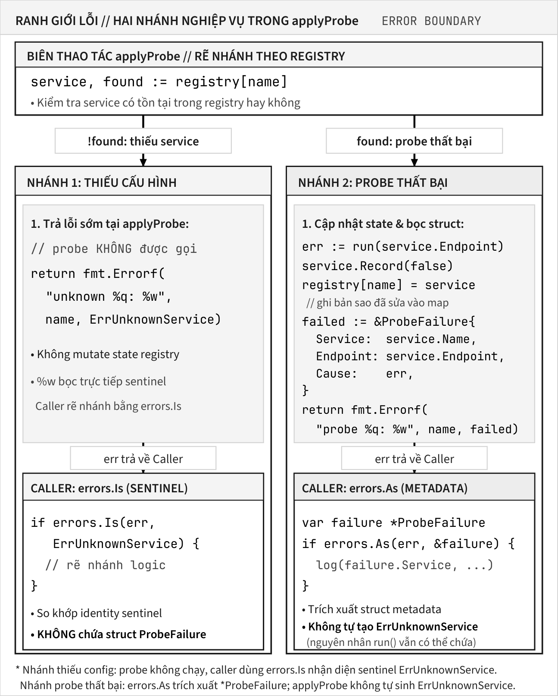
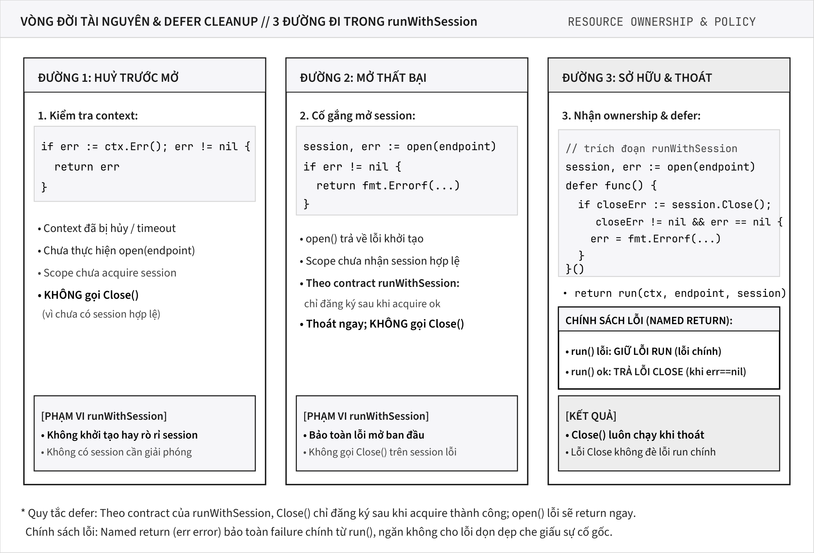

<!-- BOOK_ROLE: FOUNDATION_CORE -->

# Chương 4 — Ranh giới xử lý lỗi: để bên gọi quyết định

Công cụ `opsprobe` vừa bổ sung cấu trúc `Service`, trường trạng thái hoạt động (*state*) và một hàm ghi nhận kết quả thăm dò (*probe*). Phiên bản đầu tiên của hàm trả về kiểu boolean (`bool`): `true` nếu tên dịch vụ tồn tại, `false` nếu không tìm thấy. Đó là một giao diện API hợp lệ nếu bên gọi (*caller*) chỉ cần biết một mục ghi (*entry*) có được lưu lại hay không.

Nhưng hãy đặt hàm đó vào một tình huống vận hành thực tế. Màn hình giám sát báo dịch vụ `billing` không khỏe mạnh (*healthy*). Khi đó xuất hiện ít nhất hai câu hỏi kỹ thuật khác nhau: dịch vụ chưa từng được khai báo trong cấu hình, hay dịch vụ đã cấu hình nhưng thao tác thăm dò tới điểm cuối (*endpoint*) bị thất bại? Một giá trị `false` đơn thuần không mang bất kỳ nguyên nhân nào vượt qua ranh giới hàm. Bên gọi buộc phải suy đoán, hoặc đọc lại trạng thái đã bị biến đổi sau sự cố.

Chương này không bắt đầu bằng việc liệt kê các hàm trong gói `errors`. Nó bắt đầu bằng quyền quyết định kiến trúc: bên gọi cần tiếp nhận dạng thất bại nào để lựa chọn hiển thị thông báo, kích hoạt thử lại (*retry*), hay dừng tác vụ; còn nơi phát hiện lỗi cần bổ sung ngữ cảnh (*context*) nào mà không làm đánh mất định danh (*identity*) của nguyên nhân gốc.

## Thất bại chưa phải là một quyết định kiến trúc

Chúng ta tách hành vi thăm dò thành một giá trị hàm (*function value*). Mã nguồn chưa mở kết nối mạng thực tế; điều đó sẽ được giải quyết ở chương về nhập xuất (I/O). Hiện tại nó thiết lập một ranh giới kiểm thử: thao tác có thể thành công hoặc trả về nguyên nhân thất bại:

~~~go
type Endpoint struct {
	Host string
	Port int
}

type ProbeFunc func(Endpoint) error
~~~

Kiểu `ProbeFunc` tiếp nhận giá trị điểm cuối và trả về giá trị `error`. Nếu không có lỗi, giá trị trả về là `nil`. Nếu xuất hiện sự cố, bên gọi nhận được một giá trị lỗi mang tính mô tả. Kiểu `error` là một giao diện (*interface*) chuẩn tắc của Go; điều trọng yếu ở đây không phải giao diện đó chỉ có một phương thức, mà là mọi thất bại đều đi ra theo đường trả về chính thức với một cấu trúc đồng nhất. Tuyệt đối không dùng `panic` để báo điểm cuối không thể kết nối, và cũng không tự ý ghi nhật ký (*log*) bên trong `ProbeFunc` rồi giả vờ thao tác thành công.

Giao diện ghi nhận kết quả của `opsprobe` chuyển từ câu hỏi “có mục dữ liệu không?” sang “thao tác thăm dò và cập nhật trạng thái đã hoàn tất thành công chưa?”:

~~~go
func applyProbe(
	registry map[string]Service,
	name string,
	run ProbeFunc,
) error
~~~

Chữ ký hàm (*function signature*) khẳng định một nguyên tắc trước khi chúng ta đọc bản hiện thực (*implementation*): bên gọi không nhận về trạng thái mơ hồ hay một giá trị boolean thiếu ngữ nghĩa. Nó nhận `nil` khi thao tác hoàn tất trọn vẹn, hoặc nhận một giá trị lỗi để chủ động phân nhánh xử lý tiếp theo. Biến `registry` vẫn là giá trị bảng băm dẫn tới vùng dữ liệu dùng chung; vì bảng băm lưu trữ bản sao cấu trúc (*struct value*), hàm vẫn trích xuất phần tử, cập nhật biến cục bộ `Service`, rồi gán ngược lại bảng băm như bài học ở Chương 3.

## Phân loại lỗi để quyết định, thêm ngữ cảnh để điều tra

Không phải chuỗi thông báo lỗi nào cũng là một khế ước kỹ thuật (*contract*). Một công cụ dòng lệnh (CLI) có thể muốn xử lý riêng biệt tình huống “tên dịch vụ không tồn tại trong cấu hình”, nhưng tuyệt đối không nên phân tích chuỗi ký tự từ `err.Error()` để phục vụ logic điều hướng. Chúng ta khai báo một lỗi lính canh (*sentinel error*) cho các điều kiện mà bên gọi cần có hành vi ứng xử chuyên biệt:

~~~go
var ErrUnknownService = errors.New("service is not configured")
~~~

Khi định danh dịch vụ không tồn tại, hàm `applyProbe` không trả về lỗi lính canh trần trụi. Nó bổ sung tên thao tác đồng thời bảo toàn định danh nguyên nhân bằng động từ bọc lỗi `%w`:

~~~go
return fmt.Errorf("unknown %q: %w", name, ErrUnknownService)
~~~

`%w` không đơn thuần là thao tác nối chuỗi ký tự. Nó tạo ra một giá trị lỗi có khả năng mở gói (*unwrap*) để truy ngược về nguyên nhân gốc. Nhờ vậy bên gọi có thể kiểm tra ngữ nghĩa thông qua `errors.Is` thay vì so khớp câu chữ cảm tính:

~~~go
if errors.Is(err, ErrUnknownService) {
	fmt.Println("thêm service vào config trước khi probe")
	return
}
~~~

Trong câu lệnh trên, `errors.Is` tìm qua các lớp bọc nên bên gọi không cần đếm chúng. Đổi `%w` thành `%v` trong chính `fmt.Errorf` này giữ phần mô tả nhưng bỏ đường mở gói tới `ErrUnknownService`; lỗi mới không còn nhận diện được sentinel ấy. Đây là mất liên kết với giá trị nguyên nhân, không phải một phép “xóa kiểu” chung cho mọi lỗi.

Hai lần `errors.New("connection refused")` tạo hai giá trị lỗi khác nhau dù thông báo giống hệt. `errors.Is` mặc định so sánh giá trị khi kiểu của đích so sánh được; lỗi cũng có thể cung cấp method `Is(error) bool` để định nghĩa cách khớp. Nó không tự suy ra hai lỗi cùng nhóm từ câu chữ. Tương tự, `errors.As` không chỉ hỏi “kiểu có giống nhau không”: nó tìm lỗi gán được vào biến đích hoặc để method `As(any) bool` tùy biến việc khớp.

@figure Ranh giới lỗi không được nuốt chửng nguyên nhân gốc. Mỗi tầng kiến trúc chỉ bổ sung ngữ cảnh mà nó thực sự nắm giữ; bên gọi sử dụng `errors.Is` khi cần ra quyết định phân nhánh và dùng `errors.As` khi cần trích xuất dữ liệu có cấu trúc từ một kiểu lỗi cụ thể.

## Kiểu lỗi tùy biến mang dữ liệu cấu trúc (*custom error*)

Lỗi lính canh trả lời câu hỏi “đây có phải nhóm lỗi đó không?”. Khi thao tác thăm dò tới một điểm cuối đã cấu hình bị thất bại, công cụ dòng lệnh cần biết thêm tên dịch vụ và thông tin điểm cuối liên quan. Chúng ta sử dụng kiểu lỗi tùy biến (*custom error type*) để đóng gói ngữ cảnh có cấu trúc:

~~~go
type ProbeFailure struct {
	Service  string
	Endpoint Endpoint
	Cause    error
}

func (failure *ProbeFailure) Error() string {
	return fmt.Sprintf(
		"probe %s at %s:%d: %v",
		failure.Service,
		failure.Endpoint.Host,
		failure.Endpoint.Port,
		failure.Cause,
	)
}

func (failure *ProbeFailure) Unwrap() error {
	return failure.Cause
}
~~~

Phương thức `Error` sinh chuỗi thông báo cho người vận hành. Phương thức `Unwrap` khẳng định trường `Cause` vẫn là nguyên nhân gốc nằm dưới lớp vỏ bọc này. Giá trị lỗi cần tìm kiếm trong chuỗi là `*ProbeFailure`, bởi kiểu `ProbeFailure` triển khai phương thức nhận con trỏ (*pointer receiver*). Đối số `target` truyền vào `errors.As` bắt buộc phải là `&failure`: con trỏ tham chiếu tới biến tiếp nhận kết quả. Hàm `errors.As` sẽ gán con trỏ lỗi tìm được vào biến đó:

~~~go
var failure *ProbeFailure
if errors.As(err, &failure) {
	fmt.Printf("%s đang lỗi tại %s:%d\n",
		failure.Service,
		failure.Endpoint.Host,
		failure.Endpoint.Port,
	)
}
~~~

Hàm `errors.As` không bao giờ kiểm tra “thông báo lỗi có chứa chuỗi máy chủ hay không”. Nó tìm kiếm một giá trị lỗi có thể gán được (*assignable*) vào kiểu đích mà bên gọi chỉ định. Đây chính là lý do các kiểu lỗi tùy biến nên lưu trữ dữ liệu nghiệp vụ có cấu trúc mà bên gọi thực sự cần đến, thay vì chỉ là một cấu trúc bọc lại một chuỗi văn bản vô hồn.

`&failure` ở đây có kiểu `**ProbeFailure`: `As` cần địa chỉ của biến sẽ nhận con trỏ tìm được, không phải một đối tượng lỗi đã khởi tạo sẵn. Đích phải là con trỏ khác `nil` tới kiểu triển khai `error` hoặc tới một interface; truyền sai đích có thể gây `panic`. Nếu một API trả typed nil `(*ProbeFailure)(nil)` dưới kiểu `error`, lỗi interface vẫn khác `nil` như Chương 3; `As` có thể khớp và gán `failure == nil`. Test `TestErrorMatchingBoundaries` kiểm chứng điều đó. Hợp đồng của lab trả `nil` thật khi thành công, không dựa vào typed nil.

Bọc lỗi còn là quyết định về API. Nếu package bọc một lỗi của database bằng `%w`, bên gọi có thể dùng `Is` hoặc `As` để phụ thuộc vào lỗi đó; thay database sau này có thể phá hợp đồng. Chỉ bọc khi muốn công khai khả năng nhận diện nguyên nhân. Nếu ranh giới cần che implementation, hãy trả lỗi thuộc miền nghiệp vụ và lưu chẩn đoán nội bộ ở nơi thích hợp, không để caller phải parse text. Khi dùng `errors.Join` hoặc nhiều `%w`, cấu trúc là cây lỗi: `Is` và `As` duyệt sâu theo thứ tự từ trước ra sau, còn `errors.Unwrap` chỉ xử lý method `Unwrap() error`, không mở nhánh `Unwrap() []error` của Join.

## Phân tích thất bại: trạng thái nào cần ghi nhận, lỗi nào cần trả về?

Dưới đây là bản hiện thực của ranh giới lỗi. Hãy đánh giá đoạn mã như một quy trình phản biện thiết kế: mỗi lệnh trả về return mang theo thông tin gì, và trạng thái hệ thống nào còn lưu lại sau khi hàm kết thúc?

~~~go
func applyProbe(
	registry map[string]Service,
	name string,
	run ProbeFunc,
) error {
	service, found := registry[name]
	if !found {
		return fmt.Errorf(
			"unknown %q: %w",
			name,
			ErrUnknownService,
		)
	}

	if err := run(service.Endpoint); err != nil {
		service.Record(false)
		registry[name] = service
		failed := &ProbeFailure{
			Service:  service.Name,
			Endpoint: service.Endpoint,
			Cause:    err,
		}
		return fmt.Errorf("probe %q: %w", name, failed)
	}

	service.Record(true)
	registry[name] = service
	return nil
}
~~~

Nhánh thiếu cấu hình trả về lỗi sớm: không có cấu trúc `Service` hợp lệ để biến đổi trạng thái, do đó bảng băm đăng ký registry được giữ nguyên vẹn. Nhánh thăm dò thất bại vẫn ghi nhận trạng thái `Healthy=false` và tăng bộ đếm số lần thử lại, rồi trả về đối tượng lỗi chứa nguyên nhân gốc. Đây không phải là hai cơ chế báo lỗi xung đột; trạng thái trả lời câu hỏi “kết quả quan sát gần nhất ra sao”, còn lỗi giải thích “thao tác vừa thực thi không thể hoàn tất vì lý do gì”. Nhánh thành công cập nhật trạng thái hoạt động rồi trả về `nil`.

Khi kiểm thử mã nguồn này, hệ thống tập trung chứng minh ba cam kết hợp đồng cụ thể thay vì chỉ so khớp chuỗi thông báo:

| Tình huống kiểm thử | Điều kiện xác minh trạng thái | Điều kiện xác minh lỗi (Error Contract) |
| :--- | :--- | :--- |
| Dịch vụ không tồn tại trong cấu hình | Hàm kiểm tra probe tuyệt đối không được gọi. | `errors.Is(err, ErrUnknownService)` trả về `true`. |
| Thao tác probe thất bại | Trạng thái dịch vụ cập nhật `Healthy=false` và tăng số lần thử lại. | `errors.As` trích xuất thành công `*ProbeFailure`, đồng thời `errors.Is` bảo toàn nguyên nhân gốc. |
| Thao tác probe thành công | Trạng thái dịch vụ cập nhật `Healthy=true` tại đúng endpoint cấu hình. | Giá trị lỗi trả về là `nil`. |

Bài thực hành `part4-error-boundaries` hiện thực hóa ba khế ước trên thành các ca kiểm thử tự động. Kiểu `ProbeFunc` được thay thế bằng một hàm giả lập nhỏ gọn trong kiểm thử; chúng ta không cần mở socket mạng thực tế để chứng minh tính đúng đắn của ranh giới lỗi. Hãy mở `main_test.go` trước khi đọc `main.go`, chủ động đổi riêng `%w` thành `%v` ở câu lệnh return cuối cùng của nhánh thăm dò thất bại, rồi chạy kiểm thử `TestApplyProbePreservesFailureCauseAndContext`. Thông báo lỗi hiển thị gần như tương đồng, nhưng ca kiểm thử lập tức báo đỏ vì `errors.Is` không còn nhận diện được nguyên nhân gốc. Khôi phục lại `%w`, sau đó tạm thời vô hiệu hóa nhánh xử lý tín hiệu hủy bỏ (*cancellation*) và chạy `TestApplyProbeCancellationDoesNotChangeHealthState`: lúc này kết quả kiểm thử sẽ cảnh báo việc nhầm lẫn tín hiệu hủy tác vụ thành lỗi sức khỏe dịch vụ. Hai thao tác chủ động tiêm lỗi (*failure injection*) này mang lại bài học sâu sắc hơn việc chỉ sao chép lại chuỗi lỗi có sẵn.

> **Dừng để dự đoán:** Một lệnh `run` trả về `errors.New("connection refused")`. Nếu `applyProbe` đổi `%w` ở lệnh trả về cuối cùng thành `%v`, thông báo của công cụ dòng lệnh có thể vẫn hiển thị “connection refused”. Khế ước nào trong ba khế ước trên đã bị phá vỡ? Viết một biểu thức kiểm chứng (*assertion*) để phát hiện lỗi này.

#### Gợi ý giải pháp (chỉ đọc sau khi đã tự làm)

Khế ước nhận diện nguyên nhân gốc bị phá vỡ: biểu thức `errors.Is(err, errConnectionRefused)` sẽ trả về `false` vì chuỗi lỗi không còn mở gói (*unwrap*) tới lỗi ban đầu. Ngữ cảnh dạng chuỗi văn bản cho con người đọc không đủ để thay thế định danh kiểu cho mã nguồn. Biểu thức kiểm chứng cần khởi tạo `errConnectionRefused`, gọi `applyProbe`, rồi khẳng định `errors.Is(got, errConnectionRefused)` phải là `true`.

## Điểm dừng của ranh giới lỗi

Chúng ta chưa vội đưa cơ chế thử lại (*retry*), thời hạn quá giờ (*timeout*) hay thu hồi tài nguyên vào đây; việc dồn quá nhiều trách nhiệm sẽ làm mờ ranh giới kiến trúc. Hiện tại giao diện lập trình đã xác lập một quy ước rành mạch: giá trị `nil` khẳng định thao tác đã hoàn tất trọn vẹn, giá trị `error` bảo toàn nguyên nhân gốc và ngữ cảnh điều tra, còn bên gọi hoàn toàn làm chủ quyết định rẽ nhánh thông qua `errors.Is` hoặc `errors.As`.

Phần tiếp theo của Chương 4 sẽ thử thách ranh giới lỗi này dưới áp lực quản lý tài nguyên và tín hiệu hủy bỏ (*cancellation*): lệnh `defer` cần được đặt ở đâu, đối tượng `context` truyền tải qua giao diện lập trình như thế nào, và vì sao `panic` không bao giờ là giải pháp thay thế cho một thất bại có thể dự đoán được.

## Tín hiệu hủy bỏ không phải là chỉ dấu sức khỏe dịch vụ

Một thao tác thăm dò có thể bị hủy bỏ do người vận hành chủ động ngắt tiến trình dòng lệnh, do yêu cầu cấp cha bị quá hạn thời gian, hoặc do dịch vụ quản lý đang trong quá trình tắt dần (*shutdown*). Không tình huống nào trong số đó chứng minh điểm cuối của `billing` đã ngừng hoạt động. Nếu hàm `applyProbe` quy kết mọi lỗi vào nhánh `Record(false)`, tín hiệu hủy bỏ từ bên gọi sẽ vô tình tạo ra một chỉ dấu sai lệch về tình trạng sức khỏe dịch vụ.

Đối tượng `context.Context` chịu trách nhiệm mang theo thời hạn (*deadline*) và tín hiệu hủy bỏ xuyên qua các ranh giới giao diện. Nó luôn đứng ở vị trí tham số đầu tiên trong chữ ký hàm, tuyệt đối không được cất giữ bên trong cấu trúc `Service`, và được truyền tuần tự xuống các hàm có khả năng gây nghẽn:

~~~go
type ProbeFunc func(context.Context, Endpoint) error

func applyProbe(
	ctx context.Context,
	registry map[string]Service,
	name string,
	run ProbeFunc,
) error
~~~

Trước khi thực thi thao tác thăm dò, ranh giới lỗi chủ động kiểm tra trạng thái hủy để tránh kích hoạt các tác vụ nhập xuất vô ích. Nếu tín hiệu hủy xuất hiện trong lúc `run` đang xử lý, hàm `run` phải tôn trọng `ctx` và trả về một giá trị lỗi có thể nhận diện được thông qua `errors.Is(err, context.Canceled)` hoặc `errors.Is(err, context.DeadlineExceeded)`. Trả về trực tiếp `ctx.Err()` là cách tiếp cận đơn giản; bọc thêm ngữ cảnh cũng hoàn toàn chuẩn mực miễn là không làm mất định danh lỗi gốc. Hàm `applyProbe` nhận diện hai nguyên nhân chuẩn hóa này, bảo toàn chúng trong chuỗi bọc lỗi, nhưng tuyệt đối không cập nhật trạng thái sức khỏe dịch vụ:

~~~go
if err := ctx.Err(); err != nil {
	return fmt.Errorf("probe canceled: %w", err)
}

if err := run(ctx, service.Endpoint); err != nil {
	if errors.Is(err, context.Canceled) ||
		errors.Is(err, context.DeadlineExceeded) {
		return fmt.Errorf("probe incomplete: %w", err)
	}

	service.Record(false)
	registry[name] = service
	failed := &ProbeFailure{
		Service: service.Name,
		Endpoint: service.Endpoint,
		Cause: err,
	}
	return fmt.Errorf("probe %q: %w", name, failed)
}
~~~

Đây là một chính sách thiết kế (*policy*) của `opsprobe`, chứ không phải quy luật áp đặt rằng tín hiệu hủy không bao giờ mang ý nghĩa vận hành. Tại ranh giới lỗi này, trạng thái `Healthy` chỉ được ghi nhận khi một lượt quan sát diễn ra trọn vẹn. Một thao tác bị hủy bỏ dở dang chưa thể mang lại bằng chứng quan sát đó. Bên gọi vẫn có thể sử dụng `errors.Is(err, context.Canceled)` để kết thúc tiến trình trong yên lặng, hoặc dùng `errors.Is(err, context.DeadlineExceeded)` để phát cảnh báo quá giờ.

## Lệnh `defer` phải đi liền với khâu chiếm dụng tài nguyên

Tín hiệu hủy bỏ không tự động giải phóng các tài nguyên mà một hàm đã cấp phát. Quyền sở hữu (*ownership*) gắn liền với vị trí chiếm dụng tài nguyên (*acquisition*) thành công: hàm nào mở phiên làm việc (*session*) thì hàm đó phải lập tức lên lịch dọn dẹp (*cleanup*) trước khi chuyển sang các lệnh có thể trả về lỗi. Chúng ta tách biệt phần này khỏi trạng thái sức khỏe để phân định rõ ràng giữa chính sách thu hồi tài nguyên và chính sách kiểm tra điểm cuối:

~~~go
type ProbeSession interface {
	Close() error
}

type OpenSession func(Endpoint) (ProbeSession, error)
type SessionProbe func(
	context.Context,
	Endpoint,
	ProbeSession,
) error

func runWithSession(
	ctx context.Context,
	endpoint Endpoint,
	open OpenSession,
	run SessionProbe,
) (err error) {
	if err := ctx.Err(); err != nil {
		return err
	}

	session, err := open(endpoint)
	if err != nil {
		return fmt.Errorf("open session: %w", err)
	}
	defer func() {
		if closeErr := session.Close(); closeErr != nil {
			if err == nil {
				err = fmt.Errorf("close session: %w", closeErr)
			}
		}
	}()

	return run(ctx, endpoint, session)
}
~~~

Lệnh `defer` được đăng ký ngay sau khi hàm `open` hoàn tất thành công. Nếu `open` thất bại, chưa có phiên làm việc nào được mở để phải đóng. Nếu `run` trả về theo bất kỳ nhánh nào, phương thức `Close` luôn thực thi trước khi `runWithSession` trả về kết quả cuối cùng. Giá trị trả về có tên `err` ở đây phục vụ mục đích thiết kế cụ thể: lỗi dọn dẹp chỉ trở thành lỗi trả về khi thao tác chính diễn ra thành công. Nếu `run` đã phát sinh lỗi, mã nguồn ưu tiên bảo toàn thất bại nguyên phát thay vì thay thế nó bằng một lỗi thứ phát trong quá trình đóng phiên. Một hệ thống có yêu cầu lưu giữ đồng thời cả hai lỗi có thể sử dụng cấu trúc gom lỗi đa tầng (như `errors.Join`), nhưng điều đó phải được thực hiện với chủ đích rõ ràng.

@figure `defer` đăng ký dọn dẹp khi hàm `runWithSession` thoát, không phải khi một khối `if` kết thúc. Lỗi `Close` chỉ thay kết quả khi thao tác chính chưa có lỗi.

Điểm đăng ký và điểm thực thi khác nhau. Với `defer session.Close()`, receiver được tính ngay khi đăng ký; lời gọi chạy lúc hàm bao quanh kết thúc, theo thứ tự ngược với lúc đăng ký. Đặt defer trong vòng lặp không đóng tài nguyên ở cuối mỗi vòng: tất cả đợi tới cuối hàm. Nếu cần đóng từng phiên trước vòng kế tiếp, hãy đưa một lượt xử lý vào hàm riêng hoặc đóng tường minh. `TestDeferIsFunctionScopedAndCapturesArguments` truy vết cả khối lệnh và giá trị đối số để tách hai cơ chế này.

Defer cũng chạy khi panic tháo dỡ stack của cùng goroutine, nhưng không phải cơ chế bảo đảm trước mọi kiểu kết thúc tiến trình: `os.Exit` không chạy defer, và hàm đang nghẽn chưa thoát thì defer chưa thực thi. Giao ước `open` trong ví dụ yêu cầu trả phiên hợp lệ khi `err == nil` và không chuyển quyền sở hữu phiên cho caller khi có lỗi. Nếu API mở tài nguyên cho phép trả cả tài nguyên lẫn lỗi, phải đọc hợp đồng riêng để biết ai dọn nó.

Cần lưu ý một ranh giới kiến trúc khác: bên gọi khởi tạo đối tượng context dẫn xuất bắt buộc phải gọi hàm `cancel`, kể cả khi thời hạn deadline có thể tự động hết hạn. Trong các đoạn mã ngắn, mẫu thiết kế chuẩn tắc là khai báo `ctx, cancel := context.WithTimeout(parent, timeout)` và ngay lập tức tiếp nối bằng `defer cancel()`. Hàm `cancel` giải phóng các tài nguyên bên trong bộ định thời của context; trong khi `session.Close` giải phóng tài nguyên mạng mà hàm `runWithSession` đã chiếm dụng. Hai thao tác dọn dẹp này thuộc về hai chủ thể sở hữu hoàn toàn khác nhau.

## Đánh giá mã nguồn: đừng dùng `recover` để che giấu thất bại có thể dự đoán

Một review có thể gặp đoạn sau và thấy nó “tránh crash”:

~~~go
defer func() {
	if recovered := recover(); recovered != nil {
		err = fmt.Errorf("probe failed: %v", recovered)
	}
}()
~~~

Cách viết trên không thể thay thế cho câu lệnh `return error` chuẩn tắc. Tín hiệu hủy bỏ, thời gian quá hạn, thiếu cấu hình hay kết nối bị từ chối đều là các kết quả đầu ra (*outcomes*) mà giao diện lập trình đã lường trước; chúng bắt buộc phải lưu thông qua chuỗi bọc lỗi để bên gọi có thể phân loại theo chương trình. Việc lạm dụng `recover` ở đây sẽ biến các lỗi lập trình nghiêm trọng (như giải tham chiếu con trỏ `nil` hay phá vỡ điều kiện bất biến nội bộ) thành một chuỗi ký tự mơ hồ, trong khi trạng thái dữ liệu có thể đã bị biến dạng dở dang.

Cơ chế `panic` chỉ phù hợp với lỗi lập trình bất khả kháng, điều kiện bất biến nội bộ bị vi phạm nghiêm trọng, hoặc tại các ranh giới phục hồi chuyên biệt được thiết kế để cách ly mã nguồn không tin cậy. Hàm `recover` chỉ có vị trí hợp lý khi ranh giới đó có kế hoạch khôi phục trạng thái an toàn, ghi nhận nhật ký đầy đủ và sở hữu khế ước rõ ràng sau phục hồi. Công cụ `opsprobe` hiện tại không chứa ranh giới như vậy; để `panic` xuất hiện minh bạch trong kiểm thử sẽ trung thực hơn nhiều so với việc ngụy trang nó thành một lỗi thăm dò thông thường.

Ở tầng ngôn ngữ, `recover` chỉ chặn panic khi được gọi trực tiếp từ hàm deferred đang xử lý panic trong cùng goroutine. Gọi nó qua một helper thông thường không chặn được; defer ở goroutine cha cũng không bắt panic của goroutine con. Khi phục hồi thành công, hàm đang có defer trở về caller, không tiếp tục ở câu lệnh ngay sau chỗ panic. Các test cleanup và recover của lab kiểm tra phạm vi này bằng panic có kiểm soát; không đổi panic thành kết quả probe thành công.

### Bài thực hành: Lần theo đường dọn dẹp tài nguyên

Ngữ cảnh `ctx` bị hủy sau khi `open` trả về một phiên làm việc, còn `run` trả về `context.Canceled`. Hàm `Close` có được gọi không? Lỗi cuối cùng giữ định danh nào? Trạng thái `registry["billing"]` có nên thay đổi `Healthy` hay `Retries` không?

#### Gợi ý giải pháp (chỉ đọc sau khi đã tự làm)

Hàm `Close` được gọi đúng một lần vì lệnh `defer` đã được đăng ký ngay sau khi cấp phát tài nguyên thành công. Hàm `runWithSession` giữ `context.Canceled` làm lỗi chính nếu `Close` cũng phát sinh lỗi; `applyProbe` bọc nguyên nhân đó để phép thử `errors.Is(err, context.Canceled)` vẫn trả về `true`. Vì thao tác không hoàn tất một quan sát điểm cuối, chính sách hiện tại giữ nguyên `Healthy` và `Retries`.

## Kết chương: Mọi thất bại đều có đường lưu thông chuẩn tắc

`ErrUnknownService` cho caller điều kiện để xử lý cấu hình; `ProbeFailure` giữ ngữ cảnh của quan sát; các lớp bọc công khai nguyên nhân theo hợp đồng. Chính sách cancellation của lab giữ nguyên sức khỏe khi quan sát bị hủy, còn defer dọn phiên khi hàm bao quanh thoát. Panic có phạm vi phục hồi riêng và không thay thế đường trả lỗi đã thiết kế.

Công cụ `opsprobe` lúc này đã phân định minh bạch điều nó sở hữu, điều nó quan sát và trao toàn quyền quyết định cho bên gọi. Chương tiếp theo: ranh giới gói (*package boundary*), phạm vi xuất khẩu và nguyên lý khép kín phụ thuộc.

### Bốn câu hỏi trước khi merge một error boundary

| Tiêu chí kiểm định ranh giới lỗi | Yêu cầu kỹ thuật bắt buộc |
| :--- | :--- |
| Nhận diện định danh lỗi (Error Identity) | Bên gọi có cần rẽ nhánh quyết định theo từng loại lỗi cụ thể không? Nếu có, phải bảo toàn identity bằng sentinel error hoặc custom type có cấu trúc; cấm bắt caller parse chuỗi văn bản. |
| Bản chất quan sát miền nghiệp vụ | Lỗi này có phản ánh trạng thái thực của dịch vụ đích không? Timeout hoặc cancellation từ Context của caller không tự động đồng nghĩa với việc endpoint bị unhealthy. |
| Quyền sở hữu tài nguyên | Hàm nào nhận quyền sở hữu? Defer đăng ký ở đâu và hàm đó thoát khi nào? Đừng nhầm kết thúc khối lệnh với thực thi dọn dẹp. |
| Chính sách bảo toàn lỗi gốc (Primary Error Policy) | Nếu thao tác dọn dẹp trong defer cũng phát sinh lỗi, lỗi ban đầu có bị nuốt mất không? Cần bảo toàn lỗi gốc để không làm gián đoạn việc điều tra sự cố. |

Khi bốn câu trả lời hiện ngay trong chữ ký hàm, chuỗi bọc lỗi, chuyển dịch trạng thái và kiểm thử tự động, người đọc sau không cần phỏng đoán lỗi có bị che lấp, số lần thử lại có bị tăng sai, hay tài nguyên hệ thống có bị rò rỉ hay không. Đó là sự chuẩn bị cần thiết trước khi tách mã nguồn thành các package độc lập.
