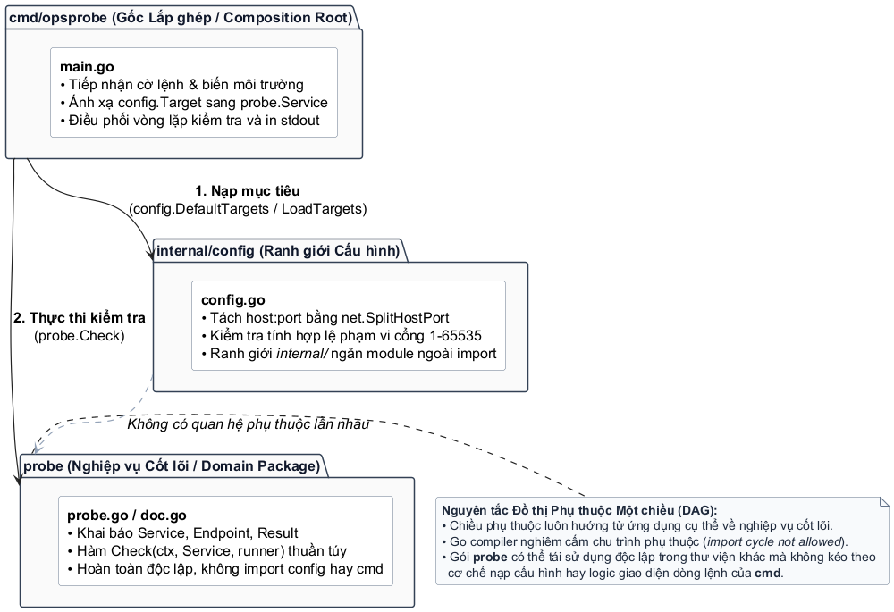

<!-- BOOK_ROLE: FOUNDATION_CORE -->

# Chương 5 — Package là ranh giới

Sau Chương 4, công cụ `opsprobe` đã sở hữu một giao diện lập trình (*API*) cho một thao tác thăm dò. Nhưng bài thực hành vẫn nằm gọn trong một gói `main` chứa lẫn lộn mô hình dữ liệu, chính sách lỗi, cấu hình giả lập và cách thức in ra thiết bị đầu cuối. Khi mọi thứ còn ngắn gọn, một tệp duy nhất là lựa chọn tốt. Vấn đề xuất hiện không phải vì số lượng tệp tăng lên, mà vì một thay đổi trong cách hiển thị dòng lệnh có thể nhìn thấy mọi chi tiết nội bộ của gói thăm dò, và một thay đổi cấu hình có thể kéo theo toàn bộ mô hình nghiệp vụ lõi.

Chúng ta không mở đầu bằng một cấu trúc thư mục “chuẩn mẫu” mang tính giáo điều. Chúng ta bắt đầu bằng việc rà soát trách nhiệm: đoạn mã nào cần biết lệnh `fmt.Println`, đoạn mã nào bắt buộc phải biết điểm cuối (*endpoint*), và đoạn mã nào nắm giữ quyền quyết định cấu hình được nạp từ đâu? Khi câu trả lời khác nhau, ranh giới kiến trúc (*boundary*) bắt buộc phải phân tách độc lập.

## Một dependency graph có thể đọc từ ngoài vào trong

Refactor đầu tiên của `opsprobe` phân định ba vai trò kiến trúc rõ rệt:

Package `cmd/opsprobe` là điểm khởi đầu dòng lệnh (command entrypoint): tiếp nhận các phụ thuộc, điều phối ca sử dụng và trình bày kết quả ra màn hình dòng lệnh.

Package `probe` là thư viện có thể tái sử dụng (importable package): sở hữu mô hình nghiệp vụ cho một lần kiểm tra và hoàn toàn độc lập với thiết bị đầu ra.

Package `internal/config` là chi tiết triển khai nội bộ của ứng dụng: quản lý cấu hình mặc định, với phạm vi import bị `go` command giới hạn theo cây thư mục cha của `internal`, không phải một quy tắc chung “cùng module”.

@figure Hướng phụ thuộc (*dependency direction*) là công cụ để rà soát thiết kế. Gói `cmd/opsprobe` là điểm cấu thành (*composition root*); nó biết rõ các gói cụ thể. Ngược lại, gói `probe` hoàn toàn không biết đến giao diện dòng lệnh hay nguồn cấu hình, do đó nó có thể được đọc hiểu, kiểm thử độc lập và thay thế hàm thực thi mà không kéo theo tầng hiển thị.

Tệp `go.mod` xác lập đường dẫn mô-đun (*module path*), còn mỗi thư mục trong Go là một gói riêng biệt. Vì bài thực hành sử dụng mô-đun `example.com/golang-master/part5-package-design`, đường dẫn nhập khẩu của gói `probe` là `example.com/golang-master/part5-package-design/probe`. Một gói có thể gồm nhiều tệp trong cùng một thư mục; việc chia nhỏ tệp không tạo thêm ranh giới mới nếu chúng vẫn cùng khai báo `package probe`.

~~~text
part5-package-design/
├── go.mod
├── cmd/opsprobe/main.go
├── probe/doc.go
├── probe/check.go
└── internal/config/config.go
~~~

Thư mục mang tên `cmd` là một quy ước hữu ích khi kho mã nguồn chứa nhiều tệp thực thi; bản thân trình biên dịch không gán ý nghĩa cú pháp đặc biệt nào cho nó. Tệp `main.go` cũng chỉ là tên tệp theo quy ước cộng đồng. Ranh giới kiến trúc thực sự được xác lập từ mệnh đề khai báo gói, đường dẫn nhập khẩu và chiều hướng của các quan hệ phụ thuộc.

## Export là lời hứa, không phải cách sửa compile error

Trong gói `probe`, bên gọi chỉ cần khởi tạo dịch vụ, truyền hàm thực thi và nhận kết quả. Chỉ những khái niệm mang tính giao ước đó mới cần được xuất bản (*export*):

~~~go
package probe

type Endpoint struct { Host string; Port int }
type Service struct { Name string; Endpoint Endpoint }

type Runner func(context.Context, Endpoint) error
type Result struct { Service string }

func Check(
	ctx context.Context,
	service Service,
	run Runner,
) (Result, error)
~~~

Chữ cái đầu viết hoa không làm cho kiểu dữ liệu “quan trọng hơn”; nó mở ra một giao ước công khai (*contract*) cho các gói khác sử dụng. Hàm `Check` được xuất bản vì công cụ dòng lệnh thực sự cần kích hoạt nó. Hàm trợ giúp bổ sung ngữ cảnh lỗi ở bên trong có thể giữ kín nội bộ (*unexported*) vì chưa có bên gọi nào ngoài `probe` cần đến nó. Việc xuất bản vội vàng rồi hy vọng một bên tiêu dùng sẽ xuất hiện là con đường ngắn nhất tạo ra một giao diện lập trình cồng kềnh với gánh nặng tương thích ngược không đáng có.

Tài liệu hướng dẫn của gói cũng là một phần không thể tách rời của giao ước. Tệp `probe/doc.go` bắt đầu bằng lời chú thích `Package probe ...`, làm rõ gói chịu trách nhiệm cho những gì và tuyệt đối không đảm nhận những gì. Lời chú thích cho các định danh xuất bản nên mô tả hành vi mà bên gọi có thể an tâm dựa vào, thay vì chỉ lặp lại một cách sáo rỗng tên của kiểu dữ liệu.

## `internal` là boundary do go command kiểm tra

Target mặc định là policy của application hiện tại. Ta để nó trong `internal/config`:

~~~go
package config

type Target struct {
	Name string
	Host string
	Port int
}

func DefaultTargets() []Target {
	return []Target{
		{
			Name: "billing",
			Host: "billing.internal",
			Port: 8443,
		},
	}
}
~~~

Package ở `internal` không phải “private bằng thỏa thuận”. Go chỉ cho code nằm trong cây thư mục của gói cha import nó. Vì `cmd/opsprobe` nằm dưới thư mục gốc module, vốn là thư mục cha của `internal`, nó hoàn toàn import được `internal/config`. Code nằm ngoài cây cha ấy bị lệnh `go` từ chối. Không nên dùng số lượng module làm phép thử: một kho mã nguồn nhiều module có thể vẫn có các package nằm trong cây được phép.

Đây không phải lý do để nhét mọi gói vào `internal` theo phản xạ. Với tệp nhị phân tự chứa, đó thường là giá trị mặc định (*default*) tốt vì không công bố giao diện lập trình (*API*) ra ngoài. Với `probe` trong bài thực hành này, chúng ta cố tình để gói này có thể nhập khẩu (*importable*) để ranh giới giữa thao tác nghiệp vụ (*domain operation*) và công cụ dòng lệnh (*CLI*) hiển lộ rõ ràng. Nếu sau này không còn bên tiêu dùng (*consumer*) nào bên ngoài ứng dụng, nó cũng có thể chuyển thành nội bộ (`internal`); vị trí phải dựa trên bên tiêu dùng thực tế, không theo cấu trúc thư mục hình thức.

## Điểm cấu thành (Composition root) chuyển dữ liệu, không giấu phụ thuộc

`config.Target` và `probe.Service` không cùng kiểu dữ liệu. Chúng thuộc hai ranh giới kiến trúc khác nhau: gói cấu hình xác định dữ liệu được khai báo như thế nào; trong khi gói thăm dò xác định một thao tác cần những gì. Tệp `cmd/opsprobe` là vị trí phù hợp nhất để ánh xạ giữa hai mô hình dữ liệu đó:

~~~go
for _, target := range config.DefaultTargets() {
	service := probe.Service{
		Name: target.Name,
		Endpoint: probe.Endpoint{
			Host: target.Host,
			Port: target.Port,
		},
	}

	result, err := probe.Check(ctx, service, run)
	if err != nil {
		fmt.Printf("%s: %v\n", service.Name, err)
		continue
	}
	fmt.Printf("%s healthy=true\n", result.Service)
}
~~~

Phép ánh xạ này thoạt nhìn như đoạn mã lặp lại thông thường, nhưng nó bảo toàn hướng phụ thuộc (*dependency direction*) một cách trung thực: `probe` không cần nhập khẩu gói cấu hình, gói cấu hình không cần biết tới cấu trúc kết quả, và mã in ấn ra thiết bị đầu cuối không rò rỉ vào gói nghiệp vụ lõi. Khi nguồn cấu hình chuyển từ giá trị mặc định sang tệp tin hoặc biến môi trường ở chương sau, phương thức `probe.Check` không hề bị xáo trộn chỉ vì cách nạp cấu hình đã đổi.

## Tái cấu trúc có kiểm chứng, không phải di chuyển tệp đơn thuần

Bài thực hành kiểm tra ba cam kết kỹ thuật trọng yếu khi phân tách gói nhằm bảo vệ ranh giới kiến trúc:

| Thành phần kiểm thử | Hành vi kỳ vọng của hệ thống | Rủi ro nếu thiết kế sai ranh giới |
| :--- | :--- | :--- |
| Điều phối hủy bỏ (`probe.Check`) | Chuyển `ctx.Err()` thành lỗi nhận diện được bằng `errors.Is`, không kích hoạt runner khi context đã bị hủy. | Tiếp tục tiêu tốn tài nguyên mạng dù bên gọi đã phát tín hiệu dừng. |
| Toàn vẹn kết quả | Đối tượng kết quả mang chính xác tên định danh dịch vụ đã cấu hình. | Trộn lẫn trạng thái giữa các dịch vụ trong quá trình duyệt danh sách. |
| Độc lập dữ liệu (`internal/config`) | Trả về một slice độc lập theo từng lần gọi factory. | Caller sửa slice nhận được làm đột biến giá trị cấu hình mặc định dùng chung. |

Ca kiểm thử cuối cùng không nhằm khẳng định “mọi lát cắt đều nguy hiểm”. Nó chứng minh quyền sở hữu (*ownership*) của hàm tạo cấu hình: `DefaultTargets` tạo dữ liệu hoàn toàn mới cho bên gọi thay vì phát tán một lát cắt dùng chung. Đây là câu hỏi về ngữ nghĩa giá trị (*value semantics*) của Chương 2, nay được đặt vào ranh giới của một gói.

### Khởi tạo Gói và Ràng buộc Đồ thị Phụ thuộc (Initialization DAG)

Đặc tả Go không cho phép một gói nhập khẩu chính nó, dù là trực tiếp hay gián tiếp. Vì vậy đồ thị nhập khẩu (*import graph*) tuyệt đối không được có chu trình; quá trình biên dịch phát hiện chu trình phụ thuộc (*cyclic dependency*) sẽ bị từ chối ngay với chẩn đoán `import cycle not allowed`. Quy tắc này giúp xác định thứ tự khởi tạo gói một cách tất định, chứ không chứng minh các dịch vụ phụ thuộc bên ngoài tiến trình đã sẵn sàng.

Nếu gói `A` nhập khẩu gói `B`, thì `B` bắt buộc phải được khởi tạo hoàn tất trước khi `A` bắt đầu. Trong phạm vi từng gói, các biến cấp gói được khởi tạo theo thứ tự phụ thuộc tĩnh, tiếp theo là các hàm `init()` chạy tuần tự trong luồng nhẹ khởi tạo trước khi hàm `main` thực thi. Tuy nhiên, hàm `init()` hoàn toàn có thể khởi tạo các luồng nhẹ khác; đồ thị nhập khẩu không thể bảo đảm các luồng đó đã kết thúc hoặc cấu hình bên ngoài đã sẵn sàng. Những tác vụ có thể phát sinh lỗi, cần thời hạn xử lý (*deadline*) hoặc cần tài nguyên bên ngoài nên được gọi một cách tường minh từ điểm khởi tạo ứng dụng, nơi bên gọi có thể trực tiếp quan sát và xử lý lỗi.

Lần này bài học không bắt đầu từ mã nguồn đã được phân tách sẵn. Mở thư mục `labs/part5-package-refactor` trong trình soạn thảo: điểm xuất phát là một tệp `main.go` nguyên khối đang chạy. Chạy `go run .` để ghi nhận hành vi hiện tại làm mốc kiểm chuẩn, rồi chạy `go test -tags exercise ./...`. Lỗi biên dịch do gói `probe` chưa tồn tại chính là tín hiệu bắt đầu, không phải lỗi cần bỏ qua: các ca kiểm thử đang đòi hỏi một ranh giới công khai mà mã nguồn chưa thiết lập. Từ yêu cầu nghiệp vụ và các ca kiểm thử, người học tự quyết định tệp nào đưa vào `probe`, tệp nào thuộc `internal/config`, và công cụ dòng lệnh ánh xạ hai mô hình dữ liệu ở đâu. Khi hoàn tất, lệnh `go run ./cmd/opsprobe` phải bảo toàn kết quả xuất ra, đồng thời các lệnh `go test -tags exercise ./...` và `go vet ./...` đều phải báo xanh.

---

#### Gợi ý giải pháp (chỉ đọc sau khi đã tự làm)

Bản triển khai tham chiếu nằm ở `labs/part5-package-design`, nhưng chỉ nên tham khảo sau khi các ca kiểm thử chấp nhận (*acceptance test*) đã đưa ra phản hồi đầu tiên. Ranh giới kiến trúc cần bảo toàn là: gói `probe` công bố các thao tác nghiệp vụ mà kiểm thử kích hoạt, gói `internal/config` duy trì chính sách mặc định và trả về lát cắt mới độc lập, còn `cmd/opsprobe` là nơi ánh xạ dữ liệu rồi hiển thị kết quả. Tuyệt đối không có lý do gì để `probe` nhập khẩu ngược lại gói cấu hình hoặc thiết bị đầu cuối.

### Bài thực hành: Xác định vị trí đặt mã nguồn trong kiến trúc gói

Một kỹ sư muốn thêm lệnh `fmt.Println` vào `probe.Check` để in tiến trình xử lý, và muốn `probe` gọi trực tiếp `config.DefaultTargets` để giảm bớt bước ánh xạ ở `main`. Với đồ thị phụ thuộc trên, hai thay đổi đó gây ra rủi ro gì? Hãy đề xuất vị trí thay thế phù hợp.

---

#### Gợi ý giải pháp (chỉ đọc sau khi đã tự làm)

Việc gọi `fmt.Println` kéo tầng hiển thị vào một gói có thể được tái sử dụng; công cụ dòng lệnh mới là nơi quyết định quy cách hiển thị và đích xuất dữ liệu. Việc để `probe` gọi gói cấu hình sẽ đảo ngược chiều phụ thuộc từ thao tác nghiệp vụ sang chính sách ứng dụng, khiến cho kiểm thử của `probe` bị ràng buộc chặt chẽ với cấu hình. Thông tin tiến trình nên được chuyển giao dưới dạng sự kiện hoặc kết quả để bên gọi tự hiển thị; việc ánh xạ dữ liệu nên nằm ở lệnh hoặc một dịch vụ ứng dụng nằm ngoài cả `probe` lẫn `config`.

## Nguồn cấu hình là dữ liệu không đáng tin cậy, không phải điểm cuối

Yêu cầu nghiệp vụ tiếp theo đến từ người vận hành: trong một lượt chạy, họ muốn thay đổi điểm cuối mặc định mà không cần sửa đổi mã nguồn. Chúng ta chọn một biến môi trường có định dạng rõ ràng: `OPS_PROBE_TARGET=payments.internal:9443`. Đây là năng lực của ứng dụng, không phải trách nhiệm của gói `probe`. Hàm `probe.Check` chỉ tiếp nhận đối tượng `Endpoint` đã hợp lệ; nó không có lý do gì để bận tâm chuỗi ký tự đó bắt nguồn từ biến môi trường, tệp cấu hình hay một cờ lệnh trong tương lai.

Điều này xác lập một ranh giới kiến trúc quan trọng. Môi trường luôn cung cấp chuỗi ký tự thô; trong khi điểm cuối đòi hỏi tên máy chủ và cổng mạng có ý nghĩa. Thao tác phân tách, chuyển đổi kiểu và kiểm tra phạm vi thuộc về trách nhiệm của `internal/config`. Công cụ dòng lệnh chuyển giao hàm đọc thực tế `os.LookupEnv` vào ranh giới đó, rồi chỉ nhận về `[]Target` hoặc lỗi. Hình thức của giao diện lập trình đủ nhỏ gọn để kiểm thử độc lập mà không cần can thiệp biến môi trường của hệ điều hành:

~~~go
type LookupEnv func(string) (string, bool)

func LoadTargets(lookup LookupEnv) ([]Target, error)
~~~

Đây không phải là một khung tiêm phụ thuộc (*dependency injection framework*) phức tạp. `LookupEnv` chỉ đơn thuần là một kiểu hàm mô tả chính xác phụ thuộc mà gói cấu hình cần: nhận một khóa, trả về giá trị chuỗi và báo hiệu khóa có tồn tại hay không. Trong kiểm thử, một hàm đóng kín nhỏ thay thế cho `os.LookupEnv`; trong lệnh chính, hàm `os.LookupEnv` đáp ứng trọn vẹn chữ ký hàm đó. Nhờ vậy, ca kiểm thử mô tả dữ liệu đầu vào tường minh mà không có ca kiểm thử nào phải thay đổi môi trường tiến trình dùng chung.

Chuỗi `host:port` cũng không nên được tách bằng lệnh thô sơ `strings.Split`. Ký tự dấu hai chấm `:` xuất hiện phổ biến trong địa chỉ IPv6, do đó `net.SplitHostPort` là bộ phân tích cú pháp phù hợp với ngữ pháp socket mạng. Chuỗi `payments.internal:9443` là đầu vào hợp lệ; địa chỉ IPv6 cần đặt trong dấu ngoặc vuông như `[2001:db8::9]:9443`. Sau khi phân tách, cổng mạng vẫn ở dạng chuỗi: hàm `strconv.Atoi` chuyển đổi thành số nguyên `int`, rồi gói cấu hình kiểm tra phạm vi 1–65535 trước khi khởi tạo mục tiêu. Mọi dữ liệu lỗi đều trả về lỗi có ngữ cảnh để công cụ dòng lệnh in ra và thoát với mã khác 0.

Ở đây không cần khai báo lỗi lính gác (*sentinel error*) mới. Bên gọi hiện chỉ có một chính sách xử lý duy nhất cho cấu hình lỗi: thông báo cho người dùng và dừng chương trình trước khi quá trình thăm dò bắt đầu. Nếu sau này công cụ dòng lệnh cần phân biệt lỗi cú pháp với lỗi thiếu thông tin bảo mật để đưa ra giải pháp khắc phục khác nhau, đó mới là thời điểm danh tính lỗi xứng đáng được đưa vào giao ước. Chương 4 không yêu cầu “mọi lỗi phải có kiểu riêng”; nó nhấn mạnh chỉ giữ lại danh tính khi bên gọi có các quyết định ứng xử khác nhau.

### Bài thực hành: Yêu cầu thay đổi sau khi tái cấu trúc

Sau khi hoàn thành lần tách package đầu tiên trong `labs/part5-package-refactor`, chạy `go test -tags configexercise ./...`. Test đòi `internal/config.LoadTargets` nhận một hàm đọc biến môi trường và đổi endpoint khi có `OPS_PROBE_TARGET`. Tự chọn file, API và thông báo lỗi; ràng buộc kỹ thuật là dùng `net.SplitHostPort`, từ chối host rỗng và port ngoài 1–65535, còn `cmd/opsprobe` mới được gọi `os.LookupEnv`. Khi test xanh, chạy lệnh với `OPS_PROBE_TARGET=payments.internal:9443` để kiểm tra đường đi thời gian chạy.

---

#### Gợi ý giải pháp (chỉ đọc sau khi đã tự làm)

Bản hiện thực tham chiếu giữ `LoadTargets` trong `internal/config`, bắt đầu từ `DefaultTargets` để quyền sở hữu của slice không đổi, rồi chỉ ghi đè host và port của target đầu. Lệnh xử lý lỗi ở biên tiến trình bằng stderr và mã thoát `2`; `probe` không thay đổi. Đây là dấu hiệu tái cấu trúc tốt: yêu cầu về nguồn cấu hình đi qua một package, trong khi thao tác kiểm tra endpoint không cần biết nguồn dữ liệu vừa đổi.

## Code review: một field không có trạng thái thứ hai

Sau khi thay đổi cấu hình, chúng ta rà soát lại giao diện lập trình công khai thay vì vội vàng bổ sung thêm tính năng mới. Hàm `Check` có hai kết quả đầu ra: trả về `error` khi thao tác không hoàn tất, hoặc trả về `Result` khi hàm thực thi thành công. Trong giao ước này, trường `Result.Healthy` luôn mang giá trị `true`. Trường dữ liệu đó trông có vẻ vô hại, nhưng nó gợi ý cho bên gọi về một trạng thái thứ hai mà hàm không bao giờ trả về.

Đây là một khiếm khuyết trong thiết kế, không phải lỗi của trình biên dịch. Một kỹ sư mới tiếp nhận mã nguồn có thể viết `if !result.Healthy { retry() }`, rồi tin rằng nhánh rẽ đó có ý nghĩa thực tế. Trong thực tế, sự cố đã được truyền tải qua giá trị `error`; giá trị mặc định của `Result` đi kèm với lỗi không phải là một quan sát mang ý nghĩa “không lành mạnh”. Việc cố giữ trường boolean chỉ để phục vụ câu in ra màn hình có chữ `true` đã khiến ranh giới giao diện rộng hơn dữ liệu mà thao tác thực sự cung cấp.

Chúng ta thu hẹp `Result` chỉ còn định danh dịch vụ đã hoàn tất. Tệp `cmd/opsprobe` đã sở hữu nhánh kiểm tra `err == nil`, do đó chính công cụ dòng lệnh, nơi sở hữu tầng hiển thị, sẽ in `healthy=true`. Hoàn toàn không có thông tin nào bị thất thoát: thành công đã là bằng chứng của trạng thái lành mạnh; thất bại vẫn là lỗi đi kèm ngữ cảnh. Đây là một lần tái cấu trúc đặc biệt giá trị vì kiểm thử không hề báo đỏ trước khi sửa. Kiểm thử cũ vẫn xanh, nhưng giao ước cũ có thể khiến người đọc suy luận sai lệch.

~~~go
// Result identifies the service whose check
// completed successfully.
type Result struct {
	Service string
}
~~~

Một lời ghi chú giải thích tốt giờ đây có thể phát biểu chính xác hơn: `Result` không “chứa trạng thái sức khỏe”, mà định danh dịch vụ đã kiểm tra thành công. Khi giao diện thực sự cần diễn đạt nhiều trạng thái quan sát (chẳng hạn như lành mạnh, suy giảm, không thể kết nối cùng mốc thời gian và độ trễ), đó sẽ là một mô hình dữ liệu khác, được thiết kế cùng yêu cầu nghiệp vụ và kiểm thử riêng. Đừng bao giờ chừa chỗ cho một tính năng chưa tồn tại chỉ để giao diện trông có vẻ linh hoạt.

<!-- pagebreak -->

### Bài thực hành: Đánh giá mã nguồn dưới các ràng buộc

Trong `labs/part5-package-design`, tạm giữ `Healthy bool` trong `Result` rồi viết ra hai kết quả mà `Check` có thể trả về. Sau đó bỏ trường này, sửa kiểm thử và chỉ sửa phần hiển thị ở tầng lệnh cho đến khi cả `go test ./...` cùng `go run ./cmd/opsprobe` đều đạt kết quả tốt. Tuyệt đối không chuyển lỗi thất bại thành `Result{Healthy: false}`: điều đó làm mất chuỗi lỗi mà Chương 4 đã xây dựng. Trong bản tái cấu trúc độc lập, `public_boundary_test.go` là khế ước tối thiểu; hãy sửa bản hiện thực theo kiểm thử, không tự ý thêm trường dữ liệu chỉ để dự đoán tương lai.

---

#### Gợi ý giải pháp (chỉ đọc sau khi đã tự làm)

Giá trị `Result{Service: service.Name}` là đủ cho nhánh thành công. Sau khi kiểm tra `err == nil`, lệnh tự in chuỗi ký tự `healthy=true`. Nếu sau này cần trạng thái sức khỏe mà vẫn giữ việc phân biệt lỗi thao tác riêng, API sẽ cần một khế ước mới quy định rõ kết quả nào có thể xuất hiện cùng lỗi nào; đó không phải việc của cờ boolean hiện tại.

## Module chọn source nào để build

Một ranh giới gói được phân chia chuẩn mực vẫn có thể biên dịch với mã nguồn khác với dự tính của người lập trình. Gói (*package*) là đơn vị tổ chức mã nguồn; trong khi mô-đun (*module*) là tập hợp các gói đi kèm phiên bản và các yêu cầu phụ thuộc. Tệp `go.mod` xác lập đường dẫn mô-đun, phiên bản ngôn ngữ và các yêu cầu; tệp `go.sum` lưu bảng băm kiểm tra để xác minh tính toàn vẹn của mã phụ thuộc đã tải. Nó không phải tệp khóa phiên bản liệt kê cứng mọi phiên bản sẽ dùng trong mọi chế độ biên dịch.

Go sử dụng thuật toán chọn phiên bản tối thiểu (*minimal version selection*) cho các yêu cầu trong đồ thị mô-đun: với mỗi đường dẫn mô-đun, Go chọn phiên bản cao nhất được yêu cầu trong đồ thị liên quan, chứ không tự ý tải bản mới nhất trên mạng Internet. Thuật ngữ “tối thiểu” ở đây chỉ tập hợp phiên bản thỏa mãn yêu cầu, không có nghĩa là chọn phiên bản thấp nhất trong mọi phụ thuộc. Chỉ thị `replace` có thể hoán đổi mã nguồn cục bộ hoặc chỉ định phiên bản; một bản biên dịch sử dụng chỉ thị thay thế cục bộ chỉ chứng minh mã nguồn trên máy đó. Chỉ thị thay thế trong các gói phụ thuộc không tự động trở thành chính sách của mô-đun chính tiêu dùng nó. Khi điều tra sự cố, hãy đọc kỹ kết quả `go list -m all`, `go mod graph` và `go env GOMOD GOWORK` trước khi kết luận kiểm thử đang chạy đúng phụ thuộc mong muốn.

Không gian làm việc (*workspace*) bổ sung một lựa chọn cục bộ: tệp `go.work` có thể đưa nhiều mô-đun vào vai trò mô-đun chính để phát triển song song. Nó không hợp nhất chúng thành một mô-đun duy nhất để phát hành. Một dịch vụ trong không gian làm việc có thể dùng thư viện vừa sửa đổi trên máy, trong khi người dùng tải về vẫn nhận phiên bản đã phát hành chính thức. Vì vậy, việc kiểm tra ngoài không gian làm việc là một phép thử độc lập bắt buộc, không phải sự lặp lại thừa thãi:

~~~powershell
go env GOMOD GOWORK
go list -m all
# Chạy trong module muốn kiểm tra độc lập
$env:GOWORK = "off"
go test ./...
Remove-Item Env:GOWORK
~~~

Nếu đã có biến `GOWORK` trong môi trường, hãy lưu và khôi phục giá trị thay vì xóa bỏ nó; đoạn trên minh họa phiên làm việc chưa đặt biến đó. Bài thực hành không cần phụ thuộc thực tế trên mạng: tạo hai mô-đun cục bộ, cho mô-đun A nhập khẩu mô-đun B, dùng không gian làm việc để kiểm thử, rồi tắt không gian làm việc. Hãy giải thích vì sao kết quả thay đổi, và điều gì bắt buộc phải xuất hiện trong `go.mod` hoặc phiên bản phát hành để bên tiêu dùng độc lập có thể biên dịch thành công. Đừng bao giờ sửa lỗi bằng chỉ thị `replace` trỏ vào đường dẫn máy tính cá nhân rồi coi sản phẩm đó là có thể tái lập.

Bộ công cụ đang chạy và phiên bản ngôn ngữ của mô-đun là hai khái niệm độc lập. Trong Go 1.27, lệnh `go test` mặc định kích hoạt kiểm tra vet `stdversion`, giúp phát hiện các biểu tượng thư viện chuẩn quá mới so với phiên bản có hiệu lực của tệp, sau khi đối chiếu cả `go.mod` và các thẻ chỉ thị biên dịch. Việc cài đặt bộ công cụ mới không tự động hợp thức hóa việc sử dụng các API mới trong một mô-đun vốn cam kết tương thích với phiên bản cũ. Lệnh `go mod tidy` của mô-đun `go 1.27` còn gom các khối khai báo `require` trùng lặp thành nhóm trực tiếp và gián tiếp; khác biệt đó là thay đổi về hình thức biểu diễn phụ thuộc, không phải bằng chứng đã nâng cấp hay tích hợp phụ thuộc thành công.

## Build là phép chọn tệp trước khi compile

Hai tệp trong cùng một thư mục chưa chắc cùng được biên dịch vào một tệp nhị phân. Quy ước đặt tên như `probe_linux.go`, hậu tố kiến trúc và chỉ thị dòng `//go:build` điều khiển việc chọn lựa mã nguồn. Ràng buộc biên dịch (*build constraint*) bắt buộc phải đặt ở đầu tệp, đứng trước khai báo gói và cách biệt bằng một dòng trống. Đây là bước chọn lọc tệp của bộ công cụ; trình biên dịch vẫn kiểm tra các tệp đã chọn theo ngữ nghĩa ngôn ngữ chuẩn mực.

Với một hàm trợ giúp thuần Go, người lập trình có thể đặt hai bản cài đặt có cùng chữ ký hàm trong các tệp phân tách theo hệ điều hành. Lệnh `go list -json .` hiển thị rõ các trường `GoFiles`, `IgnoredGoFiles` và `CgoFiles`; thông tin này hữu ích hơn nhiều so với việc phán đoán cảm tính từ cây thư mục. Biên dịch chéo (*cross-compilation*) thay đổi mục tiêu biên dịch, chứ không giúp máy tính Windows thực thi hay kiểm chứng các lời gọi hệ thống (*syscall*) của Linux:

~~~powershell
$env:GOOS = "linux"
$env:GOARCH = "amd64"
$env:CGO_ENABLED = "0"
go build -o probe-linux ./cmd/opsprobe
~~~

Thực thi trong một phiên lệnh tạm thời hoặc khôi phục ba biến môi trường về giá trị trước đó. Việc biên dịch thành công mới chỉ chứng minh trình biên dịch và trình liên kết (*linker*) chấp nhận tập hợp mã nguồn cho mục tiêu đó, chứ chưa chứng minh tệp nhị phân sẽ thực thi chính xác trên môi trường đích. Khi sử dụng cgo, hệ thống còn đòi hỏi trình biên dịch C và các thư viện phù hợp với nền tảng đích; việc tắt cgo không tạo ra một bản biên dịch chéo tương đương nếu các chức năng dựa trên C bị loại bỏ khỏi mã nguồn. Chương 14 phân tích giao ước ở ranh giới C, Chương 17 kiểm tra tiến trình trong môi trường triển khai thực tế, còn Chương 26 xác minh nguồn gốc (*provenance*) và lỗ hổng bảo mật của sản phẩm đóng gói. Mỗi bước giải đáp một câu hỏi kỹ thuật riêng biệt.

## Điểm dừng: package đủ nhỏ để thay đổi

Chưa có một “kiến trúc hoàn chỉnh” phức tạp nào ở đây: chưa phân tích tệp cấu hình, chưa dùng kiểu tổng quát (*generics*), chưa tạo gói riêng cho từng danh từ. Chúng ta chỉ sở hữu một đồ thị phụ thuộc mà mỗi mũi tên đều giải thích rõ ràng “vì sao gói này cần biết đến gói kia?”. Đó là cấu trúc tinh gọn vừa đủ để tiếp tục thay đổi mã nguồn mà không biến mọi sửa đổi thành việc chắp vá hàm `main`.
