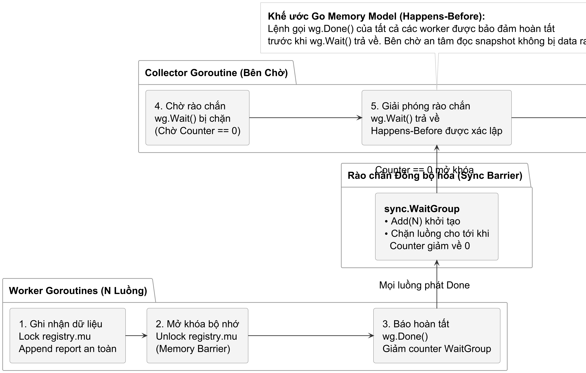

<!-- BOOK_ROLE: FOUNDATION_CORE -->

# Chương 8 — Một race bắt đầu từ đâu

Một chương trình kiểm tra nhiều endpoint thường có một người thu thập kết quả và một người trình bày. Bản chạy thử có thể luôn in đúng trên laptop, nên ta rất dễ gọi nó là “chạy song song được”. Nhưng kết quả đúng trong một lượt không tạo ra một lời hứa đúng cho lượt kế tiếp.

Mô hình tinh thần của chương này: tranh chấp dữ liệu (data race) không đơn thuần là hai goroutine cùng tồn tại đồng thời, mà là hiện tượng nhiều luồng cùng truy cập một ô nhớ dữ liệu mà không có cơ chế đồng bộ hóa an toàn xác lập thứ tự giữa chúng. Trước khi chọn channel, mutex hay atomic, ta phải lần được những lần truy cập đó và hỏi: thứ tự nào thực sự được thiết lập?

## Một lá cờ không tự công bố kết quả

Xét tình huống một tiến trình thu thập (collector) chuẩn bị bản báo cáo, sau đó gán cờ `ready` để báo cho bên hiển thị biết dữ liệu đã sẵn sàng:

~~~go
type summary struct {
	completed int
	last      string
}

var latest summary
var ready bool

func collect() {
	latest = summary{completed: 1, last: "billing"}
	ready = true
}

func show() summary {
	for !ready {
	}
	return latest
}
~~~

Nguồn trông có một thứ tự hiển nhiên: gán `latest`, rồi mới gán `ready`. Nhưng đó chỉ là thứ tự **bên trong** `collect`. `show` là một luồng thực thi khác. Nó vừa đọc `ready` khi `collect` có thể ghi `ready`, vừa đọc `latest` khi `collect` có thể ghi `latest`. Không có thao tác đồng bộ nào nối hai bên.

Vì vậy ở đây không chỉ có một vấn đề “đôi khi in cũ”. Có hai cặp truy cập tranh chấp: đọc/ghi `ready` và đọc/ghi `latest`. Việc vòng lặp có tình cờ kết thúc ở một máy không biến các cặp ấy thành có thứ tự. Đặc biệt, nhìn thấy `ready == true` không là bằng chứng ngôn ngữ rằng người đọc cũng nhìn thấy bản `latest` đã chuẩn bị xong.

## Bốn tầng không được trộn lẫn

@table Bốn loại bằng chứng khi điều tra race

| Tầng | Câu hỏi nó trả lời | Không được suy ra thêm |
| --- | --- | --- |
| Nghĩa của ngôn ngữ | Hai lần truy cập thường, cùng vị trí, có ít nhất một lần ghi và không có quan hệ happens-before là race. | Bộ chạy của máy này sẽ xen kẽ ở đúng chỗ nào. |
| Hành vi được tài liệu cam kết | Lệnh `go` khởi động goroutine mới; nhưng goroutine kết thúc không tự tạo quan hệ đồng bộ cho phần còn lại của chương trình. | Một cờ bool tự công bố mọi lần ghi xảy ra trước nó. |
| Chi tiết hiện thực | Bộ lập lịch, số P và thời điểm ngắt để chuyển việc quyết định một lần chạy thực tế xen kẽ ra sao. | Đó là hợp đồng ổn định của Go hay của code. |
| Hành vi đo được | `go test -race` báo những lần truy cập mà lượt chạy đã thực sự đi qua. | Không có báo cáo chứng minh mọi đường chạy đều không có race. |

Hai tầng đầu là lời hứa để thiết kế. Tầng thứ ba chỉ hữu ích khi giải thích một vết chạy hoặc một vấn đề hiệu năng; đừng dùng nó để biện minh rằng race “khó xảy ra”. Tầng cuối là bằng chứng thực nghiệm mạnh cho đường đã chạy, nhưng nó không thay thế lập luận về thứ tự. Một test xanh không cho phép ta đổi “chưa quan sát thấy” thành “được bảo đảm”.

## Vẽ chứng minh thay vì đoán lịch chạy

Chương 6 đã dùng race detector để tìm một lần truy cập thực sự xung đột. Ở đây bước kế tiếp không phải chạy lại cùng báo cáo, mà là viết được lời giải thích cho phiên bản đúng trước khi chạy. Ta phân tích trật tự bộ nhớ thông qua ba quan hệ định chuẩn được xác định trong Go Memory Model:

| Quan hệ thứ tự | Bản chất ngữ nghĩa trong Go | Ví dụ áp dụng thực tế |
| :--- | :--- | :--- |
| **Sequenced-before** | Trật tự thực thi tuần tự của các câu lệnh bên trong cùng một goroutine đơn lẻ. | Thao tác `append` vào slice bắt buộc phải hoàn tất trước khi gọi `wg.Done()`. |
| **Synchronized-before** | Cạnh đồng bộ hóa liên goroutine do ngôn ngữ hoặc thư viện runtime công bố. | Lệnh `mu.Unlock()` được đồng bộ hóa trước lệnh `mu.Lock()` diễn ra kế tiếp trên cùng một Mutex; hoặc `wg.Done()` trước lệnh `wg.Wait()` mở khóa. |
| **Happens-before** | Quan hệ bao đóng bắc cầu giữa sequenced-before và synchronized-before. | Khi các access được sắp thứ tự và không có race trên vị trí ấy, một read quan sát write gần nhất đứng trước nó trong thứ tự này; cần xét cả những write khác, không chỉ vẽ một cạnh từ write mong muốn. |

Cần phân biệt rạch ròi hai cặp khái niệm thường bị nhầm lẫn trong môi trường đồng thời:

Xử lý đồng thời (*concurrency*) là cấu trúc phân tách chương trình thành nhiều phần việc có thể tiến triển trong các khoảng thời gian đan xen chồng chéo; tính toán song song (*parallelism*) là việc thực thi thực tế cùng một thời điểm. Xử lý song song không bắt buộc mỗi luồng phải chạy trên một nhân vi xử lý vật lý riêng biệt, bởi CPU logic (*logical CPU*) cũng có thể là một luồng phần cứng (*hardware thread*). Trong Go, số lượng bộ xử lý logic `P` được cấu hình thông qua `GOMAXPROCS` giới hạn số goroutine thực thi mã nguồn Go đồng thời; các luồng hệ điều hành và cơ chế lập lịch của nhân hệ điều hành tác động trực tiếp đến hành vi quan sát được.

Hiện tượng chạy đua dữ liệu (*data race*) xảy ra khi có ít nhất hai thao tác truy cập vào cùng một ô nhớ (*memory location*), trong đó có ít nhất một thao tác ghi, các thao tác này không được sắp đặt trật tự bởi quan hệ xảy ra trước (*happens-before*) và không được bao bọc bởi giao ước nguyên tử (*atomic*) tương ứng. Đừng quy chụp chạy đua dữ liệu trong Go là hành vi bất định không giới hạn (*undefined behavior*) như trong C/C++: mô hình bộ nhớ Go (*Go memory model*) đặt ra các ràng buộc an toàn nhất định cho bản cài đặt, mặc dù chạy đua dữ liệu vẫn là lỗi nghiêm trọng và sự cố tranh chấp trên dữ liệu đa từ máy (*multi-word data*) có thể gây hỏng hóc bộ nhớ (*memory corruption*). Trong khi đó, điều kiện chạy đua (*race condition*) là lỗi sai lệch trật tự ở tầng logic nghiệp vụ; nó hoàn toàn có thể phát sinh ngay cả khi từng thao tác truy cập riêng lẻ đều đã được bảo vệ bằng khóa loại trừ tương hỗ (*mutex*).

Đừng biến ba tên thành câu thần chú. Với mỗi kết quả cần đọc, hãy vẽ đường cụ thể. Trong ví dụ `ready`, không có cạnh nào từ `latest = ...` sang việc `show` đọc `latest`; vì vậy lời giải không thể chỉ là thêm một vòng lặp chờ.

## Một khóa bảo vệ một bất biến, không bảo vệ một dòng

Khóa `sync.Mutex` phù hợp với dữ liệu thực sự thuộc quyền sở hữu chung, khi nhiều goroutine cần luân phiên biến đổi hoặc chụp ảnh trạng thái cùng một vùng nhớ. Bất biến kỹ thuật của phòng thực hành mới là: sau khi tiến trình điều phối đã chờ toàn bộ công nhân xử lý hoàn tất, bản chụp dữ liệu phải chứa chính xác một báo cáo từ mỗi công nhân. Khóa bảo vệ lát cắt `reports` trong suốt quá trình bổ sung và sao chép; `sync.WaitGroup` cung cấp bằng chứng cho tiến trình điều phối biết chính xác thời điểm có thể đánh giá bất biến.

Trước khi tham khảo `fixed/registry.go`, hãy đọc tệp `exercise/registry_test.go`. Bài kiểm thử đòi hỏi kiểu cấu trúc `Registry`, phương thức `Add(Report)` và phương thức `Snapshot() []Report`. Hãy tự quyết định trường dữ liệu nào cần khai báo, phương thức nào sử dụng bộ tiếp nhận con trỏ (*pointer receiver*), và phạm vi khóa (*critical section*) cần bao trùm tới ranh giới nào. Lệnh thực thi ban đầu sẽ báo lỗi đỏ vì mã nguồn chưa được lập trình:

~~~powershell
go test -tags exercise ./exercise
~~~

Tuyệt đối không giải quyết bằng cách trả về trực tiếp lát cắt nội bộ. Bài học về hiện tượng trùng lặp tham chiếu (*aliasing*) ở Chương 2 đã chứng minh lý do: bên gọi nắm giữ lát cắt trả về có thể biến đổi các phần tử bên trong nó. Phương thức `Snapshot` cam kết cung cấp một bản chụp độc lập của thùng chứa dữ liệu, do đó phòng thực hành sử dụng hàm `copy` để ngăn bên gọi ghi đè phần tử bên trong sổ đăng ký (*registry*). Kiểu `Report` chỉ chứa giá trị chuỗi thuần túy nhằm giữ trọng tâm bài học vào trật tự thực thi; quyền sở hữu phức tạp của các đối tượng lồng nhau sẽ được phân tích khi xuất hiện nhu cầu thực tế.

Một bản cài đặt đạt chuẩn không cần bận tâm bộ lập lịch sẽ kích hoạt luồng công nhân nào trước. Nó chỉ cần bảo đảm mỗi phương thức `Add` xác lập khóa trước khi nối phần tử và giải phóng khóa ngay sau đó, đồng thời `Snapshot` giữ khóa trong suốt quá trình nhân bản dữ liệu. Tài liệu gói `sync` cam kết thao tác `Unlock` xảy ra trước một thao tác `Lock` kế tiếp trên cùng một khóa. Đây là giao ước kỹ thuật của giao diện lập trình, không phải suy diễn cảm tính từ số lượng nhân CPU hay một lần kiểm thử vượt qua ngẫu nhiên.

## WaitGroup tạo mốc hoàn tất, không thay Mutex

Test đặt `wg.Add(workers)` trước khi tạo goroutine. Mỗi worker gọi `registry.Add(report)` rồi mới `wg.Done()` qua `defer`. Khi `wg.Wait()` trả về, mỗi `Done` đã mở khóa nó; do đó mọi `Add` trước `Done` đã nằm trước thời điểm assertion gọi `Snapshot`.

Đường chứng minh cho một worker có thể đọc thành lời:

@figure Đường chứng minh cho một công nhân: các bước trong từng goroutine tuân thủ trật tự mã nguồn; cạnh đứt là quan hệ Done mở khóa lượt Wait này. Hàm Snapshot chỉ chạy sau khi Wait trả về.

Các mũi tên nét liền thể hiện trật tự tuần tự trong mã nguồn; quan hệ `Done → Wait returns` là cam kết mà `sync.WaitGroup` xác lập. Khóa loại trừ tương hỗ bảo đảm các thao tác truy cập vào lát cắt không bị chồng lấn thời gian. `WaitGroup` không thể thay thế cho cơ chế khóa: nếu các tiến trình công nhân cùng đồng thời bổ sung phần tử vào một lát cắt mà không có khóa bảo vệ, sự cố chạy đua dữ liệu vẫn sẽ bùng phát cho dù luồng chính có kiên nhẫn chờ đến khi tất cả kết thúc mới thống kê kết quả.

Sau khi tự làm, chạy bản tham chiếu độc lập:

~~~powershell
go test -race ./fixed
~~~

Kết quả kiểm thử thành công cung cấp đồng thời hai loại bằng chứng kỹ thuật: bài kiểm thử xác nhận bất biến nghiệp vụ cụ thể, trong khi công cụ phát hiện chạy đua không tìm thấy bất kỳ truy cập xung đột nào trên nhánh thực thi đó. Tuy nhiên, điều này không đồng nghĩa với lời khẳng định rằng mọi giao diện lập trình bổ sung trong tương lai vào `Registry` đều tự động an toàn. Bất kỳ phương thức mới nào thao tác đọc hoặc ghi lên `reports` đều bắt buộc phải quay lại rà soát bất biến và phạm vi bao bọc của khóa.

## Điều `go` cho phép, điều nó không hứa

Câu lệnh `go f()` thiết lập quan hệ xảy ra trước từ thời điểm kích hoạt đến lúc hàm `f` bắt đầu chạy. Cơ chế này bảo đảm goroutine mới nhìn thấy đầy đủ dữ liệu đã chuẩn bị trước lệnh `go`; nhưng nó không cung cấp chiều ngược lại. Việc hàm `f` kết thúc hay goroutine hoàn tất không tự động phát tín hiệu cho các goroutine khác biết công việc đã xong. Đó là lý do `sync.WaitGroup` trong phòng thực hành là một mắt xích chứng minh hình thức, không phải là thủ thuật tạm bợ để giảm thiểu tình trạng kiểm thử chập chờn (*flaky test*).

Tuyệt đối không sử dụng `time.Sleep` để lấp liếm mũi tên quan hệ còn thiếu. Việc tạm dừng thời gian chỉ là phỏng đoán may rủi rằng tiến trình công nhân có đủ thời gian hoàn thành trên một lượt chạy; nó hoàn toàn không xác lập bất kỳ trật tự xảy ra trước nào và khiến bộ kiểm thử vừa chậm chạp vừa bất định. Kênh truyền ở Chương 9 sẽ giải quyết trọn vẹn bài toán bàn giao công việc và vòng đời; trước thời điểm đó, ta cần phân biệt rạch ròi giữa việc công bố trạng thái an toàn với việc bảo vệ trạng thái đang liên tục bị biến đổi.

## Công bố state và chờ điều kiện

`sync.Once` duy trì giao ước kỹ thuật “thực thi đúng một lần duy nhất”, chứ không phải “thử lại cho đến khi thành công”. Khi nhiều bên gọi cùng thực thi `Do(f)` trên cùng một đối tượng `Once`, sự kiện kết thúc của hàm `f` được bảo đảm xảy ra trước sự trở về của toàn bộ các lời gọi `Do` liên quan. Tuy nhiên, nếu hàm `f` phát sinh lỗi hoảng loạn (`panic`), `Once` vẫn ghi nhận lượt thực thi đó đã hoàn tất; bên gọi dù có phục hồi lỗi (`recover`) rồi gọi lại `Do` cũng không thể kích hoạt hàm `f` chạy lại lần thứ hai. Ca kiểm thử `TestOncePanicIsNotRetry` trong `labs/edition-contracts` bảo vệ chính phản ví dụ này. Quá trình khởi tạo tài nguyên phụ thuộc có nguy cơ lỗi tạm thời đòi hỏi chính sách thử lại (*retry policy*) tường minh; không được che giấu rủi ro bên trong `Once` với hy vọng hệ thống sẽ tự khôi phục kỳ diệu.

Cấu trúc `sync.Cond` phục vụ bài toán hoàn toàn khác: chờ đợi cho đến khi vị từ điều kiện (*predicate*) được bảo vệ bởi khóa chuyển sang trạng thái hợp lệ. Phương thức `Wait` giải phóng khóa, tạm hoãn thực thi chờ tín hiệu, rồi tự động tái xác lập khóa trước khi trở về. Tín hiệu thông báo (*notification*) không phải là thẻ trạng thái có thể tích lũy cho bên gọi trong tương lai; chính điều kiện vị từ mới là trạng thái cốt lõi cần được kiểm tra cẩn trọng dưới sự bảo vệ của khóa:

~~~go
mu.Lock()
for !ready {
	cond.Wait()
}
// Đọc state được bảo vệ khi vẫn giữ lock.
mu.Unlock()
~~~

Vòng lặp `for` bao quanh không hàm ý Go cho phép `Wait` tự động thức tỉnh vô cớ: tài liệu chính thức quy định rõ ràng cần có lời gọi `Signal` hoặc `Broadcast` để phương thức `Wait` trở về. Vòng lặp này tối quan trọng vì tại thời điểm goroutine tái đoạt được khóa, một goroutine khác có thể đã biến đổi dữ liệu khiến vị từ điều kiện không còn thỏa mãn. Bên sản xuất (*producer*) biến đổi vị từ dưới cùng một khóa bảo vệ, sau đó phát tín hiệu thông báo theo chính sách xác định. Nếu bên sản xuất đã thiết lập `ready = true` trước khi bên tiêu thụ tiếp cận, bên tiêu thụ sẽ trực tiếp đọc vị từ mà không cần truy vết tín hiệu thông báo trong lịch sử. Đây là nền tảng cốt lõi cho mô hình hàng đợi ở Chương 21, chứ không phải lý do lạm dụng `Cond` thay thế cho kênh truyền trong mọi tình huống.

Kỹ thuật công bố nguyên tử (*atomic publication*) phát huy tối đa hiệu quả khi bên đọc chỉ tiếp nhận một bản chụp dữ liệu (*snapshot*) đã hoàn tất toàn vẹn, trong khi bên ghi tiến hành thay thế toàn bộ bản chụp mới thay vì đột biến trực tiếp đối tượng đang lưu hành. Kiểu dữ liệu `atomic.Pointer[Config]` cho phép ghi nhận (*Store*) con trỏ mới và tải về (*Load*) con trỏ hiện hành; các thao tác nguyên tử này tuân thủ trật tự nhất quán tuần tự (*sequentially consistent*) theo đặc tả của gói `sync/atomic`. Tuy nhiên, thao tác nguyên tử trên con trỏ không tự động bảo vệ an toàn cho các trường dữ liệu nằm sau con trỏ đó. Nếu sau khi `Store` mà mã nguồn lại biến đổi bảng ánh xạ (*map*), lát cắt hay trường dữ liệu của chính đối tượng đó trong lúc bên đọc đang truy xuất, hiện tượng chạy đua dữ liệu vẫn sẽ bùng phát.

Trong ca kiểm thử `TestCondPredicateAndAtomicPublication`, mỗi đối tượng cấu hình được khởi tạo hoàn tất trước lệnh `Store` và không bao giờ bị biến đổi về sau. Bài kiểm thử xác thực giá trị quan sát được trên các nhánh thực thi xác định, trong khi công cụ phát hiện chạy đua (*race detector*) kiểm chứng các truy cập bộ nhớ; bằng chứng kỹ thuật khẳng định chính sách bản chụp bất biến sau thời điểm công bố. Thao tác nguyên tử không thể thay thế cho một giao dịch nhiều trường dữ liệu, không giải quyết quyền sở hữu của các đối tượng lồng nhau và không có bất kỳ cam kết nào khẳng định nó luôn có hiệu năng cao hơn khóa `sync.Mutex`. Hãy lựa chọn cơ chế sở hữu bằng chứng tối thiểu bảo vệ được bất biến, sau đó tiến hành đo đạc thực tế khi khối lượng công việc thực sự đặt ra bài toán tối ưu hóa.

Chương này kết thúc khi người học quan sát hai goroutine không còn hỏi “có chạy cùng lúc không?”, mà hỏi “lần truy cập nào cùng dữ liệu, bất biến nào cần giữ, và đường happens-before nào làm điều đó đúng?”. Câu hỏi ấy sẽ tiếp tục đồng hành qua channel, bộ xử lý HTTP, bộ nhớ đệm và mã nguồn runtime; cơ chế kỹ thuật có thể thay đổi, nhưng trách nhiệm chứng minh thứ tự luôn bất biến.

## Ghi chú kiểm chứng

@references
1. Go Team. The Go Memory Model, phiên bản 6 June 2022. go.dev/ref/mem
2. Go Team. Data Race Detector. go.dev/doc/articles/race_detector
3. Go Team. Package sync. pkg.go.dev/sync
