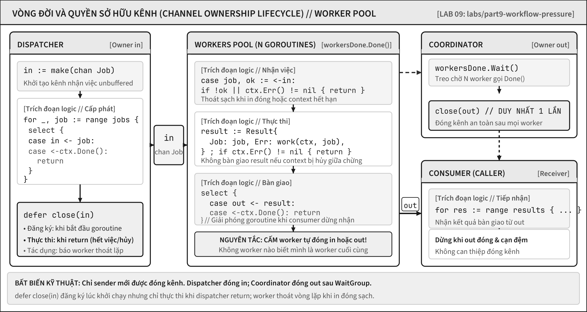

<!-- BOOK_ROLE: FOUNDATION_CORE -->

# Chương 9 — Dòng công việc có áp suất

Mô hình tinh thần của chương này là một send trên channel là một lần bàn giao còn dang dở cho tới khi bên tiêu thụ nhận nó, bộ đệm lưu giữ nó, hoặc người gửi chọn dừng. Channel không biến công việc thành “song song an toàn” chỉ bằng một dấu `<-`. Nó buộc ta viết rõ ai còn nợ ai một giá trị, ai báo không còn giá trị nào nữa, và điều gì xảy ra khi người nhận không còn chờ.

Hãy bắt đầu bằng một tiện ích có vẻ hợp lý. `firstResult` chạy nhiều probe, nhận kết quả đầu tiên rồi return. Tên này không hứa kết quả thành công: kết quả đến đầu tiên vẫn có thể chứa lỗi. Đoạn trích tập trung vào điểm gửi, chưa phải một hàm hoàn chỉnh:

~~~go
results := make(chan Result)

for _, probe := range probes {
	go func(probe Probe) {
		result := probe(ctx)
		results <- result
	}(probe)
}

select {
case result := <-results:
	return result, nil
case <-ctx.Done():
	return Result{}, ctx.Err()
}
~~~

Nếu một tác vụ kiểm tra hoàn tất trước, bên gọi tiếp nhận một `Result` và lập tức thoát khỏi hàm. Những tác vụ kiểm tra hoàn tất sau vẫn cố gắng gửi dữ liệu. Do `results` là kênh truyền không có bộ đệm (*unbuffered channel*) và không còn bên nhận nào túc trực, chúng bị phong tỏa vĩnh viễn tại lệnh `results <- result`. Đây chính là hiện tượng rò rỉ goroutine (*goroutine leak*): công việc đã kết thúc nhưng goroutine không thể giải phóng vì nó đang nắm giữ một giao dịch bàn giao không còn ai tiếp nhận. Đối tượng `context` không thể tự giải cứu lệnh gửi này; nó chỉ là một tín hiệu mà mã nguồn phải chủ động lắng nghe.

## Dừng đúng chỗ send

Một worker gửi kết quả phải nhìn đồng thời hai khả năng: consumer sẵn sàng nhận, hoặc request đã hết lý do để tiếp tục. `select` đặt hai quyết định ấy cạnh nhau:

~~~go
select {
case out <- result:
	// Giá trị đã được nhận hoặc nằm trong buffer.
case <-ctx.Done():
	// Không có lần bàn giao nào nữa.
	// Worker được phép kết thúc.
}
~~~

Đây không phải là một khoảng thời gian chờ (*timeout*) chung chung. Nếu kênh `out` chưa có bên nhận và ngữ cảnh chưa bị hủy bỏ, tiến trình công nhân sẽ chờ đợi có chủ đích: áp lực nghẽn từ bên tiêu thụ (*consumer backpressure*) đã truyền ngược trở lại công nhân. Nếu ngữ cảnh bị hủy, công nhân sẽ từ bỏ kết quả chưa bàn giao nhằm tránh bị kẹt cứng. Việc hàm `Work` đang chạy bên trong công nhân có lập tức dừng lại hay không lại thuộc về một giao ước độc lập: `ctx` là tín hiệu yêu cầu hủy bỏ mang tính hợp tác, không thể cưỡng bức một hàm hoặc lời gọi hệ thống bất kỳ phải lập tức chấm dứt.

Cấu trúc `select` chỉ lựa chọn một nhánh giao tiếp đang ở trạng thái có thể tiến triển. Khi nhiều nhánh `case` cùng sẵn sàng đồng thời, đặc tả ngôn ngữ Go yêu cầu lựa chọn ngẫu nhiên giả (*pseudo-random*) với xác suất đồng đều; nó hoàn toàn không cam kết thứ tự ưu tiên, tính công bằng dài hạn hay trật tự logic nghiệp vụ. Nhánh `default` khiến `select` không bao giờ bị nghẽn (*non-blocking*), do đó rất dễ vô tình đánh tráo trạng thái “bên tiêu thụ xử lý chậm” thành hành vi “âm thầm bỏ rơi dữ liệu”. Chỉ nên sử dụng `default` khi việc loại bỏ dữ liệu hoặc chuyển hướng sang cơ chế dự phòng là chính sách vận hành đã được quy định tường minh.

## Buffer là khoảng nợ hữu hạn

Với kênh truyền không có bộ đệm, bên gửi và bên nhận bắt buộc phải đồng bộ trực tiếp tại cùng một thời điểm giao tiếp (*rendezvous*). Với `make(chan Result, 8)`, bên gửi có thể tích lũy trước tối đa tám kết quả chưa được bên tiêu thụ tiếp nhận. Con số dung lượng `8` không giúp công việc tính toán nhanh hơn, không phản ánh số lượng luồng công nhân, và không phải bằng chứng xác nhận hệ thống có thể chịu tải tám yêu cầu mạng đồng thời. Nó đơn thuần là hạn mức công việc ứ đọng (*backlog quota*) mà chương trình cho phép lưu giữ tạm thời trong bộ nhớ trước khi áp lực truyền ngược trở lại bên gửi.

@table Buffer là backlog hữu hạn, không phải số worker

| Thiết kế | Sender được đi trước bao xa? | Câu hỏi phải trả lời |
| :--- | :--- | :--- |
| `make(chan T)` | Không có chỗ đệm; cần receiver sẵn sàng. | Người gửi có được phép chờ consumer không? |
| `make(chan T, n)` | Tối đa `n` value chưa nhận. | `n` đại diện quota bộ nhớ hay burst nào? Khi đầy thì policy là gì? |
| `select` có `default` | Có thể không gửi dù channel chưa bị đóng. | Bỏ, log, retry hay trả lỗi có được hứa không? |

Đây là ngữ nghĩa của đặc tả ngôn ngữ, không phải mô hình lập lịch nội bộ: kênh truyền có bộ đệm chỉ điều chỉnh thời điểm các thao tác gửi hoặc nhận được phép tiếp tục tiến triển. Mô hình bộ nhớ Go còn cam kết thao tác gửi xảy ra trước thời điểm thao tác nhận tương ứng hoàn tất. Giao ước này bảo đảm chuyển giao an toàn một giá trị cùng toàn bộ các bước tính toán đã được chuẩn bị trước thao tác gửi; nó hoàn toàn không cho phép nhiều goroutine cùng đồng thời biến đổi trạng thái tùy tiện.

Chiều ngược lại cần phân biệt buffer. Với kênh không đệm, lần nhận đồng bộ trước khi lần gửi tương ứng hoàn tất; bên gửi vì thế biết đã có người nhận, không biết người đó đã xử lý xong. Với capacity `C`, lần nhận thứ `k` đồng bộ trước khi lần gửi thứ `k+C` hoàn tất: muốn gửi thêm khi buffer đầy phải có chỗ được giải phóng. Lần gửi đầu vào kênh có đệm có thể hoàn tất trước bất kỳ lần nhận nào. Nếu cần chờ xử lý xong, hãy thiết kế tín hiệu xác nhận riêng.

Các test `TestBufferedAdmissionIsNotCompletion`, `TestUnbufferedReceivePublishesBeforeSendReturns` và `TestFullBufferNeedsAReceive` trong lab buộc từng trạng thái bằng tín hiệu hoặc `testing/synctest`, không dự đoán lịch chạy. Dung lượng channel giới hạn số giá trị trong buffer, không giới hạn số goroutine đang chờ gửi hay tổng byte của dữ liệu được tham chiếu. Gửi một slice hay con trỏ vẫn sao chép giá trị dẫn tới dữ liệu chung; quyền thay đổi dữ liệu sau bàn giao là chính sách phải thiết kế, không phải phép sao chép sâu của channel.

## Close nói về người gửi, không nói “mọi thứ ổn”

`close(results)` chấm dứt việc gửi, không chứng nhận mọi job thành công hay mọi kết quả đã được xử lý. Gửi vào channel đã đóng gây panic; đóng channel khi có bên đang chờ gửi cũng không phải đường hủy an toàn cho bên gửi đó. Giá trị đã nằm trong buffer vẫn được nhận trước, rồi phép nhận trả zero value với `ok == false`. Một giá trị zero đã được gửi hợp lệ vẫn có `ok == true`. `range` dừng sau khi channel đã đóng và buffer đã cạn. Việc đóng đồng bộ trước lần nhận trả zero value do channel đã đóng, không thay cho tín hiệu xác nhận xử lý xong từng kết quả.

Trong thiết kế này, quyền đóng thuộc bên điều phối việc gửi: dispatcher đóng đầu vào, coordinator chờ mọi worker rồi đóng đầu ra đúng một lần. Đây là quy ước sở hữu của chương trình, không phải quy tắc compiler rằng “chỉ sender được đóng”. Một biến `chan T` hoặc `chan<- T` vẫn cho phép gọi `close`; kiểu chỉ nhận thì không. Không để worker đầu tiên hoàn tất tự đóng đầu ra trong khi các worker khác còn có thể gửi.

@figure Sơ đồ này là mô hình tư duy về quyền sở hữu (*ownership*), không phải dòng thời gian của bộ lập lịch. Mỗi kênh truyền sở hữu duy nhất một chủ thể phát tín hiệu kết thúc, và mọi nhánh xử lý của công nhân đều phải có đường thoát an toàn khi bên tiêu thụ không còn tiếp nhận.

## Đọc một worker pool như một hợp đồng đóng kênh

Mã nguồn phòng thực hành `labs/part9-workflow-pressure` không kết nối trực tiếp vào `opsprobe`: chúng ta chưa có yêu cầu vận hành thực tế nào đòi hỏi công cụ dòng lệnh đó phải xử lý nhiều điểm cuối đồng thời. Việc sử dụng một mô hình tái hiện độc lập giúp giữ sắc bén một câu hỏi kỹ thuật cốt lõi: một bên sản xuất, nhiều công nhân và một bên tiêu thụ sẽ hoàn tất với bao nhiêu kết quả, và tại thời điểm nào?

Mở `exercise/pool_test.go` trước. Test không cho sẵn hiện thực; nó chỉ đòi các type `Job`, `Result`, `Work` và function `Run`. Bốn cam kết kỹ thuật cấu thành hợp đồng thực thi của `Run` bao gồm:

| Điều khoản hợp đồng | Mục tiêu kiểm chứng | Rủi ro hệ thống nếu vi phạm |
| :--- | :--- | :--- |
| Bảo toàn kết quả khi không hủy | Nếu không hủy và consumer tiếp tục nhận, mỗi job tạo đúng một `Result`, kể cả khi Work trả lỗi. Khi hủy, kết quả chưa bàn giao có thể bị bỏ theo policy. | Mất kết quả hoặc lặp kết quả ngoài contract. |
| Giới hạn tài nguyên song song | Số lượng lời gọi hàm `Work` thực thi đồng thời không bao giờ vượt quá ngưỡng `workers`. | Tràn bộ đệm, quá tải kết nối cơ sở dữ liệu hoặc cạn kiệt CPU. |
| Cơ chế giải phóng khi hủy bỏ | Với `Work` của fixture có thể hoàn tất trả về, context bị hủy cho worker thoát lệnh gửi dù kết quả đầu ra không được đọc; tiến trình điều phối đóng kết quả đầu ra sau khi worker trả về. | Worker giữ một lần bàn giao không còn người nhận. Nếu `Work` không trả về, nhóm worker không có quyền cưỡng bức nó dừng. |
| Chu kỳ đóng kênh duy nhất | Coordinator chờ cả dispatcher lẫn worker kết thúc rồi đóng output đúng một lần. Hết output là mốc kết thúc đợt việc của lab, không chứng nhận mọi job thành công. | Panic do đóng nhiều lần hoặc goroutine con chưa được join. |

Có một ranh giới nhỏ nhưng đáng lưu tâm ngay từ đầu: nếu `ctx` đã bị hủy trước khi bộ phân phối kịp bàn giao công việc, `Work` không được phép khởi chạy chỉ vì một worker vừa được tạo. Hủy bỏ tác vụ (*cancellation*) là chính sách dừng tiếp nhận công việc mới; việc đưa một `Job` vào `Work` với ngữ cảnh đã hết hạn chỉ tạo thêm một kết quả không còn bên tiếp nhận.

Chạy lệnh khởi đầu; nó phải đỏ vì API chưa tồn tại:

~~~powershell
go test -tags exercise ./exercise
~~~

Tránh tăng kích thước bộ đệm (*buffer*) nhằm che giấu thất bại trong kiểm thử. Ca kiểm thử hủy bỏ tác vụ chủ đích không tiêu thụ kết quả đầu ra; một giải pháp cài đặt chỉ gồm thao tác gửi đơn thuần `out <- result` sẽ làm lộ goroutine bị tắc nghẽn. Đồng thời, không đóng kênh `results` từ bên trong worker. Hãy phác thảo trên giấy ba chủ thể sở hữu (*owner*) trước khi viết mã: bộ phân phối sở hữu thao tác gửi và gọi `close(jobs)`; các worker chỉ nhận công việc rồi gửi kết quả; tiến trình điều phối sở hữu thao tác `close(results)` sau khi gọi `WaitGroup.Wait`.

Một khung đủ nhỏ cho điểm send quan trọng là:

~~~go
result := Result{Job: job, Err: work(ctx, job)}

if ctx.Err() != nil {
	return
}

select {
case out <- result:
case <-ctx.Done():
	return
}
~~~

`ctx.Err()` đặt trước mệnh đề `select` là chính sách có chủ đích của bài thực hành: nếu tín hiệu hủy đã được quan sát sau khi hoàn thành `Work`, kết quả đó không còn được bàn giao, kể cả khi bên tiêu thụ (*consumer*) vừa sẵn sàng trở lại. Bên trong `select`, tín hiệu hủy vẫn mở đường thoát cho tình huống bên tiêu thụ biến mất trong lúc worker đang chờ. Phần còn lại là thiết kế do người học chủ động triển khai: bộ phân phối đưa `jobs` vào kênh như thế nào để đồng thời lắng nghe `ctx.Done`; worker tiếp nhận công việc đến khi đóng kênh `jobs` ra sao; goroutine nào đảm trách việc chờ `WaitGroup`; và trường hợp `workers <= 0` sẽ trả về kết quả đóng ngay hay bị từ chối tại ranh giới giao diện lập trình (API). Ca kiểm thử hiện tại ấn định chính sách thứ nhất nhằm tập trung câu hỏi vào việc kiểm soát vòng đời tác vụ.

Đừng chỉ kiểm tra việc hủy bỏ ở bộ điều phối (*dispatcher*). Một công việc có thể đã được bàn giao đúng lúc tín hiệu hủy xảy ra; worker cần kiểm tra lại trước khi gọi `Work`. Điều này không cưỡng bức một lệnh `Work` đang chạy phải dừng ngay lập tức (bởi chính `Work` còn phải tôn trọng ngữ cảnh context của nó), nhưng nó giữ được cam kết hẹp hơn và kiểm chứng được: sau khi tín hiệu hủy đã được quan sát, pool không khởi động thêm một công việc mới.

Sau khi tự làm, chạy bản tham chiếu với race detector:

~~~powershell
go test -race ./fixed
~~~

## Hướng của channel cho thấy quyền hạn

Trong hàm nội bộ, `chan Job` có cả quyền gửi và nhận. Ranh giới giao diện lập trình có thể thu hẹp quyền hạn đó:

~~~go
func dispatch(ctx context.Context, jobs []Job) <-chan Job
func consume(in <-chan Job, out chan<- Result)
~~~

Đây là chữ ký API, chưa có thân hàm để chạy riêng. Giá trị `dispatch` trả cho bên gọi chỉ cho phép nhận. Bên trong `consume`, tham số `in` chỉ cho phép nhận, còn `out` chỉ cho phép gửi và vẫn cho phép `close`; quyền này thuộc biểu thức trong hàm, không thu hẹp biến channel hai chiều mà bên gọi đang giữ. Direction ngăn một số thao tác sai kiểu, nhưng không chứng minh ai là chủ thể duy nhất được đóng channel.

Khi đọc mã nguồn xử lý kênh, đừng bắt đầu bằng câu hỏi kênh này có bộ đệm (*buffered*) hay không. Hãy đặt câu hỏi theo thứ tự chặt chẽ hơn: giá trị nào đang được bàn giao, bên nào phải còn hoạt động để tiếp nhận giá trị đó, ai nắm quyền tuyên bố kết thúc việc gửi dữ liệu, và tín hiệu hủy bỏ tác vụ có mở đường thoát cho mọi điểm nghẽn chặn (*blocking*) hay không. Trả lời thỏa đáng bốn câu hỏi này trước khi lựa chọn dung lượng bộ đệm (*capacity*) thường ngăn chặn được hiện tượng rò rỉ, khóa chết (*deadlock*) và hàng đợi phình to vô hạn.

## Đã hủy công việc, vì sao goroutine vẫn còn?

Ví dụ đầu chương bị nghẽn ở thao tác gửi; việc chuyển sang thao tác nhận không tự động loại bỏ vấn đề. Trong `baseline.Wait` của bài thực hành `part10-resource-retention`, bên gọi truyền ngữ cảnh `context` rồi hủy nó, nhưng goroutine chỉ thực hiện thao tác nhận `<-in`. Khi không có bên gửi (*sender*), goroutine tiếp tục chờ đợi. Ngữ cảnh là một tín hiệu phối hợp, không phải thẩm quyền để bên gọi yêu cầu môi trường thực thi (*runtime*) cưỡng bức chấm dứt một goroutine khác. Bản sửa đặt thao tác nhận và `ctx.Done()` trong cùng mệnh đề `select`, sau đó đóng kênh `done` khi goroutine thực sự kết thúc trả về. Việc tiếp nhận tín hiệu từ `done` là bằng chứng xác nhận hoàn tất; việc gọi `cancel()` mới chỉ là phát đi yêu cầu dừng.

Ca kiểm thử sử dụng tín hiệu `started` nhằm bảo đảm goroutine đã thực sự khởi chạy, sau đó hủy ngữ cảnh và chờ tín hiệu từ `done`. Bản phát hiện lỗi bổ sung kênh giải phóng dự phòng do ca kiểm thử quản lý để mở đường thoát sau khi ghi nhận lỗi, tránh để chính mã kiểm thử gây rò rỉ goroutine. Thao tác đếm số lượng goroutine hỗ trợ quá trình điều tra, nhưng kiểm thử hồi quy cần chờ đợi chính xác công việc mà nó sở hữu thay vì đo đạc toàn bộ tiến trình hệ điều hành (*process*) rồi kỳ vọng một con số cố định.

Vòng lặp định kỳ đặt ra một bẫy khác. Hãy đọc đoạn mã dưới đây và chọn thao tác có thể kết thúc goroutine: hủy context bên ngoài, gọi `ticker.Stop()`, hay tạo một đường return riêng?

~~~go
for range ticker.C {
    refresh()
}
~~~

Phương thức `Ticker.Stop` ngừng phát nhịp định kỳ (*tick*) nhưng không đóng kênh `ticker.C`. Do đó vòng lặp `range` không được đánh thức để kết thúc chỉ nhờ thao tác dừng này; tiến trình có thể chuyển từ trạng thái chạy liên tục sang trạng thái chờ đợi vô hạn. Việc hủy một ngữ cảnh mà vòng lặp không lắng nghe cũng không đem lại hiệu quả. Bài thực hành chuẩn hóa vòng đời quản lý theo cấu trúc sau; khi có nhịp phát sinh, hàm `work` vẫn phải tuân thủ giao ước tôn trọng ngữ cảnh nếu bên gọi yêu cầu kết thúc hệ thống trong khoảng thời gian hữu hạn (*graceful shutdown*):

~~~go
for {
    select {
    case <-ctx.Done():
        return
    case <-ticker.C:
        if ctx.Err() != nil {
            return
        }
        work(ctx)
    }
}
~~~

Bên sở hữu gọi `defer ticker.Stop()` và đóng kênh `done` khi vòng lặp kết thúc. Việc kiểm tra `ctx.Err()` trước khi thực thi `work` giúp tránh bắt đầu công việc khi đã ghi nhận tín hiệu hủy; thao tác này không bảo đảm tín hiệu hủy không xuất hiện ngay sau bước kiểm tra. Nếu hàm phản hồi (*callback*) đang bị nghẽn trong một thao tác nhận dữ liệu không kiểm tra ngữ cảnh, vòng lặp chưa thể quay lại mệnh đề `select`. Ca kiểm thử `TestCancellationDoesNotKillNoncooperativeCallback` chủ ý sử dụng hàm phản hồi như vậy: việc hủy ngữ cảnh chưa thể đóng kênh `done`, đòi hỏi phải giải phóng hàm phản hồi trước. Ca kiểm thử kế tiếp thay thế hàm phản hồi bằng tác vụ lắng nghe đồng thời cả kênh `release` và `ctx.Done()`, qua đó bảo đảm khả năng kết thúc. Việc truyền đối số ngữ cảnh là chưa đủ; tác vụ bắt buộc phải kiểm tra ngữ cảnh tại mọi điểm có khả năng gây nghẽn chặn (*blocking*).

Tránh khái quát hóa sai lầm về vòng đời này thành nhận định: quên gọi `Stop` luôn dẫn đến rò rỉ bộ nhớ (*memory leak*). Tài liệu gói `time` từ phiên bản Go 1.23 xác nhận bộ thu gom rác (*Garbage Collector - GC*) có thể thu hồi đối tượng định thời không còn tham chiếu dù chưa gọi `Stop`. Trong các phiên bản Go 1.23–1.26, cấu hình phiên bản module và thiết lập `asynctimerchan` vẫn có thể kích hoạt cơ chế cũ. Go 1.27 đã loại bỏ hoàn toàn cờ thiết lập này và mặc định sử dụng kênh định thời đồng bộ; môi trường bài thực hành chạy trên Go 1.27.1 không phụ thuộc vào cờ trên để suy đoán hành vi cũ. Đây là điều kiện phiên bản cần được ghi nhận cụ thể khi đo đạc. Việc bộ định thời được giải phóng và việc goroutine đọc bộ định thời kết thúc là hai bài toán hoàn toàn tách biệt; chừng nào worker còn chạy và duy trì tham chiếu tới bộ định thời, tiền đề thu hồi bộ nhớ vẫn chưa được thỏa mãn.

Một worker chạy ngầm có thể là tác vụ hợp lệ duy trì suốt vòng đời dịch vụ. Tác vụ đó chỉ trở thành rò rỉ goroutine (*goroutine leak*) khi bên sở hữu không còn nhu cầu xử lý nhưng không thiết lập cơ chế kết thúc, bất kể worker đang bị nghẽn chặn hay thỉnh thoảng vẫn thức giấc. Khái niệm rò rỉ tài nguyên (*resource leak*) có phạm vi rộng hơn: tệp tin, kết nối mạng hoặc thao tác đăng ký hàm phản hồi không được giải phóng đúng quy trình có thể làm cạn kiệt tài nguyên hệ thống dù dung lượng vùng nhớ ảo (*heap*) không tăng đáng kể. Vì vậy, giao ước dành cho nhóm worker cần được bảo toàn: bên nào nhận việc, bên nào phát tín hiệu hủy, bên nào đóng kênh và bên nào xác nhận toàn bộ tác vụ con đã chấm dứt.

## Mô hình Điều phối G/M/P và Giới hạn Thực tế của Concurrency

Khi vết thực thi (*trace*) cho thấy worker chờ được lập lịch hoặc dung lượng bộ nhớ tăng tỷ lệ thuận theo số lượng goroutine, mô hình điều phối của môi trường thực thi (*runtime*) sẽ giúp người kỹ sư đặt đúng câu hỏi chẩn đoán. Mô hình này bổ sung cho giao ước của nhóm worker, không phải điều kiện tiên quyết để người học viết đúng cú pháp kênh.

Trong môi trường thực thi Go 1.27.1, tệp `src/runtime/proc.go` mô tả mô hình điều phối M:N thông qua ba thực thể `G`, `M` và `P`: đại diện lần lượt cho goroutine, luồng hệ điều hành và tài nguyên điều phối gắn với `GOMAXPROCS`. Thực thể `P` sở hữu một hàng đợi thực thi cục bộ; nó không đồng nhất với một lõi xử lý vật lý dành riêng. Đây là mô hình phục vụ việc phân tích vết thực thi hoặc đọc mã nguồn gốc, không phải giao ước ngữ nghĩa của ngôn ngữ. Tệp `runtime/stack.go` thiết lập hằng số `stackMin = 2048` byte cho phần ngăn xếp của Go, nhưng kích thước cấp phát thực tế còn cộng thêm phần phụ thuộc hệ điều hành rồi làm tròn; không thể suy đoán rằng mỗi goroutine trên môi trường Windows của bài thực hành chỉ tiêu tốn 2 KiB tổng bộ nhớ hay luôn bắt đầu với dung lượng cấp phát đó.

Goroutine chia sẻ tài nguyên điều phối nhưng vẫn giữ ngăn xếp, siêu dữ liệu và có thể giữ đối tượng sống; việc tạo thêm goroutine còn làm tăng gánh nặng lập lịch và gốc quét thu gom rác (GC root). Giới hạn xử lý đồng thời phải xuất phát từ tài nguyên thực tế của khối lượng công việc (kết nối mạng, bộ mô tả tệp, dung lượng RAM, tải CPU hoặc năng lực của hệ thống hạ nguồn), chứ không xuất phát từ một con số kích thước ngăn xếp hay số lượng goroutine truyền miệng.

Phiên bản môi trường thực thi này cài đặt kênh thông qua cấu trúc `hchan`, bao gồm khóa bảo vệ và hàng đợi chờ nội bộ; đó cũng không phải một giao diện lập trình hay cam kết về chi phí vận hành của ngôn ngữ. Dưới áp lực tranh chấp tài nguyên (*contention*), với các mức dung lượng bộ đệm khác nhau, hoặc khi goroutine phải chuyển sang trạng thái ngủ rồi được đánh thức, chi phí vận hành kênh có thể trở nên đáng kể. Tuy nhiên, không tồn tại quy tắc phổ quát khẳng định `Mutex`, thao tác nguyên tử `atomic` hay kênh luôn có tốc độ cao hơn: chúng mô tả các giao ước đồng bộ hóa khác nhau. Hãy sử dụng kênh khi cần bàn giao quyền sở hữu công việc hoặc phối hợp vòng đời; nếu một đường dẫn thực thi trọng yếu (*hot path*) phát sinh vấn đề hiệu năng, hãy đo kiểm chuẩn (*benchmark*) trên khối lượng công việc thực tế và kiểm tra xung đột dữ liệu (*race condition*) trước khi thay đổi nguyên hàm đồng bộ hóa (*synchronization primitive*).
