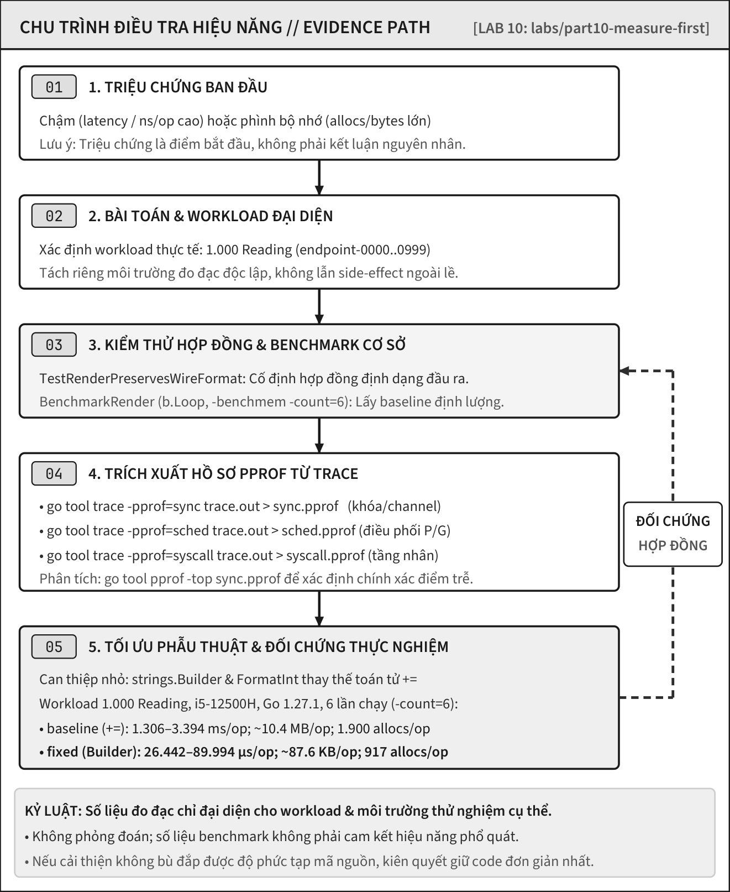

<!-- BOOK_ROLE: FOUNDATION_CORE -->

# Chương 10 — Khi chương trình chậm hoặc phình

Một chương trình bị phán xét là “chậm” hoặc “tốn bộ nhớ” thường kéo theo những nỗ lực tối ưu hóa mù quáng: thay thế gói `fmt` bằng phép cộng chuỗi thủ công, mở thêm hàng loạt goroutine không kiểm soát, hoặc viết lại thuật toán theo những mẹo vặt phức tạp. Những can thiệp này thường làm mã nguồn suy giảm độ trong sáng nghiêm trọng mà không giải quyết được nguyên nhân gốc rễ khiến người dùng hoặc hệ thống phải chờ đợi.

Mô hình tư duy nền tảng của chương này xác lập: tối ưu hóa là việc kiểm chứng một giả thuyết khoa học dưới một khối lượng công việc (workload) mang tính đại diện; một phép đo chỉ trả lời câu hỏi mà nó được thiết kế để đo lường. Benchmark không bảo đảm một dịch vụ mạng sẽ phản hồi nhanh trong mọi tình huống thực tế. Bản ghi CPU profile không phản ánh việc bộ nhớ đang phình to. Dấu vết thực thi (Execution trace) không phải là bản chụp toàn cảnh ngữ nghĩa của mã nguồn. Mỗi công cụ là một dụng cụ đo lường chuyên biệt nhằm thu hẹp không gian suy đoán.

Giả sử `opsprobe` phải dựng báo cáo cho hàng nghìn endpoint và thao tác này chậm trên CI. Câu hỏi đo được là: với cùng đầu vào, `Render` mất bao nhiêu thời gian trôi qua và cấp phát bao nhiêu; CPU profile tập trung ở đâu; bản thay thế có giữ từng byte output không? Thời gian benchmark và mẫu CPU trả lời hai câu hỏi khác nhau, không được gọi `ns/op` là thời gian CPU.

## Bản chất Chuỗi Tối ưu hóa: Từ Source đến Mã máy

Để đặt câu hỏi về hiệu năng, tách quyết định lúc compile khỏi công việc lúc chạy:

| Tầng | Cơ chế cần điều tra | Bằng chứng phù hợp |
| --- | --- | --- |
| Compiler của toolchain đã pin | Inlining, escape analysis, SSA và loại bỏ kiểm tra biên có thể đổi cách thực hiện cùng semantics. | Diagnostic compiler; assembly của cùng source và cờ build. |
| Mã máy của artifact | Instruction, thanh ghi và lời gọi còn lại sau build. | Objdump của đúng binary, không trộn với listing từ build khác. |
| Runtime khi workload chạy | Allocation, GC, lập lịch và I/O tiêu tốn tài nguyên theo đường thực thi. | Benchmark, profile và trace, kèm môi trường và giới hạn phép đo. |

Các tầng này giúp đặt câu hỏi, không phải một pipeline cố định của ngôn ngữ. Inlining là đưa thân hàm vào nơi gọi, không phải “nội suy hàm”; nó có thể làm thay đổi thông tin mà escape analysis nhận được. Compiler có thể dùng thanh ghi, stack, heap hoặc loại bỏ giá trị. Diagnostic cho biết quyết định lúc biên dịch; phép đo cho biết chi phí lúc chạy trên đúng artifact và workload, không thay thế lẫn nhau.

## Phân tích Thoát Bộ nhớ: Ngăn xếp đối đầu Vùng nhớ Động

Escape analysis theo dõi dòng con trỏ và vòng đời vùng nhớ để tránh đặt dữ liệu trên stack khi tham chiếu tới nó có thể sống lâu hơn vùng lưu trữ ấy. Phạm vi tên biến trong khối lệnh không phải vòng đời của dữ liệu: một biến hết scope chưa có nghĩa vùng nhớ phải được chuyển lên heap; ngược lại, con trỏ tới dữ liệu trong frame đã kết thúc không được tồn tại nếu frame ấy bị thu hồi. Kích thước hoặc các giới hạn cấp phát trên stack cũng có thể khiến compiler chọn heap. Đây là quyết định của toolchain, không phải quy luật cú pháp. Mã nguồn `cmd/compile/internal/escape` của bản pin giải thích các ràng buộc này.

Một giá trị `does not escape` có thể nằm trên stack, trong thanh ghi hoặc bị loại bỏ; kết luận này không nói toàn hàm không cấp phát. Trả con trỏ, lưu vào biến toàn cục hay đóng gói vào interface là những đường mà compiler phải phân tích, không phải luật “cứ có pointer là heap”. Kết quả phụ thuộc thân hàm, inlining, kiến trúc và phiên bản. Diagnostic mô tả quyết định build; `allocs/op` mô tả cấp phát bình quân trên workload đã chạy.

Chạy `go build -gcflags=all=-m=2 ./fixed` từ `labs/part10-measure-first` với Go 1.27.1. Trích đoạn dưới rút gọn prefix đường dẫn `fixed/`, lược dòng không liên quan và ngắt dòng cho vừa khung; không phải toàn bộ diagnostic:

~~~text
./render.go:13:6: cannot inline Render:
    function too complex: cost 231 exceeds budget 80
./render.go:16:18: inlining call to
    strings.(*Builder).WriteString
./render.go:18:36: inlining call to strconv.FormatInt
./render.go:13:13: readings does not escape
./render.go:16:18: append(strings.b.buf, strings.s...)
    escapes to heap in Render:
  flow: {heap} ← &{storage for append(...)}:
    from append(strings.b.buf, strings.s...) (spill)
    from strings.b.buf = append(...) (assign)
~~~

Kết quả chẩn đoán này ghi nhận hai quan sát thực nghiệm đối với mã nguồn và chuỗi công cụ của thí nghiệm:

Thứ nhất, tham số `readings []Reading` được xác nhận không thoát (`does not escape`). Bản thân lát cắt không tự quyết định nơi lưu trữ dữ liệu hay cấu trúc mô tả; kết quả này chỉ khẳng định trình biên dịch trong lượt phân tích này nhận thấy không cần đưa giá trị đó ra vùng nhớ heap dựa trên cách thức sử dụng bên trong hàm.

Thứ hai, vùng lưu trữ được tạo bởi lệnh `append` bên trong `strings.Builder` được ghi nhận thoát ra vùng nhớ heap. Đó là dữ liệu thực nghiệm hữu ích giúp giải thích chỉ số `allocs/op`, không phải quy tắc khẳng định mọi lệnh `append` hay mọi thao tác của `Builder` đều bắt buộc phải cấp phát trên heap.

## Tối ưu hóa SSA và Loại bỏ Kiểm tra Biên (Bounds Check Elimination)

Một bước tối ưu hóa quan trọng của tầng sinh mã trung gian SSA (Static Single Assignment) là loại bỏ việc kiểm tra biên truy cập (*bounds check elimination*) khi trình biên dịch chứng minh toán học được chỉ số mảng luôn nằm trong phạm vi hợp lệ. Theo ngữ nghĩa chuẩn của Go, truy cập ngoài biên bắt buộc phải kích hoạt `panic`; lệnh mã máy cụ thể dùng để bảo đảm điều kiện an toàn đó phụ thuộc vào trình biên dịch và kiến trúc vi xử lý. Dữ liệu đầu ra của `ssa/prove` dưới đây là quan sát thực nghiệm trên Go 1.27.1, không đại diện cho cấu trúc mã máy mà mọi bản dựng đều bắt buộc phải tạo ra.

Thực thi cùng lệnh biên dịch với cờ `-gcflags=all=-d=ssa/prove/debug=1`. Cờ `all` sẽ phát sinh thông tin chẩn đoán cho toàn bộ thư viện chuẩn; tiền tố đường dẫn `GOROOT` được rút gọn trong trích đoạn dưới đây nhằm tránh nhầm lẫn các dòng xuất xứ từ `strings.go` với kết quả của thân hàm `Render`:

~~~text
./render.go:15:20: Induction variable: limits [0,?), increment 1
./render.go:15:20: Inverted loop iteration
./render.go:21:19: Disproved Less64
strings/strings.go:987:27: Proved IsInBounds
strings/strings.go:988:38: Proved IsSliceInBounds
~~~

Các dòng tại `render.go` nhận diện biến quy nạp và việc chuyển bộ đếm nội bộ sang đếm giảm. `downward_counting_loop.go` của Go 1.27.1 chỉ thực hiện bước này khi thân vòng lặp không phụ thuộc biến đếm đó; nó không đảo thứ tự các Reading trong output. Các dòng `strings.go` chứng minh điều kiện biên tại chính vị trí thư viện được nêu. Muốn kết luận một bounds check cụ thể của `Render` đã biến mất, phải đối chiếu vị trí source với diagnostic và assembly của cùng artifact; sự xuất hiện của `ssa/prove` không đủ. Giữ bất biến rõ ràng rồi đo, đừng làm source khó đọc để săn một thông báo compiler.

## Cơ chế Thu gom Rác và Đánh đổi Không gian - Thời gian

Bộ thu gom rác trong môi trường thực thi chuẩn của Go 1.27.1 vận hành theo cơ chế đánh dấu - dọn dẹp đồng thời (*concurrent mark-sweep*), kết hợp hàng rào ghi (*write barrier*) và các khoảng dừng toàn hệ thống (*stop-the-world*) được mô tả chi tiết tại `runtime/mgc.go`. Đây là giải pháp kỹ thuật nội bộ của bản cài đặt, không phải đặc tả ngôn ngữ bắt buộc mọi môi trường thực thi của Go phải áp dụng. Tài liệu hướng dẫn GC (Go GC Guide) phác thảo mô hình đánh đổi cơ bản giữa tài nguyên CPU và bộ nhớ; để giải thích chính xác các chi tiết trong phiên bản này, kỹ sư cần đối chiếu thêm mã nguồn gốc và tài liệu phát hành, tuyệt đối không sử dụng tài liệu hướng dẫn như một thước đo thay thế cho bài kiểm thử dịch vụ thực tế.

Tại tệp `runtime/mgcpacer.go` của Go 1.27.1, hằng số `gcBackgroundUtilization = 0.25` thiết lập mục tiêu dành khoảng 25% năng lực của `GOMAXPROCS` cho các tác vụ đánh dấu chạy ngầm trong pha đánh dấu. Điều này không đồng nghĩa bộ thu gom rác luôn chiếm dụng đúng 25% tổng năng lực CPU của toàn bộ tiến trình hay chiếm giữ riêng biệt một bộ xử lý ảo P: các worker chuyên trách, worker bán thời gian và worker nhàn rỗi sẽ cùng tham gia điều phối, trong khi cơ chế hỗ trợ trực tiếp (*mark assist*) phát sinh chi phí riêng. Muốn xác định chính xác khối lượng công việc thực tế tiêu hao bao nhiêu phần trăm CPU cho việc dọn rác, kỹ sư phải trích xuất các chỉ số và hồ sơ hiệu năng của chính lượt chạy đó.

Môi trường thực thi phát sinh các điểm dừng tạm thời tại thời điểm kết thúc dọn dẹp (*sweep termination*) và kết thúc đánh dấu (*mark termination*); khoảng thời gian dừng thực tế cần được đo đạc từ môi trường vận hành thực, tránh ngộ nhận mục tiêu thiết kế lý thuyết thành cam kết bảo đảm độ trễ. Trong pha đánh dấu, mỗi thao tác cấp phát bộ nhớ có thể tạo ra một khoản nợ công việc đánh dấu theo tỷ lệ do bộ điều phối nhịp độ (*pacer*) tính toán. Khi một goroutine phát sinh nợ, luồng hỗ trợ đánh dấu (*mark assist*) có thể buộc chính goroutine đó phải tham gia thực hiện công việc dọn dẹp hoặc chờ cấp tín chỉ. Đây là hướng điều tra quan trọng khi nhận thấy tốc độ cấp phát và độ trễ tăng đồng thời, chứ không đơn thuần là phép so sánh trực giác giữa tốc độ cấp phát và tốc độ đánh dấu hay kết luận võ đoán rằng độ trễ đuôi (*tail latency*) chắc chắn sẽ tăng. Kỹ sư cần đối chiếu dữ liệu vết thực thi, các chỉ số từ `runtime/metrics` và luồng hỗ trợ đánh dấu trong mã nguồn thực tế.

### Green Tea GC là bối cảnh triển khai, không phải contract

GC bắt đầu từ các gốc như stack goroutine và biến toàn cục rồi lần theo con trỏ tới đối tượng còn sống. Write barrier phối hợp việc cập nhật con trỏ với pha đánh dấu để GC không bỏ sót đối tượng cần giữ; nó không thay mutex hoặc công bố dữ liệu an toàn cho goroutine khác. Tăng goroutine hay cấu trúc nhiều con trỏ có thể tăng công việc quét, nhưng phải đo mới biết chi phí đáng kể ở workload nào. Thu hồi đối tượng không đồng nghĩa trả ngay từng byte về hệ điều hành.

Phiên bản Go 1.27.1 tích hợp cơ chế Green Tea GC trong môi trường thực thi. Ý tưởng trọng tâm của thiết kế này là ưu tiên quản lý theo từng trang bộ nhớ hoặc khối liên tục (*page/span*) thay vì coi từng đối tượng đơn lẻ là đơn vị xử lý duy nhất, nhằm tối ưu hóa tính cục bộ truy cập bộ nhớ (*cache locality*). Đây là chi tiết hiện thực nội bộ có thể tiếp tục được tinh chỉnh giữa các phiên bản Go và không phải là thước đo bảo đảm hiệu năng cho một dịch vụ cụ thể. Khi chi phí thu gom rác xuất hiện trong hồ sơ hiệu năng, câu hỏi vận hành cốt lõi vẫn là: tốc độ cấp phát, dung lượng heap đang hoạt động, tập gốc tham chiếu (*root set*), mật độ con trỏ và độ trễ thực tế của khối lượng công việc đang ở mức nào? Hãy đo đạc thực nghiệm trước, rồi mới phân tích xem việc nâng cấp phiên bản Go, cắt giảm thao tác cấp phát hay tái cấu trúc dữ liệu có thực sự đem lại lợi ích.

Hai biến số môi trường chi phối trực tiếp hành vi đánh đổi không gian và thời gian này:

Tham số `GOGC`: Thiết lập điểm cân bằng trong bài toán đánh đổi giữa chi phí CPU và dung lượng bộ nhớ. Trong các phiên bản Go hiện đại, ngưỡng kích hoạt heap mục tiêu còn tính toán cả các gốc tham chiếu: ước lượng gần đúng theo công thức `live heap + (live heap + roots) * GOGC / 100`. Giá trị `GOGC=100` không đồng nghĩa tổng dung lượng heap luôn bằng chính xác hai lần lượng heap đang hoạt động. Việc tăng chỉ số này thường làm giảm tần suất kích hoạt chu kỳ thu gom rác nhưng lại gia tăng phụ phí tiêu hao bộ nhớ; đây là xu hướng định tính cần được kiểm chứng cụ thể trên khối lượng công việc thực tế.

`GOMEMLIMIT`, từ Go 1.19, là giới hạn mềm cho đại lượng bộ nhớ runtime quản lý: `MemStats.Sys - MemStats.HeapReleased`, không chỉ live heap và không phải RSS hay trần cgroup. GC điều chỉnh mục tiêu và nhịp chạy để cố giữ giới hạn, nhưng có thể vượt nó nhằm tránh dành quá nhiều CPU cho GC. Không có cam kết chỉ vượt “tạm thời”: nếu dữ liệu cần giữ đã lớn hơn ngân sách, GC không thể thu hồi nó. Cần đo thêm bộ nhớ ngoài runtime, chừa khoảng dự phòng và sửa budget/workload; setting này không bảo đảm tránh OOM.

## Đo lường Hiệu năng: Benchmark là Hợp đồng Thực nghiệm

Giao ước đo chuẩn (*benchmark contract*) quyết định công việc nào phải được tính giờ. Nếu bài toán chỉ đo riêng hàm `Render`, hãy khởi tạo danh sách `readings` bên ngoài vòng lặp đo; nếu bài toán đo toàn bộ chuỗi đường ống tiếp nhận và xử lý dữ liệu đầu vào, chi phí chuẩn bị tương ứng có thể chính là thành phần cần tính toán. Tránh lược bỏ phần thiết lập theo quán tính máy móc mà vô tình bỏ qua khối lượng công việc thực tế mà hệ thống phải gánh chịu.

Phương thức `b.Loop` xuất hiện từ Go 1.24 và là cú pháp quy chuẩn cho các bài đo chuẩn mới trong phiên bản này; vòng lặp `b.N` truyền thống vẫn tiếp tục được hỗ trợ. Lần gọi đầu tiên sẽ tái lập bộ đếm thời gian (*reset timer*), lần trả về `false` sẽ dừng bộ đếm, nhờ đó các bước thiết lập đặt trước vòng lặp không bị tính vào kết quả đo:

~~~go
func BenchmarkRender(b *testing.B) {
	readings := representativeReadings(1_000)

	for b.Loop() {
		Render(readings)
	}
}
~~~

Lệnh thực thi đo đạc thống kê nhiều lần:

~~~powershell
go test -bench BenchmarkRender -benchmem -count=6 ./fixed
~~~

`ns/op` là thời gian trôi qua mà timer benchmark ghi nhận chia cho số thao tác, không phải riêng thời gian CPU. `B/op` và `allocs/op` là các giá trị cấp phát bình quân runner ghi nhận, không phải live heap hay RSS; một số bình quân làm tròn không chứng minh mọi đường chạy đều không cấp phát. Sáu lượt giúp nhìn độ biến thiên, nhưng không loại bỏ tác động của warmup, tần số CPU hay công việc nền. Tách phép đo có profiling khỏi A/B thời gian để overhead của profiler không nghiêng về một phía.

| Công cụ chẩn đoán | Câu hỏi kỹ thuật được giải đáp | Giới hạn phân tích |
| :--- | :--- | :--- |
| Kiểm thử đơn vị (Unit test) | Đầu ra và mã lỗi có bảo toàn đúng cam kết logic? | Không chứng minh được mã chạy nhanh hơn hay tốn ít RAM hơn. |
| Đo lường chuẩn (Benchmark) | Thao tác này tiêu tốn thời gian và phân bổ bộ nhớ ra sao dưới input chuẩn? | Không phản ánh trực tiếp độ trễ mạng hay tải tương tranh thực tế. |
| Phân tích CPU (CPU profile) | Sample CPU tập trung ở stack/hàm nào? | Không đo trực tiếp thời gian chờ khi goroutine đã block; CPU dùng cho syscall, spin hay đường khóa vẫn có thể xuất hiện. |
| Phân tích Bộ nhớ (Heap profile) | Đường dẫn mã nguồn nào chịu trách nhiệm cho các khối cấp phát trên heap? | Dữ liệu mang tính lấy mẫu thống kê, không ghi nhận từng biến riêng lẻ. |
| Dấu vết thực thi (Execution trace) | Sự kiện runtime và chuyển trạng thái goroutine nào xảy ra trong khoảng đã ghi? | Kích thước và overhead tùy workload, thời gian ghi và version; cần ngân sách, không coi trace là diễn giải mọi semantics của source. |

## Phân tích CPU và Bộ nhớ (pprof)

Khi benchmark phát hiện điểm nghẽn hiệu năng, công cụ trích xuất profile (`pprof`) giúp định vị chính xác vị trí tích lũy chi phí trong cây gọi hàm:

~~~powershell
go test -run '^$' -bench BenchmarkRender `
  -cpuprofile cpu.out -memprofile mem.out ./fixed
go tool pprof -top cpu.out
~~~

Chỉ số `flat` ghi nhận chi phí tiêu tốn trực tiếp bên trong thân hàm, trong khi chỉ số `cum` (cumulative) ghi nhận tổng chi phí tích lũy của hàm đó cùng toàn bộ các hàm con mà nó triệu gọi. Một hàm có `flat` nhỏ nhưng `cum` lớn là dấu hiệu cho thấy nó đang dẫn lối vào một chuỗi thao tác tiêu tốn nhiều tài nguyên.

Nếu nghi ngờ goroutine bị giữ lại ngoài dự kiến, Go 1.27 bổ sung hồ sơ hiệu năng `goroutineleak` trong gói `runtime/pprof` cùng điểm cuối tương ứng của `net/http/pprof`, không còn cần cờ thử nghiệm như ở Go 1.26. Cơ chế này rà soát nhóm trạng thái chờ mà môi trường thực thi xác định không còn khả năng được đánh thức; nó không thể phát hiện mọi dạng rò rỉ và không tự động thu hồi goroutine. Một hồ sơ hiệu năng không ghi nhận điểm nghẽn vẫn đòi hỏi kỹ sư phải đối chiếu bản trích xuất trạng thái goroutine (*goroutine dump*), quyền sở hữu kênh và đường dẫn hủy bỏ tác vụ như đã thảo luận ở Chương 09. Khi mở giao diện quan sát vết thực thi, lệnh `go tool trace -http=:6060` từ Go 1.27 mặc định chỉ lắng nghe trên giao diện nội bộ `localhost`; nếu muốn kết nối từ xa, kỹ sư phải chỉ định địa chỉ tường minh. Tránh mở cổng công khai cho các hồ sơ hay vết thực thi chứa dữ liệu nhạy cảm chỉ nhằm mục đích thuận tiện.

## Ca điều tra: tăng bộ nhớ nhưng chưa biết ai đang giữ

Giả sử một tiến trình tiếp nhận khối dữ liệu tải trọng (*payload*) 4 MiB cho mỗi phần tử. Sau mỗi chu kỳ xử lý hai phần tử, chỉ số `TotalAlloc` tăng lên rõ rệt; người trực ca vận hành có xu hướng muốn gọi cưỡng bức bộ thu gom rác hoặc vội vàng kết luận rằng hệ thống bị rò rỉ bộ nhớ. Kỹ sư cần một câu hỏi chẩn đoán chặt chẽ hơn: các lượt cấp phát bộ nhớ đó chỉ đơn thuần đã diễn ra trong quá khứ, hay các đối tượng vẫn đang tồn tại sau khi công việc đã hoàn tất, và thành phần nào đang duy trì tham chiếu tới chúng? Bài thực hành độc lập `labs/part10-resource-retention` chủ ý cô lập đường dẫn lưu giữ dữ liệu khỏi giao thức HTTP, cơ sở dữ liệu và công cụ kiểm thử nhằm bảo đảm câu trả lời không bị nhiễu bởi nhóm kết nối (*connection pool*) hay bộ nhớ đệm (*cache*) của các thư viện.

Khởi chạy từng chế độ khảo sát trong một tiến trình riêng biệt, giữ nguyên cấu hình phần cứng, chuỗi công cụ biên dịch và các tham số đo đạc. Từ thư mục của bài thực hành, lệnh sau thực thi trên PowerShell; bổ sung cờ `-fixed` rồi thay đổi thư mục đích để ghi nhận dữ liệu bản khắc phục, tránh ghi đè lên hồ sơ hiệu năng của bản lỗi ban đầu:

~~~powershell
go build -o artifacts/investigate.exe ./cmd/investigate
./artifacts/investigate.exe -mode=slice `
  -cycles=4 -items=2 -bytes=4194304 -limit=2 `
  -out=artifacts/slice-baseline
go tool pprof -inuse_space -top `
  artifacts/slice-baseline/04.heap.pprof
go tool pprof -alloc_space -top `
  artifacts/slice-baseline/04.heap.pprof
~~~

Thay đổi chế độ sang `cache`, `churn`, `goroutine` hoặc `ticker` nhằm duy trì cùng nhịp độ công việc nhưng kiểm chứng các cơ chế hoạt động khác nhau. Chế độ `churn` cấp phát rồi lập tức giải phóng tải trọng mà không lưu giữ kết quả; cờ `-fixed` không làm thay đổi luồng thực thi của chế độ đối chứng này. Các chế độ `goroutine` và `ticker` không cấp phát tải trọng theo cờ `-bytes`: chúng khởi tạo các worker để điều tra vòng đời quản lý tác vụ thay vì mô phỏng việc xử lý 4 MiB dữ liệu. Tài liệu hướng dẫn ghi nhận đầy đủ giới hạn của khối lượng công việc cũng như cách thức chạy riêng biệt cho chế độ ngữ cảnh `context`.

Trước khi phân tích mã nguồn, hãy đối chiếu bảng số liệu thực nghiệm được đo đạc ngày 09/10/2026 trên môi trường `go1.27.1 windows/amd64`. Các dãy số thể hiện kết quả quan sát sau chu kỳ 1 đến 4; tại mỗi chu kỳ, môi trường bài thực hành chủ động kích hoạt hai lượt thu gom rác trước khi ghi nhận số liệu. Người kỹ sư cần xác định nên mở hồ sơ vùng nhớ heap hay bản trích xuất goroutine cho từng dòng dữ liệu, và giả thuyết nào hiện vẫn còn thiếu bằng chứng xác thực?

@table Các triệu chứng dẫn tới những phép đo khác nhau

| Mode | Quan sát bản lỗi hoặc đối chứng | Quan sát bản sửa |
| --- | --- | --- |
| Slice | Entry 2, 4, 6, 8; `HeapAlloc` 8.35, 16.35, 24.35, 32.35 MiB | Cùng số entry; `HeapAlloc` xấp xỉ 0.35 MiB |
| Cache | Entry 2, 4, 6, 8; `HeapAlloc` 8.35, 16.35, 24.35, 32.36 MiB | Entry luôn 2; `HeapAlloc` xấp xỉ 8.35–8.36 MiB |
| Churn | Entry 0; `HeapAlloc` xấp xỉ 0.35 MiB | Không có đường sửa riêng; đây là đối chứng |
| Receive | `NumGoroutine`: 3, 5, 7, 9 sau khi bên gọi hủy ngữ cảnh | Luôn 1, đã chờ `done` từng worker |
| Ticker | `NumGoroutine`: 3, 5, 7, 9 sau khi bên gọi hủy ngữ cảnh | Luôn 1, đã chờ `done` từng worker |

Các con số làm tròn ở trên không phải là ngưỡng kiểm thử tuyệt đối và không đại diện cho ngân sách bộ nhớ phổ quát. Bài thực hành thiết lập `MemProfileRate = 1` nhằm theo dõi chi tiết từng thao tác cấp phát trong một khối lượng công việc quy mô nhỏ; bản thân việc ghi chép hồ sơ hiệu năng và trích xuất thông tin goroutine cũng tự tiêu tốn bộ nhớ. Do đó, chỉ số `TotalAlloc` bao gồm cả chi phí quan sát chứ không đồng nhất với tổng dung lượng tải trọng xử lý. Trong điều kiện vận hành thông thường, môi trường thực thi chỉ lấy mẫu thống kê; hồ sơ hiệu năng luôn có độ trễ nhất định khi ghi nhận việc cấp phát hoặc giải phóng ô nhớ như lưu ý trong tài liệu `runtime.MemProfile`. Việc kích hoạt hai lượt thu gom rác là lựa chọn có chủ đích để chuẩn hóa môi trường thí nghiệm, tuyệt đối không phải phương thức vận hành hệ thống thực tế nhằm che đậy hiện tượng rò rỉ.

### Từ vị trí cấp phát tới đường giữ dữ liệu

Tại chế độ lát cắt (`slice`), chỉ số dung lượng đang sử dụng (`inuse_space`) sau chu kỳ 4 ghi nhận 32 MiB tại vị trí `main.payload`. Với cùng khối lượng công việc trên bản khắc phục, việc lọc ngăn xếp theo `main.payload|fixed.Prefix` cho thấy chỉ còn 128 byte tại `fixed.Prefix`. Tuy nhiên, chỉ số tổng dung lượng cấp phát tích lũy (`alloc_space`) vẫn ghi nhận 32 MiB tại `main.payload` trên cả hai phiên bản: cả hai đều đã tiếp nhận tám tải trọng, điểm khác biệt duy nhất nằm ở khối lượng dữ liệu bị giữ lại sau khi hoàn tất xử lý. Chế độ `churn` cũng ghi nhận 32 MiB đã cấp phát tại vị trí này nhưng không còn tải trọng nào tồn tại trong hồ sơ quan sát. Chỉ số `alloc_space` phản ánh tổng chi phí cấp phát lũy kế, không biểu thị lượng dữ liệu còn sống và không phải là công cụ phát hiện rò rỉ bộ nhớ.

Hồ sơ hiệu năng chỉ dẫn tới vị trí đối tượng được khởi tạo trên mã nguồn, chứ không tự động phác họa chuỗi tham chiếu đang lưu giữ đối tượng đó. Chỉ khi phân tích chi tiết hàm `Prefix`, kỹ sư mới xác định được đường dẫn từ danh sách `views` tới lát cắt tiền tố, rồi dẫn tới mảng nền kích thước lớn; biểu thức cắt lát ba chỉ số không hề thực hiện sao chép dữ liệu. Việc chủ động sao chép tại ranh giới chuyển giao sẽ loại bỏ hoàn toàn đường dẫn lưu giữ không mong muốn này. Đây chính là giải pháp khắc phục dựa trên bài kiểm thử chia sẻ mảng nền (*aliasing*) đã được thiết lập ở Chương 02, chứ không phải can thiệp vào bộ thu gom rác. Nếu một tham chiếu khác vẫn tiếp tục tồn tại, kết quả đo đạc sẽ thay đổi; do đó kỹ sư cần bảo toàn khối lượng công việc và quyền sở hữu trong bộ tạo mẫu cùng các bằng chứng thực nghiệm.

Tại chế độ bộ đệm (`cache`), hồ sơ hiệu năng của bản lỗi cũng định vị tới `main.payload`: 32 MiB vẫn sống sau bốn chu kỳ hoạt động. Bản khắc phục theo cơ chế FIFO chỉ còn giữ 8 MiB tải trọng tại `fixed.(*Cache).Put`, bởi bộ đệm chỉ sở hữu bản sao độc lập của hai mục nhập gần nhất. Trong chỉ số `alloc_space`, riêng hàm `Put` đã cấp phát 32 MiB phục vụ việc sao chép; bản khắc phục có thể phát sinh nhiều lượt cấp phát hơn nhưng lại duy trì ít ô nhớ sống hơn. Tuyệt đối không lựa chọn một phương án cài đặt chỉ vì quan sát thấy chỉ số `B/op` nhỏ hơn. Việc đối chiếu các mục nhập trong bảng ánh xạ với giao ước thiết kế ở Chương 03 giúp phân định mức tăng trưởng nào là hợp thức: tám khóa dữ liệu trong kho lưu trữ có chủ đích và tám khóa trong bộ đệm cam kết giới hạn tối đa hai phần tử có thể tạo ra cùng một biểu đồ vùng nhớ, nhưng mang bản chất kỹ thuật hoàn toàn đối lập.

### Goroutine không cần nhiều heap để làm lỗi vòng đời

Dãy số 3, 5, 7, 9 gợi mở giả thuyết rằng mỗi chu kỳ hoạt động đang lưu giữ lại hai worker, nhưng chưa đủ để khẳng định chúng đã bị rò rỉ. Mở tệp trích xuất trạng thái `04.goroutines.txt`: chế độ nhận ghi nhận tám ngăn xếp trong hàm `baseline.Wait.func1` đang ở trạng thái chờ kênh; chế độ định thời ghi nhận tám ngăn xếp trong `baseline.RunTicker.func1` đang bị phong tỏa tại mệnh đề `select`. Bước tiếp theo là phân tích mã nguồn và giao ước: bên sở hữu đã phát tín hiệu hủy, thao tác nhận không lắng nghe ngữ cảnh `context`, trong khi vòng lặp định thời chỉ chờ đợi nhịp đồng hồ hoặc kênh giải phóng dự phòng của bài thực hành. Hệ thống hoàn toàn thiếu đường dẫn hủy tác vụ nghiệp vụ để cho phép hàm kết thúc trở về. Số lượng worker gia tăng ổn định qua từng chu kỳ kết hợp cùng các điểm chờ vô hạn đó mới giúp kỹ sư kết nối chuẩn xác triệu chứng quan sát với nguyên nhân gốc rễ.

Bản khắc phục chủ động chờ tín hiệu từ kênh `done` sau khi phát lệnh hủy trước khi tiến hành đo đạc, bảo đảm các worker đã thực sự kết thúc thay vì chỉ phỏng đoán hy vọng bộ điều phối sẽ sớm bố trí tài nguyên. Khi kết thúc thí nghiệm, khung điều phối giải phóng toàn bộ worker của bản lỗi rồi đồng bộ hóa; số lượng goroutine trở về mức 1 trong lượt chạy thực tế. Đây là minh chứng rõ ràng cho việc kiểm soát trọn vẹn quy trình dọn dẹp tài nguyên, chứ không dựa dẫm vào việc môi trường thực thi tự động chấm dứt goroutine. Bài kiểm thử với hàm phản hồi không hợp tác vẫn đòi hỏi cơ chế giải phóng chuyên biệt như đã phân tích ở Chương 09: nếu dữ liệu trích xuất cho thấy tiến trình tắc nghẽn bên trong hàm phản hồi, việc chỉ sửa đổi mệnh đề `select` ở vòng lặp bên ngoài là hoàn toàn không đủ.

Chế độ ngữ cảnh làm sáng tỏ giới hạn của bộ đếm số lượng goroutine. Với 512 ngữ cảnh con được thiết lập thời hạn kết thúc (*deadline*) một giờ, phiên bản bỏ quên thao tác gọi `cancel` vẫn chỉ ghi nhận duy nhất một goroutine trong suốt lượt đo. Tuy nhiên, hồ sơ số lượng đối tượng đang sử dụng (`inuse_objects`) lại lưu giữ 1024 đối tượng trực tiếp tại `context.WithDeadlineCause` ở chu kỳ 4; bản khắc phục không còn bất kỳ đối tượng trực tiếp nào tại vị trí đó trong hồ sơ đo đạc. Cần tránh suy diễn con số 1024 đồng nghĩa với 1024 ngữ cảnh: một lời gọi hàm có thể khởi tạo nhiều cấu trúc đối tượng nội bộ, đồng thời một số điểm cấp phát của bộ định thời hoặc ngữ cảnh cha vẫn có thể xuất hiện trong hồ sơ. Bài kiểm thử vòng đời và mã nguồn của gói `context` ở Chương 12 sẽ làm rõ nguyên lý ngữ cảnh cha duy trì tham chiếu tới ngữ cảnh con cho đến khi bị hủy bỏ hoặc thời hạn kết thúc chạm ngưỡng. Sau khi khung điều phối hủy ngữ cảnh cha, các khoản cấp phát trực tiếp tại vị trí này biến mất khỏi hồ sơ quan sát. Thiếu sót trong việc gọi `cancel` ở trường hợp này là hành vi lưu giữ thừa thãi ngoài vòng đời yêu cầu, chứ không đồng nghĩa với nhận định sai lầm rằng mọi ngữ cảnh bị lỗi đều tồn tại vĩnh viễn.

### Heap đã giảm, vì sao bộ nhớ process chưa giảm tương ứng?

Kỹ sư cần phân định rạch ròi giữa số liệu đo đạc thực tế và các nhận định mang tính suy diễn. Chỉ số `HeapAlloc` phản ánh tổng số byte của các đối tượng trên heap mà môi trường thực thi tính toán đang hoạt động; `HeapInuse` biểu thị dung lượng byte trong các khối bộ nhớ (*span*) đang được sử dụng, có thể bao gồm cả những khoảng trống chưa chứa đối tượng. Chỉ số `HeapSys` là tổng bộ nhớ heap mà môi trường thực thi đã yêu cầu cấp phát từ hệ điều hành, trong khi `HeapReleased` ghi nhận dung lượng đã hoàn trả lại cho hệ thống. Các chỉ số này không đồng nhất với kích thước bộ nhớ thực tế (Resident Set Size - RSS), và bài thực hành không tiến hành đo lường RSS. Chỉ số RSS hay tập làm việc (*working set*) còn chịu ảnh hưởng sâu sắc từ hệ điều hành, dung lượng ngăn xếp, chi phí nội bộ của môi trường thực thi và các vùng nhớ bổ trợ khác; việc dung lượng đối tượng giảm không bảo đảm biểu đồ tiêu thụ bộ nhớ của tiến trình sẽ suy giảm ngay lập tức một lượng tương ứng.

Trong chế độ lát cắt bị lỗi, sau khi khung điều phối loại bỏ toàn bộ các góc nhìn (*views*), chỉ số `HeapAlloc` giảm mạnh từ 33,924,560 xuống 369,936 byte nhưng `HeapSys` vẫn giữ nguyên ở mức 41,680,896 byte trong suốt lượt chạy. Đây là bằng chứng thực nghiệm cụ thể nhắc nhở rằng không thể vội vàng kết luận bộ thu gom rác chưa hoạt động chỉ dựa trên phần dung lượng heap đã xin từ hệ điều hành. Đồng thời cũng không thể quy chụp toàn bộ phần chênh lệch đó là RSS: đó là một đại lượng hoàn toàn khác biệt chưa được đo đạc. Nếu nghi ngờ nhu cầu sử dụng bộ nhớ cao là hợp lệ, hãy kiểm tra quy mô dữ liệu đang phục vụ cùng hạn mức ngân sách; nếu nghi ngờ phát sinh nhiều cấp phát tạm thời hoặc chu kỳ thu gom rác chưa hoàn tất, hãy so sánh giữa các chu kỳ sau khi khối lượng công việc đã lắng xuống; nếu đối tượng vẫn tồn tại ngoài phạm vi cần thiết, hãy truy vết thành phần sở hữu hoặc các tham chiếu đang giữ đối tượng; nếu số lượng tệp tin mở hoặc kết nối cạn kiệt trong khi heap vẫn ổn định, hãy đo lường trực tiếp tài nguyên đó thay vì tiếp tục nhìn vào vùng nhớ heap.

Một kết luận kỹ thuật có giá trị bảo vệ khoa học đòi hỏi phải xâu chuỗi một cách logic: khối lượng công việc đại diện, vị trí cấp phát hoặc ngăn xếp chờ đợi, mã nguồn làm rõ đường dẫn duy trì tham chiếu, cùng bài kiểm thử giao ước và kết quả đo đạc lặp lại sau khi sửa đổi. Mỗi bằng chứng thực nghiệm chỉ trả lời cho một câu hỏi riêng biệt. Một bản chụp tức thời có giá trị cao, một lần chỉ số RSS không suy giảm hay một báo cáo kiểm tra tĩnh hoàn toàn sạch lỗi đều không thể thay thế cho toàn bộ chuỗi bằng chứng khoa học nói trên.

## Đối chiếu G/M/P với Execution Trace: Nhìn vào nhịp đập của Runtime

Chương 09 giới thiệu G là goroutine, M là luồng hệ điều hành, P là tài nguyên để chạy Go gắn với `GOMAXPROCS`. Đọc `findRunnable` và `stealWork` trong `runtime/proc.go` của Go 1.27.1: việc sẵn sàng chạy có thể nằm trong hàng đợi cục bộ của P hoặc hàng đợi chung; một P thiếu việc có thể lấy việc từ P khác. Netpoll đưa công việc chờ mạng trở lại trạng thái có thể chạy. Preemption tạo cơ hội nhường thực thi, nhưng không cam kết một goroutine sẽ chạy trước hạn nghiệp vụ hay theo FIFO. Đây là implementation giúp giải thích trace, không phải phép chứng minh công bằng hoặc tính đúng đắn của chương trình. Chi tiết syscall được phân biệt ở dưới.

CPU profile lấy mẫu thời gian CPU, nên không trực tiếp đo thời gian goroutine đã bị chặn. Không vì thế mà `pprof` “bất lực”: block/mutex profile có thể giúp điều tra một số khoảng chờ nếu được bật, còn trace đặt các chuyển trạng thái lên cùng dòng thời gian. CPU thấp chưa chứng minh mọi goroutine đều đang chờ hoặc xác định nguyên nhân dịch vụ chậm; phải chọn bằng chứng phù hợp.

Bản chất của Execution Trace là ghi lại một tập rộng các sự kiện runtime phát sinh trong quá trình thực thi: thời điểm goroutine chuyển đổi trạng thái, thời điểm P được gắn kết hay tách rời khỏi M, các pha thu gom rác GC, và hoạt động của các điểm dừng đồng bộ hay lời gọi hệ thống. Trace không phải là một bản ghi toàn tri ghi lại mọi hành vi phần cứng. Trong mô hình trace của Go (đối chiếu `internal/trace.GoState`), runtime quản lý các trạng thái như `GoUndetermined`, `GoNotExist`, `GoRunnable`, `GoRunning`, `GoWaiting`, và `GoSyscall`. Để phục vụ việc phân tích triệu chứng vận hành, ta thường tập trung quan sát một tập con các trạng thái chủ đạo:

Một là, `GoRunning`: Goroutine đang trực tiếp chiếm giữ một luồng M trên một bộ xử lý ảo P để thực thi mã máy.

Hai là, `GoRunnable`: Goroutine đã sẵn sàng chạy (vừa được tạo ra, vừa nhận được dữ liệu, hoặc vừa được đánh thức) nhưng đang nằm trong hàng đợi chờ P tiếp nhận. Thời gian `Runnable` cao (scheduler latency) là tín hiệu chỉ báo để điều tra áp lực lập lịch hoặc tranh chấp tài nguyên khi lượng công việc sẵn sàng lớn hơn số bộ xử lý ảo (`GOMAXPROCS`) hiện có, chứ không tự nó kết luận nguyên nhân gốc rễ.

Ba là, `GoWaiting`: Goroutine chủ động nhường quyền thực thi và chờ đợi một điều kiện đồng bộ hóa: chờ kênh truyền, chờ khóa `sync.Mutex`, chờ `sync.WaitGroup`, hoặc chờ sự kiện mạng từ bộ thăm dò mạng (*network poller*). Khi chờ kênh hay khóa mutex, runtime chuyển trạng thái goroutine sang chờ trong bộ điều phối người dùng mà không nhất thiết phải kéo theo việc chuyển ngữ cảnh luồng hệ điều hành ngay lập tức.

Bốn là, `GoSyscall`: runtime đã chuyển G sang trạng thái gọi hệ thống; trạng thái này không tự chứng minh syscall đã chặn lâu. `entersyscall` cho phép P được thu hồi để M khác chạy Go, còn đường `entersyscallblock` dành cho lời gọi biết sẽ chặn có thể bàn giao P ngay. Với I/O mạng do netpoll hỗ trợ, G thường chờ theo mô hình `GoWaiting` mà không giữ riêng một M bị chặn cho cả thời gian chờ. Không phải mọi syscall hay mọi thiết bị đều đi qua netpoll. Mark assist là một hướng điều tra khác khi cấp phát tạo nợ đánh dấu; phải đọc sự kiện và stack thực tế thay vì suy nguyên nhân từ một tên trạng thái.

Để phân tích định lượng các điểm nghẽn mà không suy diễn cảm tính từ một trạng thái đơn lẻ, công cụ `go tool trace` hỗ trợ trích xuất bốn hồ sơ pprof chuyên biệt từ dữ liệu trace: `sync` (độ trễ do rào cản đồng bộ như mutex, waitgroup, kênh truyền), `sched` (độ trễ điều phối từ lúc goroutine sẵn sàng đến lúc được chạy), `syscall` (độ trễ chặn tại các lời gọi hệ thống), và `net` (độ trễ chờ I/O mạng từ bộ thăm dò mạng).

Trong `labs/part10-measure-first`, ta có thể thu thập trace thực tế khi chạy kiểm thử xử lý theo lô đồng thời (`TestRenderConcurrentBatchWorkload`):

~~~powershell
go test -run TestRenderConcurrentBatchWorkload `
  -trace trace.out ./fixed
go tool trace trace.out
~~~

Giao diện đồ họa trên trình duyệt (mở qua lệnh `go tool trace trace.out`, mặc định chỉ lắng nghe trên localhost) hiển thị các dòng thời gian của từng bộ xử lý ảo P, cho thấy thời điểm các worker goroutine chạy song song trên các bộ xử lý và các khoảng dừng của hệ thống.

Để trích xuất các hồ sơ định lượng phục vụ phân tích, ta sử dụng cờ `-pprof` của `go tool trace`:

~~~powershell
go tool trace -pprof=sync trace.out > sync.pprof
go tool trace -pprof=sched trace.out > sched.pprof
go tool trace -pprof=syscall trace.out > syscall.pprof
go tool pprof -top sync.pprof
~~~

Các lệnh `>` ghi profile nhị phân ở trên yêu cầu PowerShell 7.4 trở lên hoặc shell chuyển hướng byte nguyên vẹn. Windows PowerShell cũ có thể chuyển output native thành text và làm hỏng profile; không dùng Out-File cho dữ liệu này. Khung kiểm chứng của lab ghi trực tiếp stdout bytes bằng subprocess.

Lượt trace ngày 11/10/2026 trên Go 1.27.1 `windows/amd64` ghi nhận `sync.(*WaitGroup).Wait` và `runtime.chanrecv1` trong hồ sơ `sync`. Hồ sơ `sched` có stack đánh thức bên chờ qua `WaitGroup.Add/Done`, ngoài chi phí khởi động trace và khung test; không được gán toàn bộ cho worker mới tạo. Hồ sơ `syscall` có đường `syscall.WriteFile` từ bộ ghi trace và output test. Hồ sơ `net` không có sample vì fixture không chạy workload mạng. Đây là các khoảng chờ quan sát được của chính harness, không phải bằng chứng Render có lỗi CPU, I/O hoặc lập lịch trong production.

Dấu vết thực thi không phải là bằng chứng xác nhận ngữ nghĩa đúng đắn của logic nguồn hay cam kết về độ trễ trên môi trường sản xuất. Trace là công cụ phân loại triệu chứng: khi gặp vấn đề về hiệu năng, các hồ sơ pprof trích xuất từ trace giúp kỹ sư định hướng bước can thiệp tiếp theo dựa trên dữ liệu đo đạc thực nghiệm thay vì phỏng đoán.

@figure Từ triệu chứng đến giả thuyết có thể bác bỏ: chọn benchmark, profile hoặc trace theo câu hỏi, thay đổi nhỏ rồi đo lại A/B cùng workload. Kiểm tra đầu ra là một gate riêng, không phải chứng minh mọi hành vi đều đúng.

## Điển cứu thực tế: Phân tích bài toán nối chuỗi

Thư mục `labs/part10-measure-first` duy trì hai cách hiện thực cho cùng một yêu cầu định dạng văn bản: phương án cơ sở (`baseline`) nối chuỗi bằng toán tử `+=` lặp lại; phương án tối ưu (`fixed`) sử dụng `strings.Builder` và `strconv.FormatInt`.

Khối lượng công việc gồm 1.000 phần tử `Reading`, từ `endpoint-0000` đến `endpoint-0999`, được khởi tạo hoàn toàn bên ngoài vòng lặp đo. Lượt kiểm chứng cục bộ ngày 01/10/2026 sử dụng Go 1.27.1, nền tảng `windows/amd64`, vi xử lý CPU 12th Gen Intel Core i5-12500H, công cụ đo ghi nhận hậu tố mặc định `-16`, thực thi sáu lần lặp lại trên cùng cấu hình máy, phiên bản Go, khối lượng công việc và giao ước đo lường. Khoảng giá trị dưới đây thể hiện mức tối thiểu và tối đa (min–max) của sáu kết quả `ns/op`, không phải khoảng tin cậy thống kê (*confidence interval*). Độ phân tán số liệu cho thấy kỹ sư cần thận trọng khi suy luận tỷ lệ tăng tốc (*speedup*); đây không phải là phép đo độ trễ vận hành của toàn bộ dịch vụ:

| Phương án hiện thực | Khoảng thời gian mỗi thao tác | Cấp phát do công cụ đo ghi nhận |
| :--- | :--- | :--- |
| `baseline` (Toán tử `+=`) | 1.306–3.394 ms/op | 10,443,876–10,443,996 B/op; 1,900–1,901 allocs/op |
| `fixed` (`strings.Builder`) | 26.442–89.994 µs/op | 87,600–87,608 B/op; 917 allocs/op |

Trong mã nguồn của phương án cơ sở `baseline`, mỗi thao tác cộng chuỗi đều lưu giữ lại chuỗi kết quả dài hơn cho lượt lặp tiếp theo. Mã nguồn tầng thực thi của Go 1.27.1 tại `runtime/string.go`, kết hợp cùng số liệu cấp phát từ bài đo chuẩn, giúp làm rõ chi phí tái cấp phát liên tục khi dựng dữ liệu chuỗi; phương án `fixed` gom toàn bộ kết quả vào cấu trúc `strings.Builder`. Không thể vội vã suy đoán từ kết quả này rằng mọi phép cộng chuỗi `+` đều gây cấp phát bộ nhớ hay áp đặt một con số thông lượng cố định. Khi trích xuất hồ sơ CPU bằng lệnh nêu trên, hãy đối chiếu trực tiếp các mẫu thu thập của chính lượt chạy với đường dẫn nối hoặc sao chép chuỗi, tránh sử dụng lại tỷ lệ phần trăm từ một hồ sơ không còn tạo tác lưu trữ để kiểm chứng.

Kết quả kiểm thử đầu ra và bài đo chuẩn củng cố cho quyết định lựa chọn `strings.Builder` đối với khối lượng công việc này: định dạng văn bản được bảo toàn nguyên vẹn và số lượng cấp phát quan sát được giảm rõ rệt. Tuy nhiên, nó chưa phải bằng chứng xác nhận dịch vụ trên môi trường sản xuất sẽ phản hồi nhanh hơn, bởi bài đo chưa tính đến yếu tố mạng, tải tương tranh đồng thời cũng như trải nghiệm người dùng cuối.

## Tối ưu hóa Dựa trên Hồ sơ Vận hành (PGO)

Từ Go 1.20 và hoàn thiện ở các phiên bản gần đây, Go hỗ trợ kỹ thuật Tối ưu hóa Dựa trên Hồ sơ (Profile-Guided Optimization - PGO).

Trong quy trình biên dịch thông thường, compiler chỉ có cái nhìn tĩnh về mã nguồn, không biết nhánh rẽ nào trong câu lệnh `if` hay phương thức nào của `interface` được gọi thường xuyên nhất trong thực tế. Với PGO, kỹ sư thu thập một tệp CPU profile đại diện (`default.pgo`) từ hệ thống production đang chịu tải thực. Trình biên dịch nạp hồ sơ này vào pass phân tích để:

Một là, profile có thể giúp compiler ưu tiên inlining ở đường nóng. Ngưỡng và heuristic không phải API ổn định; cần diagnostic và benchmark của đúng bản build, không mặc định một hàm chắc chắn được inline.

Hai là, profile có thể mở ra cơ hội devirtualization khi compiler chứng minh được điều kiện phù hợp. Đó là tối ưu hóa có thể có, không phải lời hứa rằng mọi interface call nóng sẽ thành lời gọi tĩnh hay luôn inline xuyên package.

Tuy nhiên, kỹ thuật PGO chỉ thực sự đáng tin cậy khi hồ sơ hiệu năng phản ánh đúng khối lượng công việc đại diện của môi trường mục tiêu. Cần ưu tiên thu thập hồ sơ từ môi trường sản xuất; trong trường hợp bất khả thi, môi trường thử nghiệm (*staging*) hoặc các bài đo chuẩn có độ bao phủ đại diện cũng có thể được cân nhắc. Các bài đo vi mô (*microbenchmarks*) với phạm vi hẹp thường mô phỏng quá ít hành vi thực tế của chương trình để tạo ra một hồ sơ PGO chất lượng; hãy chỉ sử dụng chúng để kiểm chứng các giao ước nhỏ. Dù sử dụng nguồn dữ liệu nào, việc đo đạc lại kết quả kiểm chứng toàn trình (*end-to-end*) sau khi áp dụng tối ưu hóa vẫn là yêu cầu bắt buộc.

### Thử A/B: profile có giúp chính workload này không?

Để kiểm tra PGO bằng số liệu thay vì chỉ mô tả khả năng của nó, trong `labs/part10-measure-first` hãy chạy phép thử bằng Python standard library và đúng Go đã pin:

~~~powershell
python pgo_ab.py --go 'D:/Golang/.tools/go1.27.1/bin/go.exe' `
  --out artifacts/pgo-ab-new
~~~

Đổi đường dẫn Go theo máy; thư mục output phải chưa tồn tại để không ghi đè evidence cũ. Đây là A/B **cùng source `fixed.Render`** khi tắt và bật PGO, không phải so hai thuật toán `baseline` và `fixed`. Script thu CPU profile ba giây bằng `-pgo=off` trên 1.000 Reading đã dựng ngoài vòng đo, build hai test binary với `-pgo=off` và `-pgo=<profile>`, rồi kiểm tra output cả hai. Profile chỉ đại diện cho bài toán Render này, không cho toàn bộ service. Lệnh compiler và SHA của source, profile, binary được lưu để xác định artifact thực sự đã dùng.

Sau một lượt warmup mỗi phía không đưa vào thống kê, script chạy sáu cặp luân phiên thứ tự A/B, mỗi mẫu 400 ms, `GOMAXPROCS=2`. Khi đo A/B không bật profiler. Lượt thực chạy ngày 11/10/2026, Go 1.27.1 `windows/amd64`, ghi nhận:

| Build cùng Render | Min–max ns/op, sáu mẫu | Median ns/op |
| --- | --- | --- |
| PGO tắt | 44,514–49,137 | 47,083 |
| PGO dùng profile vừa thu | 42,463–50,011 | 46,737.5 |

Hai khoảng chồng lấn; chênh lệch median nhỏ không đủ để nhận PGO là một cải thiện có ý nghĩa. Đây chỉ là thống kê mô tả, chưa có kiểm định ý nghĩa thống kê; máy vẫn có tải nền và chưa đo toàn service. Từng mẫu cùng raw stdout/stderr được giữ trong evidence của checkpoint, không thay bảng số liệu lịch sử phía trên. Phép thử có giá trị vì cho phép bác bỏ kỳ vọng “bật PGO là chắc chắn nhanh hơn”, chứ không vì buộc phải tạo một tỷ lệ tăng tốc đẹp.

## Kỷ luật Tối ưu hóa Kỹ thuật

Với một đề xuất tối ưu hóa, bốn bước sau giữ câu hỏi và bằng chứng đi cùng nhau:

Một là, xác định khối lượng công việc đại diện phản ánh đúng bài toán thực tế.

Hai là, thiết lập kiểm thử đơn vị để cố định hợp đồng kết quả đầu ra không bị biến dạng.

Ba là, kết hợp bài đo chuẩn, phân tích thoát bộ nhớ và công cụ đo hồ sơ hiệu năng để thu thập số liệu định lượng trước khi can thiệp mã nguồn.

Bốn là, đối chiếu lại số liệu sau khi sửa đổi; nếu mức cải thiện không đủ lớn để bù đắp cho độ phức tạp gia tăng của mã nguồn, kiên quyết giữ lại giải pháp đơn giản và dễ bảo trì nhất.
