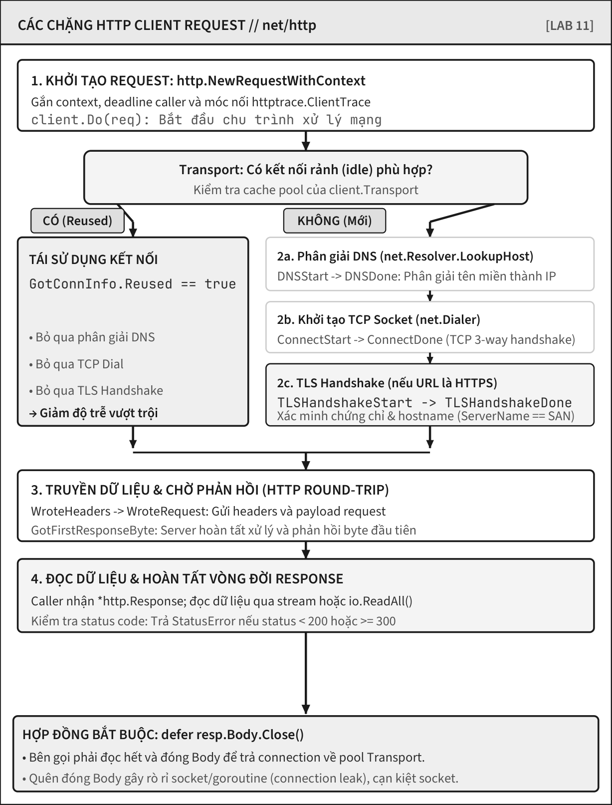

<!-- BOOK_ROLE: FOUNDATION_BRIDGE -->

# Chương 11 — Lần theo một yêu cầu HTTP

Trong nhật ký vận hành (*log*), một lệnh gọi HTTP thường chỉ còn lại một dòng tóm tắt: `GET https://api.example/... 1.8s`. Dòng nhật ký đó hữu ích, nhưng lại che giấu gần như toàn bộ câu chuyện bên dưới. Khoảng thời gian 1.8 giây có thể là tra cứu DNS, chờ một kết nối rảnh trong bể kết nối, kết nối TCP (*TCP dial*), bắt tay bảo mật (*TLS handshake*), máy chủ xử lý, đọc thân phản hồi, trễ qua máy chủ ủy quyền (*proxy*), hoặc thời hạn chót (*deadline*) do chính bên gọi đặt ra. Nếu chỉ thiết lập một thời gian chờ tổng thể duy nhất và một dòng nhật ký sau cùng, ta chỉ biết yêu cầu thất bại nhưng hoàn toàn không biết cần khắc phục ở tầng nào.

Mô hình tinh thần của chương này: một yêu cầu HTTP đi qua những chặng do địa chỉ đích, trạng thái kết nối và chính sách vận hành quyết định. Tái sử dụng kết nối có thể tránh DNS, TCP và TLS mới. Ngay cả khi phải tạo kết nối, địa chỉ IP trực tiếp không cần phân giải tên, HTTP không có TLS, còn proxy có thể thay đổi nơi quay số và cách phân giải. HTTP/2 còn cho nhiều yêu cầu dùng chung kết nối đang hoạt động. Vì vậy sơ đồ dưới đây giới hạn ở đường HTTP/1.x trực tiếp thông thường, không phải thứ tự bắt buộc của mọi lần gọi.

## Bắt đầu bằng dấu vết thay vì API

Gói `net/http/httptrace` đính kèm các điểm móc (*hook*) vào ngữ cảnh của một yêu cầu gửi ra ngoài. Nó cho phép người điều tra đánh dấu các sự kiện quan trọng như bắt đầu hoặc kết thúc tra cứu DNS, quay số kết nối TCP, bắt tay TLS, tiếp nhận kết nối mạng, gửi yêu cầu và nhận byte phản hồi đầu tiên. Các điểm móc này có thể được kích hoạt đồng thời từ nhiều goroutine và một số có thể đến sau khi yêu cầu đã hoàn tất hoặc thất bại; do đó, bộ ghi nhận (*recorder*) phải được đồng bộ hóa an toàn nếu gom các sự kiện vào cùng một lát cắt (*slice*).

~~~go
type event struct {
	name string
	at   time.Duration
}

started := time.Now()
trace := &httptrace.ClientTrace{
	DNSStart: func(httptrace.DNSStartInfo) {
		record("dns start", time.Since(started))
	},
	GotConn: func(info httptrace.GotConnInfo) {
		name := fmt.Sprintf("conn reused=%t", info.Reused)
		record(name, time.Since(started))
	},
	GotFirstResponseByte: func() {
		record("first response byte", time.Since(started))
	},
}
traceCtx := httptrace.WithClientTrace(req.Context(), trace)
req = req.WithContext(traceCtx)
~~~

Trường `GotConnInfo.Reused` mang ý nghĩa quyết định, chứ không chỉ là mốc thời gian thông thường. Thông tin này phân biệt rõ một yêu cầu tái sử dụng kết nối sẵn có trong bể kết nối (*connection pool*) với một yêu cầu phải thiết lập kết nối mạng mới. Dấu vết quan sát (*trace*) là dữ liệu của *một vòng khứ hồi (round trip)*; nó không tự động bao phủ toàn bộ chuỗi chuyển hướng (*redirect*) và không thay thế nhật ký ngữ cảnh nghiệp vụ. Hãy gắn định danh yêu cầu (*request ID*), đích đến đã chuẩn hóa và kết quả vào nhật ký vận hành; chỉ dùng dấu vết truy vết khi cần bóc tách độ trễ (*latency*) chi tiết theo từng chặng kỹ thuật.

@figure Đường HTTP/1.x trực tiếp: DNS chỉ cần khi phải phân giải tên, TLS chỉ có với HTTPS. Đọc và đóng thân phản hồi tạo điều kiện tái sử dụng nhưng không bảo đảm socket sẽ được giữ lại; HTTP/2 và proxy nằm ngoài hình.

## Tên miền, địa chỉ mạng, kết nối và danh tính không phải là một

Tên miền là dữ liệu đầu vào ở tầng ứng dụng. Phương thức `net.Resolver.LookupHost` truy vấn bộ phân giải (*resolver*) cục bộ và trả về danh sách địa chỉ mạng cho máy chủ đích. Bộ phân giải thực tế thay đổi tùy theo hệ điều hành, cấu hình mạng và cờ biên dịch; trên Unix, tài liệu gói `net` mô tả cả bộ phân giải thuần Go lẫn nhánh gọi qua thư viện C trong một số điều kiện. Đừng mặc định rằng “Go luôn tự gửi một gói tin DNS ra ngoài mạng”. Hãy ghi nhận lỗi DNS là lỗi của tầng phân giải tên miền, gắn liền với máy chủ đích và thời hạn chót, đồng thời xem cấu hình mạng là một ranh giới độc lập.

Một địa chỉ mạng khả dụng chưa phải là danh tính đã được chứng thực. Khi địa chỉ là HTTPS và cần một kết nối mới, quá trình bắt tay TLS sẽ thương lượng kênh truyền bảo mật. Thuộc tính `tls.Config.ServerName` được dùng để xác minh tên máy chủ (*hostname*) trên chứng chỉ, đồng thời được gửi trong quá trình bắt tay để hỗ trợ máy chủ ảo (*virtual hosting*) khi không dùng địa chỉ IP trực tiếp. Việc đặt `InsecureSkipVerify=true` để “sửa lỗi chứng chỉ” chính là hành vi vô hiệu hóa việc kiểm tra chuỗi chứng chỉ và tên miền mặc định, chứ không phải giải pháp sửa lỗi mạng. Giá trị mặc định `false` bảo toàn bước kiểm tra an ninh sống còn này; nếu sử dụng hàm gọi lại để kiểm tra tùy biến thì phải tự bảo đảm đúng giao ước an toàn. Với cơ quan cấp chứng chỉ (CA) nội bộ, hãy cấu hình chứng chỉ gốc (*root CA*) và chính sách tên máy chủ có chủ đích thay vì tắt bỏ khâu xác thực.

TCP, TLS và HTTP là các tầng giao thức hoàn toàn tách biệt. Kết nối TCP được thiết lập tới địa chỉ và cổng mạng; tầng TLS xác minh danh tính đối tác và thương lượng mã hóa; tầng HTTP thực thi chu trình gửi yêu cầu và nhận phản hồi bên trên. Với HTTP/2, nhiều yêu cầu có thể cùng chia sẻ một kết nối mạng duy nhất (*multiplexing*). Vì thế nhận định “mỗi yêu cầu tương ứng một kết nối TCP riêng biệt” là mô hình tinh thần sai lệch ngay từ đầu.

## Chứng chỉ hợp lệ, vì sao thao tác vẫn phải bị từ chối?

Một bên gọi có chứng chỉ máy khách do CA nội bộ ký và hoàn tất bắt tay TLS thành công. Nó gửi yêu cầu `POST /write` kèm tiêu đề `X-Role: admin`. Dịch vụ có được phép thực thi không? Nếu câu trả lời chỉ dựa vào việc “đã kết nối qua mTLS” thì ta vừa đồng nhất quyền được tham gia vào kênh truyền với quyền thực hiện mọi thao tác bên trong kênh truyền đó.

Bài thực hành `labs/part11-request-path/identity` khởi tạo CA, chứng chỉ máy chủ và chứng chỉ máy khách mới trong thời gian chạy bằng gói `crypto/x509`. Trình lắng nghe chỉ mở trên giao diện cục bộ (*loopback*); không có khóa riêng tư nào ghi vào kho mã nguồn, không phụ thuộc vào kho tin cậy của hệ điều hành và tuyệt đối không bỏ qua khâu kiểm thực. Máy khách kết nối tới địa chỉ cục bộ nhưng thiết lập `ServerName=service.test`, khớp chính xác với trường DNS SAN của chứng chỉ máy chủ. Địa chỉ mạng để quay số kết nối và tên máy chủ cần xác minh là hai dữ liệu đầu vào riêng biệt; trường Common Name (CN) cũ không thể thay thế cho SAN trong phép kiểm tra tên máy chủ này.

Hãy mở tệp kiểm thử `TestCertificateBoundaries` và dự đoán từng trường hợp bị từ chối trước khi chạy lệnh. Máy khách bắt buộc phải từ chối chuỗi chứng chỉ không thuộc CA tin cậy hoặc trường SAN không khớp. Máy chủ sử dụng cờ `RequireAndVerifyClientCert`, từ chối khi thiếu chứng chỉ, CA máy khách lạ, chứng chỉ hết hạn hoặc chứng chỉ có mục đích sử dụng không phù hợp. Ca kiểm thử đi qua quy trình bắt tay TLS thực tế của thư viện chuẩn, sau đó xác nhận không có biến đổi dữ liệu trái phép. Kiểm thử không dùng cấu trúc giả để tự gán nhãn đã xác thực.

~~~powershell
cd labs/part11-request-path
go test -count=1 -v ./identity
go test -race ./identity
~~~

Sau quá trình bắt tay, hàm `Authorize` chỉ trích xuất định danh URI SAN từ chứng chỉ lá (*leaf certificate*) trong `VerifiedChains`, không lấy vai trò từ tiêu đề HTTP hay từ chứng chỉ chưa được kiểm chứng. Chính sách mẫu cho phép `urn:go-book:reader` đọc dữ liệu tại `/read`; và chỉ tài khoản `urn:go-book:operator` mới được phép ghi dữ liệu tại `/write`. Chứng chỉ do CA tin cậy ký nhưng mang danh tính lạ hoặc thiếu thông tin danh tính đều nhận mã từ chối 403 Forbidden. Tầng TLS không thể thay tầng ứng dụng quyết định chính sách phân quyền này. Chương 12 đặt ranh giới này trước hàm xử lý có tác dụng phụ (*side effects*); Chương 28 tiếp tục ràng buộc thẩm quyền với hành động, đối tượng và quy trình phê duyệt.

> **Thử nghiệm đối chứng:** Kích hoạt biến môi trường `RELIABILITY_MUTANT=trust_equals_role` rồi chạy kiểm thử `TestAuthorizationContract`. Biến thể lỗi sẽ cấp quyền thực hiện mọi hành động cho bất kỳ chuỗi chứng chỉ hợp lệ nào; cùng ca kiểm thử đó sẽ thất bại (báo đỏ) vì tài khoản đọc ghi được dữ liệu và bộ đếm đột biến tăng lên. Không được khắc phục bằng cách tắt khâu kiểm thực chứng chỉ: điều đó sẽ phá vỡ ranh giới danh tính và không giải quyết được bài toán phân quyền.

Bài thực hành chọn TLS 1.3 làm chính sách cục bộ, không áp đặt đây là yêu cầu cho mọi môi trường triển khai thực tế. Nó chưa đi sâu vào cơ chế xoay vòng chứng chỉ, thu hồi chứng chỉ (*revocation*), kết thúc TLS tại cổng trung gian hay nhà cung cấp danh tính tập trung. Cơ chế mTLS là một giải pháp khi có hạ tầng phân phối và quản lý chứng chỉ tương thích; đây không phải điều kiện bắt buộc cho mọi tầng truyền tải giao thức MCP.

## Thời hạn chót có phạm vi, không phải một con số trang trí

Hàm `http.NewRequestWithContext` ràng buộc ngữ cảnh vào toàn bộ vòng đời của yêu cầu gửi ra ngoài: tìm kết nối mạng, gửi yêu cầu, đọc tiêu đề và đọc toàn bộ thân phản hồi. Đó là thời hạn chót sát nhất với mục tiêu của bên gọi: khi bên gọi mất kiên nhẫn, toàn bộ yêu cầu cần nhận biết lý do để dừng lại.

~~~go
ctx, cancel := context.WithTimeout(parent, 2*time.Second)
defer cancel()

req, err := http.NewRequestWithContext(
	ctx,
	http.MethodGet,
	rawURL,
	nil,
)
if err != nil {
	return err
}
resp, err := client.Do(req)
~~~

Thuộc tính `http.Client.Timeout` thiết lập giới hạn toàn diện từ đầu đến cuối (*end-to-end*) cho các yêu cầu qua máy khách đó, bao gồm cả thời gian đọc thân phản hồi. Cấu hình `http.Transport` cung cấp các chốt chặn hẹp hơn: `TLSHandshakeTimeout`, `ResponseHeaderTimeout`, giới hạn số lượng kết nối và thời hạn quay số. Mỗi chốt chặn giải quyết một yêu cầu chính sách riêng biệt, vì vậy không nên áp đặt máy móc một con số “5 giây” chung chung cho mọi trường cấu hình.

@table Timeout phải gắn với một khả năng chờ cụ thể

| Chốt | Phạm vi | Câu hỏi thiết kế |
| --- | --- | --- |
| Context của request | Toàn bộ ý nghĩa của request với caller | Caller còn cần kết quả sau bao lâu? |
| `Client.Timeout` | End-to-end cho call qua client | Client dùng chung có một ngân sách chung hợp lý không? |
| `TLSHandshakeTimeout` | Handshake TLS mới | Có cần chặn handshake treo mà vẫn cho body dài? |
| `ResponseHeaderTimeout` | Sau khi gửi đủ request, chờ response headers | Server phải bắt đầu phản hồi trong bao lâu? |
| `MaxConnsPerHost` | Tổng connection theo host; dial có thể block khi đầy | Bao nhiêu concurrency là quota có chủ đích? |

Thời gian chờ không thể tự trả lời câu hỏi liệu việc thử lại (*retry*) có an toàn hay không. Bộ điều vận `Transport` có cơ chế thử lại nội bộ có giới hạn cho một số lỗi mạng trên các kết nối đã từng dùng thành công, khi yêu cầu có tính lũy đẳng (*idempotent*) và phần thân có thể gửi lại; đó là hành vi được ghi trong tài liệu của thư viện, không phải cam kết của tầng nghiệp vụ. Nếu mã nguồn tự động thử lại yêu cầu `POST`, lập trình viên bắt buộc phải định nghĩa khóa lũy đẳng (*idempotency key*), ngân sách số lần thử lại, thời hạn chót chung và tiên liệu hậu quả khi máy chủ đã xử lý xong nhưng máy khách chưa kịp nhận phản hồi. “Lỗi mạng” không đồng nghĩa với việc thao tác nghiệp vụ chưa từng diễn ra.

## Thân phản hồi là khoản nợ tài nguyên của bên gọi

Phương thức `Client.Do` trả về cấu trúc `Response` với trường thân `Body` khác `nil` khi không có lỗi. Bên gọi bắt buộc phải đóng thân phản hồi này. Việc đọc hết đến ký tự kết thúc `io.EOF` rồi mới đóng sẽ tạo điều kiện để tái sử dụng kết nối HTTP/1.x duy trì (*keep-alive*), dù không cam đoan yêu cầu tiếp theo chắc chắn sẽ dùng lại kết nối đó. Từ Go 1.27, khi gọi lệnh `Close`, tầng hiện thực HTTP/1 sẽ tự động giải phóng phần dữ liệu chưa đọc tới một hạn mức thận trọng để hỗ trợ tái sử dụng kết nối. Điều đó không đồng nghĩa với việc đóng một phần thân bất kỳ đều sẽ đọc hết dữ liệu hoặc giữ lại được kết nối mạng; không nên biến chi tiết cài đặt này thành chính sách phân định quyền sở hữu tài nguyên. Hàm tiện ích hoặc trả về `*http.Response` và ghi rõ tài liệu yêu cầu bên gọi phải đóng thân phản hồi, hoặc chủ động đọc hết, đóng lại rồi chỉ trả về giá trị dữ liệu độc lập.

Bài thực hành lựa chọn chính sách thứ hai cho phản hồi nhỏ, đáng tin. Hàm `Fetch` gắn ngữ cảnh bên gọi vào yêu cầu và đóng thân trên cả nhánh thành công lẫn lỗi đọc. Nó đọc thân trước rồi mới kiểm tra mã trạng thái cuối cùng sau chính sách chuyển hướng của `Client`; nếu đọc thành công mà mã ngoài dải 2xx, nó trả `StatusError`. Lỗi đọc thân được ưu tiên, không tự biến thành `StatusError`. `Client.Do` không coi mã ngoài 2xx là lỗi truyền tải. Bộ kiểm thử truyền máy khách và bộ điều vận giả để quan sát contract mà không cần mạng ngoài; `Fetch` hiện không có trần số byte, nên không phải hàm an toàn cho phản hồi lớn hoặc nguồn không đáng tin.

~~~powershell
cd labs/part11-request-path
go test -tags exercise ./exercise
go test -race -tags exercise ./exercise
go test -tags traceexercise ./exercise
go test -race -tags traceexercise ./exercise
go test ./fixed
~~~

Sau hàm `Fetch`, còn một nhiệm vụ độc lập thứ hai: chuyển các điểm móc truy vết thành dữ liệu có thể đọc mà không phát sinh xung đột dữ liệu (*data race*) mới. Mở tệp `exercise/trace_test.go`; kiểm thử không đòi hỏi kết nối DNS hay máy chủ thực tế. Bộ kiểm thử kết nối các điểm móc `DNSStart`, `GotConn` và `GotFirstResponseByte` vào một bộ ghi nhận, rồi gọi phương thức `GotConn` đồng thời từ nhiều goroutine. Bạn có thể tự chọn cấu trúc dữ liệu, cơ chế đồng bộ hóa và tên sự kiện, nhưng phương thức `Snapshot` bắt buộc phải trả về bản sao độc lập để bên gọi không can thiệp vào lịch sử của bộ ghi. Đây là bài kiểm tra tối thiểu cho đúng lời cảnh báo ở đầu chương: `httptrace` kích hoạt các điểm móc đồng thời; dấu vết dùng để điều tra yêu cầu không được phép tự gây ra xung đột dữ liệu ngay trong công cụ điều tra.

Thứ tự sự kiện trong một ảnh chụp trạng thái tuần tự có thể là bằng chứng hữu ích cho một yêu cầu cụ thể. Khi các điểm móc kích hoạt đồng thời, bộ ghi nhận chỉ cam kết lưu giữ các sự kiện đã tiếp nhận mà không tự suy diễn thứ tự nhân quả thiếu cơ sở. Hãy dùng mốc thời gian để hỗ trợ điều tra, đối chiếu với trường `GotConnInfo.Reused`, thời hạn chót và kết quả cuối cùng; không nên vội vã kết luận từ danh sách sự kiện rằng tra cứu DNS, quay số hay máy chủ luôn là chặng gây chậm trễ nhất.

Khi bên gọi cần truyền phát (*stream*) một phản hồi dung lượng lớn, chính sách của bài thực hành sẽ không còn phù hợp: không nên dùng `io.ReadAll` chỉ để “cho đơn giản”. Khi ấy giao diện lập trình bắt buộc phải trả về luồng dữ liệu và chuyển giao trách nhiệm gọi lệnh `Close` lại cho bên gọi, tương tự như bài toán vào/ra dữ liệu ở Chương 7. Một giao diện lập trình tinh gọn nhưng mơ hồ về việc đóng thân phản hồi thường gây rò rỉ kết nối mạng âm thầm và nguy hiểm hơn nhiều so với một hàm có thêm vài dòng tài liệu giải thích rõ ràng.

Cấu trúc `http.Client` và `http.Transport` an toàn khi sử dụng đồng thời từ nhiều luồng; tài liệu chuẩn `net/http` khuyến nghị nên khởi tạo và tái sử dụng chúng vì bộ điều vận lưu giữ trạng thái nội bộ như bộ đệm kết nối (*connection cache*). Việc tái sử dụng không đồng nghĩa với việc lạm dụng một biến toàn cục vô danh. Hãy đóng gói một máy khách đã được cấu hình chặt chẽ theo đúng chính sách vận hành của dịch vụ, truyền nó qua tham số vào ranh giới cần thực hiện lệnh gọi mạng, đồng thời duy trì khả năng kiểm thử độc lập cho cả bộ điều vận lẫn thời hạn chót.

### Thí nghiệm cục bộ: yêu cầu thứ hai có thực sự tái sử dụng kết nối cũ?

Tệp `labs/part11-request-path/fixed/reuse_test.go` sử dụng `httptest.Server`, một đối tượng `http.Transport` mới và gói `httptrace`. Thí nghiệm này hoàn toàn không có bước tra cứu DNS hay mã hóa TLS; đó là chủ ý thiết kế nhằm cô lập hoàn toàn bể kết nối rảnh. Hai yêu cầu tuần tự đọc trọn vẹn dữ liệu rồi đóng thân phản hồi. Ca kiểm thử kiểm tra giá trị `GotConnInfo.Reused` mang giá trị `false` cho yêu cầu đầu tiên, và `true` cho yêu cầu tiếp theo. Điều này không khẳng định mọi yêu cầu trên môi trường thực tế đều sẽ được tái sử dụng: máy chủ có thể chủ động ngắt kết nối, thân phản hồi có thể chưa được hoàn trả về bể, hạn ngạch hoặc cơ chế ghép kênh HTTP/2 có thể làm thay đổi đường đi. Thí nghiệm chỉ mang lại bằng chứng có thể tái lập cho một mệnh đề xác thực: khi bộ điều vận đã sở hữu một kết nối rảnh tương thích, vòng khứ hồi tiếp theo có thể bỏ qua việc khởi tạo kết nối mạng mới.

~~~powershell
cd labs/part11-request-path
go test -run TestTransportReusesIdleConnection ./fixed
go test -race ./fixed
~~~

Kiểm thử `TestLiteralIPNeedsNoDNSAndServerMayPreventReuse` đặt thêm một phản ví dụ: máy chủ cục bộ dùng địa chỉ IP và gửi `Connection: close`. Hai yêu cầu đều đọc hết và đóng thân nhưng không có điểm móc DNS nào và không tái sử dụng kết nối. Điều này tách trách nhiệm đóng tài nguyên của bên gọi khỏi quyền quyết định giữ kết nối của hai phía.

Khi điều tra yêu cầu chậm, hãy kiểm tra kết nối có được tái sử dụng, giới hạn nào đã kích hoạt, các mốc DNS/TLS/byte đầu tiên nằm ở đâu, thân phản hồi có được đóng và việc thử lại có an toàn cho nghiệp vụ hay không. Một dòng nhật ký 1.8 giây là điểm khởi đầu; kết luận cần dữ liệu ở đúng chặng đang nghi ngờ.

@references
1. Go Team. Package `net`, phần Name Resolution và `Resolver.LookupHost`. pkg.go.dev/net
2. Go Team. Package `crypto/tls`, phần `Config.ServerName` và `InsecureSkipVerify`. pkg.go.dev/crypto/tls
3. Go Team. Package `net/http`, phần Clients and Transports, `Request`, `Client` và `Transport`. pkg.go.dev/net/http
4. Go Team. Package `net/http/httptrace`. pkg.go.dev/net/http/httptrace
5. Go Team. Go 1.27 Release Notes, net/http: bounded drain khi đóng HTTP/1 response body. go.dev/doc/go1.27
6. Go Team. `crypto/tls` và `crypto/x509`, Go 1.27.1: `RequireAndVerifyClientCert`, `VerifiedChains`, `ServerName`, `Certificate.Verify` và `VerifyHostname`. pkg.go.dev/crypto/tls@go1.27.1; pkg.go.dev/crypto/x509@go1.27.1
