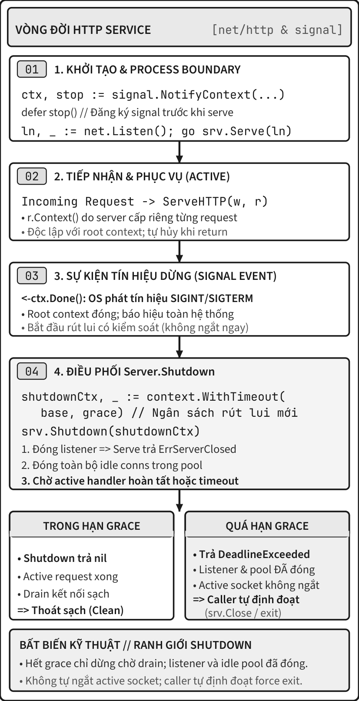

<!-- BOOK_ROLE: FOUNDATION_BRIDGE -->

# Chương 12 — Một service sống và tắt thế nào

Một dịch vụ nhỏ thường bắt đầu bằng `http.ListenAndServe(":8080", handler)`. Dòng lệnh đó đủ để mở cổng mạng (*port*), nhưng chưa đủ để khẳng định dịch vụ đang cam kết điều gì với bên gọi, với hệ thống triển khai (*deployment system*), hay với người vận hành. Khi tiến trình nhận tín hiệu dừng, nếu hàm `main` kết thúc ngay thì các yêu cầu đang xử lý sẽ bị cắt đứt. Khi một máy khách gửi tiêu đề quá chậm, nếu máy chủ thiếu chính sách thời gian chờ đọc tiêu đề thì kết nối mạng có thể chiếm dụng tài nguyên lâu hơn dự kiến. Khi hàm xử lý tiếp nhận JSON lạ và cố suy đoán ngữ nghĩa, ranh giới giữa dữ liệu đầu vào chưa được kiểm chứng và trạng thái nội bộ sẽ hoàn toàn biến mất.

Mô hình tinh thần của chương này: dịch vụ là một ranh giới biến dữ liệu đầu vào chưa được kiểm chứng thành các đơn vị công việc có giới hạn tài nguyên, sau đó rút lui an toàn theo một vòng đời có thể quan sát được. Việc định tuyến, phần mềm trung gian, kiểm tra tính hợp lệ và tắt êm dịu chỉ thực sự đáng đưa vào khi chúng làm sáng tỏ ranh giới này. Chúng không phải một danh mục tính năng để phô diễn cấu trúc khung làm việc (*framework*).

## Một lần triển khai bị cắt ngang cho thấy sự thiếu hụt giao ước vận hành

Xét trường hợp `/v1/checks` tiếp nhận một mục tiêu kiểm tra, lưu yêu cầu, rồi trả về mã `201`. Trong một lần triển khai phiên bản mới, bộ cân bằng tải (*load balancer*) chuyển hướng lưu lượng mạng sang phiên bản mới nhưng tiến trình cũ nhận tín hiệu dừng ngay giữa lúc đang ghi phản hồi. Có ba trạng thái cần phân biệt rõ ràng: dịch vụ còn nhận kết nối mới, đang để các yêu cầu đã tiếp nhận chạy đến khi hoàn tất, hay đã dừng hẳn. Phương thức `Server.Shutdown` của `net/http` đóng trình lắng nghe (*listener*), đóng các kết nối rảnh (*idle connection*), rồi kiên nhẫn chờ các kết nối đang hoạt động hoàn tất để trở về trạng thái rảnh rồi mới đóng lại. Lệnh này không tự hủy ngữ cảnh của hàm xử lý đang chạy. Ngữ cảnh `r.Context()` của yêu cầu gửi đến có vòng đời độc lập: nó bị hủy khi máy khách ngắt kết nối, luồng HTTP/2 bị hủy, hoặc khi `ServeHTTP` trả về, chứ không phải chỉ vì `Shutdown` vừa được gọi. Nó không tự chờ các kết nối đã chuyển giao quyền kiểm soát (*hijacked connection*), chẳng hạn như WebSocket; những kết nối tồn tại lâu dài luôn cần chính sách vòng đời chuyên biệt.

@figure Khái niệm vòng đời (*lifecycle*) khi dịch vụ tắt êm dịu (*graceful shutdown*). Thời hạn chót (*deadline*) của quá trình tắt là chính sách vận hành: giới hạn thời gian chờ, không biến mọi yêu cầu thành kết quả thành công.

Một hàm chạy server có thể giữ contract ấy trong một nơi thay vì để `main` thoát vì mọi error đều trông giống nhau. Hãy đọc phần đầu và phần shutdown dưới đây như hai đoạn liên tiếp của cùng một function; tách chúng ra cũng giúp lifecycle hiện rõ hơn trên trang:

~~~go
func ServeUntilStopped(
	ctx context.Context,
	srv *http.Server,
	ln net.Listener,
	grace time.Duration,
) error {
	if srv == nil {
		return errors.New("HTTP server is required")
	}
	if ln == nil {
		return errors.New("listener is required")
	}
	if grace <= 0 {
		return errors.New("shutdown grace must be positive")
	}

	serveErr := make(chan error, 1)
	go func() { serveErr <- srv.Serve(ln) }()

	select {
	case err := <-serveErr:
		if errors.Is(err, http.ErrServerClosed) {
			return nil
		}
		return fmt.Errorf("serve: %w", err)
	case <-ctx.Done():
	}
~~~

Đến đây máy chủ đã nhận yêu cầu dừng, nhưng `ctx` không nên dùng trực tiếp làm ngữ cảnh tắt dịch vụ: ngữ cảnh đó đã bị hủy. Ta tạo một ngân sách thời gian mới để `Shutdown` có cơ hội hoàn tất các yêu cầu đang xử lý dở dang (*drain*):

~~~go
	base := context.Background()
	shutdownCtx, cancel := context.WithTimeout(base, grace)
	defer cancel()
	if err := srv.Shutdown(shutdownCtx); err != nil {
		return fmt.Errorf("shutdown: %w", err)
	}
	err := <-serveErr
	if err == nil {
		return errors.New("server stopped without an error")
	}
	if !errors.Is(err, http.ErrServerClosed) {
		return fmt.Errorf("serve after shutdown: %w", err)
	}
	return nil
}
~~~

Ba mệnh đề bảo vệ (*guard clauses*) đầu tiên không phải lập trình phòng thủ vô định. `srv`, `ln` và `grace` là ba điều kiện tiên quyết của hàm hỗ trợ vòng đời; nếu thiếu một trong số đó, việc gọi `Serve` chỉ để nhận hoảng loạn (`panic`) hoặc treo tiến trình sẽ không giúp bên gọi sửa được cấu hình. `shutdownCtx` được tạo từ `context.Background()` có chủ đích. Ngữ cảnh gốc (*root context*) đã bị hủy để phát tín hiệu dừng; nếu lấy thời hạn chót tắt dịch vụ trực tiếp từ đó, thời hạn sẽ bị hủy ngay trước khi `Shutdown` có cơ hội giải phóng các yêu cầu còn dang dở. Tham số `grace` phải xuất phát từ chỉ tiêu cam kết dịch vụ (SLO), thời gian triển khai và đặc thù yêu cầu của hệ thống, thay vì một con số sao chép từ ví dụ mẫu. Sau thời hạn chót, `Shutdown` trả về lỗi; quyết định tiếp theo (ghi nhật ký, cảnh báo, cưỡng bức đóng kết nối hay để trình giám sát tiến trình xử lý) là chính sách cần được quy định rõ tại ranh giới vận hành.

### Từ signal của process sang context của server

`ServeUntilStopped` đã nhận một `context.Context`, nên hàm `main` chỉ cần nối vòng đời của tiến trình vào đầu vào đó. Trên các máy chủ tương thích Unix, `signal.NotifyContext` chuyển tín hiệu `SIGINT` hoặc `SIGTERM` thành thao tác hủy ngữ cảnh; lệnh `defer stop()` hủy đăng ký bắt tín hiệu khi `main` thoát ra. Cho đến khi hàm `stop()` được kích hoạt, tín hiệu hệ điều hành vẫn được điều hướng theo chính sách này; nếu hệ thống muốn ngắt lần thứ hai quay về hành vi mặc định hoặc thoát cưỡng bức, đó phải là một quyết định thiết kế có chủ đích. Sau tín hiệu đầu tiên, `ServeUntilStopped` bước vào giai đoạn `Shutdown` với khoảng thời gian `grace` đã chọn thay vì lập tức cắt ngang các yêu cầu đang xử lý.

~~~go
ctx, stop := signal.NotifyContext(
	context.Background(),
	os.Interrupt,
	syscall.SIGTERM,
)
defer stop()

if err := ServeUntilStopped(
	ctx,
	srv,
	ln,
	15*time.Second,
); err != nil {
	return err
}
~~~

Đây là cầu nối tại ranh giới tiến trình, không phải sự cho phép để hàm xử lý (*handler*) bỏ qua `r.Context()`: `Shutdown` chỉ ngừng tiếp nhận yêu cầu mới và chờ các yêu cầu đang chạy hoàn tất; nó không tự hủy `r.Context()` của các hàm xử lý đó. Hàm xử lý vẫn bắt buộc phải truyền `r.Context()` vào cơ sở dữ liệu hoặc các lệnh gọi HTTP ra bên ngoài (*outbound*) để thích ứng với vòng đời riêng của từng yêu cầu gửi đến.

Nếu chính sách của dịch vụ quy định tín hiệu dừng cũng phải hủy các hàm xử lý đang chạy, việc đó cần được đấu nối tường minh, chẳng hạn dùng ngữ cảnh ứng dụng làm `Server.BaseContext` rồi hủy ngữ cảnh đó ngay khi nhận tín hiệu:

~~~go
appCtx, cancelApp := context.WithCancel(context.Background())
srv.BaseContext = func(net.Listener) context.Context {
	return appCtx
}
// Policy đã chọn khi nhận signal:
cancelApp()
~~~

Đó là một chính sách khác với việc rút lui êm dịu thuần túy (*graceful drain*): hàm xử lý nào theo dõi ngữ cảnh đều có thể dừng trước khi hoàn tất toàn bộ công việc đang phục vụ. Lựa chọn này phù hợp khi việc giới hạn thời gian tắt tiến trình quan trọng hơn việc chờ mọi yêu cầu hoàn thành trọn vẹn. Trên Windows, `os.Interrupt` là tín hiệu khả chuyển; máy chủ dịch vụ và trình quản lý tiến trình cần được kiểm chứng trên đúng môi trường thực tế trước khi giả định `SIGTERM` có cùng hành vi tiếp nhận.

## Thao tác đã xong nhưng ngữ cảnh con vẫn còn sống

Một hàm xử lý đã trả kết quả không đồng nghĩa mọi tài nguyên do nó tạo ra đều được giải phóng đúng lúc. Trong bài thực hành `part10-resource-retention`, hàm `DoTimeout` tạo ngữ cảnh con (*child context*) có thời hạn một giờ trực thuộc ngữ cảnh cha (*parent context*) sống lâu nhưng có thể hủy. Hàm gọi lại (*callback*) trả về ngay. Ngữ cảnh con sẽ hết hạn cùng hàm gọi lại, cùng hàm xử lý, hay theo lộ trình hủy của chính ngữ cảnh? Ngữ cảnh không thể tự biết hàm gọi lại đã hoàn tất công việc. Nếu bên sở hữu bỏ quên hàm hủy `CancelFunc`, ngữ cảnh con vẫn không bị hủy chỉ vì hàm vừa kết thúc.

Theo giao ước (*contract*) của gói `context`, gọi lệnh hủy sẽ hủy ngữ cảnh con cùng toàn bộ các thế hệ con cháu kế thừa (*descendants*), gỡ bỏ quan hệ liên kết từ ngữ cảnh cha và dừng bộ đếm thời gian (*timer*) liên quan. Trong mã nguồn Go 1.27.1, phương thức `cancelCtx.propagateCancel` đăng ký ngữ cảnh con vào tập `children` của ngữ cảnh cha; phương thức `timerCtx.cancel` tháo gỡ liên kết đó và dừng bộ đếm. Đây là chi tiết hiện thực được kiểm chứng trên phiên bản này, không phải trường dữ liệu để tầng ứng dụng truy cập trực tiếp. Ngữ cảnh cha còn sống, thời hạn còn xa và không ai gọi lệnh hủy là điều kiện đủ để giữ các ngữ cảnh con tồn tại vượt quá thời gian thao tác thực sự cần đến. Bộ thu gom rác (GC) không thể thay thế cho quyết định kết thúc chủ động này.

Đặt trách nhiệm dọn dẹp ngay tại nơi sở hữu một lần gọi:

~~~go
func DoTimeout(
    parent context.Context,
    budget time.Duration,
    work func(context.Context) error,
) error {
    ctx, cancel := context.WithTimeout(parent, budget)
    defer cancel()
    return work(ctx)
}
~~~

Lệnh `defer` bảo vệ cả nhánh thực thi thành công lẫn nhánh phát sinh lỗi. Nếu tạo nhiều ngữ cảnh con bên trong vòng lặp của một hàm sống suốt vòng đời dịch vụ rồi `defer` mọi thao tác hủy ở hàm bao bọc ngoài cùng, việc dọn dẹp tài nguyên sẽ bị trì hoãn tới tận khi dịch vụ ngừng hẳn. Hãy tách mỗi thao tác thành một hàm có phạm vi cục bộ ngắn như trên, hoặc chủ động gọi hủy ở cuối mỗi vòng lặp và trên mọi nhánh thoát. Đồng thời, không trả ngữ cảnh con ra cho tác vụ đang chạy nền rồi lập tức hủy ngay khi hàm tạo kết thúc: cần bàn giao hàm hủy `CancelFunc` cùng trách nhiệm chờ đợi hoàn tất cho bên tiếp nhận mới, tránh áp dụng `defer` một cách máy móc.

Kiểm thử của bài thực hành ghi nhận ngữ cảnh con mà hàm gọi lại tiếp nhận. Với bản sửa lỗi trả về, `child.Err()` mang giá trị `context.Canceled`; với bản còn lỗi, ngữ cảnh con vẫn chưa có lỗi, rồi chỉ bị hủy khi kiểm thử chủ động hủy ngữ cảnh cha. Một ca kiểm thử khác dùng thời hạn chót đã quá hạn để chứng minh ngữ cảnh con có thể tự kết thúc dù bên sở hữu quên hủy. Các ca kiểm thử này tập trung kiểm chứng vòng đời công khai, không xâm phạm trường nội bộ hay kỳ vọng một con số suy giảm RAM thiếu căn cứ.

Công cụ `go vet` phát hiện trường hợp phổ biến như bỏ qua `CancelFunc` bằng ký tự gạch dưới `_`; dữ liệu mẫu `testdata/lostcancel` cố ý tạo ra cảnh báo chẩn đoán đó. Tuy nhiên, bản lỗi chuyển hàm hủy cho hàm `ForgetCancel` rỗng: công cụ phân tích tĩnh cục bộ có thể nhận định trách nhiệm đã được bàn giao trong khi thực tế không ai thực thi việc dọn dẹp. Vì vậy, kết quả `go vet` sạch không chứng minh quyền sở hữu tài nguyên đã chuẩn xác. Đọc kỹ luồng gọi mã nguồn và kiểm thử thời điểm kết thúc của ngữ cảnh con là hai bằng chứng bổ sung bắt buộc.

Không phải mọi trường hợp quên gọi hủy đều dẫn đến rò rỉ bộ nhớ vĩnh viễn. Ngữ cảnh cha bị hủy hoặc thời hạn chót trôi qua thì ngữ cảnh con cũng sẽ chấm dứt; với `WithCancel(context.Background())` không có bộ đếm hay quan hệ cha con giữ ngữ cảnh, việc bỏ mọi tham chiếu tới ngữ cảnh con sẽ không tự hình thành chuỗi giữ từ gốc. Dù vậy, một ngữ cảnh con mang theo dữ liệu giá trị lớn, có nhánh con cháu, bộ đếm thời gian hoặc tác vụ đang chờ sẽ gây tiêu tốn tài nguyên khác biệt so với một ngữ cảnh con rỗng. Cần xác định rõ nhánh tham chiếu giữ lại và thời gian lưu giữ dư thừa. Lệnh `CancelFunc` cũng không chờ hàm gọi lại kết thúc: bài toán chờ tín hiệu hoàn tất `done` từ Chương 9 vẫn giữ nguyên giá trị.

Ngữ cảnh của yêu cầu gửi đến `r.Context()` do máy chủ HTTP quản lý; hàm xử lý không nhận `CancelFunc` để tự hủy ngữ cảnh gốc đó. Hàm xử lý chỉ chịu trách nhiệm đối với các ngữ cảnh con do chính nó khởi tạo để gọi các dịch vụ hạ nguồn (*downstream*). Chính sách hủy các yêu cầu đang hoạt động khi tắt tiến trình là quyết định kiến trúc riêng biệt đã nêu ở trên, không được nhầm lẫn giữa việc quên gọi hủy trong một thao tác với mô hình tinh thần về `Server.Shutdown`.

## Hàm xử lý là ranh giới kiểm tra, không phải nơi “cố hiểu” dữ liệu đầu vào

Trong bài thực hành, `POST /v1/checks` là một ranh giới nhỏ. Điểm cuối tiếp nhận dữ liệu JSON chỉ chứa trường `target`, chấp nhận giao thức `http` hoặc `https` với máy chủ không rỗng, chuyển giá trị hợp lệ sang kho lưu trữ `Store`, và không để lộ lỗi nội bộ của kho lưu trữ ra phía máy khách. Bài thực hành chưa thực hiện lệnh thăm dò gửi ra ngoài: đó là quyết định tiềm ẩn rủi ro giả mạo yêu cầu phía máy chủ (SSRF) và cạn kiệt hạn ngạch (*quota*), do đó không nên đưa tùy tiện vào một hàm xử lý mẫu.

> **Dừng để dự đoán:** Xét một hàm xử lý HTTP tiếp nhận gói tin (*payload*) thông qua `json.Decoder`:
> ~~~go
> decoder := json.NewDecoder(r.Body)
> var input Check
> err := decoder.Decode(&input)
> ~~~
> Nếu client gửi body gồm một document hợp lệ rồi nối thêm dữ liệu thừa như `{"target":"https://example.com"}{"debug":true}`, lệnh `decoder.Decode(&input)` có báo lỗi không, và phần dữ liệu thừa phía sau sẽ đi về đâu? Làm thế nào để chứng minh stream đã thực sự kết thúc trước khi chuyển giao dữ liệu sang `Store`?

#### Gợi ý giải pháp (chỉ đọc sau khi đã tự làm)
Lệnh `decoder.Decode(&input)` đọc và giải mã thành công object đầu tiên vào biến `input` mà không trả về lỗi nào, bởi vì `json.Decoder` được thiết kế để xử lý luồng stream và dừng lại ngay khi hoàn tất một JSON value hợp lệ. Lúc này, phần dữ liệu thừa phía sau không nhất thiết còn nguyên vẹn trong `r.Body`. Do `json.Decoder` duy trì một bộ đệm đọc trước (read buffer) nội bộ, các byte của object thứ hai có thể đã được nạp sẵn vào bộ đệm của decoder hoặc vẫn còn nằm lại trên stream của request. Nếu handler dừng lại ở lần gọi đầu tiên rồi tiếp tục xử lý nghiệp vụ, dữ liệu thừa sẽ bị bỏ qua và ranh giới kiểm soát input bị phá vỡ.

Để chứng minh luồng dữ liệu (*stream*) không còn dữ liệu thừa ngoài khoảng trắng, hàm xử lý thực hiện thêm một lần giải mã thứ hai vào một cấu trúc rỗng (`var extra struct{}`). Khi luồng dữ liệu đã kết thúc đúng chuẩn, bộ giải mã bắt buộc phải trả về chính xác lỗi `io.EOF`. Mọi dữ liệu còn sót lại trong bộ đệm giải mã hoặc trên luồng mạng đều khiến lần gọi thứ hai trả về một kết quả khác `io.EOF`, tạo bằng chứng rõ ràng để hàm xử lý từ chối yêu cầu bằng mã 400 Bad Request trước khi chuyển giao việc cho `Store`.

Dưới đây là cài đặt kiểm định ranh giới hoàn chỉnh của handler trong lab:

~~~go
func (a app) createCheck(
	w http.ResponseWriter,
	r *http.Request,
) {
	if r.Method != http.MethodPost {
		methodNotAllowed(w)
		return
	}

	r.Body = http.MaxBytesReader(w, r.Body, maxRequestBody)
	decoder := json.NewDecoder(r.Body)
	decoder.DisallowUnknownFields()

	var input Check
	err := decoder.Decode(&input)
	if err != nil || validateTarget(input.Target) != nil {
		badRequest(w)
		return
	}
	var extra struct{}
	if err := decoder.Decode(&extra); !errors.Is(err, io.EOF) {
		badRequest(w)
		return
	}
	check, err := a.store.Create(r.Context(), input)
	if err != nil {
		internalError(w)
		return
	}
	writeJSON(w, http.StatusCreated, check)
}
~~~

Lần gọi `Decode` thứ hai không nhằm đọc một bản ghi kiểm tra khác. Nó chỉ kiểm chứng rằng sau giá trị đầu tiên chỉ còn khoảng trắng và ký hiệu kết thúc tệp `io.EOF`; nếu vẫn còn giá trị JSON dư thừa, yêu cầu sẽ bị từ chối trước khi chuyển giao cho `Store`. Đoạn mã trên không phải bộ giải mã dùng chung cho mọi giao diện lập trình (API): chẳng hạn điểm tiếp nhận tải tệp lên không thể áp dụng mức trần 4 KiB cố định này. Nguyên tắc cốt lõi là giới hạn dung lượng, lược đồ dữ liệu và kiểm tra tính hợp lệ phải được thực thi ngay trước khi dữ liệu đầu vào biến thành công việc nội bộ; không nên giải mã vô hạn rồi mới kiểm tra tính hợp lệ của yêu cầu.

`http.MaxBytesReader` thiết lập hạn ngạch bảo vệ ranh giới thân yêu cầu (*body*). Lệnh `Decoder.DisallowUnknownFields` áp dụng lược đồ chặt chẽ, rất hữu ích khi máy khách gửi nhầm tên trường mà hệ thống không muốn âm thầm bỏ qua. Tính chặt chẽ là sự cân nhắc về độ tương thích: một API mở rộng có thể cần phiên bản hóa hoặc chính sách xử lý trường linh hoạt hơn. Tuy nhiên, “bỏ qua mọi trường lạ” không được trở thành thói quen vô thức khi dữ liệu đầu vào có khả năng điều khiển các hành vi tiêu tốn chi phí hệ thống.

Bài thực hành bắt đầu bằng các ca kiểm thử thất bại (báo đỏ) đối với yêu cầu hợp lệ, sai phương thức HTTP, JSON chứa trường lạ, chứa tài liệu JSON thứ hai và sai mục tiêu kiểm tra. Hãy tự hoàn thiện hàm xử lý trước khi tham khảo thư mục `fixed/`:

~~~powershell
cd labs/part12-service-lifecycle
go test -tags exercise ./exercise
go test -race -tags exercise ./exercise
go test -tags lifecycleexercise ./exercise
go test -race -tags lifecycleexercise ./exercise
go test ./fixed
~~~

Kiểm thử của hàm xử lý còn đặt hai giá trị JSON liên tiếp để phân biệt hai loại lỗi dễ nhầm: tài liệu hợp lệ đầu tiên không được phép khiến phần dữ liệu thừa phía sau bị âm thầm bỏ qua. Sau khi hàm xử lý vượt qua kiểm thử (báo xanh), bộ kiểm thử `lifecycleexercise` truyền trình lắng nghe cục bộ và ngữ cảnh hủy vào `ServeUntilStopped`; giao ước đặt ra là trình lắng nghe phục vụ yêu cầu trước khi có tín hiệu hủy, máy chủ trả về sau khi tắt êm dịu, và các tiền điều kiện sai phải trả về lỗi tường minh thay vì gây sụp đổ (`panic`). Kiểm thử dùng `httptest` hoặc trình lắng nghe cục bộ, nhờ đó kiểm chứng trọn vẹn giao ước HTTP mà không cần mở cổng ra mạng. Phương thức `ResponseRecorder.Result()` ghi nhận ảnh chụp trạng thái phản hồi sau khi hàm xử lý thực thi; không nên dùng `DeepEqual` trên toàn bộ cấu trúc `http.Response`, mà chỉ so khớp mã trạng thái, tiêu đề (*header*) và phần thân mà dịch vụ đã cam kết.

## Định tuyến và phần mềm trung gian là cách đặt luật ở đúng ranh giới

Một bộ định tuyến (*router*) tinh gọn phát huy giá trị khi người bảo trì nhìn vào bảng định tuyến là biết phương thức nào dẫn đến hàm xử lý nào. Với dịch vụ có ít điểm cuối tiếp nhận, `http.ServeMux` kết hợp kiểm tra phương thức tường minh thường hiệu quả hơn một thư viện phụ thuộc cồng kềnh. Mẫu định tuyến, yêu cầu xác thực và giới hạn thân yêu cầu nên được thể hiện rõ ràng ngay tại ranh giới tiếp nhận; hàm nghiệp vụ bên trong chỉ nhận giá trị đã được làm sạch và ngữ cảnh của yêu cầu.

Phần mềm trung gian (*middleware*) hợp lý là nơi thực thi các quy tắc chung cho nhiều yêu cầu: đính kèm định danh yêu cầu do máy chủ tạo, ghi nhật ký kết quả, truy vết (*tracing*), xác thực người dùng hoặc kiểm soát tần suất gửi yêu cầu (*rate limiting*). Đây không phải nơi để nhồi nhét rẽ nhánh nghiệp vụ. Nếu phần mềm trung gian cần ghi nhận mã trạng thái và số byte đã truyền, bộ bọc `ResponseWriter` phải tuyệt đối tôn trọng giao ước của `net/http`; một lớp bọc cẩu thả có thể phá vỡ các giao diện tùy chọn hoặc ghi tiêu đề sau khi thân phản hồi đã gửi. Hãy bắt đầu với các lớp trung gian nhỏ gọn có thể kiểm thử độc lập, thay vì sao chép một chuỗi bộ bọc phức tạp mà không ai còn hiểu rõ.

Nhật ký vận hành (*logging*) phải giải đáp được câu hỏi giám sát: định danh yêu cầu, tuyến đường và phương thức, mã trạng thái, thời lượng xử lý, kết quả và phân loại lỗi. Không được ghi mật khẩu, mã xác thực quyền truy cập (*bearer token*), tệp cookie hay toàn bộ phần thân yêu cầu theo mặc định. Lỗi trả về cho máy khách là giao ước công khai; nhật ký nội bộ có thể lưu vết nguyên nhân kỹ thuật chi tiết với quyền truy cập phù hợp. Khi hai thông điệp này trùng lặp nguyên văn, đó là dấu hiệu ranh giới kỹ thuật chưa được phân định rõ ràng.

## Thời hạn chờ phía máy chủ phòng ngừa một kiểu áp lực khác

Thời gian chờ phía máy khách ở chương trước bảo vệ bên *gọi*. Phía máy chủ cũng phải thiết lập các giới hạn để bảo vệ tài nguyên của chính nó. `ReadHeaderTimeout` giới hạn thời gian đọc tiêu đề yêu cầu rồi tái lập thời hạn chót để hàm xử lý tự quyết định tốc độ và thời hạn đọc phần thân. `ReadTimeout` bao trùm toàn bộ thời gian đọc thân yêu cầu nhưng không cho phép hàm xử lý áp dụng chính sách riêng cho từng tác vụ tải tệp. `WriteTimeout` giới hạn thời gian ghi phản hồi; `IdleTimeout` giới hạn thời gian chờ yêu cầu kế tiếp trên kết nối duy trì (*keep-alive*). `MaxHeaderBytes` đặt trần bảo vệ bộ phân tích cú pháp tiêu đề.

@table Server timeout là các policy khác nhau

| Field | Bảo vệ điều gì | Cần quyết định cùng nó |
| --- | --- | --- |
| `ReadHeaderTimeout` | Client gửi header quá chậm | Header hợp lệ cần bao lâu trong mạng thực? |
| `ReadTimeout` | Toàn bộ đọc request, gồm body | Endpoint upload có rate/lifetime riêng không? |
| `WriteTimeout` | Response write kéo dài | Streaming response có cần policy khác? |
| `IdleTimeout` | Keep-alive không gửi request tiếp | Bao lâu connection rảnh vẫn đáng giữ? |
| `MaxHeaderBytes` | Header bất thường lớn | Cookie/proxy hợp lệ chiếm bao nhiêu? |

Không có bộ tham số chung nào phù hợp cho mọi dịch vụ. Với thời gian chờ đọc, ghi hoặc duy trì kết nối rảnh, giá trị bằng không đồng nghĩa với việc không áp đặt thời gian chờ theo tài liệu chuẩn của `net/http`; thuộc tính `MaxHeaderBytes` cũng có giá trị mặc định riêng. Mặc định vô thức vẫn là một chính sách vận hành. Hãy đánh giá khối lượng công việc, hạ tầng ủy quyền trung gian (*proxy*), đường dẫn tải tệp và ngân sách bộ nhớ trước khi ấn định các con số; sau đó kiểm thử lưu lượng mạng thực tế khi có người dùng truy cập.

Phương thức `Server.Shutdown` không ngắt các yêu cầu đang hoạt động và không tự hủy `r.Context()` của hàm xử lý. Hàm xử lý vẫn phải tôn trọng `r.Context()` khi tương tác với cơ sở dữ liệu, máy khách gọi ra ngoài hoặc luồng xử lý nền, bởi vì yêu cầu gửi đến có vòng đời độc lập. Chương 9 và Chương 11 đã cung cấp hai mảnh ghép còn lại: goroutine phải có đường thoát khi ngữ cảnh bị hủy; yêu cầu của máy khách phải tiếp nhận ngữ cảnh từ bên gọi. Việc tắt êm dịu chỉ thực sự đạt được khi các ranh giới bên trong sẵn sàng trả lại quyền điều khiển.

Một dịch vụ đáng tin cậy được đo lường tại các ranh giới: đầu vào bị giới hạn ở đâu, mã nghiệp vụ tiếp nhận dữ liệu gì, phản hồi và nhật ký có phân tách rõ ràng giữa thông tin công khai và nội bộ hay không, máy chủ ngừng nhận việc khi nào và yêu cầu cũ được bao nhiêu thời gian để kết thúc. Kết nối WebSocket cần một bên sở hữu riêng biệt. Trả lời trọn vẹn những câu hỏi đó, dịch vụ mới có một vòng đời hoàn chỉnh để vận hành thay vì chỉ gọi `ListenAndServe` một cách phó mặc.

@references
1. Go Team. Package `net/http`, phần Handler, Server fields, `Shutdown` và `ResponseWriter`. pkg.go.dev/net/http
2. Go Team. Package `net/http/httptest`, phần `ResponseRecorder` và test server. pkg.go.dev/net/http/httptest
3. Go Team. Package `os/signal`, phần `NotifyContext`. pkg.go.dev/os/signal
4. Go Team. Security Best Practices for Go Developers. go.dev/doc/security/best-practices
5. Go Team. Package `context`, Overview và `WithTimeout`, Go 1.27.1. pkg.go.dev/context@go1.27.1#WithTimeout
6. Go Team. Source `context/context.go`, `cancelCtx.propagateCancel` và `timerCtx.cancel`, tag go1.27.1. github.com/golang/go/blob/go1.27.1/src/context/context.go
7. Go Team. Analyzer `lostcancel`, kiểm tra CancelFunc và giới hạn phân tích tại lời gọi. pkg.go.dev/golang.org/x/tools/go/analysis/passes/lostcancel
