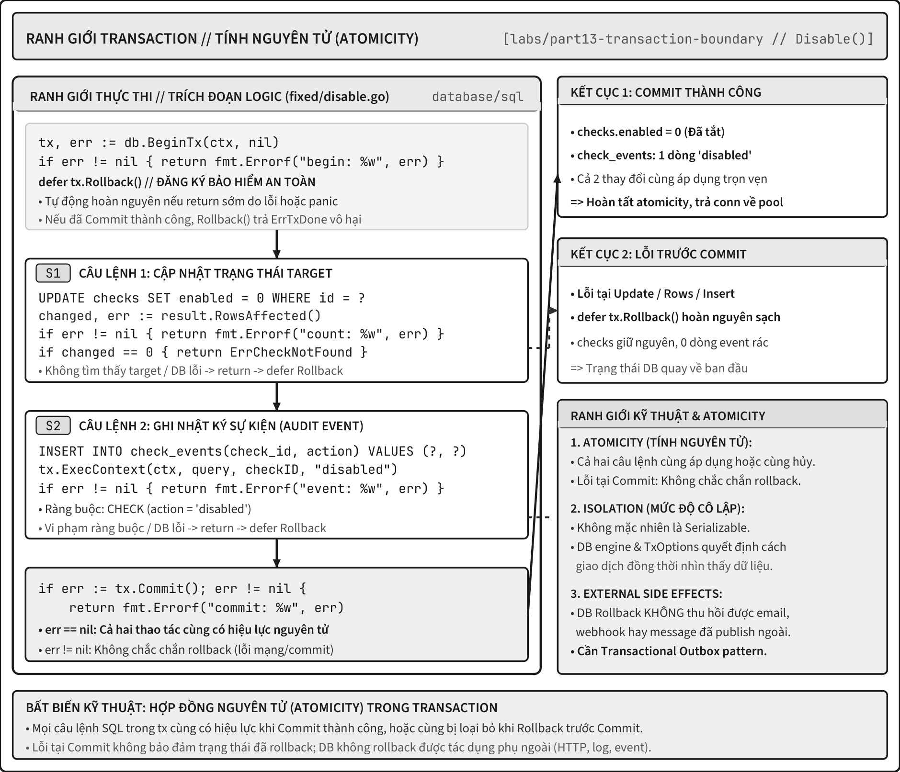

<!-- BOOK_ROLE: FOUNDATION_BRIDGE -->

# Chương 13 — Một thay đổi hoặc không có gì

Một buổi trực, dịch vụ trả mã `500` cho thao tác tắt một điểm kiểm tra đang gặp lỗi. Người trực ca tin rằng yêu cầu thất bại nên thực hiện gọi lại. Lần đọc tiếp theo lại cho thấy điểm kiểm tra đã bị tắt, nhưng nhật ký kiểm toán (*audit log*) không ghi nhận dòng nào về danh tính người thực hiện. Đây không phải lỗi bỏ quên nhật ký đơn thuần. Từ ngoài nhìn vào, hệ thống đang kể hai câu chuyện mâu thuẫn về cùng một thay đổi.

Trạng thái bền vững sẽ được yêu cầu kế tiếp, tiến trình khác hoặc lần khởi động sau sử dụng. Câu hỏi đầu tiên là: sau thao tác nhiều bước, những trạng thái nào được phép tồn tại? Mô hình tư duy của chương là ranh giới xác nhận: các thay đổi cùng ý nghĩa nghiệp vụ phải được xác nhận hoặc hoàn nguyên cùng nhau. Tính nguyên tử bảo vệ kết cục lưu trữ; việc người đọc đồng thời thấy gì còn phụ thuộc mức cô lập, snapshot và cách họ nhóm các lần đọc. Hai truy vấn độc lập vẫn có thể đọc một phần trước và một phần sau commit, dù giao dịch ghi nguyên tử.

## Một `if err != nil` không tự tạo atomicity

Giả sử API `Disable` cần làm hai việc: đổi `checks.enabled` thành `false`, rồi ghi event `disabled`. Đoạn code ngây thơ có vẻ cẩn thận vì đã kiểm tra error sau từng câu SQL:

~~~go
if _, err := db.ExecContext(ctx,
	"UPDATE checks SET enabled = 0 WHERE id = ?", checkID,
); err != nil {
	return err
}

if _, err := db.ExecContext(ctx,
	"INSERT INTO check_events(check_id, action) VALUES (?, ?)",
	checkID, "disabled",
); err != nil {
	return err
}
~~~

Nhưng hai lời gọi độc lập là hai ranh giới thực thi tách biệt. Nếu câu lệnh `UPDATE` thành công còn `INSERT` lỗi vì vi phạm ràng buộc toàn vẹn (*constraint*), hàm trả về lỗi thật, song cơ sở dữ liệu vẫn giữ điểm kiểm tra ở trạng thái tắt. Bên gọi có lý do để thực hiện thử lại; người điều tra sự cố đối mặt với một trạng thái thiếu nguyên nhân phát sinh. Không có dòng `if` nào tự động đảo ngược câu lệnh đầu tiên chỉ vì câu lệnh kế tiếp thất bại.

Giao dịch thông báo cho cơ sở dữ liệu rằng tập câu lệnh thuộc một đơn vị công việc: các thay đổi được xác nhận hoặc hoàn nguyên cùng nhau theo contract của hệ quản trị. Tính nguyên tử không có nghĩa “hàm Go trả lỗi thì chắc chắn chưa commit”. Nếu phản hồi xác nhận bị mất, bên gọi có thể không biết kết cục dù phía lưu trữ đã quyết định. Khi `Commit` trả lỗi, tài liệu Go yêu cầu bỏ các kết quả của giao dịch vì không còn xác nhận được chúng là hợp lệ; việc truy vấn lại hoặc thử lại cần định danh thao tác và policy của database/driver.

@figure Sơ đồ khái niệm về tính nguyên tử (*atomicity*) của thao tác `Disable`. Hình không khẳng định mức độ cô lập (*isolation level*) nào; cơ sở dữ liệu, trình điều khiển (*driver*) và `TxOptions` mới quyết định chi tiết mức cô lập được hỗ trợ.

> **Dừng để dự đoán:** Nếu câu lệnh ghi sự kiện bị từ chối, ca kiểm thử nào chứng minh điểm kiểm tra vẫn giữ trạng thái `enabled`? Việc chỉ kiểm tra hàm trả về lỗi chưa đủ; trạng thái của dữ liệu sau sự cố mới là điều hợp đồng hành vi phải khóa chặt.

### Bài thực hành: Làm cho thất bại không để lại dấu vết nửa chừng

Bài thực hành dùng SQLite trong bộ nhớ (*in-memory*) qua gói `modernc.org/sqlite`, một trình điều khiển thuần Go. Lý do chọn công cụ này là để kiểm thử chạy cục bộ độc lập, không cần Docker, thông tin xác thực hay kết nối mạng. Gói `database/sql` vẫn là giao diện lập trình chính; trình điều khiển là bộ chuyển đổi thích ứng theo phương ngữ (*dialect*) và giao thức của cơ sở dữ liệu cụ thể. Việc dùng SQLite không phải lời khuyên thay thế PostgreSQL cho mọi dịch vụ: cơ chế giữ chỗ tham số (*placeholder*), khả năng xử lý đồng thời (*concurrency*) và hành vi vận hành giữa hai hệ thống là hoàn toàn khác biệt.

Mở `exercise/disable_test.go` trước. Test đã dựng schema và nêu API, nhưng chưa cho implementation. Cần viết hàm `Disable` sao cho thỏa mãn đủ bốn giao ước:

Một là, `check` tồn tại được tắt và có đúng một event `disabled`.

Hai là, không có `check` thì trả `ErrCheckNotFound`, không tự tạo event.

Ba là, nếu event không thể ghi, `check` vẫn giữ `enabled = true`.

Bốn là, `nil` database là lỗi ở API boundary, không phải một lỗi `panic` muộn trong goroutine hay driver.

~~~powershell
cd labs/part13-transaction-boundary
go test -tags exercise ./exercise
go test -race -tags exercise ./exercise
go test ./fixed
go test -race ./fixed
~~~

Đừng mở `fixed/` trước lượt tự làm đầu tiên. Contract đã nói rõ điều gì phải đúng, còn thiết kế do người học chủ động quyết định: transaction được mở ở đâu, cleanup đặt thế nào, statement nào phải chạy qua `tx` thay vì `db`, và `RowsAffected` được dùng ra sao để phân biệt không tìm thấy check với cập nhật thành công.

~~~go
// Đáp án tham chiếu: một transaction, một commit.
func Disable(
	ctx context.Context,
	db *sql.DB,
	checkID int64,
) error {
	if db == nil {
		return errors.New("database is required")
	}
	tx, err := db.BeginTx(ctx, nil)
	if err != nil {
		return fmt.Errorf("begin disable transaction: %w", err)
	}
	defer tx.Rollback()

	result, err := tx.ExecContext(ctx,
		"UPDATE checks SET enabled = 0 WHERE id = ?", checkID,
	)
	if err != nil {
		return fmt.Errorf("disable check: %w", err)
	}
	changed, err := result.RowsAffected()
	if err != nil {
		return fmt.Errorf("count disabled checks: %w", err)
	}
	if changed == 0 {
		return ErrCheckNotFound
	}

	if _, err := tx.ExecContext(
		ctx,
		"INSERT INTO check_events(check_id, action) " +
			"VALUES (?, ?)",
		checkID,
		"disabled",
	); err != nil {
		return fmt.Errorf("record disable event: %w", err)
	}
	if err := tx.Commit(); err != nil {
		return fmt.Errorf("commit disable: %w", err)
	}
	return nil
}
~~~

Sau khi tự làm, hãy đối chiếu `fixed/disable.go`. `defer tx.Rollback()` đặt ngay sau `BeginTx` bảo vệ những đường thoát trước khi giao dịch kết thúc; mọi statement của đơn vị phải chạy qua `tx`, không chen `db.ExecContext` ở ngoài. Sau `Commit` thành công, rollback trả `sql.ErrTxDone`. Trong Go 1.27.1, nếu đã gọi `driver.Tx.Commit` rồi driver trả lỗi, `sql.Tx` cũng đã đánh dấu kết thúc: deferred rollback không gọi ngược xuống driver để đảo commit. Test `TestCommitErrorDoesNotMakeDeferredRollbackUndoCommit` dùng driver giả cố ý trả lỗi xác nhận để kiểm chứng vòng đời thật của `database/sql`; nó không giả làm thí nghiệm mất gói tin với database thật. Cleanup của Go và kết cục lưu trữ là hai ranh giới khác nhau.

Phương thức `RowsAffected` trả về số dòng bị tác động do trình điều khiển cung cấp; một số hệ cơ sở dữ liệu hoặc câu lệnh đặc thù có thể không hỗ trợ thông tin này. Bài thực hành dùng SQLite, nơi hợp đồng này được kiểm chứng nhất quán. Trong dịch vụ thực tế, kỹ sư cần chọn cách phân biệt trường hợp không tìm thấy bản ghi dựa trên ngữ nghĩa của hệ quản trị và truy vấn đang dùng, thay vì xem một phương thức tiện tay là quy chuẩn chung của SQL.

Ký tự `?` cũng không phải cú pháp giữ chỗ phổ quát. Trình điều khiển SQLite dùng ký tự đó, trong khi nhiều trình điều khiển PostgreSQL lại dùng `$1`, `$2`. Tuy nhiên nguyên tắc cốt lõi không thay đổi: luôn truyền giá trị qua đối số của trình điều khiển, không ghép chuỗi đầu vào trực tiếp vào câu lệnh SQL. Cơ chế ràng buộc tham số (*parameter binding*) tách biệt dữ liệu khỏi cấu trúc cú pháp; cơ chế này không thay thế cho kiểm tra hợp lệ nghiệp vụ, nhưng ngăn ngừa việc biến `target` hay `checkID` thành một mảnh mã lệnh ngoài ý muốn.

## `*sql.DB` là một handle dùng chung, không phải “một connection”

Gói `database/sql` là thư viện chuẩn cung cấp giao diện lập trình chung cho các cơ sở dữ liệu quan hệ; nó luôn cần một trình điều khiển cụ thể để hoạt động. Theo tài liệu của thư viện, kiểu `*sql.DB` là một đối tượng xử lý (*handle*) an toàn khi dùng đồng thời và quản lý một tập kết nối dùng chung (*connection pool*). Vì thế, hãy giữ đối tượng này tại ranh giới vòng đời ứng dụng và đóng lại khi tiến trình dừng hoạt động; tránh tạo mới rồi đóng `*sql.DB` theo từng yêu cầu HTTP riêng lẻ.

Một hiểu lầm phổ biến là xem `sql.Open` như bằng chứng cho thấy cơ sở dữ liệu đang hoạt động thông suốt. Việc mở đối tượng xử lý thường không thiết lập kết nối mạng ngay lập tức. Khi quá trình khởi động hoặc chính sách kiểm tra sức khỏe cần xác nhận khả năng tiếp cận máy chủ, hãy dùng `PingContext` kèm thời hạn xử lý (*deadline*) phù hợp; tránh biến lệnh kiểm tra này thành thủ tục bắt buộc trước mỗi truy vấn.

~~~go
func OpenAndCheck(
	ctx context.Context,
	dsn string,
) (*sql.DB, error) {
	db, err := sql.Open("sqlite", dsn)
	if err != nil {
		return nil, fmt.Errorf("open database handle: %w", err)
	}
	if err := db.PingContext(ctx); err != nil {
		db.Close()
		return nil, fmt.Errorf("ping database: %w", err)
	}
	return db, nil
}
~~~

Ví dụ này chỉ minh họa boundary. Nó không chép sẵn `SetMaxOpenConns(50)` vì một con số đẹp không phải policy. Quản lý connection pool trong `database/sql` xoay quanh bốn chính sách cốt lõi và một giao diện quan sát:

Một là, `SetMaxOpenConns` đặt trần cho tổng số kết nối mở tại một thời điểm, bao gồm cả kết nối đang bận thực thi lẫn kết nối rảnh trong pool. Mặc định giá trị này bằng 0 (không giới hạn). Khi chạm trần, các truy vấn tiếp theo bị chặn và xếp hàng chờ cho đến khi có kết nối được giải phóng hoặc context bị hủy. Nếu một goroutine đang giữ một kết nối trong transaction lại cố gắng thực hiện một truy vấn độc lập từ cùng pool mà không còn kết nối trống, việc chạm trần sẽ trực tiếp dẫn đến bế tắc đồng thời (deadlock).

Hai là, `SetMaxIdleConns` khống chế số lượng kết nối rảnh tối đa được giữ lại trong pool. Giá trị mặc định trong tài liệu hiện hành của thư viện chuẩn là 2 (tài liệu lưu ý giá trị mặc định này có thể thay đổi trong các phiên bản tương lai). Nếu ứng dụng đặt `SetMaxOpenConns` rất cao nhưng giữ nguyên `SetMaxIdleConns` bằng 2, sau mỗi đợt tăng tải đột biến, toàn bộ các kết nối dư thừa sẽ bị đóng ngay lập tức, dẫn đến hiện tượng mở và đóng kết nối liên tục (connection churn), tiêu tốn chi phí bắt tay kết nối và xác thực tài khoản.

Ba là, `SetConnMaxIdleTime` xác định thời gian rảnh rỗi tối đa mà một kết nối được phép nằm chờ trong pool trước khi bị thu hồi (đóng lười khi rảnh), giúp thu nhỏ kích thước pool về mức tối thiểu trong những khung giờ thấp điểm.

Bốn là, `SetConnMaxLifetime` quy định tuổi thọ tối đa mà một kết nối được phép tiếp tục tái sử dụng (reuse) tính từ thời điểm khởi tạo; các kết nối quá hạn có thể được đóng một cách lười (lazily) trước khi tái sử dụng. Đây không phải cơ chế ngắt cưỡng chế (hard kill) khi kết nối đang bận phục vụ truy vấn. Việc chủ động đặt giới hạn tuổi thọ kết nối giúp làm mới tài nguyên kết nối định kỳ theo yêu cầu của hạ tầng hoặc máy chủ cơ sở dữ liệu.

Năm là, phương thức `DB.Stats()` cung cấp dữ liệu quan sát trực tiếp tại thời gian chạy qua cấu trúc `sql.DBStats`. Các trường `OpenConnections`, `InUse`, `Idle`, `WaitCount`, `WaitDuration`, `MaxIdleClosed`, `MaxIdleTimeClosed` và `MaxLifetimeClosed` phục vụ việc chẩn đoán xem ứng dụng có đang gặp tình trạng thiếu hụt kết nối hay phải xếp hàng chờ đợi kéo dài hay không; đây là số liệu quan sát hỗ trợ điều tra, không phải lời khẳng định nguyên nhân gốc rễ duy nhất. Việc lựa chọn thông số pool phải dựa trên năng lực chịu tải của máy chủ cơ sở dữ liệu phía sau, số lượng bản sao tiến trình cùng chia sẻ tài nguyên, và số liệu thực nghiệm từ `DB.Stats()`, tránh sao chép những con số cảm tính.

Cơ chế hủy bỏ (*cancellation*) cũng dừng lại tại ranh giới của trình điều khiển. Phương thức `QueryContext` và `BeginTx` nhận đối số ngữ cảnh (`context.Context`), nhưng tài liệu `database/sql` ghi rõ rằng nếu trình điều khiển không hỗ trợ hủy bỏ ngữ cảnh thì phương thức có thể chỉ trả về kết quả sau khi truy vấn đã hoàn tất trên máy chủ. Ngữ cảnh vẫn phải được truyền xuyên suốt; đồng thời, thời hạn thực tế của truy vấn cần được kiểm chứng với đúng trình điều khiển và máy chủ cơ sở dữ liệu trước khi đưa vào mục tiêu mức dịch vụ (*SLO*).

## Đọc cũng mượn tài nguyên

Phương thức `QueryRowContext` phù hợp khi truy vấn được kỳ vọng trả về tối đa một dòng dữ liệu; lỗi phát sinh sẽ xuất hiện trong bước quét dữ liệu `Scan`. Phương thức này không kiểm tra tính duy nhất: nếu truy vấn trả về nhiều dòng, `Scan` chỉ đọc dòng đầu tiên và bỏ qua phần còn lại; nếu không có dòng nào, nó trả về lỗi `sql.ErrNoRows`. Bất biến nghiệp vụ rằng chỉ có duy nhất một bản ghi phải do câu truy vấn hoặc lược đồ dữ liệu bảo đảm, không thể tự suy diễn từ tên hàm. Khi làm việc với nhiều dòng, `QueryContext` trả về `*Rows`, đại diện cho dòng kết quả và tài nguyên của trình điều khiển. Hãy đóng đối tượng này trên mọi nhánh trả về, duyệt qua toàn bộ dữ liệu rồi kiểm tra lỗi lặp qua phương thức `rows.Err()`.

~~~go
rows, err := db.QueryContext(ctx,
	"SELECT id, target FROM checks WHERE enabled = ?", true,
)
if err != nil {
	return nil, fmt.Errorf("list enabled checks: %w", err)
}
defer rows.Close()

var checks []Check
for rows.Next() {
	var check Check
	if err := rows.Scan(&check.ID, &check.Target); err != nil {
		return nil, fmt.Errorf("scan check: %w", err)
	}
	checks = append(checks, check)
}
if err := rows.Err(); err != nil {
	return nil, fmt.Errorf("iterate checks: %w", err)
}
return checks, nil
~~~

Đoạn code này chưa đề cập đến mức cô lập (isolation level): việc thao tác đọc nhận diện được hàng dữ liệu nào khi có luồng ghi đồng thời đang chạy phụ thuộc hoàn toàn vào chính sách của giao dịch và cơ sở dữ liệu. Nó chỉ chốt vòng đời ở phía Go: truy vấn đã mượn tài nguyên thì hàm phải hoàn trả. Đây là cùng một trách nhiệm ta đã gặp với response body ở Chương 11 và listener ở Chương 12, chỉ ở một ranh giới khác.

## Câu lệnh chuẩn bị sẵn (Prepared Statement) và ranh giới tài nguyên

`PrepareContext` tạo một statement có thể thực thi nhiều lần với các đối số khác nhau. Driver và hệ quản trị quyết định nó chuẩn bị, lập kế hoạch và tái sử dụng tài nguyên thế nào; `database/sql` không hứa một lần biên dịch SQL duy nhất cho cả pool. Statement tạo từ `DB` có thể được chuẩn bị lại trên kết nối khác, còn statement từ `Tx` gắn với kết nối của giao dịch. Ví dụ sau chuẩn bị một mẫu chèn sự kiện rồi dùng lại trong cùng `tx`:

~~~go
stmt, err := tx.PrepareContext(ctx,
	"INSERT INTO check_events(check_id, action) VALUES (?, ?)",
)
if err != nil {
	return fmt.Errorf("prepare insert event: %w", err)
}
defer stmt.Close()

for _, action := range actions {
	_, err := stmt.ExecContext(ctx, checkID, action)
	if err != nil {
		return fmt.Errorf("insert event %s: %w", action, err)
	}
}
~~~

Quy tắc sở hữu tài nguyên ở đây rất rõ ràng: một prepared statement tạo từ `db.PrepareContext` sống cùng với vòng đời của database handle và có thể tự động chuẩn bị lại trên các kết nối vật lý khác nhau trong pool khi cần thiết. Ngược lại, statement được tạo bên trong một transaction qua `tx.PrepareContext` gắn chặt với vòng đời của chính transaction đó; khi transaction kết thúc bằng `Commit` hoặc `Rollback`, statement này sẽ tự động đóng và không thể tiếp tục sử dụng. Lệnh `stmt.Close()` tường minh vẫn hữu ích khi muốn giải phóng tài nguyên sớm trước khi transaction hoàn tất, nhưng không phải điều kiện duy nhất để ngăn ngừa rò rỉ trong transaction.

Prepared statement không mặc định đồng nghĩa với việc mọi câu lệnh đều chạy nhanh hơn. Lợi ích tối ưu của prepared statement phát huy rõ rệt khi cùng một mẫu câu lệnh được thực thi lặp lại nhiều lần với các tham số khác nhau (chẳng hạn trong các vòng lặp chèn dữ liệu hàng loạt như dự án `opsprobe` ở Chương 20). Nếu một câu lệnh chỉ được gọi duy nhất một lần trong toàn bộ vòng đời của request, chi phí phụ trội để chuẩn bị câu lệnh cần được cân nhắc và đo đạc thực nghiệm với driver và hệ quản trị cơ sở dữ liệu cụ thể trước khi quyết định áp dụng.

Việc truyền giá trị qua tham số (parameter binding / placeholder) tách biệt rành mạch dữ liệu khỏi cấu trúc câu lệnh SQL, giúp phòng ngừa lớp lỗ hổng tấn công chèn mã SQL (SQL injection) do nối trực tiếp giá trị vào chuỗi truy vấn. Tuy nhiên, theo tài liệu hướng dẫn bảo mật chính thức của Go (`go.dev/doc/database/sql-injection`), parameter binding chỉ áp dụng cho các giá trị tham số; các thành phần động trong câu lệnh như tên bảng, tên cột, mệnh đề `ORDER BY` hoặc các đoạn SQL ghép nối vẫn cần ranh giới kiểm tra và danh sách trắng (allowlist) riêng.

## Transaction giải quyết được gì, và không giải quyết được gì

Giao dịch giúp gom nhóm các thao tác ghi trên cùng một cơ sở dữ liệu. Cơ chế này không tự biến lời gọi HTTP, việc phát thông điệp (*publish message*), vô hiệu hóa bộ nhớ đệm hay gửi thư điện tử thành một khối nguyên tử cùng với lệnh xác nhận (*commit*). Nếu hàm `Disable` vừa xác nhận giao dịch vừa gọi webhook, sự cố sau khi xác nhận có thể khiến cơ sở dữ liệu lưu dữ liệu mới nhưng webhook chưa từng được phát đi. Đó là một bài toán ranh giới khác, đòi hỏi định danh phân biệt, cơ chế thử lại có kiểm soát và mô hình hộp thư gửi đi (*outbox pattern*) khi yêu cầu nghiệp vụ đặt ra; một lệnh `defer tx.Rollback()` không thể giải quyết được ranh giới liên hệ thống này.

### Atomicity không làm retry tự nhiên an toàn

Nhìn lại sự cố mở đầu chương: phản hồi từ dịch vụ có thể bị thất lạc ngay sau khi lệnh `Commit` đã hoàn tất. Bên gọi chỉ quan sát thấy lỗi đường truyền mạng nhưng cơ sở dữ liệu đã thay đổi trạng thái bền vững. Giao dịch đã giữ đúng cam kết phạm vi hẹp của nó: câu lệnh `UPDATE` và `INSERT` cùng có hiệu lực hoặc cùng bị hủy bỏ. Tuy nhiên giao dịch chưa thể phân định lần gọi lại tiếp theo là cùng một thao tác cần lặp lại hay là một yêu cầu hoàn toàn mới.

Với hàm `Disable` trong bài thực hành, thao tác `UPDATE checks SET enabled = 0` thoạt nhìn có vẻ mang tính lũy đẳng (*idempotent*): chạy lại nhiều lần thì trường trạng thái vẫn giữ nguyên giá trị `false`. Tuy nhiên lệnh `INSERT` sự kiện kiểm toán sẽ ghi thêm một dòng bản ghi mới. Vì vậy, việc trạng thái đích đạt giá trị mong muốn chưa đủ để kết luận thao tác thử lại là an toàn; các tác dụng phụ (*side effects*) như nhật ký kiểm toán, thông báo hoặc hạn ngạch có thể biến đổi theo mỗi lượt thực thi. Kiểm thử `TestDisableRepeatedCallRecordsAnotherAuditEvent` cố ý chứng minh hợp đồng hiện tại của bài thực hành: việc gọi `Disable` hai lần sẽ tạo ra hai sự kiện độc lập. Kiểm thử thành công không phải bằng chứng khẳng định giao diện lập trình an toàn khi gọi lại; đó là thực nghiệm để tránh ngộ nhận rằng tính nguyên tử đương nhiên đồng nghĩa với tính lũy đẳng.

Khi yêu cầu nghiệp vụ quy định bên gọi có thể thử lại cùng một thao tác nhưng hệ thống chỉ được sinh ra duy nhất một tác dụng phụ, giao diện lập trình bắt buộc phải có định danh cho thao tác đó: chẳng hạn khóa lũy đẳng (*idempotency key*) được bên gọi lưu giữ qua các lần gửi lại. Dịch vụ cần nhận diện xem khóa này đã được xử lý hay chưa để trả về kết quả tương ứng, thường bằng ràng buộc duy nhất (*unique constraint*) hoặc bản ghi theo dõi trạng thái nằm trong cùng giao dịch cơ sở dữ liệu. Các chi tiết như cấu trúc phản hồi khi phát hiện khóa trùng lặp, thời gian lưu giữ khóa và những tác dụng phụ nào thuộc về cùng thao tác đều là thành phần trong cam kết của dịch vụ. Chúng không thể tự động hình thành chỉ nhờ lời gọi `BeginTx`.

> **Dừng để dự đoán:** Một bên gọi gửi yêu cầu `Disable` nhưng gặp lỗi quá hạn thời gian chờ (*timeout*) ở tầng truyền tải mạng và phản hồi từ dịch vụ bị thất lạc. Tại thời điểm nhận lỗi quá hạn, bên gọi chỉ biết mình chưa nhận được kết quả, trong khi phía máy chủ có thể đã xác nhận thành công hoặc chưa từng hoàn tất giao dịch. Nếu bên gọi tự ý gửi lại lệnh `Disable` mà không mang theo khóa lũy đẳng, việc quan sát thấy trường `enabled = false` cùng số lượng bản ghi sự kiện kiểm toán tăng lên 2 sau đó nói lên điều gì về sự khác biệt giữa sự thật phía máy chủ và bằng chứng bên gọi sở hữu, cũng như ranh giới an toàn của việc thử lại?

#### Gợi ý giải pháp (chỉ đọc sau khi đã tự làm)

Sự cố mạng làm đứt gãy kênh truyền khiến bên gọi chỉ sở hữu một bằng chứng duy nhất: yêu cầu đã quá hạn thời gian chờ, hoàn toàn không có bằng chứng xác nhận máy chủ đã kịp hoàn tất giao dịch hay chưa. Trong thực tế, máy chủ có thể đã xác nhận giao dịch thành công trước khi gói tin phản hồi bị rơi rụng trên đường truyền. Khi bên gọi tự động gửi lại lệnh mà không có khóa lũy đẳng, trạng thái `enabled = false` trên bảng `checks` không chứng minh được lần gọi nào đã tạo nên kết quả, bởi tài nguyên có thể đã tắt từ lần gọi đầu tiên hoặc do một tiến trình khác can thiệp.

Bằng chứng rõ ràng nhất nằm ở bảng `check_events`: số lượng bản ghi tăng lên 2 khẳng định giao dịch thứ hai đã thực thi độc lập và ghi thêm tác dụng phụ. Tình huống này chứng minh tính nguyên tử (*atomicity*) của giao dịch chỉ bảo đảm các câu lệnh trong một phiên cùng thành công hoặc cùng thất bại, chứ không tự động mang lại tính an toàn khi gọi lại (*idempotency*). Để bên gọi có thể thử lại an toàn sau các lỗi mạng không chắc chắn, hệ thống bắt buộc phải cung cấp hợp đồng thử lại tường minh thông qua khóa lũy đẳng được kiểm tra và lưu vết nguyên tử cùng giao dịch nghiệp vụ.

Tương tự, giao dịch không tự động biến mọi thao tác đồng thời thành tuần tự. Cấu trúc `sql.TxOptions` cho phép bên gọi yêu cầu mức độ cô lập (*isolation level*); khi bên gọi yêu cầu mức cô lập khác mặc định mà trình điều khiển không hỗ trợ, `BeginTx` sẽ trả về lỗi. Hệ quản trị và trình điều khiển thực tế mới là nơi quyết định các hiện tượng dị thường đọc dữ liệu (*read anomalies*), cơ chế khóa và độ trễ phản hồi có ngữ nghĩa ra sao. Do đó, trước khi dùng mức cô lập để bảo vệ một bất biến nghiệp vụ thực tế, kỹ sư cần đọc kỹ tài liệu cơ sở dữ liệu, thiết kế kiểm thử tranh chấp cho bất biến đó và đo lường lỗi cũng như thời gian chờ khóa. Trong chương này, ta tập trung khóa chặt một hợp đồng hành vi có thể kiểm chứng cục bộ: nếu thao tác ghi sự kiện gặp lỗi thì thao tác cập nhật dữ liệu không được phép tồn tại.

## Giết process ở khe giữa hai lời hứa

Một yêu cầu cộng 7 đơn vị đã xác nhận thành công trên cơ sở dữ liệu, nhưng bên gọi chưa kịp nhận phản hồi thì tiến trình bị dừng đột ngột. Khi khởi động lại, dịch vụ có được phép cộng thêm 7 đơn vị nữa hay không? Nếu hệ thống còn phải phát đi một sự kiện thông báo, làm sao tiến trình mới biết được sự kiện ấy chưa từng được gửi? Hai câu hỏi này không có cùng lời giải. Cơ sở dữ liệu có thể ghi nhận thao tác đã hoàn tất trong khi nghĩa vụ phát tán thông điệp ra bên ngoài vẫn còn dang dở.

Thực hành tại thư mục `labs/part13-transaction-boundary/outbox` thu gọn bài toán vào ba thành phần: một giá trị số dư, một khóa thao tác (*operation key*) và một sự kiện tương ứng. Dữ liệu tải trọng (*payload*) là số nguyên `delta` có giá trị từ 1 đến 100; việc lặp lại cùng khóa và cùng giá trị gia số được coi là thao tác thử lại của cùng một lệnh, trong khi việc thay đổi giá trị gia số trên cùng khóa sẽ bị từ chối bằng lỗi `ErrConflict`. Đây là quy ước dữ liệu của bộ kiểm thử, không phải thuật toán chuẩn hóa JSON hay chính sách lưu trữ áp dụng cho mọi hệ thống. Hãy mở tập tin `TestOutboxContract` trước khi đọc `store.go`: yêu cầu của bài thực hành là sau khi xác nhận giao dịch, số dư chỉ được tăng đúng một lần và nghĩa vụ gửi sự kiện bắt buộc phải tồn tại bền vững.

Phiên bản lỗi `BrokenApply` ghi nhận số dư cùng bản ghi thao tác, xác nhận giao dịch, rồi mới cố gắng chèn sự kiện vào bảng hàng đợi (*outbox*). Tiến trình con kết thúc đột ngột bằng lệnh `os.Exit(77)` ngay sau bước xác nhận: các hàm dọn dẹp trì hoãn (*deferred cleanup*) hoàn toàn không có cơ hội thực thi. Khi mở cơ sở dữ liệu bằng kết nối mới, kiểm thử ghi nhận số dư đã tăng nhưng không hề tồn tại sự kiện nào ở trạng thái chờ gửi (*pending*). Thao tác gửi lại với cùng khóa thao tác cũng không thể khắc phục: bản ghi thao tác đã tồn tại từ trước khiến nhánh tạo sự kiện bị bỏ qua. Một tác vụ quét bộ nhớ khi khởi động lại ứng dụng không thể khôi phục một nghĩa vụ chưa từng được ghi xuống đĩa cứng.

Phiên bản khắc phục đưa toàn bộ ba thao tác ghi vào trong cùng một giao dịch: đặt chỗ trước cho khóa bằng ràng buộc duy nhất (*unique constraint*), cập nhật số dư, và lưu sự kiện ở trạng thái chờ gửi. Câu lệnh đầu tiên là thao tác ghi trực tiếp; bài thực hành không đọc trước rồi mới nâng mức khóa trong hai giao dịch cạnh tranh nhau. Hai kết nối gửi cùng một khóa thao tác được kiểm thử độc lập: chỉ duy nhất một thao tác nghiệp vụ và một sự kiện tương ứng được phép tồn tại. Thao tác gửi trùng lặp sẽ đối chiếu lại dữ liệu tải trọng trước khi hoàn tất; hệ thống không mặc định coi một khóa hợp lệ là quyền được thay đổi dữ liệu đã được chấp nhận trước đó.

@table Trạng thái phải nhìn thấy khi mở lại database sau process death

| Checkpoint chết | Dữ liệu nghiệp vụ | Nghĩa vụ gửi | Hành động khi khôi phục |
| --- | --- | --- | --- |
| Trước xác nhận giao dịch | Chưa cộng; không có bản ghi thao tác. | Không có sự kiện. | Gửi lại cùng khóa để thực hiện. |
| Sau xác nhận, trước phản hồi | Đã cộng đúng một lần. | Chờ xử lý (*pending*). | Thử lại không cộng thêm; bộ phân phối đọc bản ghi chờ. |
| Phía nhận đã xác nhận, trước khi đánh dấu hoàn tất | Đã cộng ở cả hai phía. | Phía gửi vẫn chờ xử lý. | Gửi lại cùng định danh; phía nhận khử trùng lặp. |

Chạy bộ kiểm thử từ mô-đun Chương 13; mỗi lượt thực thi sử dụng tập tin tạm riêng biệt do kiểm thử quản lý, không tác động đến cơ sở dữ liệu của dự án:

~~~powershell
go test -count=1 -v ./outbox
go test -race ./outbox
~~~

Kiểm thử `TestRecoveryWindows` là tên bộ kiểm thử các khoảng thời gian xảy ra lỗi (*failure windows*), không phải bài kiểm thử chỉ dành riêng cho hệ điều hành Windows. Kịch bản này kích hoạt một tiến trình con chạy đến điểm kiểm tra (*checkpoint*), yêu cầu mã thoát 77, sau đó mở lại tập tin cơ sở dữ liệu để xác minh trạng thái. Lượt điều phối phục hồi sự kiện cũng được khởi chạy trong một tiến trình mới độc lập. Trường hợp sau khi gửi dùng tập tin cơ sở dữ liệu riêng của phía nhận: không hề có giao dịch phân tán xuyên qua hai tập tin, nhưng phía nhận lưu định danh hộp thư đến (*inbox identity*) cùng tác dụng phụ tương ứng trong cùng một giao dịch cục bộ. Tình huống mất gói tin xác nhận (*acknowledgment*) dẫn đến việc gửi lặp hai lần nhưng chỉ tạo ra một hiệu ứng duy nhất; đó là hợp đồng lũy đẳng của phía nhận, không phải cơ chế chuyển phát chính xác một lần (*exactly-once delivery*).

Bộ điều phối (*dispatcher*) trong bài thực hành chỉ có một bên sở hữu duy nhất, kể cả giữa các tiến trình khác nhau. Thành phần này duy trì sự kiện ở trạng thái chờ gửi cho đến khi bộ truyền tin báo thành công rồi mới đánh dấu đã hoàn tất. Nhờ đó, hệ thống không gặp tình trạng cờ xử lý bị treo kẹt sau khi tiến trình dừng đột ngột; đổi lại, cơ chế chưa hỗ trợ thuê bao tài nguyên (*lease*) để nhiều bộ điều phối cùng chia sẻ khối lượng công việc. Việc thử lại sau các lỗi không rõ kết quả có thể dẫn đến việc phát lại sự kiện. Nếu phía nhận không có cơ chế khử trùng lặp bền vững gắn nguyên tử với tác dụng phụ, hoặc xóa định danh quá sớm, mô hình hộp thư gửi đi không thể ngăn chặn hoàn toàn hiệu ứng lặp lại. Khi tích hợp dịch vụ bên ngoài, kỹ sư cần tìm hiểu kỹ hợp đồng lũy đẳng và thời gian lưu giữ khóa của nhà cung cấp dịch vụ, thay vì giả định dựa trên hành vi cục bộ của SQLite.

> **Dừng để dự đoán:** Đặt `RELIABILITY_MUTANT=split_commit` rồi chạy chỉ `TestOutboxContract`; ca kiểm thử sẽ báo đỏ với số dư 7 nhưng pending 0. Bỏ biến môi trường ấy và chạy lại. Vì sao đổi thứ tự thành “đánh dấu completed rồi send” chỉ chuyển từ nguy cơ gửi lặp sang nguy cơ mất event?

#### Gợi ý giải pháp (chỉ đọc sau khi đã tự làm)

Tiến trình (*process*) có thể dừng đột ngột sau `completed` nhưng trước khi kịp gọi `send`, khiến lần khởi động lại không còn nhận diện được tác vụ cần hoàn tất. Giữ trạng thái `pending` cho tới khi nhận xác nhận (*acknowledgment*) sẽ đảm bảo nghĩa vụ gửi có thể phục hồi, nhưng không khép kín được khoảng trống sau `send`. Tính nguyên tử cục bộ chỉ bảo vệ tính nhất quán của dữ liệu và nghĩa vụ; chính định danh tại phía nhận (*receiver identity*) mới triệt tiêu nguy cơ trùng lặp khi tác vụ được gửi lại.

Bài thực hành cố định phiên bản trình điều khiển `modernc.org/sqlite v1.59.0`, thiết lập nhật ký hoàn nguyên dạng `DELETE`, cờ đồng bộ `synchronous=FULL` và thời gian chờ bận 5 giây trên mỗi kết nối. Bằng chứng thực nghiệm đã kiểm chứng là kịch bản tiến trình dừng đột ngột tại điểm kiểm tra, không bao gồm các sự cố mất điện nguồn, hỏng hóc đĩa vật lý hay lỗi hệ thống tệp mạng. Các giả định về cơ chế khóa và đồng bộ dữ liệu xuống đĩa của SQLite vẫn phải được thỏa mãn; một lệnh thoát tiến trình `os.Exit` không thể chứng minh toàn bộ độ bền vững của toàn bộ ngăn xếp lưu trữ.

## Tiến hóa lược đồ dữ liệu (Schema Migration) như một trạng thái bền vững

Cấu trúc bảng và các ràng buộc dữ liệu (schema) cũng là trạng thái bền vững. Mã nguồn ứng dụng có thể được rollback về một commit Git cũ chỉ trong vài giây, nhưng dữ liệu trên đĩa cứng đã bị thay đổi thì không thể đảo ngược một cách tự động. Khi dịch vụ bước vào môi trường sản xuất có dữ liệu người dùng thật, việc gọi các câu lệnh tạo bảng tùy tiện trong mã khởi động không còn là giải pháp khả thi. Quản lý schema đòi hỏi sáu nguyên tắc kỷ luật:

Một là, thứ tự di chuyển có phiên bản (*versioned migration ordering*). Mọi thay đổi lược đồ dữ liệu phải được biểu diễn thành các bước tuần tự có đánh số phiên bản hoặc nhãn thời gian tăng dần, được lưu trữ trong một bảng quản lý (như `schema_migrations`). Mỗi bước chỉ được thực thi đúng một lần và theo đúng thứ tự đã định.

Hai là, quyền sở hữu di chuyển lược đồ (*migration ownership*). Một phương án triển khai phổ biến là giao quyền hạn thực thi cho một quy trình phát hành chuyên trách (như Kubernetes Job hoặc bước chạy đường ống CI/CD trước khi cập nhật khối lượng công việc). Tuyệt đối không để hàng chục thể hiện của ứng dụng cùng khởi động và cùng tranh chấp chạy các câu lệnh DDL mà không có cơ chế điều phối, vì điều này có thể dẫn đến xung đột khóa và gây dừng hoạt động hệ thống.

Ba là, tính tương thích khi triển khai (*deployment compatibility*). Trong các chiến lược triển khai không gián đoạn (như cập nhật cuốn chiếu *rolling update* hay triển khai song song *blue-green*), phiên bản mã nguồn cũ và phiên bản mã nguồn mới sẽ cùng chạy đồng thời trong một khoảng thời gian. Một chiến lược thường dùng là Mở rộng - Di chuyển - Thu hẹp (*Expand - Migrate - Contract*): khi cần thêm một cột mới, cột đó cho phép giá trị NULL hoặc có giá trị mặc định để mã nguồn cũ chưa biết đến cột này vẫn hoạt động bình thường; sau khi toàn bộ thể hiện mới đã vận hành ổn định, mới tiến hành bước dọn dẹp các trường lỗi thời.

Bốn là, chiến lược xử lý sự cố khi nâng cấp dữ liệu. Phương án sửa tiến (*forward-fix*) thường được ưu tiên trong thực tế vận hành để tránh nguy cơ mất mát dữ liệu mới phát sinh trong giai đoạn chuyển tiếp nếu chạy tập lệnh đảo ngược (*down migration*). Tuy nhiên, lựa chọn giữa sửa tiến và hoàn nguyên (*rollback*) phụ thuộc vào mô hình lỗi, tính toàn vẹn của dữ liệu và chính sách vận hành của từng hệ thống.

Năm là, khả năng đặt các câu lệnh định nghĩa dữ liệu (*DDL*) trong giao dịch phụ thuộc vào hệ quản trị và phiên bản. PostgreSQL cho phép nhiều thao tác như `CREATE TABLE`, `ALTER TABLE` nằm trong giao dịch, nhưng vẫn phải xét khóa và ngoại lệ như `CREATE INDEX CONCURRENTLY`. SQLite cho phép giao dịch chứa DDL; lab kiểm chứng `ALTER TABLE ADD COLUMN`. MySQL 8.0 có DDL nguyên tử cho những statement được hỗ trợ; với thao tác trên bảng, khả năng này còn phụ thuộc storage engine, cụ thể là InnoDB. DDL nguyên tử từng statement không phải giao dịch DDL do ứng dụng quản lý: phần lớn DDL gây xác nhận ngầm định (*implicit commit*), nên không thể gom tùy ý với những thay đổi khác rồi hoàn nguyên chung. `CREATE TEMPORARY TABLE` là ngoại lệ không gây implicit commit, nhưng bảng được tạo vẫn không bị xóa bởi `ROLLBACK`. Phải đọc contract của đúng statement, không áp một quy tắc chung cho mọi DDL.

Sáu là, kiểm thử tiến hóa lược đồ dữ liệu (*schema evolution*). Bài thực hành của chương chứng minh cơ chế này qua kiểm thử `TestSchemaMigrationOrderingAndRollback`. Việc nâng cấp lược đồ từ phiên bản 1 lên phiên bản 2 được thực thi trong giao dịch nguyên tử. Kiểm thử chủ động tạo kịch bản di chuyển lỗi (thêm cột `failed_col` nhưng hoàn nguyên giao dịch trước khi hoàn tất ghi nhận phiên bản) và kiểm tra qua `PRAGMA table_info` cùng bảng `schema_migrations` để xác nhận cột hủy không tồn tại và số hiệu phiên bản giữ nguyên ở mức 1; sau đó mới thực thi bước nâng cấp v2 hợp lệ và xác nhận thành công.

## Ranh giới bộ nhớ đệm (Cache Consistency) và nguồn chân lý

Khi lưu lượng đọc tăng cao, việc đưa thêm một lớp bộ nhớ đệm (*cache*) vào kiến trúc là giải pháp phổ biến để giảm tải cho cơ sở dữ liệu. Tuy nhiên, bộ nhớ đệm là một ranh giới hoàn toàn tách biệt khỏi cơ sở dữ liệu. Trong thiết kế của chương này, cơ sở dữ liệu là nguồn chân lý duy nhất (*single source of truth*).

Mô hình đệm thông dụng nhất là đệm bên cạnh (*Cache-Aside*): Khi đọc, ứng dụng kiểm tra bộ nhớ đệm trước; nếu không có dữ liệu (*cache miss*), nó đọc từ cơ sở dữ liệu rồi lưu ngược lại vào bộ nhớ đệm. Khi cập nhật trạng thái: ứng dụng ghi thay đổi vào cơ sở dữ liệu trước, rồi mới tiến hành xóa hoặc vô hiệu hóa (*invalidate*) bản ghi tương ứng trong bộ nhớ đệm.

Vấn đề cốt lõi của tính nhất quán nằm ở ranh giới thất bại: nếu thao tác cập nhật cơ sở dữ liệu thành công nhưng lời gọi mạng xóa bộ nhớ đệm phía sau gặp sự cố (đứt kết nối mạng, quá hạn thời gian chờ, hoặc máy chủ đệm gặp sự cố dừng đột ngột), cơ sở dữ liệu đã mang trạng thái mới nhưng bộ nhớ đệm vẫn giữ nguyên giá trị cũ. Lượt đọc tiếp theo từ một bên gọi khác sẽ lấy dữ liệu lỗi thời từ bộ nhớ đệm (*stale read*), tạo ra tình huống hệ thống kể hai câu chuyện mâu thuẫn nhau.

Nguyên nhân căn bản là vì giao dịch cơ sở dữ liệu không thể bảo đảm tính nguyên tử cho một hệ thống bộ nhớ đệm bên ngoài. Giao dịch của gói `database/sql` chỉ có phạm vi hiệu lực bên trong công cụ lưu trữ (*storage engine*) của cơ sở dữ liệu; nó hoàn toàn không có khả năng hoàn nguyên một gói tin mạng đã gửi sang Redis hay Memcached.

Cơ chế hết hạn theo thời gian (*TTL - Time-To-Live*) chỉ là một biện pháp giới hạn khoảng thời gian tối đa mà dữ liệu lỗi thời có thể tồn tại nếu các giả định về chính sách làm mới dữ liệu được thỏa mãn; TTL không phải một cam kết đúng đắn tuyệt đối. Kỹ sư phải luôn phân định rõ: với những dữ liệu cho phép tính nhất quán cuối cùng (*eventual consistency* như số lượt xem bài viết, thông tin hiển thị hồ sơ), sự chênh lệch ngắn hạn giữa bộ nhớ đệm và cơ sở dữ liệu là chấp nhận được; nhưng với các bất biến nghiệp vụ quan trọng, giải pháp phụ thuộc vào yêu cầu của hệ thống: đọc trực tiếp cơ sở dữ liệu bỏ qua đệm (*bypass cache*), sử dụng khóa có phiên bản, mô hình ghi xuyên (*write-through*) hoặc ghi sau (*write-behind*) với hợp đồng phù hợp, vô hiệu hóa qua sự kiện, hoặc cơ chế kiểm tra phiên bản dữ liệu.

Kiểm thử `TestCacheAsideStaleReadOnInvalidationFailure` trong bài thực hành cố ý tái lập kịch bản này: cơ sở dữ liệu đã cập nhật thành công cờ `enabled = false`, nhưng thao tác xóa bộ nhớ đệm gặp lỗi khiến đệm vẫn trả về giá trị `true`. Đây là bằng chứng thực nghiệm rõ ràng nhất để người học không nhầm lẫn giữa tính nguyên tử của giao dịch cục bộ với tính nhất quán của toàn bộ hệ thống.

## Biểu diễn tuần tự hóa và tương thích tiến hóa dữ liệu

Như đã phân tích ở Chương 07, việc tuần tự hóa dữ liệu (serialization) biến các cấu trúc dữ liệu trong bộ nhớ thành dòng byte để truyền qua mạng hoặc ghi xuống đĩa. Trong tầng lưu trữ, việc lưu các đối tượng phức tạp dưới dạng chuỗi JSON hoặc mảng byte nhị phân (BLOB) vào một cột của cơ sở dữ liệu là một hợp đồng biểu diễn giữa người ghi (writer) và người đọc (reader) qua các mốc thời gian khác nhau.

Tính tương thích của dữ liệu đã lưu trữ phụ thuộc vào định dạng tuần tự hóa, lược đồ phiên bản, chiến lược di chuyển dữ liệu, ngữ nghĩa giá trị mặc định, khả năng phân biệt giữa việc vắng mặt trường dữ liệu với giá trị zero tường minh, thời gian lưu giữ (retention period), và khả năng viết lại dữ liệu lịch sử nếu cần thiết. Các thẻ tag như `omitempty` (hoặc `omitzero` từ Go 1.24) là các tùy chọn định dạng tuần tự hóa, không phải cơ chế tương thích phổ quát cho mọi trường hợp tiến hóa dữ liệu. Đối chiếu Chương 07 để nắm vững cách thức xử lý dòng byte và ánh xạ dữ liệu.

## Điểm dừng: Giữ vững ranh giới trạng thái bền vững

Điểm dừng của chương không phải là việc thuộc lòng các câu lệnh SQL hay cấu hình máy chủ. Đó là thói quen phân định ranh giới trạng thái một cách có kỷ luật:

Một là, gom các thay đổi cùng ý nghĩa nghiệp vụ vào một transaction; phân biệt kết cục nguyên tử với bằng chứng bên gọi nhận được và mức cô lập của các lần đọc.

Hai là, quản lý kết nối như một tài nguyên dùng chung có giới hạn qua connection pool, đo lường bằng `DB.Stats()` thay vì suy đoán thông số.

Ba là, tận dụng prepared statement cho các thao tác lặp lại theo lô, đồng thời giải phóng tài nguyên với `Close()` và bảo vệ câu lệnh bằng parameter binding.

Bốn là, coi schema như một trạng thái bền vững cần tiến hóa có phiên bản, kiểm soát quyền sở hữu và bảo đảm tương thích hai chiều khi triển khai.

Năm là, nhận thức rõ ranh giới giữa cơ sở dữ liệu và bộ nhớ đệm, luôn xác định nguồn chân lý và chấp nhận đánh đổi tính nhất quán dựa trên yêu cầu bất biến của nghiệp vụ.

Khi các ranh giới này được phân định rõ ràng, hệ thống giảm thiểu các trạng thái dữ liệu mơ hồ, cho phép kỹ sư xác lập và kiểm chứng được các ranh giới thất bại từ mã nguồn ứng dụng đến tầng lưu trữ bền vững.
