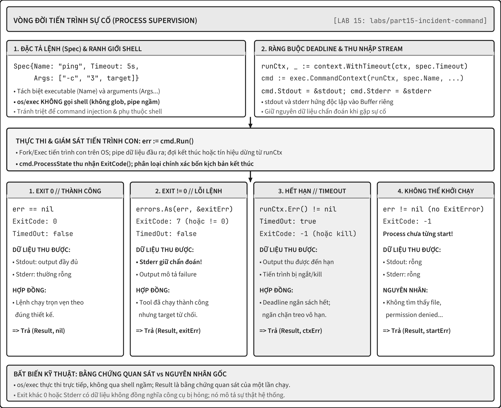

<!-- BOOK_ROLE: FOUNDATION_BRIDGE -->

# Chương 15 — Từ incident đến công cụ

Một sự cố vận hành (*incident*) thông thường không thiếu các câu lệnh để gõ. Điều còn thiếu là một bản ghi đáng tin cậy về những gì câu lệnh đó đã thực sự thực hiện. Một kỹ sư vận hành có thể chạy `curl`, `nslookup`, `git`, hoặc một công cụ nội bộ rồi quan sát thấy một dòng báo lỗi. Nhưng dòng lỗi ấy không cho biết chính xác câu lệnh nào đã được kích hoạt, tiến trình có được cấp đủ thời gian xử lý hay không, có xuất dữ liệu chẩn đoán ra luồng lỗi chuẩn `stderr` hay không, và tiến trình đã kết thúc với mã trạng thái thoát nào. Việc gõ lại cùng một dòng lệnh nhiều lần chỉ làm lịch sử điều tra thêm mờ mịt.

Chương này bắt đầu từ một yêu cầu nghiệp vụ khiêm tốn: một lệnh điều tra sự cố sẽ kích hoạt một công cụ chẩn đoán đã được chọn trước, chờ đợi tiến trình theo một thời hạn xử lý (*deadline*), rồi thu thập toàn bộ dữ liệu đầu ra và trạng thái kết thúc có thể giải trình. Đây chưa phải một tính năng đồ sộ cho công cụ `opsprobe`; trước hết ta dựng một mô hình tái lập tối giản độc lập nhằm nắm vững ranh giới quản lý tiến trình con (*process boundary*). Khi hợp đồng hành vi đã được minh định, `opsprobe` mới có thể tích hợp thành phần này như một khối nền tảng vững chắc.

Mô hình tư duy của chương là: bộ chạy câu lệnh là một tiến trình giám sát thu nhỏ của tiến trình con. Nó không chỉ đơn thuần kích hoạt một tệp nhị phân. Thành phần này tiếp nhận ý định đã được kiểm tra hợp lệ, quản lý thời hạn thực thi, chờ tiến trình kết thúc, lưu giữ dữ liệu đầu ra tách bạch giữa các luồng, phân loại kết quả thoát, và để bên gọi quyết định phương thức hiển thị cũng như lưu vết. Nếu thiếu sự kiểm soát chặt chẽ các yếu tố đó, công cụ chẩn đoán có thể biến một sự cố rõ ràng thành một chuỗi lệnh vỏ hệ điều hành rời rạc và không thể tái lập.

## Một câu lệnh nhìn có vẻ vô hại

Giả sử alert báo dependency `catalog` trả lời chậm. Một command đầu tiên có thể chạy một probe nội bộ hoặc một program hệ điều hành để lấy thêm manh mối. Cách tắt nhất thường trông như sau:

~~~go
exec.Command("sh", "-c", "probe " + target).Run()
~~~

Cách làm tắt này che giấu quá nhiều quyết định hệ thống. Giá trị `target` là dữ liệu thuần túy hay là một đoạn mã kịch bản vỏ lệnh (*shell script*)? Lỗi trả về xuất phát từ mã thoát khác 0, không tìm thấy tệp thực thi, hay do thời hạn xử lý đã cạn kiệt? Dữ liệu từ luồng đầu ra chuẩn `stdout` và luồng lỗi chuẩn `stderr` được chuyển hướng về đâu? Và nếu tiến trình cha của `opsprobe` đang trong quá trình dừng tắt theo vòng đời đã nêu ở Chương 12, liệu tiến trình con có tiếp tục chạy mồ côi hay không?

Gói `os/exec` cố ý không tự động kích hoạt vỏ lệnh hệ thống và không tự ý mở rộng ký tự đại diện (*globbing*), đường ống dẫn (*pipeline*) hay chuyển hướng luồng (*redirect*). Đó là một ranh giới bảo vệ hữu ích: tên lệnh thực thi và từng đối số là các phần tử dữ liệu độc lập. Nếu thực sự cần tới vỏ lệnh, kỹ sư phải chủ động lựa chọn trình thông dịch, cơ chế bao đóng chuỗi ký tự và mô hình đe dọa an ninh một cách tường minh; một công cụ xử lý sự cố không nên vô tình nhận quyền thực thi vỏ lệnh chỉ vì hành vi nối chuỗi thiếu kiểm soát.

@figure Mô hình khái niệm. `Result` là bằng chứng cục bộ về một lần chạy; nó không tự chứng minh nguyên nhân gốc của incident.

Trong chương này, bên gọi chỉ định tệp thực thi trực tiếp từ mã nguồn hoặc thông qua danh sách trắng cho phép (*allowlist*). Giá trị `target` chỉ đơn thuần là một đối số tham số. Đây không phải lời giải vạn năng cho mọi bộ điều phối công cụ, nhưng là ranh giới chuẩn xác cho yêu cầu hiện tại: người dùng không được phép truyền nguyên một chuỗi dòng lệnh tùy ý qua cờ cấu hình rồi buộc chương trình phải tự suy đoán ý nghĩa cú pháp.

Tách đối số ngăn việc shell diễn giải `;`, `*` hay `$HOME`, nhưng chương trình đích vẫn có thể hiểu đầu vào như một cờ, biểu thức hoặc đường dẫn nguy hiểm. Bên gọi phải kiểm tra theo hợp đồng của chính công cụ; `--` chỉ kết thúc cờ nếu công cụ hỗ trợ. Tên không chứa dấu phân cách đường dẫn còn được tìm qua cơ chế `LookPath`; kết quả phụ thuộc môi trường. `exec.ErrDot` chặn trường hợp tìm ra executable tương đối với thư mục hiện tại, không xác minh danh tính hay tính tin cậy của mọi executable trong PATH. Công cụ đã chọn trước nên dùng đường dẫn và quyền truy cập được kiểm soát.

## Bốn kết cục, không phải một `error`

Bộ chạy lệnh có thể trả về lỗi `error`, nhưng bên gọi bắt buộc phải phân biệt được dạng thất bại cụ thể. Thành công trọn vẹn là khi tiến trình được khởi chạy và kết thúc với mã trạng thái bằng 0. Một câu lệnh được kích hoạt thành công nhưng kết thúc với mã thoát 7 lại là một kết cục hoàn toàn khác: luồng lỗi chuẩn `stderr` của nó có thể chứa đựng chính xác manh mối chẩn đoán sự cố. Quá hạn thời gian chờ (*deadline exceeded*) là kết cục thứ ba. Không tìm thấy tệp thực thi hoặc không đủ quyền khởi chạy là kết cục thứ tư, thường xuất phát từ sai sót cấu hình môi trường trước khi quá trình chẩn đoán kịp bắt đầu.

@table Kết cục của một lần chạy process

| Kết cục | Process đã start? | `Result` giữ gì | Caller nên biết gì |
| --- | --- | --- | --- |
| Exit 0 | Có | stdout, stderr, exit code 0 | Tool hoàn tất theo contract của nó. |
| Exit khác 0 | Có | stdout, stderr, exit code | Tool đã chạy; output có thể giải thích failure. |
| Deadline/cancel | Có thể đã start | output đã thu được, cờ timeout | Parent context hay ngân sách thời gian đã kết thúc. |
| Không start | Không | command và exit code chưa có | Sai executable, quyền hoặc môi trường. |

Hai đối tượng `Result` và `error` song hành cùng nhau vì chúng giải đáp hai khía cạnh riêng biệt. Cấu trúc `Result` lưu giữ toàn bộ bằng chứng thực nghiệm thu thập được; giá trị `error` xác nhận lượt chạy có thỏa mãn hợp đồng hành vi hay không. Do đó, tránh thiết kế giao diện lập trình chỉ trả về lỗi đơn thuần rồi làm thất lạc nội dung `stderr` mỗi khi tiến trình kết thúc với mã thoát khác 0. Đồng thời, không nên quy chụp mọi mã thoát khác 0 đều là lỗi nghiêm trọng: một công cụ chẩn đoán có thể chủ động sử dụng mã thoát để thông báo một tình trạng nghiệp vụ đã được trù tính từ trước.

## Viết supervisor nhỏ trước

Bài thực hành giới hạn cấu trúc `Spec` trong phạm vi rất hẹp: trường `Name` là tệp thực thi do bên gọi quyết định, mảng `Args` chứa các đối số phân tách rõ ràng, và `Timeout` quy định ngân sách thời gian của lượt chạy. Hàm `Run` không cần biết dịch vụ `catalog` là gì, không phân tích cú pháp JSON và không tự ý ghi nhật ký. Việc tách bạch các trách nhiệm này giúp kiểm thử cô lập và kiểm soát trọn vẹn ranh giới tiến trình. Hai đoạn mã `Run` dưới đây là các phần liên tiếp của cùng một hàm; mã nguồn hoàn chỉnh có thể chạy được lưu tại tập tin `fixed/run.go`.

~~~go
type Spec struct {
	Name    string
	Args    []string
	Timeout time.Duration
}

type Result struct {
	Command  []string
	Stdout   string
	Stderr   string
	ExitCode int
	TimedOut bool
}
~~~

Đối số `context.Context` luôn là dữ liệu đầu vào tiên quyết. Nó liên kết bộ chạy lệnh vào chuỗi yêu cầu, dòng lệnh CLI, hoặc vòng đời của dịch vụ mà không buộc bộ chạy phải trực tiếp xử lý các tín hiệu hệ điều hành cụ thể. Ta thiết lập một thời hạn con; cơ chế hủy bỏ từ tiến trình cha sẽ lan truyền xuyên suốt qua cùng đường dẫn đó. Phương thức `exec.CommandContext` sử dụng ngữ cảnh để ngắt tiến trình khi ngữ cảnh hoàn tất; mặc định hàm hủy bỏ của câu lệnh sẽ gửi tín hiệu cưỡng chế dừng (*Kill*) lên tiến trình. Đây là hành vi đã được tài liệu hóa của thư viện chuẩn, không phải lời cam kết rằng toàn bộ cây tiến trình con trên mọi hệ điều hành đều được dọn dẹp sạch sẽ.

~~~go
func Run(ctx context.Context, spec Spec) (Result, error) {
	if ctx == nil || strings.TrimSpace(spec.Name) == "" {
		return Result{}, ErrInvalidSpec
	}
	if spec.Timeout <= 0 {
		return Result{}, ErrInvalidSpec
	}

	runCtx, cancel := context.WithTimeout(ctx, spec.Timeout)
	defer cancel()

	cmd := exec.CommandContext(runCtx, spec.Name, spec.Args...)
	var stdout, stderr bytes.Buffer
	cmd.Stdout = &stdout
	cmd.Stderr = &stderr
	err := cmd.Run()
~~~

Đoạn mã đầu tiên kết thúc tại lệnh `Run`: nó khởi động tiến trình, chờ tiến trình cùng hai luồng nhập xuất hoàn tất, rồi lưu giữ lỗi gốc để phân loại. Bước kiểm tra tính hợp lệ bắt buộc phải diễn ra trước lời gọi `context.WithTimeout`, bởi việc truyền ngữ cảnh `nil` sẽ gây sập chương trình. Hai bộ đệm dữ liệu được gán trước khi chạy để bên gọi không phải suy đoán xem một dòng thông tin chẩn đoán xuất phát từ luồng chuẩn `stdout` hay luồng lỗi `stderr`.

Sau khi process đã trả, phần còn lại dựng `Result` kể cả khi có error. Đọc nó như đoạn tiếp theo của function ở trên:

~~~go
	result := Result{
		Command:  append([]string{spec.Name}, spec.Args...),
		Stdout:   stdout.String(),
		Stderr:   stderr.String(),
		ExitCode: -1,
	}
	if cmd.ProcessState != nil {
		result.ExitCode = cmd.ProcessState.ExitCode()
	}
	if contextErr := runCtx.Err(); contextErr != nil {
		result.TimedOut = errors.Is(
			contextErr,
			context.DeadlineExceeded,
		)
		return result, fmt.Errorf(
			"command context: %w",
			contextErr,
		)
	}
	if err == nil {
		return result, nil
	}
	var exitErr *exec.ExitError
	if errors.As(err, &exitErr) {
		return result, fmt.Errorf(
			"command exited with code %d: %w",
			result.ExitCode,
			err,
		)
	}
	return result, fmt.Errorf("start command: %w", err)
}
~~~

`ProcessState` được điền khi tiến trình đã khởi chạy và được chờ kết thúc. Runner khởi tạo `ExitCode=-1` khi chưa có trạng thái ấy, nhưng `ProcessState.ExitCode()` cũng có thể trả `-1` nếu tiến trình kết thúc bởi signal trên hệ điều hành hỗ trợ. Trước bước chạy, lỗi đặc tả trả `Result{}` với mã zero; vì vậy chỉ một số `ExitCode` không chứng minh tiến trình đã chạy hay thành công. Hãy xét cả `error` và hợp đồng của runner.

Runner ưu tiên `runCtx.Err()` ở thời điểm thu kết quả. Đây là chính sách phân loại, không phải bằng chứng context đã gây ra mọi mã thoát. Nếu context bị hủy sát lúc tiến trình kết thúc, lỗi context có thể được ưu tiên và `*exec.ExitError` không còn nằm trong error trả về. Cờ `TimedOut` chỉ chỉ ra `DeadlineExceeded`, không chỉ mọi lần hủy. Muốn phân biệt thêm nguyên nhân, cần hợp đồng kết quả khác; helper hiện tại không suy ra nhân quả từ thứ tự quan sát.

Giải pháp này chỉ phù hợp với dữ liệu đầu ra dung lượng nhỏ, được giới hạn theo hợp đồng của công cụ đang chạy. Cấu trúc `bytes.Buffer` không phải chính sách tiếp nhận đầu ra phù hợp cho một tiến trình có thể in dữ liệu vô tận. Một công cụ môi trường thực tế bắt buộc phải chọn một trong ba chiến lược rõ ràng: truyền dòng dữ liệu có cơ chế tạo áp lực ngược (*backpressure*), thu thập có giới hạn trần và đánh dấu cắt ngắn rõ ràng, hoặc lưu trữ dữ liệu đầu ra thành tệp tạo tác (*artifact*). Tuyệt đối không âm thầm sử dụng bộ đệm vô hạn trong bộ nhớ rồi ngộ nhận đó là năng lực quan sát hệ thống.

## Cancel process không đồng nghĩa dọn cả cây process

`CommandContext` mặc định gọi `Process.Kill` cho tiến trình trực tiếp khi context kết thúc; việc khởi chạy có thể chưa xảy ra nếu context đã hủy. Nó không dọn cả cây tiến trình. Tiến trình hậu duệ có thể giữ mở pipe dù tiến trình trực tiếp đã thoát. `WaitDelay` bắt đầu đếm từ khi context kết thúc hoặc `Wait` quan sát tiến trình thoát, tùy điều kiện nào đến trước; khi hết khoảng chờ nó có thể kill tiến trình trực tiếp còn sống và đóng các pipe do `Cmd` quản lý. Đây không phải thời lượng tối đa kể từ `Start`, cũng không làm một `Read`/`Write` tùy ý đang block tự kết thúc. Nếu tiến trình thoát thành công nhưng pipe phải đóng bởi `WaitDelay` và không có lần gọi `Cancel`, `Wait` trả `exec.ErrWaitDelay`. Nhóm tiến trình và Windows job object cần chính sách hệ điều hành riêng.

Test deadline hiện có kiểm lỗi và cờ timeout, không chứng minh tiến trình đã khởi chạy trước hạn: 30ms có thể hết ngay trong giai đoạn start. Test `TestRunCancelsAnAlreadyStartedChild` bổ sung điểm bắt tay qua TCP loopback; chỉ hủy sau khi helper báo đã chạy và đang chờ. Fixture chờ runner trả về, kiểm kết nối đã đóng và join goroutine do test sở hữu. Nó kiểm tiến trình trực tiếp trên môi trường chạy test, không đo latency cố định, không chứng minh cây hậu duệ được dọn. Runner vẫn để `WaitDelay=0`, nên các công cụ giữ pipe mở có thể khiến `Run` chờ lâu hơn ngân sách context. Đó là giới hạn cần giải quyết trước khi dùng cho loại công cụ ấy.

## Từ runner sang CLI có thể kể lại

Giao diện dòng lệnh (*CLI*) là ranh giới tiếp xúc trực tiếp với con người. Mã nguồn không nên nhồi nhét việc phân tích cờ cấu hình, kiểm tra hợp lệ mục tiêu, khởi tạo tiến trình con, định dạng dữ liệu và ghi nhật ký vào trong một hàm `main` kéo dài. Kiểu `flag.FlagSet` là đủ cho câu lệnh đầu tiên: phân tích cờ `-target` và `-timeout`, kiểm tra mục tiêu theo đúng hợp đồng của công cụ thăm dò, rồi kích hoạt bộ chạy với tệp thực thi đã định. Khi hàm `Run` hoàn tất, giao diện có thể in báo cáo trực quan cho người dùng; nhật ký có cấu trúc chỉ ghi nhận các trường dữ liệu cần thiết phục vụ việc tái dựng lượt chạy.

~~~go
if !errors.Is(err, ErrInvalidSpec) {
	logger.Info(
		"diagnostic returned",
		"tool", spec.Name,
		"exit_code", result.ExitCode,
		"timed_out", result.TimedOut,
		"ok", err == nil,
	)
}
~~~

Đoạn ghi nhận dùng `spec.Name` đã được chọn trước, không truy cập `result.Command[0]`: lỗi đặc tả trả slice rỗng và truy cập ấy sẽ panic. Nhãn “returned” cùng trường `ok` cũng tránh gọi mọi lượt chạy là hoàn tất thành công; không ghi toàn bộ error hay đối số vì chúng có thể chứa dữ liệu nhạy cảm.

Tuyệt đối không ghi nhật ký các thông tin mã thông báo bảo mật (*token*), tiêu đề ủy quyền (*authorization header*), toàn bộ biến môi trường hay chuỗi dòng lệnh thô chứa mật khẩu bí mật. Gói `slog` không tự động che giấu dữ liệu nhạy cảm; chính ranh giới thiết kế phải chọn lọc trường nào được phép lưu vào nhật ký. Chương 16 sẽ nâng tầm một lượt chẩn đoán đơn lẻ thành các tín hiệu quan sát toàn diện qua trạng thái sức khỏe, chỉ số đo lường, dấu vết thực thi và mục tiêu mức dịch vụ (*SLO*). Tại mốc này, điều cốt lõi là báo cáo không được đánh tráo giữa ba trạng thái: câu lệnh không thể khởi động, câu lệnh thực thi thất bại, và câu lệnh bị chủ động ngắt do cạn kiệt ngân sách thời gian.

> **Dừng để dự đoán:** Nếu hàm `Run` chỉ trả về `error`, báo cáo sự cố sẽ đánh mất thông tin gì khi một công cụ thăm dò kết thúc với mã thoát 2 nhưng đã kịp in lời giải thích chẩn đoán vào `stderr`? Ngược lại, nếu hàm `Run` chỉ trả về `Result` mà không trả về `error`, liệu bên gọi có còn phân biệt được lượt chạy thành công với lượt chạy bị cưỡng chế dừng do quá hạn thời gian?

### Bài thực hành: Chứng minh trạng thái thoát và thời hạn

Hãy mở tập tin `labs/part15-incident-command/exercise/run_test.go` trước. Bài kiểm thử không gọi `ping`, `curl` hay bất kỳ tệp thực thi có sẵn nào của hệ điều hành. Nó sử dụng chính tệp nhị phân kiểm thử hiện hành làm tiến trình hỗ trợ, giúp các trường hợp thành công, mã thoát khác 0 và tạm dừng đều vận hành đồng nhất trên Windows, Linux và macOS. Đó là một nguyên lý thiết kế kiểm thử cốt lõi: thay vì phụ thuộc vào các công cụ ngoại vi trên máy chủ, ta chủ động kiểm soát tiến trình mục tiêu đang được quan sát.

~~~powershell
cd labs/part15-incident-command
go test -tags exercise ./exercise
go test -race -tags exercise ./exercise
go test ./fixed
go vet ./fixed
go test -race ./fixed
~~~

Hợp đồng hành vi đòi hỏi: đặc tả rỗng hoặc thời gian chờ không dương phải bị từ chối dứt khoát trước khi khởi chạy; trường hợp thành công lưu giữ hai luồng dữ liệu riêng biệt cùng mã thoát 0; trường hợp mã thoát khác 0 bảo toàn luồng `stderr`, mã thoát và vẫn cho phép `errors.As` nhận diện kiểu `*exec.ExitError`; trường hợp quá hạn thời gian trả về lỗi khớp với `context.DeadlineExceeded`, đánh dấu cờ `TimedOut` và không bị treo tiến trình. Việc hủy bỏ từ ngữ cảnh cha vẫn trả về `context.Canceled`, không bị đánh đồng với lỗi quá hạn thời gian. Bài tập ban đầu báo đỏ vì hành vi chưa được cài đặt, không phải do gói thư viện gặp lỗi.

#### Gợi ý giải pháp (chỉ đọc sau khi đã tự làm)

Tạo ngữ cảnh con sau khi xác thực dữ liệu, dùng `exec.CommandContext` với tên lệnh và các tham số tách riêng, rồi gán hai bộ đệm `bytes.Buffer` trước khi gọi `Run`. Dựng đối tượng `Result` bất kể `Run` trả về lỗi, vì dữ liệu đầu ra và trạng thái thoát vẫn có thể cần thiết cho công tác điều tra sự cố. Kiểm tra `runCtx.Err()` trước lỗi `ExitError` để thời hạn quá giờ không bị che khuất bởi trạng thái của tiến trình vừa bị hủy. Bản sửa đổi không dùng vỏ lệnh hệ thống (*shell*) và không cam kết dọn dẹp toàn bộ cây tiến trình con.

## Khi nào runner nhỏ này chưa đủ

Bộ chạy lệnh này chưa tiếp nhận luồng nhập chuẩn `stdin`, chưa thiết lập thư mục làm việc hay biến môi trường riêng biệt, chưa truyền dòng dữ liệu đầu ra, chưa che giấu dữ liệu bí mật, chưa hỗ trợ thử lại, và chưa được coi là bộ thực thi tổng quát cho dữ liệu người dùng tùy ý. Mỗi tính năng trên đều làm thay đổi bề mặt tấn công (*attack surface*) hoặc vòng đời tiến trình. Chẳng hạn, trường `Cmd.Env` sẽ thay thế hoàn toàn biến môi trường của tiến trình con chứ không tự động hợp nhất với môi trường hiện hành; trường `Cmd.Dir` biến thư mục làm việc thành một đầu vào khác cần kiểm tra hợp lệ. Tuyệt đối không thêm các trường này chỉ vì cấu trúc dữ liệu còn chỗ trống.

Điểm dừng của chương ghi nhận một bước tiến vững chắc: chuyển dịch từ thói quen gõ lệnh cảm tính khi hoảng loạn sang việc kiểm soát câu lệnh có hợp đồng hành vi chặt chẽ về tiến trình. Ứng dụng `opsprobe` sau này có thể tận dụng bộ chạy này để kích hoạt một công cụ chẩn đoán đã được lựa chọn, nhưng chỉ khi yêu cầu xử lý sự cố thực sự đòi hỏi. Trước khi nghĩ đến việc bổ sung chỉ số đo lường, bảng điều khiển hay Kubernetes, kỹ sư phải hiểu tường minh một lượt thực thi đơn lẻ đã bắt đầu, kết thúc và thất bại như thế nào.
