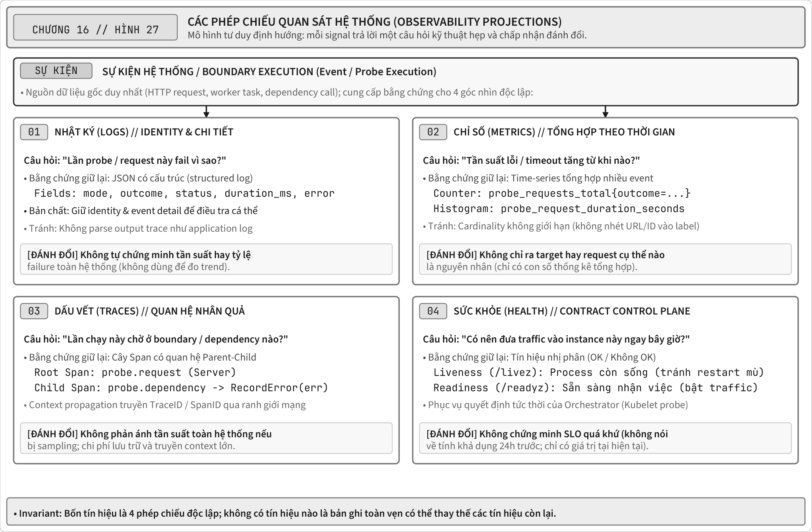
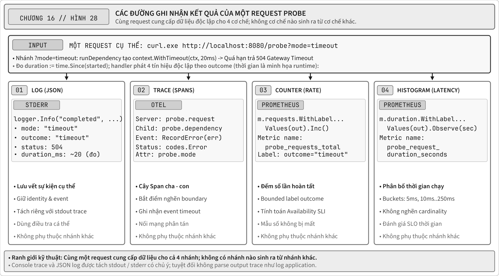

<!-- BOOK_ROLE: APPLICATION_SYSTEMS -->

# Chương 16 — Thấy được hệ thống

Sau Chương 15, `opsprobe` đã ghi nhận được một lượt thực thi: lệnh đã gọi, mã thoát và việc hết thời gian chờ. Nhưng điều tra sự cố thường cần nhiều hơn một lượt chạy. Dịch vụ phụ thuộc có chậm dần từ sáng? Lỗi tập trung ở một đích hay nhiều đích? Một yêu cầu chậm đã chờ ở đâu? Chỉ giữ dòng log cuối cùng thì mất xu hướng; chỉ giữ biểu đồ tổng hợp thì mất chi tiết để điều tra từng lần thất bại.

Mô hình tư duy của chương là các phép chiếu: mỗi tín hiệu giữ lại một phần bằng chứng về hệ thống và bỏ qua phần khác. Log lưu chi tiết sự kiện; metric tổng hợp để thấy biến động theo thời gian; trace liên kết các chặng xử lý khi ngữ cảnh được truyền đúng; health check trả lời một câu hỏi hẹp tại thời điểm kiểm tra. Không tín hiệu nào tự ghi lại toàn bộ hệ thống.

## Một biểu đồ xanh vẫn có thể nói dối

Giả sử dashboard hiển thị `probe_success=1` sau lần thăm dò gần nhất. Một lần thành công sau sự cố có thể làm biểu đồ xanh trở lại, nhưng không cho biết mười phút trước có bao nhiêu lần thất bại. Nó cũng không nói timeout được tính thế nào, hay giá trị còn sót lại từ một tiến trình đã ngừng thăm dò. Ta phải xác định ý nghĩa dữ liệu trước khi chọn cách vẽ.

Một bộ đếm chỉ có nghĩa khi biết sự kiện nào làm nó tăng. Trong lab, mỗi lượt thăm dò hoàn tất nhận đúng một kết quả: `success`, `failure` hoặc `timeout`. SLI khả dụng được chọn là số lượt `success` chia cho tổng số lượt hoàn tất. Timeout tăng mẫu số nhưng không tăng tử số. Đây là chính sách của phép thăm dò này, không phải định nghĩa khả dụng áp dụng cho mọi sản phẩm.

~~~text
availability = successes / completed probes
~~~

Nếu chưa có lượt thăm dò nào hoàn tất, phép chia tỷ lệ hoàn toàn vô nghĩa về mặt toán học. Tuyệt đối không tự ý trả về `1.0` chỉ để nhuộm xanh bảng điều khiển khi hệ thống hoàn toàn chưa thu thập được dữ liệu. Giao diện lập trình của bài thực hành cung cấp thêm một giá trị logic kiểu boolean nhằm giúp bên gọi (*caller*) phân biệt rạch ròi giữa trạng thái “0% thành công” với trạng thái “chưa có mẫu thu thập (*sample*)”. Một chỉ số mức độ dịch vụ (SLI) chỉ đơn thuần là quy ước đo lường đã định hình; mục tiêu mức độ dịch vụ (SLO) mới chính là đích ngắm và khoảng thời gian quan sát (*time window*) mà đội ngũ kỹ thuật cam kết gắn liền với chỉ số đó. Con số “99.9%” sẽ không có giá trị vận hành thực tế chừng nào ta chưa xác định rõ đo lường đối tượng nào, trong khung thời gian bao lâu, và biện pháp can thiệp nào sẽ được kích hoạt khi làm cạn kiệt ngân sách lỗi (*error budget*).

## Bốn câu hỏi, bốn loại bằng chứng

@figure Các tín hiệu đo lường giải đáp những câu hỏi kỹ thuật khác nhau. Sơ đồ là mô hình tư duy định hướng, không phải cấu trúc bắt buộc hay đường ống OpenTelemetry hoàn chỉnh.

@table Chọn signal từ câu hỏi trước

| Câu hỏi | Signal chính | Điều nó không tự chứng minh |
| --- | --- | --- |
| “Lần probe này fail vì sao?” | Log có field và error an toàn | Tần suất hay tỷ lệ failure toàn hệ thống. |
| “Timeout tăng từ khi nào?” | Metric theo thời gian | Target hay request cụ thể nào là nguyên nhân. |
| “Lần chạy này chờ ở boundary nào?” | Trace của một execution | Tần suất của mọi execution nếu trace bị sample. |
| “Có nên đưa traffic vào instance này ngay bây giờ?” | Readiness | SLO của một giờ vừa qua. |

Log có thể lưu đích đến đã che dữ liệu nhạy cảm, mã thoát, thời lượng và request ID để điều tra một lượt cụ thể. Không nên đưa nguyên URL, user ID, thông điệp lỗi thô hay trace ID vào nhãn metric mặc định. Mỗi tổ hợp giá trị nhãn tạo một chuỗi thời gian riêng. Cardinality là số chuỗi phân biệt, không chỉ là số tên nhãn: một nhãn `request_id` cũng có thể sinh hàng triệu chuỗi. Chi phí lưu trữ và truy vấn có thể trở thành sự cố mới.

Dấu vết thực thi (*trace*) cũng không đơn thuần là dòng nhật ký gắn thêm mũi tên điều hướng. Nó khắc họa chuẩn xác mối quan hệ nhân quả giữa các tác vụ trong cùng một lượt xử lý; cơ chế truyền ngữ cảnh (*context propagation*) là mắt xích gắn kết các phân đoạn (*span*) xuyên qua ranh giới giao thức HTTP, hàng đợi thông điệp (*queue*) hoặc tiến trình con khi hệ thống được cài đặt cơ chế giám sát thích hợp. Chương 11 đã sử dụng `httptrace` để quan sát một ứng dụng máy khách cục bộ, nhưng kỹ thuật đó không tự động trở thành hệ thống truy vết phân tán (*distributed tracing*). Phần này tập trung chuẩn hóa ngữ nghĩa để khi áp dụng OpenTelemetry trong thực tế, ta nắm rõ một thuộc tính (*attribute*), phân đoạn thực thi (*span*) hay quyết định chọn mẫu (*sampling*) đang trực tiếp phục vụ câu hỏi kỹ thuật nào.

Tín hiệu kiểm tra sức khỏe (*health check*) là kênh thông tin dễ bị lạm dụng sai lệch nhất. Tín hiệu sống (*liveness*) trả lời việc tiến trình có còn năng lực tiếp tục hoạt động hay không để hệ thống giám sát (*supervisor*) không khởi động lại mù quáng; tín hiệu sẵn sàng (*readiness*) giải đáp xem thể hiện tiến trình hiện tại có nên đón nhận lưu lượng truy cập hay không. Cả hai đều là giao ước tức thời phục vụ mặt phẳng điều khiển (*control plane*) ở thời điểm hiện tại. Một điểm cuối `/readyz` phản hồi mã `200` ở thời khắc này không thể chứng minh độ khả dụng trong 24 giờ đã qua, và ta cũng không được phép kích hoạt một dịch vụ phụ thuộc ở xa trong mọi lượt thăm dò liveness chỉ để khiến điểm cuối có vẻ tinh vi. Việc xác định dịch vụ phụ thuộc nào thuộc phạm vi kiểm tra readiness là một chính sách dựa trên năng lực phục vụ thực tế, không phải bảng danh mục sao chép máy móc từ các bộ khung mẫu (*framework*).

## Gắn metric vào outcome, không gắn vào cảm giác

Đoạn mã mô phỏng thu nhỏ dưới đây không xuất định dạng Prometheus và không nhằm thay thế hệ thống thu thập (*collector*). Nó gói gọn ngữ nghĩa cốt lõi mà các bộ trích xuất dữ liệu sau này có thể đọc: kết quả là một tập đóng cố định, ảnh chụp trạng thái (*snapshot*) là bản sao chép nhất quán, và chỉ số SLI không mang giá trị khi chưa thu thập mẫu đo. Việc giữ bài thực hành hoàn toàn trong thư viện chuẩn giúp ta kiểm chứng chặt chẽ các ràng buộc hợp đồng trước khi thảo luận về bộ thư viện phát triển (SDK) hoặc hạ tầng lưu trữ phía sau.

~~~go
type Outcome string

const (
	OutcomeSuccess Outcome = "success"
	OutcomeFailure Outcome = "failure"
	OutcomeTimeout Outcome = "timeout"
)

type Snapshot struct {
	Completed uint64
	Succeeded uint64
	Failed    uint64
	TimedOut  uint64
}

func (s Snapshot) SuccessRatio() (float64, bool) {
	if s.Completed == 0 {
		return 0, false
	}
	return float64(s.Succeeded) / float64(s.Completed), true
}
~~~

Trường dữ liệu `Completed` không phải là chi tiết dư thừa. Nó là mẫu số được lưu trữ độc lập để kiểm chứng tính bất biến toán học: `Completed == Succeeded + Failed + TimedOut`. Trong bài thực hành, một lệnh gọi `Observe` thành công sẽ gia tăng chính xác hai giá trị: trường `Completed` và nhóm kết quả tương ứng. Một kết quả không xác định bắt buộc phải trả về lỗi trước khi thực hiện biến đổi trạng thái; nếu mã nguồn chấp nhận chuỗi ký tự thô tùy ý rồi tự tạo nhóm mới, tập đóng sẽ lập tức biến thành lỗi rò rỉ bùng nổ số lượng nhãn (*cardinality leak*) ngay tại nguồn phát sinh dữ liệu.

~~~go
type Recorder struct {
	mu       sync.Mutex
	snapshot Snapshot
}

func (r *Recorder) Observe(outcome Outcome) error {
	r.mu.Lock()
	defer r.mu.Unlock()

	switch outcome {
	case OutcomeSuccess:
		r.snapshot.Succeeded++
	case OutcomeFailure:
		r.snapshot.Failed++
	case OutcomeTimeout:
		r.snapshot.TimedOut++
	default:
		return ErrUnknownOutcome
	}
	r.snapshot.Completed++
	return nil
}

func (r *Recorder) Snapshot() Snapshot {
	r.mu.Lock()
	defer r.mu.Unlock()
	return r.snapshot
}
~~~

Khóa đồng bộ `sync.Mutex` ở đây không phải là nỗ lực tự viết lại một thư viện số liệu đo lường. Cơ chế này đơn thuần bảo toàn tính bất biến của bộ ghi nhận mẫu khi nhiều luồng thực thi đồng thời từ Chương 9 cùng thông báo kết quả. Phương thức `Snapshot` trả về bản sao giá trị độc lập, bởi bên gọi tuyệt đối không được phép chỉnh sửa trạng thái nội bộ làm bộ đếm bị đảo ngược giá trị. Nếu bộ xuất dữ liệu sau này đọc ảnh chụp trạng thái theo chu kỳ, nó vẫn phải tuân thủ giao ước riêng về hành vi tái lập khi tiến trình khởi động lại, mốc thời gian, bộ đếm tích lũy hoặc giá trị vi phân chênh lệch. Bản ghi trong bộ nhớ tạm thời này không có chính sách lưu trữ dài hạn (*retention*), không hỗ trợ cửa sổ trượt và không thể xem là bằng chứng lịch sử sau khi tiến trình kết thúc.

> **Dừng để dự đoán:** Một probe kết thúc với lỗi `context.DeadlineExceeded` (timeout). Sự kiện này có đồng nghĩa với việc máy chủ đích đã sập hoàn toàn không? Trong SLI đo độ khả dụng, kết quả timeout được phân loại vào đâu?

#### Gợi ý giải pháp (chỉ đọc sau khi đã tự làm)
Lỗi quá thời gian (*timeout*) chỉ chứng minh bên gọi không nhận được phản hồi trong ngân sách thời gian đã định, hoàn toàn không đủ căn cứ để suy diễn dịch vụ đích đã sập hoàn toàn. Trong thực tế, dịch vụ đích có thể vẫn đang chạy nhưng bị nghẽn hàng đợi xử lý, hoặc phản hồi đã được gửi đi nhưng bị chậm trễ trên đường truyền mạng, thậm chí một tác vụ ghi dữ liệu đã được xác nhận thành công ở hệ thống phía sau trước khi bên gọi cạn kiệt thời gian chờ.

Theo contract của lab, timeout tăng `Completed` và `TimedOut`, không tăng `Succeeded`: mẫu số là mọi lượt hoàn tất, không phải chỉ các lượt thất bại. Nhãn `outcome="timeout"` giữ nguyên nhân quan sát để điều tra; nó không biến timeout thành thành công. Sản phẩm có thể chọn một SLI khác, nhưng phải công bố rõ đối tượng, công thức và cửa sổ đo.

Tính lũy đẳng (*idempotency*) trả lời câu hỏi khác: lặp lại thao tác có làm thay đổi tác động dự kiến so với thực hiện một lần không? Nó giúp thiết kế retry, không chứng minh lần gọi hết hạn đã thành công hay thất bại ở phía máy chủ. Chương 13 đã xét trường hợp ghi dữ liệu xong nhưng mất phản hồi; ở đây ta chỉ biết kết quả mà bên thăm dò quan sát được.

> **Dừng để dự đoán:** Bộ đếm đã ghi 1.000 lượt thành công. Mười lượt tiếp theo đều timeout. Tỷ lệ từ lúc khởi động và tỷ lệ trong mười lượt mới nhất là bao nhiêu?

`SuccessRatio()` trên snapshot mới trả về `1000/1010`, xấp xỉ 99,01%; trong cửa sổ mười lượt mới, tỷ lệ là `0/10 = 0%`. Không phép tính nào sai, nhưng chúng trả lời hai câu hỏi khác nhau. `TestLifetimeRatioCanHideRecentOutage` tái hiện sự khác biệt này mà không cần máy chủ thật hay chờ thời gian thực.

Hai snapshot của cùng một recorder chưa reset cho phép tính chênh lệch `Succeeded` và `Completed`. Khi tiến trình khởi động lại, bộ đếm có thể giảm; trừ trực tiếp hai số `uint64` khi đó có thể tràn vòng và sinh số rất lớn. Một khoảng mất dữ liệu còn có thể làm cửa sổ không đủ độ bao phủ. Hệ thống thu thập phải xử lý reset, thời gian và dữ liệu thiếu; ví dụ Prometheus `increase()` xử lý reset và ngoại suy theo cửa sổ, nên kết quả không nhất thiết là số nguyên hay một bản đếm sự kiện chính xác từng lần. Lab snapshot không hiện thực những cơ chế đó.

## SLO không phải một alert thật to

Một cam kết SLO thiết lập kỳ vọng dịch vụ có thể đo lường định lượng; trong khi cảnh báo (*alert*) là chính sách vận hành buộc kỹ sư phải can thiệp khi rủi ro đe dọa kỳ vọng đó vượt qua ngưỡng an toàn. Ta không nên kích hoạt cảnh báo cho từng sự kiện `failure` đơn lẻ: một máy chủ kiểm thử bị tắt có thể sinh ra tín hiệu nhiễu vô hại, trong khi một tỷ lệ lỗi ban đầu còn thấp nhưng tăng trưởng đột biến trên lưu lượng thực tế lại là tín hiệu khẩn cấp cần khoanh vùng. Khi đã xác lập đầy đủ chỉ số SLI, khung thời gian quan sát và mục tiêu cam kết, đội ngũ mới có thể cấu hình cảnh báo chuẩn xác dựa trên tốc độ tiêu hao ngân sách lỗi và tài liệu quy trình xử lý (*runbook*) tương ứng.

Điều này cũng lý giải vì sao trạng thái `Completed=0` không được phép quy kết thành mức độ khả dụng 100%. Khi hoàn toàn thiếu vắng mẫu đo, ta không thể suy diễn ra tỷ lệ phần trăm; trạng thái phản ánh trung thực có thể là `unknown`, một chú thích trên bảng điều khiển, hoặc một cảnh báo về sự gián đoạn dữ liệu đo từ xa (*telemetry gap*) tùy theo chính sách quy định. Tuyệt đối không chữa cháy bằng cách chia cho `max(1, completed)`: câu lệnh toán học sẽ vượt qua bước biên dịch, nhưng tính toàn vẹn của bằng chứng đã bị bóp méo.

Một cảnh báo chất lượng phải dẫn dắt trực tiếp tới hành động ứng phó cụ thể. Thông báo cần chỉ rõ định danh dịch vụ hoặc máy chủ đích, chỉ số SLI chịu ảnh hưởng, khung thời gian xảy ra sự cố, đội ngũ sở hữu chịu trách nhiệm và địa chỉ tra cứu chi tiết một cách an toàn. Chỉ số đo lường khoanh vùng kỹ sư điều tra tới nhóm đối tượng (*cohort*) đang suy thoái; nhật ký hoặc dấu vết thực thi sẽ trả lời câu hỏi “điều gì bất thường đang diễn ra bên trong nhóm đối tượng đó?”. Đó là một quy trình điều tra thống nhất và tuần tự, không phải phép ghép nối rời rạc bốn công cụ quan sát đặt cạnh nhau.

### Bài thực hành: Giữ mẫu số và ranh giới nhãn quan sát

Mở tệp `labs/part16-observability-evidence/exercise/recorder_test.go` trước tiên. Bài tập không yêu cầu cài đặt Prometheus, OpenTelemetry hay dựng bảng điều khiển phức tạp. Bộ kiểm thử ràng buộc các giao ước thiết kế tinh gọn nhưng thường bị vi phạm: tình trạng thiếu dữ liệu không được ngụy tạo thành 100%; kết quả không xác định không được làm biến đổi trạng thái nội bộ; và nhiều luồng đồng thời ghi nhận kết quả không được làm xáo trộn tổng số tích lũy. Đây là điểm mà công cụ dò điều kiện chạy đua từ Chương 8 gắn liền trực tiếp với tính đúng đắn của dữ liệu giám sát, không đơn thuần là một câu lệnh kiểm tra hình thức.

~~~powershell
cd labs/part16-observability-evidence
go test -tags exercise ./exercise
go test -race -tags exercise ./exercise
go test ./fixed
go vet ./fixed
go test -race ./fixed
~~~

Giao ước thiết kế chủ ý không tiếp nhận `target string`, đường dẫn URL hay nội dung thông điệp lỗi. Những dữ liệu đó thuộc về nhật ký vận hành, dấu vết thực thi hoặc một mô hình dữ liệu riêng biệt có chính sách lưu trữ và khử thông tin nhạy cảm. Bộ ghi nhận `Recorder` chỉ lưu giữ chỉ số tổng hợp có giới hạn chiều nhãn. Khi các ca kiểm thử đạt kết quả tốt, hãy đối chiếu với thư mục `fixed/` và giải thích vì sao phương thức `Snapshot` trả về giá trị cấu trúc thay vì con trỏ `*Snapshot`, cũng như lý do vì sao một khóa `sync.Mutex` dùng chung là hoàn toàn đầy đủ cho tính đúng đắn trước khi phát sinh nhu cầu đo lường tranh chấp tài nguyên.

#### Gợi ý giải pháp (chỉ đọc sau khi đã tự làm)

Khai báo kiểu `Outcome` là một tập đóng rồi dùng `switch` kiểm tra trước khi tăng biến đếm `Completed`. Đặt khóa đồng bộ bao quanh cả bước xác thực lẫn thao tác biến đổi dữ liệu để kết quả không hợp lệ không thể chạy đua với hàm chụp nhanh (*snapshot*) hoặc tạo ra trạng thái cập nhật dở dang. Phương thức `SuccessRatio` trả về `(float64, bool)`; giá trị boolean `false` mang ngữ nghĩa không có dữ liệu, không phải là cơ chế truyền tải lỗi. Bản sửa đổi ưu tiên một bất biến dễ kiểm chứng hơn là một API có vẻ “linh hoạt”.

## Giai đoạn hai: ba tín hiệu đi qua một service thật

Bộ ghi nhận vừa rồi chủ ý không phụ thuộc vào Prometheus hay OpenTelemetry. Khi câu hỏi nghiệp vụ đã rõ ràng, ta liên kết nó với các công cụ giám sát thực tế mà không cần xây dựng một nền tảng quan sát đồ sộ. Thư mục `labs/part16-real-signals` chứa một dịch vụ HTTP thu nhỏ. Một yêu cầu gửi tới điểm cuối `/probe` sẽ khởi tạo một phân đoạn máy chủ `probe.request`; tác vụ mô phỏng dịch vụ phụ thuộc tạo ra phân đoạn con `probe.dependency`; kết quả sau cùng được lưu thành nhật ký định dạng JSON, bộ đếm Prometheus và biểu đồ tần suất (*histogram*). Bộ xuất dữ liệu ra màn hình dòng lệnh in dấu vết thực thi ra cổng xuất chuẩn để người lập trình quan sát trực tiếp quan hệ cha con ngay trên môi trường phát triển cục bộ.

@figure Cùng một yêu cầu cung cấp dữ liệu cho nhật ký, dấu vết thực thi, bộ đếm và biểu đồ tần suất. Các đường ghi nhận thể hiện những góc nhìn khác nhau, không phải nhật ký sinh ra bộ đếm hay dấu vết sinh ra biểu đồ tần suất.

Đây là một lộ trình thu thập bằng chứng độc lập, không phải ba cách gọi tên khác nhau cho cùng một dòng dữ liệu. Bộ đếm trả lời câu hỏi *bao nhiêu lần đã hoàn tất theo từng nhóm kết quả*. Biểu đồ tần suất trả lời câu hỏi *thời lượng thực thi phân bố ra sao so với các khoảng phân chia (*bucket*) đã ấn định*. Dấu vết thực thi bảo toàn mối quan hệ của **một** yêu cầu cụ thể với các dịch vụ phụ thuộc mà nó triệu gọi. Nhật ký lưu giữ mã trạng thái và thời lượng của từng sự kiện để kỹ sư không phải suy diễn ngược từ dữ liệu tổng hợp về một yêu cầu riêng lẻ.

Mở tệp `labs/part16-real-signals/README.md`, theo dõi nhiệm vụ tự điều tra, rồi khởi chạy dịch vụ. Dấu vết trên giao diện dòng lệnh và nhật ký JSON được phân tách có chủ đích giữa hai luồng xuất chuẩn (*stdout*) và xuất lỗi (*stderr*): tuyệt đối không bóc tách dữ liệu dấu vết thực thi như thể nhật ký ứng dụng trong môi trường vận hành thực tế.

~~~powershell
cd labs/part16-real-signals
go test ./...
go vet ./...
go test -race ./...
go run ./cmd/probe-api
~~~

Tại một cửa sổ dòng lệnh khác, lần lượt thực thi từng kịch bản lỗi (*failure mode*). Lệnh `curl.exe -i` giữ nguyên vẹn mã trạng thái HTTP thay vì để hệ vỏ biến đổi các phản hồi 503 hoặc 504 thành thông báo lỗi khó theo dõi.

~~~powershell
curl.exe -i http://localhost:8080/probe?mode=ok
curl.exe -i http://localhost:8080/probe?mode=slow
curl.exe -i http://localhost:8080/probe?mode=fail
curl.exe -i http://localhost:8080/probe?mode=timeout
curl.exe -s http://localhost:8080/metrics
~~~

Các trạng thái `ok` và `slow` đều được ghi nhận là `success`; việc xử lý chậm chạp không đồng nghĩa với thất bại. Trạng thái `fail` xuất hiện khi dịch vụ phụ thuộc phản hồi lỗi lập tức và dịch vụ trả về mã `503`. Trạng thái `timeout` phản ánh trường hợp bên gọi cạn kiệt ngân sách 20 ms trước khi dịch vụ phụ thuộc mô phỏng kịp hoàn tất, khiến dịch vụ trả về mã `504`. Đây là cơ chế tiêm lỗi có ranh giới xác định, không phải độ trễ ngẫu nhiên không kiểm soát. Hãy so sánh nhật ký JSON, bộ đếm, biểu đồ tần suất và dấu vết thực thi trước khi mở mã nguồn: bằng chứng nào giúp phân biệt `fail` với `timeout` nhanh nhất? bằng chứng nào chứng minh `slow` vẫn thành công nhưng đã rơi vào khoảng phân loại thời gian khác?

@table Instrument của lab và contract của nó

| Instrument | Event boundary | Tập dữ liệu cố ý giữ hẹp | Điều không được suy ra |
| --- | --- | --- | --- |
| `probe_requests_total` | Dependency trả kết quả, trước khi ghi HTTP response. | `outcome`: `success`, `failure`, `timeout`. | Không chứng minh client nhận được response. |
| `probe_request_duration_seconds` | Từ đầu handler đến sau dependency, trước ghi response. | Cùng label; bucket 5–250 ms. | Không đo toàn bộ thời gian phía client; bucket không là SLO. |
| JSON log | Sau dependency, trước ghi response. | mode, outcome, HTTP status dự định gửi, duration. | Không xác nhận response đã được bàn giao thành công. |
| Hai spans | Request và dependency. | mode/outcome; error status khi fail. | Một trace không là thống kê cho mọi request. |

Việc lựa chọn các khoảng phân loại (*bucket*) cho biểu đồ tần suất là một quyết định đo lường có tính toán. Bài thực hành chọn các mốc 5, 10, 25, 50, 100 và 250 ms nhằm phân biệt rõ ràng trường hợp quá thời gian 20 ms với trường hợp chậm 40 ms trên máy tính cá nhân; cấu hình này không được sao chép nguyên xi thành ngưỡng đo lường thực tế. Nếu cần trả lời câu hỏi về độ trễ ở ngưỡng 2 giây, việc đặt mốc tối đa 250 ms sẽ làm mất hoàn toàn độ phân giải dữ liệu cần thiết. Nếu đưa từng đường dẫn định tuyến, URL thô, định danh người dùng, mã dấu vết hay thông báo lỗi vào làm nhãn, một chỉ số tổng hợp sẽ bị biến thành kho lưu trữ sự kiện vô tận. Bài tập chỉ gán kết quả `outcome` vào nhãn; tham số `mode` ít mang giá trị trong ngữ cảnh này và không cần thiết cho câu hỏi vận hành được đặt ra.

> **Dừng để dự đoán:** Sau khi chạy `ok`, `slow`, `fail`, `timeout` một lần, bộ đếm `success` sẽ mang giá trị bao nhiêu? Khởi động lại tiến trình rồi thu thập lại `/metrics`: vì sao việc các con số bị đặt lại từ đầu không chứng minh rằng những lượt probe cũ chưa từng diễn ra? Máy chủ Prometheus lưu trữ mẫu theo chuỗi thời gian là một ranh giới độc lập với tiến trình ứng dụng đang xuất dữ liệu tích lũy hiện thời.

Bộ kiểm thử của bài học không nhằm thay thế bộ thu thập cục bộ hay bảng điều khiển hiển thị. Nó xác thực ba giao ước kỹ thuật có thể tự động hóa: chỉ số đo lường chỉ chứa các nhãn có giới hạn chiều, nhật ký JSON ghi nhận trường `outcome`, và phân đoạn con thực sự nhận phân đoạn yêu cầu làm nút cha. Mã nguồn sử dụng thư viện Go client của Prometheus để xuất dữ liệu tại `/metrics`, cùng bộ phát triển OpenTelemetry Go SDK kèm bộ xuất dữ liệu dòng lệnh để phục vụ gỡ lỗi cục bộ. Khi chuyển dấu vết sang hệ thống thu thập tập trung hoặc dịch vụ lưu trữ chuyên dụng, các yếu tố về điểm cuối, tỷ lệ chọn mẫu, thời hạn lưu trữ, bảo mật quyền riêng tư và quyền truy cập là những chính sách mới cần được thiết kế; tuyệt đối không ghi dữ liệu bí mật vào thuộc tính chỉ để phục vụ tìm kiếm tiện lợi.

## Có sample chưa có nghĩa tín hiệu đã trả lời sự cố

Trong thư mục `part16-real-signals`, các chế độ cục bộ giúp việc thiết lập đo lường được trực quan và sáng tỏ. Giai đoạn tiếp theo tại `projects/opsprobe/failurelab` tiếp tục vận hành với `slog`, một vùng đăng ký Prometheus riêng biệt và bộ xuất dữ liệu dòng lệnh OpenTelemetry, nhưng thay thế dịch vụ phụ thuộc giả lập bằng kết nối mạng nội bộ HTTP có điểm kiểm tra (*checkpoint*). Mục đích không phải là dựng thêm bảng điều khiển: cấu trúc này buộc cả ba tín hiệu đo lường phải phản ánh thống nhất về cùng một lượt thăm dò khi phát sinh sự cố quá thời gian hoặc phần thân phản hồi bị ngắt quãng.

Biểu đồ tần suất `opsprobe_probe_duration_seconds` đo lường thời gian thực thi nội tại của lượt thăm dò; chỉ số `failurelab_job_seconds` đo từ lúc tiếp nhận yêu cầu cho tới khi hoàn tất thăm dò, bao gồm cả thời gian chờ trong hàng đợi nhưng không tính thời gian chờ tiến trình tiêu thụ lấy kết quả. Thước đo biến thiên `failurelab_running` chỉ bao quát các lượt thăm dò đang trong tiến trình xử lý, trong khi `failurelab_queue_depth` phản ánh số công việc chưa được công nhân (*worker*) tiếp nhận. Các chỉ số này không thể thay thế thước đo số lượng tiến trình công nhân còn sống của toàn dự án. Một luồng công nhân đang chờ gửi dữ liệu vẫn có thể duy trì hoạt động ngay cả khi chỉ số đang chạy bằng 0; chỉ khi ghi nhận kênh `Done` đóng lại mới xác nhận luồng đã thực sự kết thúc.

Hãy đọc Chương 20 để chủ động lựa chọn bằng chứng phân biệt trước khi thực thi. Bộ kiểm thử xác thực sự hiện diện của nhật ký kèm kết quả, mẫu đo biểu đồ tần suất và phân đoạn dấu vết, chứ không cam đoan về độ trễ môi trường vận hành thực tế hay một hạ tầng lưu trữ dấu vết bền vững. Khi thực hiện khối lượng công việc có giới hạn, hãy ghi nhận cả số lượng yêu cầu bị từ chối: thông lượng chỉ tính trên các yêu cầu được tiếp nhận mà bỏ qua lượng từ chối có thể khiến một dịch vụ đang chủ động cắt tải trông có vẻ rất khỏe mạnh. Không sử dụng mã định danh máy chủ đích tùy tiện làm nhãn đo lường; bài thực hành giữ nguyên tập kết quả hữu hạn, còn định danh cụ thể được lưu giữ trong nhật ký và phân đoạn dấu vết theo đúng chính sách dữ liệu đã định trước.

## Khi dùng thư viện thật

Khi yêu cầu kỹ thuật đòi hỏi điểm cuối `/metrics`, biểu đồ tần suất đo thời lượng, mẫu điểm nổi bật (*exemplars*), lan truyền ngữ cảnh dấu vết, bộ thu thập hoặc truy vấn hạ tầng lưu trữ, hãy sử dụng thư viện máy khách chuẩn mực và quy ước ngữ nghĩa được duy trì ổn định thay vì tự sáng chế định dạng truyền tải trên đường truyền. Tuy nhiên, bộ công cụ phát triển phần mềm không thể lựa chọn chỉ số SLI thay cho đội ngũ kỹ thuật. Trước khi bổ sung một công cụ đo lường, hãy xác định rõ câu hỏi vận hành cần giải đáp, ranh giới phát sinh sự kiện, đơn vị đo, số lượng chiều nhãn, hành vi khi khởi động lại, đội ngũ sở hữu và hành động can thiệp khi tín hiệu suy thoái. Nếu chưa trả lời được những câu hỏi then chốt đó, việc bổ sung thêm chỉ số đo lường chỉ tạo thêm rác dữ liệu chứ không giúp cải thiện khả năng quan sát hệ thống.

Điểm dừng của chương đánh dấu một bước chuyển trong nhận thức: kết quả từ Chương 15 không còn là một giá trị `Result` bị in ra màn hình rồi lãng quên. Nó có thể chuyển hóa thành bằng chứng xác thực theo chuỗi thời gian, nhưng chỉ sau khi ta quy ước trung thực kết quả nào được thống kê, tín hiệu nào lưu giữ chi tiết bối cảnh, và những suy diễn nào mà số liệu hiện thời chưa đủ căn cứ chứng minh. Chương 17 sẽ chuyển dịch từ “thể hiện tiến trình có thể quan sát” sang “tạo phẩm được đóng gói và điều phối”; khi ấy tín hiệu sẵn sàng sẽ kết nối trực tiếp với một mặt phẳng điều khiển thực sự, thay vì chỉ dừng lại ở một điểm cuối hình thức.

@references
1. OpenTelemetry Authors. Signals: traces, metrics, logs và profiles. opentelemetry.io/docs/concepts/signals/
2. Prometheus Authors. Instrumentation: naming, labels, counters và metric design. prometheus.io/docs/practices/instrumentation/
3. Google SRE. Alerting on SLOs: SLI, objective, error budget và alert policy. sre.google/workbook/alerting-on-slos/
4. Go Team. Package `sync`: `Mutex` và synchronization primitives. pkg.go.dev/sync
5. Prometheus Authors. Prometheus Go client: metric primitives và HTTP exposition. pkg.go.dev/github.com/prometheus/client_golang/prometheus
6. OpenTelemetry Authors. Go exporters: console exporter cho local debugging; collector/backend cho telemetry path thực tế. opentelemetry.io/docs/languages/go/exporters/
