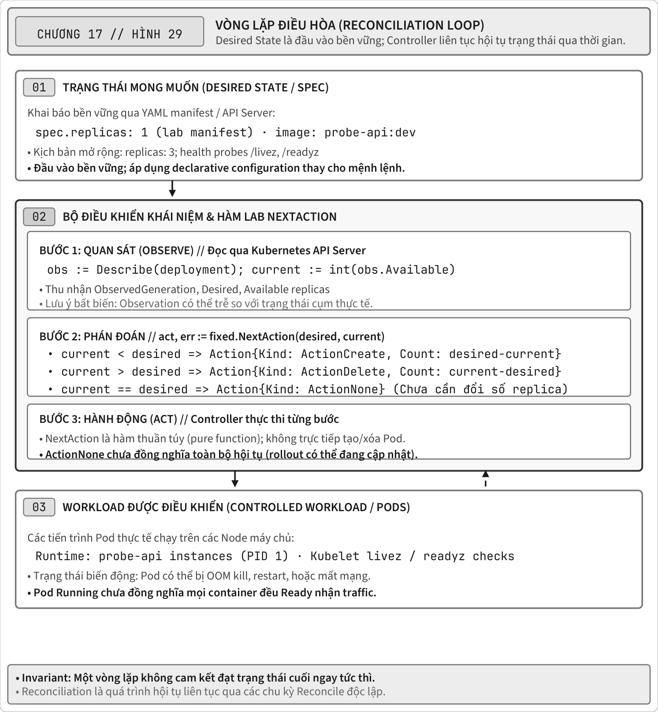
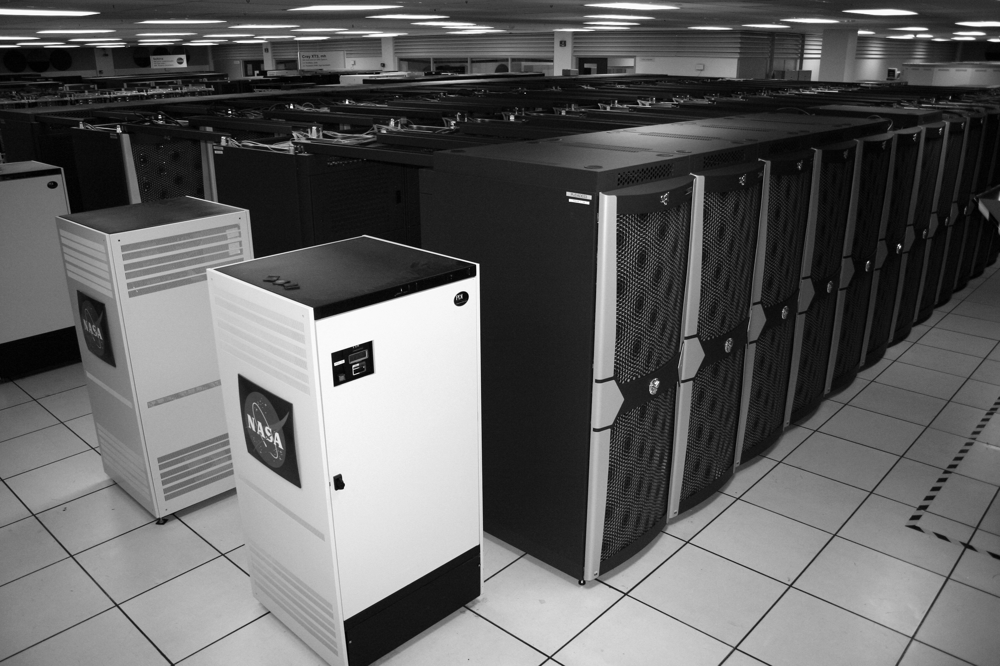
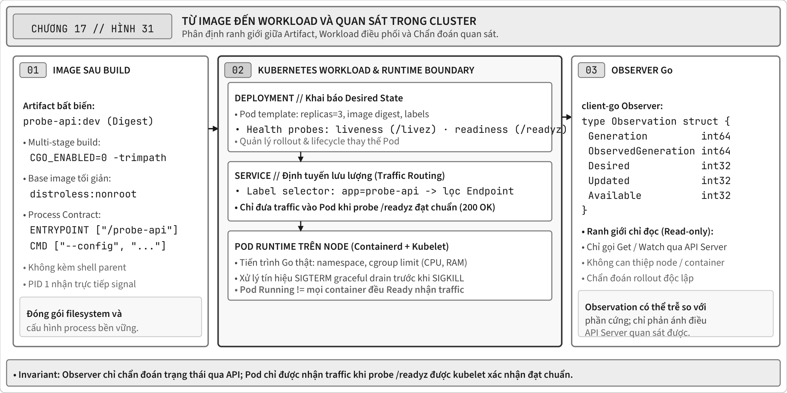

<!-- BOOK_ROLE: APPLICATION_SYSTEMS -->

# Chương 17 — Đóng gói và điều phối

Một chương trình Go chạy được bằng lệnh `go run` thường tạo ra một ảo giác an tâm: mã nguồn (*source*), trình biên dịch (*compiler*), hệ vỏ dòng lệnh (*shell*), tệp cấu hình và tiến trình (*process*) đều hiện diện cận kề, khiến việc “chạy được” có vẻ là một kết quả hiển nhiên. Nhưng mọi sự không còn đơn giản khi chương trình phải được biên dịch một lần, triển khai sang máy chủ khác, tiếp nhận các cấu hình môi trường khác, bị dừng đột ngột giữa chừng, rồi tự động thay thế khi nút mạng (*node*) gặp sự cố biến mất. Lúc ấy, câu hỏi đặt ra không đơn thuần là “làm sao chạy Docker?” mà là: ai sở hữu trạng thái mà ta muốn hệ thống duy trì?

Mô hình tư duy của chương là: ảnh container đóng gói giao ước khởi động của một tiến trình; bộ điều phối duy trì trạng thái mong muốn bằng vòng lặp điều hòa, không lặp lại một lệnh khởi chạy. Ảnh container (*image*) xác định tiến trình mặc định nào, hệ thống tệp nào và tham số mặc định nào hiện diện. Một bản khai báo tải công việc (*workload declaration*) quy định bao nhiêu bản sao của tạo phẩm (*artifact*) đó cần tồn tại và chính sách nào được áp dụng. Bộ điều khiển (*controller*) quan sát trạng thái hiện tại, thực thi một hành động tối thiểu nhằm thu hẹp khoảng cách tới trạng thái mong muốn (*desired state*), rồi tiếp tục quan sát. Không bước nào trong quy trình này tự động chứng minh ứng dụng đã phục vụ chính xác các yêu cầu nghiệp vụ.

## Một image chạy được chưa phải một deployment

Giả sử đội ngũ kỹ thuật đã đóng gói một ảnh container và khởi chạy thử nghiệm. Tệp nhị phân xuất nhật ký bình thường, cổng mạng mở, yêu cầu đầu tiên phản hồi mã `200`. Nhưng khi đưa cùng ảnh container đó vào cụm điều phối (*cluster*), một thể hiện bị khởi động lại liên tục do tiến trình kết thúc sớm, thể hiện khác chưa tiếp nhận lưu lượng vì chưa đạt trạng thái sẵn sàng, trong khi bản triển khai (*deployment*) vẫn đang luân chuyển thay thế Pod cũ bằng Pod mới. Nếu quy kết tất cả thành “Docker bị lỗi”, ta đã đánh mất ba ranh giới kỹ thuật tách biệt:

@table Ba contract không nên trộn làm một

| Boundary | Câu hỏi chính | Bằng chứng phù hợp |
| --- | --- | --- |
| Artifact | Process nào, default args nào, file nào được mang theo? | Image config, digest, Dockerfile, SBOM nếu có. |
| Runtime | Process có start, nhận signal, mở listener và thoát theo contract không? | Exit status, log, health/readiness, resource observation. |
| Control plane | Desired state có đang được đưa gần current state không? | Spec, status, event và action của controller. |

Vùng chứa (*container*) không phải là một máy ảo thu nhỏ, cũng không tự biến một tệp nhị phân thành một dịch vụ hoàn chỉnh. Đó là phương thức đóng gói hệ thống tệp và cấu hình thực thi cho một tiến trình độc lập. Lệnh `docker run` là một chỉ thị mang tính mệnh lệnh: nó yêu cầu môi trường thực thi khởi tạo một vùng chứa ngay tức thì. Ngược lại, Kubernetes vận hành ở một tầng trừu tượng khác: đối tượng có trường `spec` mô tả trạng thái mong muốn, trường `status` báo cáo trạng thái thực tế đã quan sát, và các bộ điều khiển liên tục thu hẹp khoảng cách giữa hai trạng thái đó. Vì lẽ đó, việc “đã áp dụng tệp YAML” không đồng nghĩa với việc “đã có lưu lượng được phục vụ”, cũng như trạng thái “Pod Running” hoàn toàn không bảo đảm “mọi vùng chứa bên trong đều đã sẵn sàng”.

@figure Trạng thái mong muốn là đầu vào bền vững hơn một lệnh khởi chạy tức thời. Bộ điều khiển thực thi qua nhiều vòng lặp; trạng thái cụm máy chủ liên tục biến động.

## Image là process contract, không phải bản sao của laptop

Đặc tả cấu hình image OCI chứa đựng các giá trị thực thi mặc định như nền tảng phần cứng, thư mục làm việc, định danh người dùng, `Entrypoint` và `Cmd`. Với một ảnh container chạy tệp nhị phân Go, cách tiếp cận chuẩn mực là: `ENTRYPOINT` ấn định tệp thực thi cố định; `CMD` cung cấp danh sách tham số mặc định mà môi trường thực thi có thể ghi đè. Việc áp dụng cả hai ở định dạng mảng thực thi (*exec form*) giúp phân tách rõ ràng tệp thực thi và từng đối số, ngăn chặn tiến trình hệ vỏ làm sai lệch quy tắc trích dẫn chuỗi và cắt đứt đường truyền tín hiệu hệ điều hành.

~~~dockerfile
FROM golang:1.27.1 AS build
WORKDIR /src

COPY go.mod go.sum ./
RUN go mod download
COPY . .
RUN CGO_ENABLED=0 go build -trimpath \
  -o /out/probe-api ./cmd/probe-api

FROM gcr.io/distroless/static-debian12:nonroot
COPY --from=build /out/probe-api /probe-api
USER nonroot:nonroot
ENTRYPOINT ["/probe-api"]
CMD ["--config", "/etc/probe-api/config.json"]
~~~

Đây là một mẫu cấu trúc tham khảo, không phải tệp Dockerfile có thể sao chép nguyên xi cho bài thực hành hiện hành: kho mã nguồn của cuốn sách không đặt `cmd/probe-api` hay `go.sum` tại thư mục gốc. Chi tiết đó quan trọng hơn vẻ ngoài trau chuốt của đoạn mã ví dụ. Một tệp Dockerfile chỉ phát huy giá trị khi đường dẫn gói phần mềm, các thành phần phụ thuộc, nền tảng mục tiêu và tài nguyên thực thi hoàn toàn khớp nối với mã nguồn thực tế. Đừng áp dụng `CGO_ENABLED=0`, ảnh distroless hay tài khoản `nonroot` như một công thức máy móc; hãy kiểm chứng xem tệp nhị phân có thực sự đòi hỏi thư viện ngôn ngữ C, chứng chỉ số CA, dữ liệu múi giờ, hệ vỏ dòng lệnh hoặc đường dẫn ghi tệp tin nào hay không.

Chỉ thị `RUN` thực thi tại thời điểm đóng gói ảnh container (*build time*) và tạo ra một lớp dữ liệu (*layer*); chỉ thị `CMD` ấn định giá trị mặc định khi vùng chứa bắt đầu khởi chạy (*container start*). Sự nhầm lẫn giữa hai thời điểm này có thể khiến các ca kiểm thử hoặc tác vụ di chuyển dữ liệu bị kích hoạt nhầm lúc đóng gói, trong khi ảnh container khi khởi chạy lại thiếu vắng tiến trình chính xác. Tương tự, thao tác sao chép mã nguồn rồi biên dịch bên trong ảnh container không tự động bảo đảm tính tái lập của mã nguồn: thẻ ảnh cơ sở (*base image tag*) có thể bị trôi phiên bản, việc tải mô-đun đòi hỏi đồ thị phụ thuộc được kiểm soát chặt chẽ, và ảnh container cuối cùng phải được định danh bằng mã băm cố định (*digest*) khi tính bất biến của danh tính quan trọng hơn một nhãn phiên bản dễ đọc.

> **Dừng để dự đoán:** Nếu môi trường thực thi ghi đè `CMD` thành `--config /run/config.json`, tệp thực thi nào vẫn được giữ nguyên? Nếu `ENTRYPOINT` được viết ở định dạng hệ vỏ (*shell form*), tiến trình nào thực sự nắm giữ mã định danh PID 1 và tín hiệu yêu cầu dừng sẽ được điều hướng qua đâu? Hãy kiểm chứng trực tiếp từ cấu hình image OCI hoặc quy tắc đặc tả của môi trường thực thi.

## Container vẫn sống trên máy thật

@figure Dãy máy chủ Pleiades tại NASA Ames, ảnh chụp ngày 08/10/2008 của Marco Librero/NASA Ames Research Center, từ Wikimedia Commons. Tài nguyên thuộc phạm vi công cộng theo giấy phép PD-USGov-NASA; bản sách chuyển sang thang độ xám (*grayscale*). Bức ảnh phản ánh hạ tầng vật lý thực tế, không nhằm chứng minh NASA sử dụng Go hay Kubernetes trên hệ thống này.

Bức ảnh phòng máy chủ nhắc nhở một ranh giới thực tế dễ bị các tệp YAML che khuất: tiến trình sau cùng vẫn trực tiếp cạnh tranh tài nguyên CPU, RAM, băng thông I/O và mạng trên phần cứng vật lý. Không gian tên (*namespace*) trên Linux thiết lập những góc nhìn cô lập cho một số tài nguyên nhất định; nhóm điều khiển (*cgroup*) tổ chức và thiết lập hạn mức tài nguyên theo chính sách. Chúng không biến hạn ngạch CPU thành các nhân vật lý bổ sung, cũng không biến giới hạn bộ nhớ thành một dung lượng vùng nhớ heap Go được bảo đảm cấp phát nguyên vẹn.

Hãy điều tra một tình huống giả định: Pod có hạn ngạch bộ nhớ (*memory limit*), dịch vụ không tăng số lượng yêu cầu, nhưng vẫn bị hệ điều hành tiêu diệt do cạn kiệt bộ nhớ (*OOM kill*) sau khi bổ sung thư viện bản địa (*native library*). Hồ sơ cấp phát vùng nhớ (*heap profile*) của Go chưa thể giải thích toàn bộ dung lượng bộ nhớ thực tế (RSS); ngoài bộ nhớ do Go trực tiếp quản lý, hệ thống còn có các khoản cấp phát bản địa, ánh xạ vùng nhớ (*mappings*) và các thành phần hệ điều hành hoạch toán theo chính sách của môi trường. Thiết lập `GOMEMLIMIT` chỉ là giới hạn mềm cho phần bộ nhớ do runtime Go kiểm soát, không phải trần giới hạn RSS hay quyền yêu cầu nhân hệ điều hành bỏ qua hạn mức cgroup. Tài liệu `runtime/debug.SetMemoryLimit` nêu rõ cả phần bị loại khỏi ngân sách, điển hình như vùng nhớ do mã nguồn bên ngoài runtime quản lý.

Vì vậy việc đọc hạn mức trong phần khai báo, lượng tài nguyên sử dụng thực tế và hồ sơ đo lường là ba bước khác nhau. Chương 10 cung cấp công cụ đo cấp phát và giải thích vai trò của `GOMAXPROCS`; số công việc Go có thể chạy song song không đồng nhất với ngân sách thời gian CPU do cgroup cấp. Tại đây, nhiệm vụ của khâu triển khai là thiết lập khoảng đệm tài nguyên phù hợp với tải và quan sát hiện tượng điều tiết (*throttling*), cạn bộ nhớ hoặc độ trễ gia tăng. Không chọn một tỷ lệ phần trăm bộ nhớ cố định cho mọi dịch vụ. Bài điều tra kết thúc khi người học chỉ rõ thành phần nào đã được đo, thành phần nào chưa được đo và cơ chế nào thực thi ngưỡng dừng, không phải sau khi thêm một biến môi trường vào tệp kê khai.

## Một process làm gì khi control plane muốn dừng nó?

Chương 12 đã phân tách vòng đời máy chủ HTTP khỏi hàm `main`: tín hiệu ngắt chuyển tiếp tới ngữ cảnh (`context`) của ứng dụng, máy chủ dừng tiếp nhận kết nối mới, rồi gọi `Shutdown` để chờ các yêu cầu đang xử lý trong một khoảng thời gian ân hạn (*grace period*). Khế ước đó thuộc trách nhiệm của chương trình. Môi trường thực thi vùng chứa (*container runtime*) và tiến trình `kubelet` chỉ phát sinh thêm một sự kiện phía trên: khi đến thời điểm chấm dứt, tiến trình nhận tín hiệu theo chính sách của môi trường thực thi; Kubernetes cũng có thể chờ một khoảng thời gian ân hạn trước khi cưỡng chế dừng tiến trình. Không có lời hứa hẹn chung nào rằng mọi hàm xử lý đang chạy sẽ tự động bị hủy, mọi tiến trình con tự động biến mất, hay toàn bộ yêu cầu chắc chắn sẽ hoàn tất trọn vẹn.

Vì vậy, cú pháp `ENTRYPOINT ["/probe-api"]` mang ý nghĩa vận hành chuẩn tắc hơn `ENTRYPOINT /probe-api --config ...` khi mục đích là để tệp nhị phân trở thành tiến trình chính (PID 1). Dạng mảng thực thi (*exec form*) không tự động xử lý dừng êm dịu thay cho chương trình, nhưng nó tránh việc chèn một vỏ lệnh hệ thống (*shell*) nằm chắn giữa môi trường thực thi và tệp nhị phân. Tín hiệu `SIGTERM` vẫn chỉ là một thông điệp: ứng dụng phải chủ động quyết định cách chuyển nó thành thao tác làm cạn yêu cầu (*drain*), thiết lập hạn định thời gian (*deadline*) và trả về mã thoát phù hợp; hệ thống điều phối cần được cấu hình khoảng thời gian đủ lớn cho chính sách dừng đó.

Đây cũng là lúc xem xét lại cơ chế sẵn sàng (*readiness*) của Chương 16 theo đúng phạm vi. Đầu kiểm tra sẵn sàng trả lời câu hỏi: “Có nên đưa Pod này vào tập đích phục vụ của Service hay không?”. Nó không xác nhận image được đóng gói đúng, không thay liveness hay SLO, và không yêu cầu khởi động lại chỉ vì một phụ thuộc ở xa đang chậm. Khi Pod được đánh dấu chưa sẵn sàng, Service thông thường sẽ loại nó khỏi tập đích sau khi trạng thái được truyền tới các thành phần định tuyến. Đây không phải hàng rào tức thời cho mọi yêu cầu mới: cập nhật có độ trễ, kết nối đã thiết lập và khách truy cập thẳng Pod không tự bị chặn. Readiness thất bại không tự dừng tiến trình; chính sách khác vẫn có thể thay thế Pod.

## Desired state không phải một script dài

Tệp kê khai (*manifest*) minh họa dưới đây chỉ xác lập ba ý niệm rõ ràng: định danh bất biến của gói phát hành, số lượng bản sao mong muốn và khế ước sẵn sàng phục vụ. Nó không tuyên bố rằng đây là toàn bộ cấu hình hoàn chỉnh của một dịch vụ trên môi trường sản xuất.

~~~yaml
apiVersion: apps/v1
kind: Deployment
metadata:
  name: probe-api
spec:
  replicas: 3
  selector:
    matchLabels:
      app: probe-api
  template:
    metadata:
      labels:
        app: probe-api
    spec:
      containers:
        - name: probe-api
          image: registry.example/probe-api@sha256:REPLACE_ME
          args: ["--config", "/etc/probe-api/config.json"]
          readinessProbe:
            httpGet:
              path: /readyz
              port: 8080
~~~

`replicas: 3` không có nghĩa “chạy lệnh khởi động đúng ba lần rồi xong”. Đó là số lượng bản sao mong muốn (*desired count*). Bộ điều khiển (*controller*) có thể tạo Pod khi thiếu hụt, tạo bản sao thay thế (*replacement*) khi một Pod bị mất, hoặc từng bước thay thế các bản sao khi mẫu khai báo (*template*) thay đổi. Pod là đơn vị mang tính tạm thời (*ephemeral*); một Pod đã được ấn định lịch điều phối không tự động chuyển dịch sang máy chủ khác. Chính bộ điều khiển cấp cao hơn mới là thành phần khởi tạo Pod mới để khối lượng công việc liên tục tiến về trạng thái mong muốn.

Trường `image` sử dụng mã băm nội dung (*digest*) trong ví dụ vì mã băm là định danh bất biến của gói phát hành cụ thể. Nhãn phiên bản như `:latest` chỉ là một tên gọi có thể trỏ đến ảnh container khác ở thời điểm khác; nó có thể tiện lợi cho quy trình phát triển, nhưng tuyệt đối không phải là bằng chứng khẳng định việc triển khai đang chạy đúng bản dựng nào. Ký hiệu giữ chỗ `REPLACE_ME` cố ý khiến tệp kê khai chưa thể áp dụng ngay: một mã băm giả mạo sẽ tạo ra cấu hình trông có vẻ hoàn chỉnh nhưng hoàn toàn không có gói phát hành thực tế để kéo về.

Đặc tả Pod (*pod spec*) cũng không phải là nơi để nhồi nhét mọi cấu hình trong mã nguồn. Biến môi trường, Secret, ConfigMap, ổ lưu trữ (*volume*), tài khoản dịch vụ (*service account*), yêu cầu và hạn ngạch tài nguyên cùng chính sách mạng đều có ngữ nghĩa, quyền truy cập và vòng đời riêng biệt. Khi một trường dữ liệu ảnh hưởng tới khả năng khởi động hay tính sẵn sàng phục vụ, nó là một phần của khế ước thời gian chạy bắt buộc phải được kiểm thử và quan sát; đó không phải là “chất keo YAML” để xem nhẹ khâu đánh giá mã nguồn.

## Đọc reconciliation bằng một hàm nhỏ

Bộ điều khiển Kubernetes trong thực tế quan sát các đối tượng API, có bộ nhớ đệm, cơ chế thử lại, xử lý lỗi và điều phối nhiều loại tài nguyên khác nhau. Chúng ta không cần mô phỏng lại cả một cụm máy chủ trong bài thực hành. Thay vào đó, mô hình tái hiện tối thiểu giữ lại phần tư duy cốt lõi: một lần quan sát chỉ trả về hành động kế tiếp, tuyệt đối không cam kết hệ thống đã hội tụ ngay tức thì sau hành động đó.

~~~go
type ActionKind string

const (
	ActionNone   ActionKind = "none"
	ActionCreate ActionKind = "create"
	ActionDelete ActionKind = "delete"
)

type Action struct {
	Kind  ActionKind
	Count int
}

func NextAction(desired, current int) (Action, error) {
	if desired < 0 || current < 0 {
		return Action{}, ErrNegativeReplicaCount
	}
	switch {
	case current < desired:
		return Action{
			Kind:  ActionCreate,
			Count: desired - current,
		}, nil
	case current > desired:
		return Action{
			Kind:  ActionDelete,
			Count: current - desired,
		}, nil
	default:
		return Action{Kind: ActionNone}, nil
	}
}
~~~

Hàm cố tình không lặp vòng `for` cho đến khi số lượng bằng nhau. Nếu nó tự gọi lệnh “khởi động” ba lần liên tiếp, nó sẽ che khuất những sự kiện thực tế diễn ra giữa các hành động: thao tác tạo mới có thể thất bại, phiên bản mới có thể chưa sẵn sàng, trạng thái hiện tại có thể bị một tác nhân khác thay đổi, hoặc bộ điều khiển cần phải áp dụng cơ chế điều tốc (*rate limit*). Trạng thái `ActionNone` không chứng minh ứng dụng đang khỏe mạnh; nó chỉ khẳng định bản chụp số lượng tức thời đưa vào hàm đang bằng với số lượng mong muốn. Sự cẩn trọng này là một đặc tính kỹ thuật cốt lõi của mã nguồn điều phối.

Trong bộ điều khiển thực tế, trạng thái mong muốn có thể thay đổi liên tục, bộ nhớ đệm có thể bị trễ, và hành động có thể đã hoàn tất thành công trước khi bên gọi kịp nhận phản hồi. Phương thức `NextAction` trả về cùng một hành động cho cùng một đầu vào chỉ chứng minh tính tất định của thuật toán tính toán, hoàn toàn không chứng minh các hiệu ứng phụ (*side effects*) là an toàn khi lặp lại nhiều lần. Với bản chụp số lượng mong muốn 3 và hiện tại 1, việc thực thi chỉ thị “tạo thêm 2” hai lần liên tiếp có thể làm phát sinh tới 5 phiên bản hoạt động. Để lặp lại một cách an toàn, bộ điều khiển bắt buộc phải đọc lại trạng thái và thiết lập cơ chế định danh quyền sở hữu chặt chẽ cho thao tác tạo mới; sự cố quá thời gian không thể khẳng định thao tác trước đó đã diễn ra hay chưa. Chương 21 và Chương 23 sẽ kiểm chứng ranh giới này với hàng đợi công việc, dữ liệu quan sát cũ và khoảng thời gian tiến trình gặp sự cố đột ngột. Đây là bài toán về vòng lặp điều khiển và giao diện lập trình, không thuộc về cú pháp ngôn ngữ Go.

@table Điều một vòng reconciliation được phép kết luận

| Dữ liệu quan sát | Hành động hợp lý của bộ điều hòa mẫu | Điều vẫn chưa biết |
| --- | --- | --- |
| Mong muốn 3, hiện tại 1 | Tạo thêm 2 phiên bản máy chủ. | Hai phiên bản đó có khởi động và sẵn sàng hay không. |
| Mong muốn 3, hiện tại 5 | Dừng hoặc loại bỏ 2 phiên bản. | Phiên bản nào nên bị chọn, kết nối mạng có cần rút cạn (*drain*) hay không. |
| Mong muốn 3, hiện tại 3 | Giữ nguyên số lượng bản sao. | Bản sửa đổi ảnh container, lưu lượng mạng, độ trễ, chỉ số SLO và sức khỏe tài nguyên. |

### Bài thực hành: Tự hoàn thành vòng lặp điều hòa một bước

Mở tệp `labs/part17-reconciliation-contract/exercise/reconcile_test.go` trước tiên. Bài tập không đòi hỏi dịch vụ nền Docker, cụm máy chủ, thông tin xác thực hay kết nối mạng. Bộ kiểm thử truyền số lượng mong muốn và hiện thời vào hàm rồi yêu cầu hành động đầu ra phải có giới hạn, tất định, và không biến đầu vào âm thành một hành động sai lệch. Bộ kiểm thử không thực thi hiệu ứng phụ, do đó không chứng minh tính lũy đẳng của một giao diện lập trình khởi tạo phiên bản. Đây là cách tách biệt phép tính toán chênh lệch khỏi hệ thống điều phối thực tế.

~~~powershell
cd labs/part17-reconciliation-contract
go test -tags exercise ./exercise
go test ./fixed
go vet ./fixed
go test -race ./fixed
~~~

Hãy hoàn thiện phương thức `NextAction` dựa trên giao ước thiết kế, tuyệt đối không mở thư mục `fixed/` trước khi tự làm. Câu hỏi trước khi viết mã là: hành động nào phản ánh chính xác sự chênh lệch giữa số lượng mong muốn và hiện thời, và trường hợp hai số bằng nhau cần trả về giá trị gì để bên gọi không phải suy đoán mơ hồ? Sau khi các ca kiểm thử đạt kết quả tốt, hãy thử thay thế trạng thái hiện tại bằng kết quả dự kiến của hành động đó rồi gọi lại hàm. Hiện tượng gì sẽ xảy ra ở vòng lặp thứ hai? Đó là phép thử nghiệm tính hội tụ khi dữ liệu quan sát được cập nhật mới, chứ chưa phải bằng chứng về tính an toàn khi lặp lại hiệu ứng phụ.

#### Gợi ý giải pháp (chỉ đọc sau khi đã tự làm)
Xác thực cả hai số lượng trước, vì phép trừ `desired - current` với số âm có thể biến một cấu hình lỗi thành hành động hợp lệ giả tạo. Sau đó trả về `create` hay `delete` với `Count` đúng bằng độ chênh lệch; trường hợp bằng nhau trả về `ActionNone` với `Count` bằng 0. Không làm biến đổi dữ liệu đầu vào, không dùng vòng lặp, không tạm dừng (*sleep*) và không cố “chờ sẵn sàng”: mỗi việc đó thuộc về một ranh giới trách nhiệm khác.

## Giai đoạn hai: đưa service thật vào container và cụm máy chủ

Vòng lặp `NextAction` ở trên giúp chúng ta hiểu bản chất của quy trình điều hòa trạng thái (*reconciliation*) mà chưa
cần tới cụm máy chủ thực tế. Nhưng khi đưa một dịch vụ Go vào vận hành, mã nguồn không còn
chạy trực tiếp trên máy của lập trình viên. Nó phải được đóng gói vào một ảnh container OCI (*OCI image*) và
giao phó cho một hệ thống điều phối. Thư mục `labs/part17-container-kubernetes` dùng chính
dịch vụ HTTP `probe-api` từ `labs/part16-real-signals` để thực hành các
ranh giới này trên môi trường cục bộ có Docker và Kubernetes.

@figure Đối tượng Deployment khai báo khuôn mẫu Pod cùng các đầu kiểm tra, Service chọn luồng lưu lượng truy cập, môi trường thực thi trên máy chủ chạy ảnh container. Quan sát viên chỉ đọc dữ liệu thông qua API Server; sơ đồ lược bỏ các thành phần điều phối trung gian.

Trước khi bắt đầu, bài thực hành kiểm tra các công cụ bắt buộc bằng tệp kịch bản
`scripts/verify-prereqs.ps1`. Nó yêu cầu các công cụ `docker`, `kubectl` và `kind` phải hiện diện
trên máy tính cá nhân. Nếu môi trường hiện tại chưa được cài đặt đầy đủ các công cụ này, kịch bản
sẽ dừng lại kèm thông báo chỉ dẫn rõ ràng; khi đó, các câu lệnh dưới đây là quy trình mẫu
được chuẩn hóa để người học đối chiếu khi có đủ điều kiện, tuyệt đối không
tự ý thay thế bằng một cụm máy chủ đám mây trả phí.

~~~powershell
cd labs/part17-container-kubernetes
./scripts/verify-prereqs.ps1
~~~

### Ảnh container là khế ước kỹ thuật của tiến trình

Tệp Dockerfile của bài thực hành áp dụng mô hình dựng nhiều giai đoạn (*multi-stage build*) để tách biệt môi trường
biên dịch với môi trường thực thi. Giai đoạn đầu tiên sử dụng ảnh Go chính thức để tải
mô-đun phụ thuộc và biên dịch tệp nhị phân với `CGO_ENABLED=0` cùng cờ `-trimpath` nhằm loại bỏ
đường dẫn tệp hệ thống cục bộ khỏi tệp nhị phân. Giai đoạn cuối cùng chỉ sao chép duy nhất
tệp nhị phân sang ảnh nền tối giản `distroless/static-debian12:nonroot`.

~~~dockerfile
FROM golang:1.27.1 AS build
WORKDIR /src
COPY go.mod go.sum ./
RUN go mod download
COPY . .
RUN CGO_ENABLED=0 go build -trimpath \
  -o /out/probe-api ./cmd/probe-api

FROM gcr.io/distroless/static-debian12:nonroot
COPY --from=build /out/probe-api /probe-api
USER 65532:65532
ENTRYPOINT ["/probe-api"]
~~~

Với câu lệnh dưới đây, chỉ thị `ENTRYPOINT` ở định dạng mảng thực thi (*exec form*) sẽ khởi chạy tệp nhị phân trực tiếp làm tiến trình PID 1
bên trong vùng chứa; nếu bổ sung thêm cờ `--init`, tiến trình khởi tạo hệ thống sẽ đảm nhận vị trí đó. Máy chủ tiếp nhận
cổng từ biến môi trường `PORT` tương tự như Chương 12 và Chương 16. Cờ `--read-only` thiết lập hệ thống tệp gốc ở chế độ
chỉ đọc, không ngăn cấm thao tác ghi vào ổ lưu trữ (*volume*) hay vùng nhớ tạm (*tmpfs*) được gắn kết riêng biệt. Cờ `--cap-drop ALL`
loại bỏ toàn bộ năng quyền Linux (*capabilities*), trong khi chỉ định `USER 65532:65532` ấn định danh tính tài khoản không mang đặc quyền quản trị (*root*).
Những thiết lập này thu hẹp đáng kể bề mặt tấn công nhưng không thể thay thế toàn diện chính sách cô lập của vùng chứa.

~~~powershell
# Chạy từ thư mục gốc của repository (minh họa)
docker build `
  -f labs/part17-container-kubernetes/Dockerfile `
  -t probe-api:dev `
  labs/part16-real-signals

docker run --rm --name probe-api `
  --read-only --cap-drop ALL `
  -p 18080:18080 -e PORT=18080 probe-api:dev
~~~

Ở một terminal khác, ta kiểm tra các contract vận hành:

~~~powershell
curl.exe -i http://localhost:18080/readyz
curl.exe -i http://localhost:18080/probe?mode=slow
docker inspect --format '{{.Config.User}}' probe-api
docker stop -t 5 probe-api
~~~

Trong ảnh container của bài thực hành, lệnh `docker stop -t 5` chuyển tiếp tín hiệu `SIGTERM` tới tiến trình chính và ấn định thời gian chờ tối
đa 5 giây; nếu tiến trình vẫn chưa thoát, Docker mới cưỡng chế dừng bằng `SIGKILL`. Khoảng thời gian chờ đó không
cam đoan mọi yêu cầu mạng đều hoàn tất trọn vẹn: ta cần chủ động quan sát khâu làm cạn yêu cầu (*drain*) và mã trạng thái thoát của chương trình để
kiểm chứng giao ước dừng êm dịu (*graceful shutdown*). Đánh đổi của
ảnh tối giản (*distroless*) và hệ thống tệp chỉ đọc là gì? Vùng chứa sẽ hoàn toàn không có hệ vỏ dòng lệnh (`/bin/sh`),
không chứa trình quản lý gói phần mềm, và tệp nhị phân không thể tùy tiện ghi tệp tạm thời nếu không
được gắn kết một thư mục riêng biệt. Việc cắt giảm công cụ và các gói phụ thuộc giúp thu hẹp phạm vi
quản lý, nhưng không đồng nghĩa tệp nhị phân, các thư viện liên kết hay cấu hình môi trường hoàn toàn miễn nhiễm với lỗ hổng bảo mật.

Cần lưu ý: nhãn `probe-api:dev` chỉ là định danh cục bộ trên máy phát triển. Nó
không phải là một định danh bất biến dùng cho môi trường production; Chương 18
sẽ giải quyết bài toán định danh bằng digest.

### Trạng thái mong muốn và điều tra sự cố trong cụm máy chủ

Khi chuyển từ vùng chứa đơn lẻ sang Kubernetes, ta không còn ra lệnh chạy một
tiến trình mà khai báo trạng thái mong muốn (*desired state*) thông qua các tệp kê khai: `namespace.yaml`,
`deployment.yaml` và `service.yaml`.

~~~powershell
kind create cluster --name go-book
kind load docker-image probe-api:dev --name go-book
kubectl apply -f k8s/namespace.yaml
kubectl apply -f k8s/deployment.yaml
kubectl apply -f k8s/service.yaml
kubectl -n go-book rollout status deployment/probe-api
kubectl -n go-book get deploy,pod,service
kubectl -n go-book port-forward service/probe-api 18080:80
~~~

Trong `deployment.yaml`, hai probe dẫn tới hai quyết định khác nhau:

Thứ nhất là đầu kiểm tra sẵn sàng phục vụ (*readiness probe*, tại điểm cuối `/readyz`): Giải đáp câu hỏi “Liệu Pod này có sẵn sàng tiếp nhận lưu lượng truy cập từ đối tượng Dịch vụ (*Service*) ngay lúc này hay không?”. Sau khi vượt quá ngưỡng thất bại cho phép, tiến trình `kubelet` sẽ thiết lập điều kiện sẵn sàng thành sai (`false`). Với đối tượng dịch vụ thông thường, điểm cuối chưa sẵn sàng sẽ bị loại bỏ khỏi danh sách phân phối lưu lượng; đối tượng lát cắt điểm cuối (*EndpointSlice*) vẫn có thể lưu giữ địa chỉ mạng nhưng đánh dấu trạng thái chưa sẵn sàng. Cấu hình dịch vụ bật cờ `publishNotReadyAddresses` là trường hợp ngoại lệ cần đối soát chính sách riêng biệt. Việc kiểm tra sẵn sàng thất bại không tự động kích hoạt thao tác khởi động lại vùng chứa.

Thứ hai là đầu kiểm tra sống còn (*liveness probe*, tại `/livez`): giám sát điều kiện mà chính sách vận hành chọn để khởi động lại container. `kubelet` đếm các lần thất bại liên tiếp theo `failureThreshold`; manifest của lab đặt ngưỡng 3, nên một lần thất bại chưa đủ. Ngưỡng có thể được đặt bằng 1: không có bảo đảm chung rằng một mẫu lỗi đơn lẻ không bao giờ dẫn tới restart. Khi đủ ngưỡng, kubelet chấm dứt container theo grace period và áp dụng restart policy. Tránh đưa lỗi phụ thuộc ở xa vào liveness nếu restart không giải quyết nguyên nhân gốc; nó có thể tạo chuỗi khởi động lại liên hoàn. Readiness và liveness phục vụ hai quyết định khác nhau.

Phần tài nguyên cũng phân định rạch ròi giữa mức yêu cầu `requests` (chỉ số mà bộ lập lịch sử dụng
để tìm kiếm nút mạng phù hợp cho Pod) và mức trần `limits` (ngưỡng giới hạn tài nguyên được cưỡng chế thực thi theo
cơ chế của môi trường vận hành). Với nhóm điều khiển (*cgroup*) trên Linux, khi hết ngân sách thời gian CPU trong một chu kỳ, tiến trình có thể phải chờ tới lần cấp ngân sách kế tiếp (*throttling*). Đây là giới hạn thời gian được chạy, không phải giảm xung nhịp phần cứng. Giới hạn bộ nhớ được xử lý theo cơ chế phản ứng thụ động và có thể
dẫn tới việc tiến trình bị tiêu diệt do cạn bộ nhớ (*OOM kill*). Đây không phải lời cam đoan rằng mọi thời điểm vượt ngưỡng đều bị chấm dứt
tức thì, cũng không phải là trần giới hạn dành riêng cho vùng nhớ heap của Go.

Để hiểu cách điều tra sự cố dựa trên bằng chứng thay vì suy đoán, lab cung cấp
fixture `k8s/failure-wrong-image.yaml` với tên image không tồn tại:

~~~powershell
kubectl apply -f k8s/failure-wrong-image.yaml
kubectl -n go-book rollout status `
  deployment/probe-api --timeout=45s
kubectl -n go-book get pods
kubectl -n go-book get events --sort-by=.lastTimestamp
kubectl -n go-book describe pod `
  -l app.kubernetes.io/name=probe-api
kubectl apply -f k8s/deployment.yaml
kubectl -n go-book rollout status deployment/probe-api
~~~

Nếu ảnh container vẫn không thể kéo về máy chủ và tệp triển khai chưa được điều chỉnh, câu lệnh `rollout status`
dự kiến sẽ cạn kiệt thời gian chờ sau 45 giây. Người vận hành thiếu kinh nghiệm thường vội vã kết luận
“hệ thống Kubernetes bị treo”. Nhưng khi tra cứu sự kiện bằng `kubectl get events` và kiểm tra chi tiết bằng `kubectl describe pod`, mặt phẳng điều khiển
(*control plane*) cung cấp các bằng chứng chẩn đoán cụ thể: lỗi không kéo được ảnh container `ErrImagePull` và cơ chế lùi bước chờ kéo lại `ImagePullBackOff`. Sau khi xác
định chính xác nguyên nhân gốc, ta khôi phục trạng thái bằng cách áp dụng lại tệp `deployment.yaml` chuẩn ban đầu.
Khi hoàn tất bài học, ta giải phóng cụm máy chủ cục bộ bằng lệnh:
`kind delete cluster --name go-book`.

### Quan sát API bằng client-go

Thay vì phụ thuộc hoàn toàn vào lệnh CLI `kubectl`, các kỹ sư Go thường cần viết
các công cụ chẩn đoán hoặc tự động hóa bằng chính ngôn ngữ Go. Thư mục
`labs/part17-container-kubernetes/client-observer` minh họa một chương trình
chẩn đoán chỉ đọc (*read-only*) dùng thư viện `k8s.io/client-go`.

Chương trình nạp cấu hình cluster từ kubeconfig cục bộ, gọi API `Get` để lấy
snapshot của Deployment `probe-api`, và mở một kênh `Watch` có giới hạn 15 giây
để lắng nghe các thay đổi:

~~~powershell
cd labs/part17-container-kubernetes/client-observer
go test ./...
go vet ./...
go test -race ./...
go run ./cmd/observe-deployment `
  --namespace go-book --name probe-api
~~~

Kết quả in ra tách biệt rõ ràng giữa trạng thái mong muốn (*desired state*) và quan sát thực tế (*current observation*):

~~~text
get: generation=1 observed=1 desired=1 updated=1 available=1
~~~

Chương trình này cố ý giữ phạm vi hẹp: nó không tạo, sửa hay xóa bất kỳ tài
nguyên nào. Nó minh họa sự khác biệt giữa `Generation` (số thế hệ phiên bản đặc tả mà
người dùng muốn) và `ObservedGeneration` (thế hệ mà bộ điều khiển báo đã quan sát).
Hai số lệch nhau cho biết trạng thái chưa theo kịp thế hệ hiện tại, không chứng minh
bộ điều khiển đang tiến triển: nó có thể đang lỗi hoặc chưa chạy. Hai số bằng nhau
cũng không chứng minh khối lượng công việc khỏe mạnh; còn phải đọc các điều kiện và trạng thái bản sao.

Lab chỉ in một snapshot rồi chờ sự kiện đầu tiên; nó không duy trì một dòng lịch sử liên tục. Watch hiện không truyền `ResourceVersion` từ kết quả Get, nên một thay đổi xảy ra giữa hai lời gọi có thể không được phản ánh trong dòng sự kiện mà người học thấy. Thời hạn 15 giây là ngân sách chung của cả Get và Watch, không phải thêm 15 giây sau Get. Không lấy việc watch im lặng làm bằng chứng Deployment không thay đổi. Chương 22 sẽ dạy đầy đủ cách nối List/Watch và xử lý lịch sử đã hết hạn; không biến công cụ chẩn đoán này thành controller mới.

@table Các lớp kiểm soát từ binary đến cluster

| Tầng kiểm soát | Nhiệm vụ chính | Bằng chứng kiểm chứng | Giới hạn không được suy diễn |
| --- | --- | --- | --- |
| Tệp nhị phân (*Binary*) | Xử lý yêu cầu, tín hiệu, cổng HTTP. | Kiểm thử đơn vị/chạy đua, nhật ký JSON. | Chưa nắm bắt hệ thống tệp hay hạn mức cgroup. |
| Vùng chứa (*Container*) | Đóng gói hệ thống tệp, định danh người dùng, PID 1. | Lệnh `docker inspect`, mã thoát. | Chạy được một vùng chứa không bảo đảm tính sẵn sàng. |
| Tải công việc (*Workload*) | Điều phối bản sao, cập nhật cuộn, đầu kiểm tra. | Trạng thái triển khai, sự kiện của Pod. | Trạng thái Pod khả dụng không chứng minh mã ứng dụng không lỗi. |
| Thư viện máy khách | Đọc và theo dõi trạng thái qua giao diện lập trình. | Thế hệ mong muốn, thế hệ đã quan sát. | Ảnh chụp tức thời không thay thế được bộ điều khiển. |

> **Dừng để dự đoán:** Nếu một Pod có đầu kiểm tra sống còn thành công nhưng đầu kiểm tra sẵn sàng thất bại, Service có chuyển tiếp yêu cầu vào Pod đó không? Kubelet có khởi động lại Pod không? Hãy đối chiếu câu trả lời với bảng trên trước khi xem tiếp.

## Khi nào phải dùng Docker, Kubernetes và client-go thật

Khi yêu cầu kỹ thuật đòi hỏi đóng gói và đẩy ảnh container, chạy kiểm thử tích hợp trong vùng chứa, triển khai khối lượng công việc, đọc trạng thái cụm máy chủ hoặc viết bộ điều khiển, lúc đó các công cụ thực tế là bắt buộc. Docker CLI/BuildKit và API Kubernetes đều có phiên bản, quyền hạn và chính sách cụm máy chủ riêng biệt; `client-go` không phải một thư viện tiện ích để nạp vào chỉ vì muốn phân tích cú pháp YAML. Trước khi tương tác với API, hãy xác định rõ ràng tài nguyên nào là nguồn chân lý duy nhất (*source of truth*), định danh nào gắn với quyền sở hữu, cơ chế thử lại có thể lặp lại hành động nào, trạng thái nào bên gọi được phép tin cậy, và thông tin xác thực nào chương trình tự động được phép sử dụng.

Điểm kết thúc của chương là một góc nhìn thoát khỏi tư duy giản lược “triển khai chỉ là chạy câu lệnh”. Định danh bất biến của gói phát hành, vòng đời tiến trình và trạng thái mong muốn là ba khế ước kỹ thuật liên tiếp. Chương 16 cung cấp các tín hiệu đo lường để nắm bắt hiện trạng phiên bản; chương này cung cấp tư duy bộ điều khiển để hiểu thấu đáo vì sao phiên bản có thể bị tạo mới, thay thế hoặc rút khỏi luồng lưu lượng truy cập.

`NextAction` chỉ là một lần quan sát và một hành động kế tiếp; nó cố ý chưa có hàng đợi, cơ chế thử lại hay máy chủ API. Sau dự án tổng kết ở Chương 20, Chương 21 sẽ xây dựng các cơ chế điều phối đó trên một mô hình tái lập độc lập. Chương 22 mới gắn kết mô hình tư duy này vào `client-go`, bộ nhớ đệm và cơ chế `List/Watch` của Kubernetes. Trình tự này giúp cho Dockerfile, tệp YAML và các bộ khung công cụ không che khuất câu hỏi nền tảng: tại lần quan sát này, hành động nào là hợp lệ và còn điều gì vẫn chưa thể kết luận?

@references
1. Open Container Initiative. Image configuration: platform, `Entrypoint`, `Cmd`, `WorkingDir`, `User` và default execution parameters. github.com/opencontainers/image-spec/blob/main/config.md
2. Docker Authors. Dockerfile reference: `RUN`, `CMD`, `ENTRYPOINT`, exec form và shell form. docs.docker.com/reference/dockerfile/
3. Kubernetes Authors. Controllers: desired state, current state và control loops. kubernetes.io/docs/concepts/architecture/controller/
4. Kubernetes Authors. Pod lifecycle: Pod spec/status, restart policy, readiness và container lifecycle. kubernetes.io/docs/concepts/workloads/pods/pod-lifecycle/
5. Kubernetes Authors. Package `client-go`: programmatic interface cho Kubernetes API. pkg.go.dev/k8s.io/client-go
6. GoogleContainerTools. Distroless: language focused docker images, non-root user và minimal runtime footprint. github.com/GoogleContainerTools/distroless
7. Kubernetes Authors. Configure probes: failureThreshold và restart policy; Resource management: CPU throttling và memory limits. kubernetes.io/docs/tasks/configure-pod-container/configure-liveness-readiness-startup-probes/; kubernetes.io/docs/concepts/configuration/manage-resources-containers/
8. Kubernetes Authors. API concepts: get/list/watch và resourceVersion. kubernetes.io/docs/reference/using-api/api-concepts/
