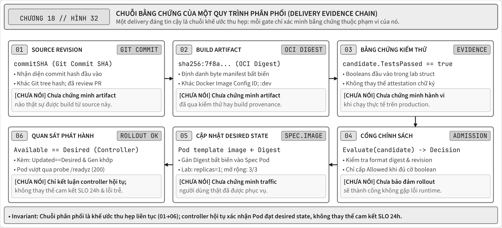
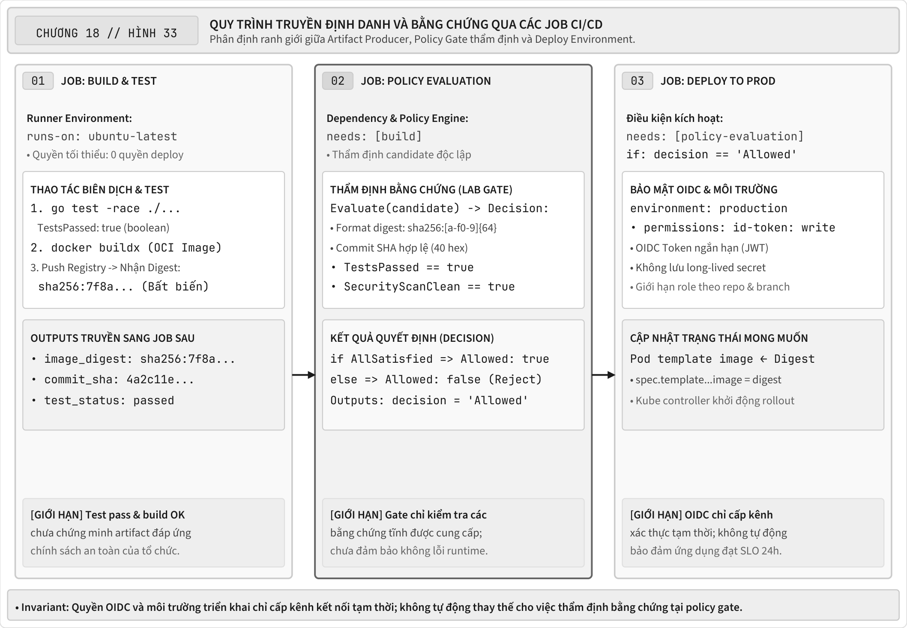

<!-- BOOK_ROLE: APPLICATION_SYSTEMS -->

# Chương 18 — Đưa thay đổi ra production

Sau Chương 17, ta có thể đặt một sản phẩm đóng gói (*artifact*) có mã băm nội dung (*digest*) vào trạng thái mong muốn (*desired state*). Tuy nhiên, một mã băm không tự trả lời sản phẩm ấy đến từ mã nguồn nào, đã vượt qua bài kiểm thử nào, tác vụ nào có thẩm quyền triển khai, hay quá trình luân chuyển hoàn tất mang ý nghĩa gì đối với người dùng cuối. Một đường ống tự động báo xanh chỉ là tín hiệu về những công đoạn nó đã thực thi; nếu các bước không xác định rõ khế ước kỹ thuật (*contract*), sắc xanh chỉ mang lại cảm giác yên tâm giả tạo thay vì cung cấp bằng chứng xác thực.

Mô hình tư duy cốt lõi của chương là: phân phối phần mềm là chuỗi bằng chứng kỹ thuật gắn kết một phiên bản mã nguồn với một sản phẩm đóng gói bất biến, sau đó cho phép thăng hạng (*promotion*) dựa trên chính sách kiểm soát nghiêm ngặt. Đường ống tự động không “đưa mã nguồn lên môi trường thực tế”. Nó đóng gói sản phẩm, ghi lại định danh duy nhất của sản phẩm, thu thập bằng chứng cho các cổng kiểm soát đã xác định, và chỉ có tác vụ mang đầy đủ thẩm quyền mới được phép cập nhật trạng thái mong muốn bằng chính mã băm nội dung đó. Quy trình phục hồi (*rollback*) cũng là một hành động thăng hạng có chủ đích trở lại một sản phẩm đóng gói đã biết từ trước, hoàn toàn không phải chiếc nút hoàn tác kỳ diệu cho mọi hiệu ứng phụ trong toàn hệ thống.

## Một commit xanh vẫn chưa là release

Giả sử một yêu cầu nhập mã (*pull request*) vượt qua bài kiểm thử đơn vị. Sau đó máy thực thi (*runner*) đóng gói ảnh container, tác vụ triển khai sử dụng nhãn `:main`, cụm máy chủ kéo ảnh về và quá trình luân chuyển hiển thị trạng thái `3/3 Sẵn sàng`. Chuỗi vận hành này còn rất nhiều câu hỏi cốt lõi chưa được trả lời: ảnh container đang vận hành có thực sự khớp với ảnh vừa đóng gói hay không; phiên bản mã nguồn nào đã tạo ra ảnh đó; thông tin xác thực dùng để triển khai có phạm vi phân quyền rộng đến mức nào; trạng thái `3/3` chỉ phản ánh số lượng bản sao khả dụng hay thực sự chứng minh các yêu cầu nghiệp vụ đang xử lý thành công; và nếu bước chuyển dịch cơ sở dữ liệu (*data migration*) đã diễn ra, việc phục hồi ảnh container cũ có tự động khôi phục lại dữ liệu hay không?

Đây không phải lý do để chối bỏ tự động hóa tích hợp và phân phối liên tục vì định kiến “quá phức tạp”. Đó là căn cứ xác đáng để mỗi công đoạn chỉ đưa ra một lời hứa kỹ thuật thu hẹp nhưng có thể kiểm chứng được. Phiên bản mã nguồn là định danh của dữ liệu đầu vào. Mã băm nội dung là định danh bất biến của sản phẩm đóng gói đầu ra. Bài kiểm thử là bằng chứng về hành vi trong phạm vi mà ca kiểm thử đó bao phủ. Bản ghi xuất xứ (*provenance*) là bằng chứng về mối quan hệ giữa mã nguồn và quy trình đóng gói do công cụ kiểm chứng xác nhận. Chính sách thăng hạng quyết định bằng chứng nào là đủ điều kiện để cập nhật trạng thái mong muốn. Trạng thái luân chuyển là quan sát tức thời về bộ điều khiển và các bản sao, không đồng nghĩa với cam kết mức dịch vụ (SLO).

@figure Một chuỗi phân phối đáng tin cậy được cấu thành từ các khế ước kỹ thuật thu hẹp. Mũi tên tiến trình không biến một bài kiểm thử thành công thành lời hứa bảo đảm trước mọi dạng sự cố.

@table Mỗi tín hiệu delivery cho phép kết luận đến đâu

| Bằng chứng kỹ thuật | Điều có thể khẳng định | Điều chưa thể khẳng định |
| :--- | :--- | :--- |
| Phiên bản mã nguồn | Mã nguồn đầu vào đã được chỉ định rõ ràng. | Sản phẩm đóng gói nào thực sự được tạo ra. |
| Mã băm ảnh container | Một sản phẩm đóng gói bất biến xác định theo nội dung. | Sản phẩm đó đã vượt qua bài kiểm thử hay xuất xứ nào. |
| Kiểm thử thành công | Khế ước kỹ thuật của ca kiểm thử hiện tại đã đạt. | Toàn bộ hành vi trên môi trường thực tế, dữ liệu hay phụ thuộc ngoài. |
| Luân chuyển hoàn tất | Bộ điều khiển đã thỏa mãn điều kiện luân chuyển của khối công việc. | Chỉ số SLO, chi phí hạ tầng hay giao dịch nghiệp vụ của người dùng. |

Nhãn phiên bản dễ đọc vẫn mang lại giá trị ghi nhớ cho con người, nhưng nhãn là một con trỏ có thể thay đổi và trỏ sang một sản phẩm đóng gói hoàn toàn khác theo thời gian. Việc thăng hạng lên môi trường thực tế bắt buộc phải mang theo mã băm nội dung mà cổng kiểm soát đã phê duyệt, không thể kích hoạt đóng gói lại “cùng một commit” ở tác vụ sau rồi hy vọng hai kết quả đầu ra sẽ giống hệt nhau. Nếu đòi hỏi khả năng tái lập cao hơn, chính sách đóng gói phải ghim chặt các dữ liệu đầu vào phù hợp, ghi nhận chính xác phiên bản công cụ và quản trị ảnh cơ sở cùng các gói phụ thuộc; mã băm nội dung chỉ định danh kết quả đầu ra chứ không tự giải thích cách sản phẩm đó được tạo ra.

## Gate không phải nghi thức, mà là policy có người chịu trách nhiệm

Một đường ống tự động được thiết kế tốt không bắt buộc mọi thay đổi mã nguồn phải chạy toàn bộ tập kiểm thử tốn kém chỉ để bảng theo dõi có thêm nhiều ô hiển thị màu xanh. Hệ thống cần thiết lập cổng kiểm soát dựa trên mức độ rủi ro và vòng phản hồi thông tin. Kiểm tra tĩnh hoặc kiểm thử đơn vị gọn nhẹ có thể thực thi sớm trên mọi thay đổi. Kiểm thử tích hợp phụ thuộc vào dịch vụ thực tế có thể chạy ở giai đoạn riêng biệt với thời hạn và bước dọn dẹp tài nguyên rõ ràng. Tác vụ đóng gói và tải lên kho chỉ kích hoạt khi mã nguồn đã vượt qua cổng kiểm soát cần thiết. Việc thăng hạng lên môi trường thực tế đòi hỏi định danh bất biến, bằng chứng đã được xác minh, phạm vi phân quyền thu hẹp và phương án phục hồi đã được diễn tập cẩn trọng.

Hạn ngạch chi phí (*cost guardrail*) cũng là một khế ước kỹ thuật bắt buộc. Một tác vụ tích hợp có thể khởi tạo cụm máy chủ tạm thời, dung lượng kho lưu trữ hoặc lưu lượng mạng đi ra ngoài; tất cả đều phải có chủ thể chịu trách nhiệm, thời hạn tối đa, giới hạn số lượng tác vụ đồng thời, quy trình thu hồi tài nguyên và giới hạn phạm vi truy cập. Chi phí tốn kém không tự động biến một tác vụ thành sai trái, nhưng một quy trình báo xanh cũng không thể hợp thức hóa những tài nguyên thiếu vòng đời quản lý. Hãy chủ động đo lường chi phí của từng giai đoạn nặng nề trước khi tối ưu hóa, tương tự như cách đặt phép đo chuẩn trước khi can thiệp vào mã nguồn ở Chương 10.

> **Dừng để dự đoán:** Nếu tác vụ đóng gói (*build job*) thành công nhưng không ghi mã băm nội dung (*digest*) vào bản ghi thăng hạng, tác vụ triển khai (*deploy job*) đang chứng minh điều gì khi nó chỉ kéo nhãn `:main`? Nếu công cụ quét bảo mật báo không có lỗ hổng nhưng ảnh container mang đi triển khai lại là kết quả của một lần dựng khác, liệu lượt quét đó đã đánh giá đúng gói phát hành chưa?

Không có cổng kiểm soát (*gate*) chung áp dụng cho mọi sản phẩm. Một dịch vụ thanh toán có thể đòi hỏi quy trình phê duyệt khắt khe và kiểm thử khế ước khác xa một công cụ dòng lệnh (CLI) nội bộ. Điều bắt buộc phải giữ vững là chính sách không bao giờ mở khi gặp lỗi (*fail-closed*, tức không cho phép vượt qua mặc định khi thiếu chứng cứ): bằng chứng thiếu hụt hoặc không hợp lệ phải dẫn tới quyết định từ chối thăng hạng môi trường kèm lý do giải thích minh bạch, chứ không âm thầm đổi nhãn phiên bản hay lạm dụng thông tin xác thực quyền cao để “chạy cho xong”.

## Quyền deploy là capability, không phải biến môi trường tiện tay

Tiến trình thực thi của hệ thống CI có thể biên dịch mã nguồn và chạy các hành động mà quy trình tự động (*workflow*) cho phép, do đó thông tin xác thực để triển khai tuyệt đối không nên hiện diện tràn lan ở mọi tác vụ. Với GitHub Actions, mã định danh `GITHUB_TOKEN` nên bắt đầu bằng đặc quyền đọc tối thiểu rồi mới nâng quyền cục bộ tại tác vụ thực sự cần thiết. Khóa bảo mật dài hạn của nhà cung cấp đám mây được lưu vào biến bí mật (*secret*) là một ranh giới rủi ro lớn: biến bí mật có thể bị lạm dụng ngoài ý muốn, cơ chế che giấu nhật ký không phải giải pháp bảo vệ tuyệt đối, và chính sách kiểm soát trên đám mây mới là nơi quyết định mã xác thực làm được những gì.

Xác thực liên kết OpenID Connect (OIDC) là giải pháp phân quyền năng lực (*capability*) chính xác cho tác vụ thực sự cần. Quy trình tự động xin token định danh (*identity token*); nhà cung cấp đám mây kiểm tra các khẳng định (*claims*) và điều kiện tin cậy rồi cấp mã truy cập ngắn hạn cho tác vụ. Cơ chế này không tự động trao quyền triển khai: chính sách tin cậy vẫn bắt buộc phải giới hạn chặt chẽ theo kho mã nguồn, nhánh phát triển, môi trường, vai trò (*role*) và tài nguyên cụ thể. Quyền `id-token: write` chỉ cho phép tác vụ xin mã OIDC, không đồng nghĩa được phép sửa đổi tài nguyên đám mây. Đó là lý do việc “bật OIDC” không thể thay thế cho khâu đánh giá cẩn trọng chính sách IAM.

~~~yaml
permissions:
  contents: read

jobs:
  deploy-production:
    permissions:
      contents: read
      id-token: write
    environment: production
~~~

Đoạn YAML trên chỉ mô tả ý định phân định quyền hạn, chưa phải một quy trình triển khai hoàn chỉnh có thể vận hành: nó chưa định nghĩa vai trò trên đám mây, khẳng định đối tượng (*subject claim*), quy tắc phê duyệt, mã băm nội dung, phiên bản hành động hay câu lệnh thực thi. Tuyệt đối không sao chép đoạn mã rồi tùy tiện thêm khóa quản trị viên (*admin*) để vượt qua bước kiểm tra tin cậy. Thiết kế an toàn phải bắt đầu từ tài nguyên mà tác vụ được phép chỉnh sửa, danh tính quy trình được đám mây tin tưởng, và điều kiện cụ thể khiến yêu cầu cấp mã bị từ chối.

## Promotion phải giữ identity của artifact

Bài lab không thực hiện ký ảnh container và không kết nối trực tiếp kho lưu trữ bên ngoài. Nó tập trung vào ranh giới ra quyết định: ứng viên phát hành (*candidate*) phải có mã băm nội dung hợp lệ, mã phiên bản để truy vết, bằng chứng kiểm thử và bằng chứng xuất xứ; thiếu bất kỳ điều kiện nào cổng kiểm soát sẽ trả về `Decision` từ chối, trong khi mã băm sai định dạng được coi là dữ liệu đầu vào không hợp lệ. Phân biệt rõ hai trường hợp này giúp bên gọi không nhầm lẫn giữa một cấu hình sai sót nghiêm trọng với một “bản phát hành bị từ chối theo quy trình thông thường”.

~~~go
type Candidate struct {
	Digest             string
	Revision           string
	TestsPassed        bool
	ProvenanceVerified bool
}

type Decision struct {
	Allowed bool
	Digest  string
	Reason  string
}

func Evaluate(candidate Candidate) (Decision, error) {
	if !validDigest(candidate.Digest) {
		return Decision{}, ErrInvalidDigest
	}
	if strings.TrimSpace(candidate.Revision) == "" {
		return Decision{}, ErrMissingRevision
	}
	if !candidate.TestsPassed {
		return Decision{Reason: ReasonTestsNotPassed}, nil
	}
	if !candidate.ProvenanceVerified {
		return Decision{Reason: ReasonProvenanceMissing}, nil
	}
	return Decision{
		Allowed: true,
		Digest:  candidate.Digest,
	}, nil
}
~~~

`ProvenanceVerified` ở đây là dữ liệu đầu vào đã được bộ kiểm chứng khác xác thực; trường boolean này **không** mô hình hóa chữ ký số, gốc tin cậy, định danh của bên tạo dựng hay chính sách tiếp nhận (*admission policy*). Đây là chủ ý sư phạm: trước khi tiếp cận các bộ khung chứng thực (*attestation framework*) hay giao diện API của kho lưu trữ, chúng ta cần thấy rõ quyết định thăng hạng môi trường phải bảo toàn mã băm nội dung và tuân thủ nguyên tắc đóng an toàn (*fail-closed*) khi thiếu chứng cứ. Một cấu trúc nhỏ trong bài học không thể thay thế cho toàn bộ hệ thống chuỗi cung ứng thực tế.

## Rollback là một release khác, không phải máy quay thời gian

Đối tượng Kubernetes Deployment lưu giữ phiên bản chỉnh sửa (*revision*) cho mỗi thay đổi trong khuôn mẫu Pod và hỗ trợ quay lui (*rollout undo*) về phiên bản trước. Tuy nhiên, phiên bản chỉnh sửa không thể bao quát toàn bộ trạng thái bên ngoài khuôn mẫu Pod: việc thay đổi số lượng bản sao `replicas` không tạo phiên bản mới, lịch sử triển khai có thể bị dọn dẹp theo hạn mức `revisionHistoryLimit`, cấu hình bên ngoài có thể đã bị sửa đổi, trong khi việc di chuyển dữ liệu (*database migration*) và các thông điệp đã gửi vào hàng đợi sẽ không tự động hoàn tác. Do đó, tuyên bố “có khả năng phục hồi về bản cũ” phải được định nghĩa bằng các điều kiện cụ thể: *phục hồi gói phát hành/khuôn mẫu nào, trên môi trường nào, với khế ước dữ liệu và tác dụng phụ ra sao?*

Một tài liệu hướng dẫn vận hành phục hồi (*rollback runbook*) cần tối thiểu: tiêu chí kích hoạt, mã băm/phiên bản đã được xác nhận ổn định, người chịu trách nhiệm có thẩm quyền phê duyệt, câu lệnh hoặc quy trình tự động hóa đã được kiểm nghiệm, bằng chứng giám sát sau phát hành, và phương án xử lý dữ liệu. Nếu bản phát hành mới chỉ thay đổi tệp nhị phân phi trạng thái (*stateless*), thao tác phục hồi có thể đơn giản là thăng hạng lại mã băm cũ rồi theo dõi tiến trình triển khai. Nếu bản phát hành thay đổi lược đồ dữ liệu theo hướng phá vỡ tính tương thích, phục hồi có thể đòi hỏi cờ tính năng (*feature flags*), chiến lược di chuyển dữ liệu hai pha (*expand/contract*) hoặc tạm dừng dịch vụ thay vì vội vã chạy lệnh đảo ngược (*undo*).

~~~text
rollback request
  -> chọn artifact/revision đã biết
  -> kiểm tra data và blast radius policy
  -> promote digest cũ
  -> quan sát rollout + signal
  -> ghi lại quyết định và kết quả
~~~

Đừng thiết lập phục hồi tự động chỉ vì một chỉ số giám sát đột ngột báo đỏ nếu chính sách chưa xác định rõ cửa sổ thời gian quan sát, chủ thể sở hữu và chi phí chấp nhận cảnh báo dương tính giả (*false-positive cost*). Nhưng cũng đừng biến “phục hồi thủ công” thành việc một cá nhân tự ý gõ nhãn phiên bản bất kỳ trong lúc xảy ra sự cố. Cùng định danh bất biến, cổng kiểm soát và ranh giới phân quyền của quy trình phát hành xuôi bắt buộc phải được duy trì nghiêm ngặt khi thực hiện quy trình quay lui.

## Điển cứu: triển khai báo xanh nhưng người dùng vẫn lỗi

Một bản phát hành mang mã băm `sha256:abc...` đã vượt qua bài kiểm thử đơn vị và kiểm thử tích hợp, xuất xứ đã được xác minh đầy đủ, rồi được triển khai chính xác theo mã băm nội dung. Bộ điều khiển Deployment báo hoàn tất: các Pod mới đã ở trạng thái sẵn sàng phục vụ. Vài phút sau, chỉ số cam kết mức dịch vụ (SLI) về tính sẵn sàng tụt dốc vì cấu hình trên môi trường thực tế trỏ tới điểm cuối của dịch vụ phụ thuộc đã bị ngừng hoạt động. Không có bằng chứng nào ở đây mâu thuẫn với nhau:

Một là, bằng chứng đóng gói và thăng hạng chỉ ra chính xác sản phẩm nào và cổng kiểm soát nào đã được áp dụng.

Hai là, trạng thái triển khai chỉ khẳng định bộ điều khiển đã thay thế các bản sao đúng theo chính sách luân chuyển.

Ba là, các chỉ số đo lường, nhật ký ghi vết và phân tích phân tán từ Chương 16 phản ánh luồng tương tác của người dùng đang gặp lỗi và hỗ trợ khoanh vùng nhóm phiên bản hoặc cấu hình bị sai lệch.

Hành động xử lý đúng đắn không phải là vội vã kết luận “hệ thống CI vô dụng” hay “Kubernetes đánh lừa chúng ta”. Đội ngũ kỹ sư cần kiểm tra bán kính ảnh hưởng sự cố (*blast radius*), cấu hình của ứng viên phát hành và khế ước dữ liệu; nếu việc phục hồi về mã băm cũ khôi phục được khả năng phục vụ mà không làm xung đột dữ liệu, họ sẽ thăng hạng mã băm cũ theo đúng quy trình hướng dẫn. Sau sự cố, cổng kiểm soát cần được bổ sung tại chính ranh giới còn thiếu hụt: cơ chế kiểm tra tính hợp lệ của cấu hình hoặc môi trường tích hợp sát với thực tế hơn, chứ không nhất thiết là chèn thêm một lượt quét bảo mật không liên quan.

### Bài thực hành: Tự viết quyết định tiếp nhận đóng khi lỗi (fail-closed)

Mở tệp `labs/part18-promotion-evidence/exercise/admission_test.go` trước. Bài kiểm thử không cần kết nối mạng, kho lưu trữ ngoài, biến bí mật hay thư viện mật mã. Nó yêu cầu ta tự phân định rõ ràng sự khác biệt giữa một ứng viên có cấu trúc dữ liệu bị lỗi (*malformed*) với một ứng viên hợp lệ về hình thức nhưng chưa đủ bằng chứng phê chuẩn. Phần bài tập ban đầu sẽ báo lỗi đỏ vì hàm `Evaluate` chưa được viết; phần mã hoàn chỉnh giữ lại hiện thực cô đọng để kiểm chứng các bất biến trước khi phụ thuộc vào bất kỳ nhà cung cấp dịch vụ CI nào.

~~~powershell
cd labs/part18-promotion-evidence
go test -tags exercise ./exercise
go test ./fixed
go vet ./fixed
go test -race ./fixed
~~~

Sau khi hoàn thành, hãy thử viết thêm một ca kiểm thử mới: nếu trường `TestsPassed` nhận giá trị phủ định nhưng xuất xứ hợp lệ, liệu biến quyết định `Decision` có được phép giữ lại mã băm nội dung hay không? Hãy lựa chọn chính sách kiểm soát và giải thích rõ ràng lý do kỹ thuật. Bài thực hành hiện tại chọn phương án không giữ lại mã băm trong quyết định bị từ chối để bên gọi không vô tình lấy định danh đó mang đi triển khai; một chính sách khác chỉ được coi là hợp lệ khi được ghi nhận minh bạch và có ca kiểm thử độc lập đi kèm.

<!-- pagebreak -->

#### Gợi ý giải pháp (chỉ đọc sau khi đã tự làm)

Hãy thẩm định mã băm nội dung rồi đến phiên bản mã nguồn trước vì chúng là khế ước dữ liệu đầu vào. Sau đó kiểm tra từng cổng điều kiện và trả về quyết định từ chối bình thường mà không phát sinh lỗi; `error` chỉ dành riêng cho các ứng viên có dữ liệu bị lỗi hình thức (*malformed*). Chỉ quyết định được chấp thuận mới được phép mang theo mã băm nội dung. Hàm `validDigest` chấp nhận đúng tiền tố `sha256:` cùng 64 ký tự thập lục phân viết thường; đây là kiểm tra định dạng cú pháp, không phải xác thực nội dung thực tế có tồn tại hay kiểm tra chữ ký số.

## Giai đoạn hai: chuỗi chuyển giao từ commit đến cổng phê duyệt

Thuật toán thẩm định `Evaluate` ở trên làm sáng tỏ các điều kiện cần thiết để phê duyệt một quyết định thăng hạng môi trường. Tuy nhiên trong thực tế vận hành, các bằng chứng ấy không xuất hiện đồng thời trong một hàm xử lý đơn lẻ; chúng được sinh ra qua từng chặng độc lập của một quy trình phân tán. Dự án `labs/part18-workflow-delivery` kết nối nền tảng lý thuyết này vào một quy trình hoàn chỉnh gồm ba cấu phần: tệp quy trình tự động mẫu có thể khảo sát (*specimen*), công cụ dòng lệnh `promote-gate` viết bằng Go vận hành trực tiếp trong đường ống CI, và cấu hình Terraform thiết lập cầu nối phân quyền OpenID Connect (OIDC) với hạ tầng đám mây.

Để tránh những ngộ nhận sai lệch trong vận hành, chuỗi phân phối kỹ thuật phải phân định rõ ràng bảy lớp thông tin:

| Lớp thông tin | Bản chất kỹ thuật | Vai trò trong quy trình phân phối |
| :--- | :--- | :--- |
| Phiên bản mã nguồn | Mã băm commit Git của mã nguồn đầu vào (ví dụ: `bcb3fe0`). | Xác định chính xác phiên bản mã nguồn cần đóng gói. |
| Định danh ảnh cục bộ | Nhãn cục bộ hoặc mã băm cấu hình (`.Id`) trên máy đóng gói. | Mang tính tạm thời cục bộ, không dùng để ra quyết định trên môi trường thực tế. |
| Mã băm bản kê OCI | Mã băm nội dung bản kê ảnh container (`sha256:...`). | Ghim chặt nội dung bản kê thay vì nhãn phiên bản có thể bị trôi. Ảnh container đa nền tảng còn có mã băm chỉ mục (*index digest*); đường ống tự động phải phân định rõ đang ghim chỉ mục hay bản kê đơn lẻ. |
| Bản ghi xuất xứ | Tài liệu chứng thực ghi nhận cam kết mã nguồn, công cụ và quy trình. | Cung cấp bằng chứng chuỗi cung ứng cho cổng kiểm soát thẩm định. |
| Bằng chứng xác thực | Kết quả xác minh chữ ký số của bản ghi xuất xứ từ công cụ chuyên trách. | Căn cứ kỹ thuật xác thực, loại bỏ cờ điều kiện giả mạo. |
| Quyết định thăng hạng | Quyết định phê duyệt hoặc từ chối đóng khi gặp lỗi (*fail-closed*). | Cổng chặn ngăn ngừa việc triển khai khi thiếu hụt bằng chứng. |
| Triển khai thực tế | Cập nhật trạng thái mong muốn của khối công việc bằng mã băm đã duyệt. | Thực thi đưa phiên bản đã phê chuẩn vào vận hành chính thức. |

@figure Quy trình tự động truyền định danh và bằng chứng qua các tác vụ; quyền OIDC và môi trường triển khai không tự động thay thế cho việc cổng kiểm soát thẩm định ứng viên phát hành. Chỉ quyết định được phê duyệt mới được phép cập nhật trạng thái mong muốn bằng mã băm nội dung.

### Workflow GitHub Actions mẫu và kiểm tra repo multi-module

Tệp `labs/part18-workflow-delivery/workflows/delivery.yaml` là tài liệu nghiên
cứu và kiểm tra mẫu (runnable specimen), không phải workflow đang kích hoạt trong
`.github/workflows/`. Nó minh họa các nguyên tắc thiết kế cốt lõi:

Một là, kiểm tra chuẩn xác từng module Go: Kho mã nguồn của chúng ta bao gồm nhiều module độc lập và không sử dụng tệp `go.work` ở thư mục gốc. Việc thực thi `go test ./...` tại thư mục gốc sẽ thất bại hoặc không mang ý nghĩa. Tác vụ `verify` sử dụng chỉ thị `working-directory` để chạy kiểm thử, kiểm tra cú pháp (*vet*), và công cụ phát hiện tương tranh (*race detector*) độc lập cho từng module nằm trong chuỗi phân phối: `labs/part16-real-signals` (dịch vụ mẫu) và `labs/part18-workflow-delivery` (cổng kiểm soát).

Hai là, quyền mặc định chỉ đọc: Khai báo `permissions: { contents: read }` ở cấp cao nhất. Quyền `id-token: write` chỉ được mở duy nhất ở job deploy.

Ba là, ghim hành động tự động bằng mã băm commit bất biến: Thay vì dùng nhãn phiên bản có nguy cơ bị trôi lệch, quy trình tự động ghim chặt mã băm commit 40 ký tự đầy đủ của từng Action.

Bốn là, không đánh đồng mã định danh ảnh cục bộ với mã băm Manifest: Trường `.Id` mà lệnh kiểm tra (`inspect`) của bài lab lấy ra chính là mã băm cấu hình (*config digest*), không phải mã băm manifest dùng để kéo ảnh từ kho lưu trữ. Bản kê OCI Manifest và mã băm tương ứng hoàn toàn có thể được tạo cục bộ theo bố cục OCI; việc đẩy ảnh lên kho không phải là điều kiện tiên quyết để mã băm tồn tại. Đường ống CI/CD này trích xuất định danh phục vụ thăng hạng từ siêu dữ liệu Buildx/kho lưu trữ và bắt buộc phải phân biệt giữa bản kê của một nền tảng đơn lẻ với chỉ mục ảnh (*image index*) hỗ trợ đa nền tảng.

~~~yaml
# Trích riêng verify.steps; workflow đầy đủ nằm trong lab.
# YAML scalar xuống dòng, SHA vẫn là một chuỗi liên tục.
- uses:
    actions/checkout@11bd71901bbe5b1630ceea73d27597364c9af683
- uses:
    actions/setup-go@3041d5d36e89ee602123d24268e0ec2d978a6375
  with:
    go-version: '1.27.1'
- name: Verify Service Module
  working-directory: labs/part16-real-signals
  run: |
    go test -v ./...
    go vet ./...
    go test -race ./...
- name: Verify Gate Module
  working-directory: labs/part18-workflow-delivery
  run: |
    go test -v ./...
    go vet ./...
    go test -race ./...
~~~

### Thực thi cổng phê duyệt bằng Go và nguyên tắc đóng khi lỗi

Để biến policy admission thành một chốt chặn tự động trong pipeline, thư mục
`labs/part18-workflow-delivery/cmd/promote-gate` cung cấp một công cụ dòng lệnh
nhỏ gọn viết bằng Go. Công cụ này nhận các tham số đầu vào và trả về mã thoát
(exit code) chuẩn của hệ điều hành:

~~~powershell
cd labs/part18-workflow-delivery
go test -v ./...
go vet ./...
go test -race ./...
~~~

Trong đường ống CI/CD, giá trị `tests-passed=true` được suy diễn hợp lệ vì tác vụ kiểm tra `verify` phía
trước đã hoàn tất thành công trong đồ thị phụ thuộc (`needs: verify`). Tuy
nhiên, `provenance-verified` chỉ có thể mang giá trị `true` khi hệ thống đã có một bước xác thực
chữ ký số chuyên trách. Nếu giai đoạn này chưa có bước thẩm định chứng thực xuất xứ (*attestation*) thật, ta
tuyệt đối không truyền cờ giả mạo `--provenance-verified=true` (tránh tạo ảo tưởng bằng chứng, tức *evidence*
*theater*). Cổng kiểm soát bắt buộc phải từ chối theo nguyên tắc đóng an toàn (*fail-closed*):

~~~powershell
# Định danh digest mẫu 64 ký tự hex
$DIGEST = "sha256:0123456789abcdef0123456789abcdef" + `
          "0123456789abcdef0123456789abcdef"
go build -o promote-gate.exe ./cmd/promote-gate

# 1. Thiếu provenance: gate từ chối fail-closed (Exit 1)
./promote-gate.exe `
  --digest $DIGEST `
  --revision "bcb3fe0" `
  --tests-passed=true `
  --provenance-verified=false

# 2. Đạt chuẩn khi có đủ cả test và provenance (Exit 0)
./promote-gate.exe `
  --digest $DIGEST `
  --revision "bcb3fe0" `
  --tests-passed=true `
  --provenance-verified=true

# 3. Trượt test: gate từ chối (Exit 1)
./promote-gate.exe `
  --digest $DIGEST `
  --revision "bcb3fe0" `
  --tests-passed=false `
  --provenance-verified=true

# 4. Định danh trôi nổi :latest: lỗi đầu vào (Exit 2)
./promote-gate.exe `
  --digest ":latest" `
  --revision "bcb3fe0"
~~~

Khi truyền `--digest ":latest"`, chương trình dừng ngay với thông báo:
`invalid candidate: digest must be a lowercase sha256 digest` và trả mã lỗi 2. Các lệnh trên chạy binary vừa build, nên `$LASTEXITCODE` là mã của chương trình: 0 cho allow, 1 cho deny, 2 cho input lỗi. Nếu thay bằng `go run`, công cụ Go chỉ trả mã khác 0 khi chương trình lỗi; không giữ nguyên mã thoát 2 cho shell (chẩn đoán có thể ghi `exit status 2`). Hậu tố `.exe` và cách gọi trên dành cho PowerShell/Windows; trên Linux build tên không hậu tố rồi gọi `./promote-gate`.

Đặc biệt, trong đường ống CI/CD, khi công cụ `promote-gate` trả về mã lỗi (khác 0) do thiếu dữ liệu xuất xứ hoặc trượt kiểm thử, tác vụ thăng hạng phải dừng lại ngay lập tức. Mọi cơ chế nuốt lỗi (như `|| echo` hay `continue-on-error`) nhằm để bước triển khai tiếp tục chạy đều là hành vi “diễn kịch bằng chứng”: dựng cổng kiểm soát cho có hình thức nhưng vẫn âm thầm phát hành mã nguồn chưa qua kiểm chứng. Ứng viên phát hành bị cổng từ chối đồng nghĩa với việc tuyệt đối không có bất kỳ lệnh triển khai nào được phép kích hoạt.

### Cầu nối AWS OIDC và Terraform: nguyên tắc phân quyền tối thiểu nghiêm ngặt

Thư mục `labs/part18-workflow-delivery/terraform/` cung cấp một cấu hình Terraform
minh họa mô hình liên kết danh tính OpenID Connect (OIDC) giữa GitHub Actions và
AWS IAM trong đường ống này nhằm sử dụng thông tin xác thực tạm thời thay cho các khóa truy cập dài hạn lưu trữ trong hệ thống CI.

Cần hiểu đúng ranh giới của các cơ chế phân quyền trong cấu hình này:

Thứ nhất, khóa chặt danh tính: chính sách tin cậy (*trust policy*) sử dụng toán tử `StringEquals` với định danh đối tượng (*subject*) thực tế của tác vụ triển khai, truyền qua biến Terraform bắt buộc `github_oidc_subject`. Với đối tượng mặc định có định dạng `repo:OWNER/REPO:environment:production`, điều kiện `sub` kiểm tra kho mã nguồn và môi trường; nó không tự động khóa nhánh. Bài lab bổ sung điều kiện AWS riêng biệt trên khẳng định `ref`, mặc định khớp với `refs/heads/main`; quy trình tự động cũng ngăn chặn tác vụ triển khai ngoài nhánh `main`. Đây là hai cổng kiểm soát hoàn toàn độc lập. Môi trường triển khai trên GitHub vẫn cần thiết lập quy tắc nhánh/nhãn và phê duyệt phù hợp. Nếu hạ tầng đám mây không hỗ trợ khẳng định `ref` riêng, việc tùy biến chuỗi đối tượng chứa nhánh là một giải pháp khác nhưng bắt buộc phải xác thực khẳng định thực tế. Chuỗi đối tượng của kho mã nguồn có thể dùng định danh bất biến chứa mã số định danh; các kho mã nguồn lâu năm có thể chọn định dạng đó, vì vậy bài lab không tự suy đoán định danh đối tượng từ tên kho mã nguồn.

Thứ hai, phân định tài nguyên theo từng hành động cụ thể: trong chính sách của bài lab, mệnh đề `ecr:GetAuthorizationToken` bắt buộc phải dùng `Resource = ["*"]` vì hành động này không hỗ trợ định danh tài nguyên cụ thể (ARN ở cấp độ tài nguyên). Đó không phải trường hợp ngoại lệ duy nhất trong toàn bộ hệ thống phân quyền AWS IAM. Các hành động ECR còn lại trong chính sách đều hỗ trợ giới hạn theo ARN của kho lưu trữ; các hành động trên AWS App Runner được giới hạn bằng ARN của dịch vụ tương ứng. Luôn tra cứu tài liệu tham khảo phân quyền dịch vụ cho từng hành động trước khi thiết lập tài nguyên và điều kiện kiểm tra; cấu hình ARN thu hẹp trong một ví dụ cụ thể không thể coi là quy tắc áp dụng cho mọi quyền hạn.

Thứ ba, tên kho ECR và tên IAM role có hợp đồng riêng. `ecr_repository_name` kiểm độ dài và từng thành phần đường dẫn theo pattern của API ECR, không chỉ xem các ký tự có viết thường hay không: một tên như `team//api` vẫn sai. Biến `deployer_role_name` giữ tên role riêng với giới hạn IAM, vì tên kho có dấu `/` không thể dùng nguyên xi làm tên role. Không suy từ việc Terraform nhận biến rằng tài nguyên đã tồn tại hay caller có quyền thao tác.

~~~hcl
# Trích đoạn từ terraform/main.tf
data "aws_caller_identity" "current" {}

condition {
  test     = "StringEquals"
  variable = "token.actions.githubusercontent.com:sub"
  values   = [var.github_oidc_subject]
}

condition {
  test     = "StringEquals"
  variable = "token.actions.githubusercontent.com:ref"
  values   = [var.github_deploy_ref]
}
~~~

Lưu ý: cấu hình Terraform này là tài liệu và mã nguồn kiểm tra cú pháp
mẫu. Nó không chứng minh vai trò IAM đã được đảm nhận (*assume role*) thành công, không
chứng minh tài nguyên ECR/App Runner thực tế tồn tại, và không chứng minh lệnh
triển khai đã hoàn tất. Máy hiện tại không cài `terraform` hay `aws`; ta giữ
blocker này rõ ràng, không tự cài và không tạo tài nguyên cloud thật.

@table Bảy tầng bằng chứng trong quy trình delivery có trách nhiệm

| Tầng bằng chứng | Bản chất kỹ thuật | Trách nhiệm kiểm chứng | Giới hạn không được suy diễn |
| :--- | :--- | :--- | :--- |
| Phiên bản mã nguồn | Mã băm cam kết Git. | Đồ thị cam kết Git. | Chưa chứng minh mã nguồn biên dịch thành công. |
| Kiểm tra hợp chuẩn | `go test`, `go vet`, `go test -race`. | Đồ thị phụ thuộc của máy thực thi CI. | Chỉ bao phủ phạm vi các ca kiểm thử hiện hành. |
| Định danh ảnh cục bộ | Mã băm cấu hình (`.Id`). | Tiến trình nền Docker cục bộ. | Không dùng làm định danh để kéo ảnh từ xa. |
| Mã băm bản kê OCI | Mã băm bản kê ảnh container (`sha256:`). | Siêu dữ liệu đóng gói hoặc kho lưu trữ. | Chưa chứng minh vùng chứa chạy đúng logic nghiệp vụ. |
| Bản ghi xuất xứ | Siêu dữ liệu chứng thực đóng gói. | Công cụ kiểm chứng chuyên trách (Cosign hoặc GitHub). | Thiếu khâu kiểm chứng thì không thể coi là đã xác thực. |
| Cổng phê duyệt | Công cụ dòng lệnh Go kiểm tra đóng an toàn (*fail-closed*). | Chính sách tiếp nhận thăng hạng. | Không thay thế được môi trường vận hành thực tế. |
| Triển khai môi trường | Cập nhật trạng thái mong muốn của cụm máy chủ. | Bộ điều khiển của hệ thống điều phối. | Bản sao sẵn sàng không bảo đảm cam kết mức dịch vụ (SLO) nghiệp vụ. |

> **Dừng để dự đoán:** Nếu một đường ống CI tự động gán cờ `--provenance-verified=true` mà không xác thực chữ ký, điều gì sẽ xảy ra nếu kẻ tấn công tráo đổi ảnh container bằng một ảnh độc hại có cùng nhãn? Vì sao đó là tạo ảo tưởng bằng chứng (*evidence theater*)?

## Điểm dừng: evidence không thay thế trách nhiệm

Đường ống CI/CD, liên kết OIDC, chứng thực nguồn gốc, đối tượng Deployment và cơ chế quay lui không làm phần mềm tự động an toàn. Chúng biến toàn bộ lộ trình của một thay đổi thành một chuỗi có thể kiểm chứng độc lập: mã nguồn nào, gói phát hành nào, cổng kiểm soát nào, đặc quyền nào, tiến trình phát hành nào và phương án ứng phó nào khi xảy ra sự cố. Đó chính là nền tảng kỹ thuật vững chắc để một dịch vụ Go có thể được phát hành liên tục mà không biến mỗi đợt triển khai thành một canh bạc của niềm tin mơ hồ.

Từ đây, cuốn sách bước vào một nghiên cứu điển hình lớn hơn: một dịch vụ tiếp nhận dữ liệu đầu vào, thực thi tác vụ có thời hạn kết thúc (*deadline*), phát tín hiệu giám sát, được đóng gói hoàn chỉnh, rồi được chuyển giao qua chính sách phân phối và sẵn sàng phục hồi dựa trên đầy đủ bằng chứng kỹ thuật. Mỗi công cụ chỉ được giới thiệu khi câu hỏi vận hành thực tế đã xuất hiện và đòi hỏi lời giải.
