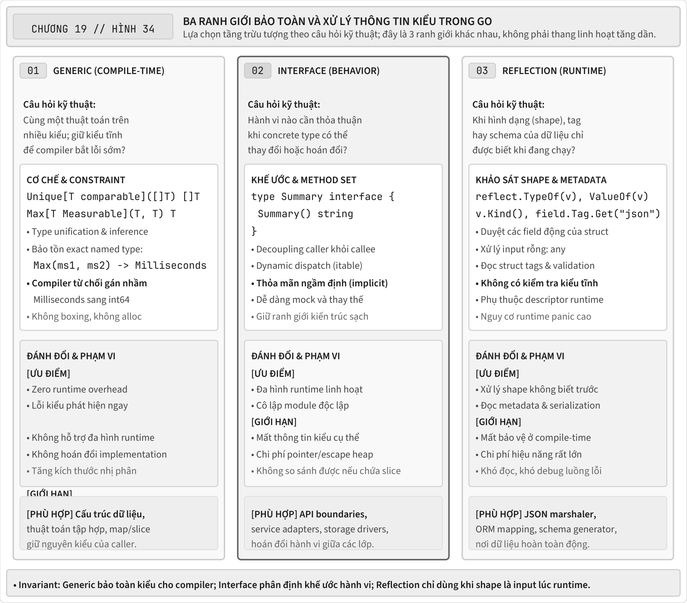

<!-- BOOK_ROLE: FOUNDATION_CORE -->

# Chương 19 — Giữ type information khi abstraction lớn lên

Một dịch vụ có hai danh sách đích phục vụ: tên miền và cổng mạng. Cả hai đều đòi hỏi cùng một thao tác xử lý: giữ lại phần tử xuất hiện đầu tiên của mỗi giá trị theo đúng thứ tự ban đầu. Nếu viết trực diện, ta sẽ có hai hàm xử lý gần như giống hệt nhau. Sự trùng lặp này chưa gây nguy hiểm; nó làm nổi bật câu hỏi thiết kế cốt lõi: phần nào trong thao tác thực sự khác biệt theo kiểu dữ liệu, và phần nào tuân theo quy luật tính toán chung?

~~~go
func uniqueNames(values []string) []string {
	seen := make(map[string]struct{}, len(values))
	result := make([]string, 0, len(values))
	for _, value := range values {
		if _, exists := seen[value]; !exists {
			seen[value] = struct{}{}
			result = append(result, value)
		}
	}
	return result
}

func uniquePorts(values []int) []int {
	seen := make(map[int]struct{}, len(values))
	result := make([]int, 0, len(values))
	for _, value := range values {
		if _, exists := seen[value]; !exists {
			seen[value] = struct{}{}
			result = append(result, value)
		}
	}
	return result
}
~~~

Một phản ứng thường thấy là chuyển đổi mọi thứ sang kiểu `any`. Hàm xử lý sẽ bớt lặp lại về mặt hình thức, nhưng bên gọi sẽ đánh mất thông tin kiểu mà trình biên dịch có thể tận dụng để bắt lỗi sớm. Phản ứng ngược lại là vội vã tạo một tầng trừu tượng tổng quát (*generic*) cho mọi đoạn mã trùng lặp. Điều đó cũng nguy hại không kém: một tham số kiểu (*type parameter*) chỉ thực sự có ý nghĩa khi thao tác tính toán chung trở nên sáng tỏ và chặt chẽ hơn sau khi được tách biệt.

Mô hình tư duy cốt lõi của chương là: hàm tổng quát giữ lại thông tin kiểu cho trình biên dịch khi cùng một thao tác áp dụng lên một tập kiểu dữ liệu; giao diện (*interface*) bảo toàn khế ước hành vi khi kiểu cụ thể có thể thay đổi; trong khi cơ chế phản chiếu (*reflection*) chỉ phù hợp khi hình thái dữ liệu hoặc siêu dữ liệu thực sự là đầu vào lúc chương trình đang chạy. Đây là ba ranh giới kỹ thuật hoàn toàn tách biệt, không phải ba cấp độ linh hoạt tăng dần để tùy tiện sử dụng.

@figure Lựa chọn tầng trừu tượng phù hợp với câu hỏi kỹ thuật cần giải quyết. Sơ đồ minh họa mô hình tư duy, không mô tả cách biểu diễn bộ nhớ lúc vận hành của giao diện hay cách trình biên dịch sinh mã thực thi.

## Bắt đầu bằng duplication, không bằng dấu ngoặc vuông

Cả hai hàm `uniqueNames` và `uniquePorts` đều chỉ cần một phép tính toán duy nhất: so sánh hai giá trị bằng toán tử bằng `==`. Điều kiện này loại bỏ các kiểu mảng động (*slice*), bảng băm (*map*) và hàm (*function*), nhưng hoàn toàn đáp ứng cho `string`, `int`, con trỏ, cấu trúc chứa các trường có thể so sánh, và kiểu định danh có kiểu nền tảng tương ứng. Ràng buộc `comparable` xác lập chính xác ranh giới kỹ thuật đó.

~~~go
func Unique[T comparable](values []T) []T {
	seen := make(map[T]struct{}, len(values))
	result := make([]T, 0, len(values))
	for _, value := range values {
		if _, exists := seen[value]; !exists {
			seen[value] = struct{}{}
			result = append(result, value)
		}
	}
	return result
}

names := Unique([]string{"api", "db", "api"})
ports := Unique([]int{443, 8080, 443})
~~~

Trong khai báo trên, `T` là tham số kiểu (*type parameter*), còn `comparable` là ràng buộc (*constraint*): tập hợp các đối số kiểu mà `T` được phép tiếp nhận, đồng thời là giới hạn cho các thao tác được phép thực thi trong thân hàm. Do bên gọi truyền vào `[]string` hoặc `[]int`, trình biên dịch sẽ tự động suy luận đối số kiểu mà không bắt buộc lập trình viên phải viết `Unique[string](...)`. Việc viết tường minh vẫn hoàn toàn hợp lệ khi ngữ cảnh chưa đủ dữ liệu để suy luận, nhưng đó không phải là nghi thức bắt buộc cho mọi lời gọi hàm.

Nếu thử nghiệm với `Unique([][]byte{{1}, {1}})`, mã nguồn sẽ không thể biên dịch. Đó là một kết quả bảo vệ có giá trị thiết thực: mảng động không thể so sánh bằng toán tử bằng, do đó khóa của bảng băm và phép so sánh `==` không có ngữ nghĩa tương thích với những gì hàm đã cam kết. Việc chuyển đổi đầu vào thành `[]any` không sửa chữa được khế ước kỹ thuật; hai giá trị giao diện mang kiểu động là mảng còn có thể gây hoảng loạn (`panic`) ngay trong lúc chạy khi đem so sánh. Khi phép so sánh bằng cho các mảng byte đòi hỏi một ngữ nghĩa khác (như `bytes.Equal`), giao diện lập trình mới bắt buộc phải tuyên bố rõ ràng ngữ nghĩa đó thay vì giả vờ rằng hàm `Unique` có thể áp dụng phổ quát cho mọi loại dữ liệu.

Kiểu `any` là tên định danh phụ (*alias*) của `interface{}` rỗng. Nó phát huy vai trò ở ranh giới thực sự tiếp nhận nhiều hình thái dữ liệu đa dạng, tương tự như Chương 14 khi tiếp nhận đối tượng đích để kiểm tra qua cơ chế phản chiếu. Tuy nhiên, khai báo `func UniqueAny(values []any) []any` sẽ ép buộc phần hiện thực phải chuyển mạch kiểu (*type switch*), khẳng định kiểu (*type assertion*) hoặc chấp nhận phát sinh lỗi lúc chạy mới biết cách so sánh. Kiểu tổng quát không làm biến mất kiểu dữ liệu; nó yêu cầu trình biên dịch kiểm tra tính hợp lệ của đối số kiểu đối với ràng buộc ngay trước khi mã nguồn được phép thực thi.

Có một ngoại lệ cần kiểm tra ngay: từ Go1.20, `any` và một số kiểu chứa interface có thể thỏa mãn ràng buộc `comparable`, dù không thuộc tập kiểu strictly comparable. Vì thế `Unique([]any{[]byte{1}})` biên dịch nhưng panic khi dùng slice động làm khóa map; chỉ một phần tử cũng đủ. Constraint cho phép viết phép toán trong thân hàm, không cam đoan mọi giá trị động đều so sánh an toàn. Test `TestUniqueInterfaceKeyCanPanic` bắt panic có chủ đích này; không chuyển nó thành hợp đồng trả error mà implementation không có.

Ngay cả phép so sánh không panic cũng chưa định nghĩa cách gộp mọi dữ liệu nghiệp vụ: `NaN != NaN`, nên hai NaN vẫn là hai phần tử trong kết quả Unique. Hãy chọn chính sách riêng nếu miền dữ liệu muốn gộp NaN. Các phép thử tên miền/cổng chỉ dùng string/int; chúng không chứng minh hàm là bộ chuẩn hóa dữ liệu phổ quát.

## Constraint là danh sách phép được phép, không phải giấy phép bao hết type

Có những thao tác đòi hỏi so sánh thứ tự hơn kém thay vì so sánh bằng. Chúng ta hoàn toàn có thể tự định nghĩa một ràng buộc thu hẹp phù hợp với đúng miền nghiệp vụ của bài toán, thay vì sao chép một ràng buộc quá rộng lớn chỉ để hàm trông có vẻ “tái sử dụng được”.

~~~go
type Measurable interface {
	~int | ~int64 | ~float64
}

func Max[T Measurable](left, right T) T {
	if left > right {
		return left
	}
	return right
}

type Milliseconds int64

slowest := Max(Milliseconds(120), Milliseconds(80))
~~~

Max ở đây dùng đúng toán tử `>` chứ không định nghĩa thứ tự toàn phần cho số thực. Với NaN, phép so sánh ấy là false: `Max(NaN, 1)` trả 1 nhưng `Max(1, NaN)` trả NaN. Nếu số đo có thể chứa NaN, cần xác thực đầu vào hoặc quy định rõ cách xử lý; không suy từ constraint rằng kết quả độc lập thứ tự hai đối số.

Toán tử hợp nhất `|` chỉ ra rằng một đối số kiểu phải thuộc về một trong các thành phần liệt kê. Ký tự ngã `~` mở rộng thành phần đó cho mọi kiểu tự định nghĩa (*defined type*) có kiểu nền tảng tương ứng. Nếu thiếu `~int64`, kiểu `Milliseconds` sẽ không thỏa mãn ràng buộc cho dù phép so sánh `left > right` hoàn toàn sáng tỏ về mặt ngữ nghĩa. Ngược lại, ký tự `~` không thực hiện ép kiểu ngầm định giữa hai giá trị đã mang kiểu cụ thể: kiểu `int` và `int64` vẫn hoàn toàn khác biệt, vì vậy lời gọi `Max(int(1), int64(2))` không thể tìm ra một tham số `T` duy nhất để suy luận kiểu. Riêng các hằng số chưa định kiểu (như số `1`) có thể tự động tiếp nhận kiểu dữ liệu từ đối số còn lại.

Một ràng buộc chứa thành phần kiểu như `~int | ~int64` được gọi là giao diện tổng quát (*general interface*): nó được dùng riêng để giới hạn tham số kiểu, hoàn toàn không phải một giá trị giao diện để truyền qua lại trong chương trình. Một giao diện cơ bản (*basic interface*) có thể được dùng làm kiểu của biến: nó chỉ khai báo hoặc nhúng các phương thức, và có thể để rỗng như `any`. Ràng buộc còn có thể sử dụng các thành phần kiểu để giới hạn tập hợp kiểu dữ liệu và các phép toán mà trình biên dịch cho phép. Việc đặt cả hai khái niệm này dưới cùng một từ khóa “interface” rất dễ làm mờ nhạt đi hai vai trò kỹ thuật riêng biệt.

> **Dừng để dự đoán:** Xét đoạn mã sau:

~~~go
slowest := Max(Milliseconds(120), Milliseconds(80))
var raw int64 = slowest
~~~

> 1. Trình biên dịch thực hiện suy luận kiểu (type inference) cho `T` là `int64` hay `Milliseconds`?
> 2. Biến `slowest` có kiểu dữ liệu tĩnh là gì?
> 3. Lệnh gán `var raw int64 = slowest` có biên dịch thành công không, hay bị compiler báo lỗi?

#### Gợi ý giải pháp (chỉ đọc sau khi đã tự làm)

Quá trình suy luận kiểu (type unification) chọn `T` chính xác là `Milliseconds` chứ không hề thu gọn (decay) về underlying type `int64`. Do cả hai đối số truyền vào đều mang kiểu `Milliseconds`, hàm generic bảo toàn thông tin kiểu của đối số và trả về kết quả mang đúng kiểu tĩnh `Milliseconds` thay vì ép về kiểu nền hay bọc trong interface rỗng.

Vì lý do đó, lệnh gán `var raw int64 = slowest` bị trình biên dịch từ chối ngay lập tức với lỗi: `cannot use slowest (variable of type Milliseconds) as int64 value in variable declaration`. Dù `Milliseconds` có underlying type là `int64`, hệ thống kiểu của Go không bao giờ cho phép ép kiểu ngầm định giữa hai defined type khác nhau. Muốn gán giá trị này sang một biến `int64`, lập trình viên bắt buộc phải chuyển đổi tường minh bằng cú pháp `int64(slowest)`. Đây chính là giá trị bảo toàn thông tin kiểu (type preservation) ở thời điểm biên dịch của Generic: nó loại bỏ nguy cơ gán nhầm đơn vị đo lường mà không đòi hỏi chi phí đánh đổi qua `any` và type assertion ở runtime.

## Generic named type giữ invariant cùng dữ liệu

Khi cấu trúc dữ liệu và các thao tác tính toán gắn liền với nhau, kiểu định danh tổng quát (*generic named type*) có thể làm giao diện lập trình trở nên tinh gọn và mạch lạc hơn. Tập hợp `Set` dưới đây chỉ chấp nhận các kiểu dữ liệu thỏa mãn `comparable` vì khóa của bảng băm trong Go bắt buộc phải đáp ứng ràng buộc này. Do ràng buộc được đặt ngay tại phần khai báo của kiểu, mọi phương thức gắn liền đều tự động kế thừa bất biến này thay vì phải khai báo lặp lại.

~~~go
type Set[T comparable] map[T]struct{}

func (set Set[T]) Has(value T) bool {
	_, found := set[value]
	return found
}

ports := Set[int]{443: {}, 8080: {}}
~~~

Hai kiểu `Set[string]` và `Set[int]` là các kiểu được khởi tạo cụ thể riêng biệt. Bên gọi không thể vô tình gọi nhầm `Set[string].Has(443)`. Đây không phải lời khẳng định rằng mã nguồn tổng quát luôn chạy nhanh hơn mã nguồn dùng giao diện; hiệu năng phụ thuộc mật thiết vào khối lượng công việc, trình biên dịch và phiên bản Go, vì vậy cần phải đo đạc thực nghiệm nếu hiệu năng là căn cứ lựa chọn. Trong trường hợp này, lợi ích kỹ thuật đã sáng tỏ ngay trước khi đo chuẩn: giao diện lập trình xác định chính xác giá trị nào được phép đưa vào tập hợp.

Phiên bản Go 1.27 cho phép phương thức tự khai báo tham số kiểu riêng biệt của nó. Đặc tính này phát huy giá trị lớn khi thao tác xử lý thuộc về không gian tên của kiểu dữ liệu nhưng kết quả trả về lại làm biến đổi kiểu phần tử.

~~~go
type Batch[E any] []E

func (batch Batch[E]) Map[F any](fn func(E) F) Batch[F] {
	result := make(Batch[F], len(batch))
	for i, value := range batch {
		result[i] = fn(value)
	}
	return result
}

labels := Batch[int]{2, 4}.Map(func(port int) string {
	return fmt.Sprintf("port=%d", port)
})
~~~

Đây là phương thức tổng quát của Go 1.27, khác biệt với phương thức thông thường khai báo trên kiểu tiếp nhận tổng quát như `Set[T].Has`. Phương thức tổng quát được khởi tạo cụ thể tại thời điểm sử dụng. Nó không biến phương thức giao diện thành phương thức tổng quát: phương thức trong giao diện không được phép tự khai báo tham số kiểu, và phương thức tổng quát không phải là cách để hiện thực hóa một phương thức giao diện tổng quát. Nếu bên sử dụng chỉ cần gọi `Map` trên một đối tượng mảng `Batch` cụ thể, phương thức giúp tổ chức mã nguồn ngăn nắp; nếu bên sử dụng cần một hành vi có thể thay thế linh hoạt, một giao diện nhỏ với chữ ký hàm cụ thể sẽ tường minh hơn rất nhiều.

## Compiler có thể chia sẻ hoặc chuyên biệt hóa mã: không biến điều đó thành lý do chọn API

Xét theo ngữ nghĩa ngôn ngữ, một hàm tổng quát được khởi tạo cụ thể sau khi đối số kiểu thỏa mãn đầy đủ ràng buộc. Đặc tả kỹ thuật không cam kết cách thức trình biên dịch sinh mã máy, kích thước tệp thực thi hay số lượng cấp phát bộ nhớ. Bộ công cụ Go hiện tại sử dụng các cấu trúc nội bộ như biểu diễn hình thái kiểu dữ liệu và từ điển tra cứu; những thông tin này hỗ trợ kỹ sư khi đọc mã hợp ngữ hoặc mã nguồn của trình biên dịch, nhưng hoàn toàn không phải khế ước kỹ thuật dành cho tầng ứng dụng và có thể thay đổi tùy theo phiên bản, kiến trúc phần cứng, cơ chế tối ưu hóa theo hồ sơ đo lường và cấu trúc thân hàm.

Vì lẽ đó, không nên lựa chọn kiểu tổng quát chỉ vì niềm tin ngây thơ rằng nó luôn chạy nhanh hơn giao diện, và cũng đừng loại bỏ nó chỉ vì e ngại các cấu trúc từ điển tra cứu nội bộ của trình biên dịch. Hãy chọn kiểu tổng quát khi các thao tác và ràng buộc kỹ thuật giúp giao diện lập trình trở nên chuẩn xác hơn. Khi chi phí hiệu năng là căn cứ mang tính quyết định, hãy đo lường hai phương án hiện thực dưới cùng một phiên bản Go, cùng môi trường máy chủ, khối lượng tải và khế ước kiểm thử hiệu năng; sau đó tiến hành phân tích lượng cấp phát bộ nhớ và hồ sơ thực thi thay vì suy đoán mơ hồ từ các chi tiết nội bộ.

## Interface thay vì generics khi câu hỏi là “ai làm được việc này?”

Một công cụ thăm dò qua giao thức mạng, một công cụ thăm dò tầng truyền vận và một đối tượng giả lập dùng trong kiểm thử có thể trả về kết quả qua các phương án hiện thực hoàn toàn khác nhau. Bên gọi không cần nắm giữ kiểu dữ liệu cụ thể của chúng; bên gọi chỉ cần kích hoạt một hành vi đã được định nghĩa. Giao diện ghi nhận khế ước kỹ thuật đó ngay ở thời điểm biên dịch.

~~~go
type Checker interface {
	Check(context.Context) error
}

type httpChecker struct{}

func (httpChecker) Check(context.Context) error { return nil }

func RunOne(ctx context.Context, checker Checker) error {
	return checker.Check(ctx)
}

var _ Checker = httpChecker{}
~~~

Dòng lệnh cuối cùng thực hiện kiểm tra tính hợp chuẩn ở thời điểm biên dịch: nếu cấu trúc `httpChecker` thiếu mất phương thức `Check`, gói mã nguồn sẽ không thể biên dịch. Khi chương trình vận hành, một giá trị giao diện mang kiểu tĩnh là `Checker`, trong khi giá trị cụ thể chứa bên trong có thể mang kiểu động khác nhau ở từng lần gọi. Đó là lý do giao diện phát huy giá trị cốt lõi cho tính đa hình theo hành vi, hoàn toàn không phải vì nó có thể “tiếp nhận mọi loại kiểu dữ liệu”.

Khi mã nguồn cần xác định trường hợp cụ thể nào đang ẩn sau giá trị giao diện, phép khẳng định kiểu (*type assertion*) và chuyển mạch kiểu (*type switch*) là các công cụ trực tiếp và an toàn nhất. Chúng hoàn toàn không đòi hỏi cơ chế phản chiếu tốn kém.

~~~go
func describe(value any) string {
	switch typed := value.(type) {
	case string:
		return "name=" + typed
	case int:
		return "port"
	}
	return "unsupported"
}
~~~

Cú pháp `value.(int)` không có cờ kiểm tra sẽ lập tức phát sinh lỗi hoảng loạn (`panic`) khi phép khẳng định kiểu thất bại. Ngược lại, dạng hai giá trị `port, ok := value.(int)` sẽ trả về giá trị mặc định của `int` cùng cờ `false`, nhờ đó bên gọi có thể chủ động quyết định chính sách xử lý lỗi phù hợp. Cấu trúc chuyển mạch kiểu chỉ thực hiện so sánh kiểu động với các trường hợp đã biết trước; các công cụ phản chiếu kiểu và thẻ cấu trúc từ Chương 14 chỉ nên xuất hiện khi siêu dữ liệu lúc thực thi chính là bản chất bài toán (như công cụ giải mã hoặc phân tích lược đồ). Tuyệt đối không lạm dụng cơ chế phản chiếu chỉ để thay thế cho một khối chuyển mạch kiểu có một vài trường hợp rõ ràng.

## Typed nil: type động vẫn còn, dù pointer bên trong nil

Đoán output trước khi chạy đoạn này:

~~~go
type ProbeError struct {
	Target string
}

func (err *ProbeError) Error() string {
	return "probe failed"
}

var problem *ProbeError = nil
var result error = problem

fmt.Println(problem == nil)
fmt.Println(result == nil)
~~~

Kết quả in ra lần lượt là `true`, sau đó là `false`. Biến `problem` là một con trỏ `nil` (*`nil` pointer*). Khi gán biến này vào kiểu giao diện `error`, giá trị giao diện vẫn lưu giữ kiểu động là `*ProbeError`; và giá trị động thuộc kiểu đó là một con trỏ rỗng.

Không cần phải suy đoán cách bố trí bộ nhớ nội bộ để giải thích hiện tượng này. Theo ngữ nghĩa chuẩn tắc của giao diện trong Go, biến `result` lưu giữ kiểu động `*ProbeError` và giá trị động rỗng của kiểu đó, do đó giá trị giao diện này hoàn toàn không phải là một giao diện `nil` (*`nil` interface*). Cách biểu diễn hai từ máy mà bộ thực thi Go trên một kiến trúc phần cứng sử dụng chỉ là chi tiết cài đặt; tuyệt đối không coi chi tiết đó là khế ước kỹ thuật và không bao giờ dựa vào kích thước hay các trường nội bộ của giao diện trong mã nguồn vận hành thực tế.

Bug thường gặp nằm ở đường return:

~~~go
func checkTarget(ok bool) error {
	var problem *ProbeError
	if !ok {
		problem = &ProbeError{Target: "api"}
	}
	return problem // ok == true vẫn trả error khác nil
}
~~~

Hãy trả về trực tiếp giá trị `nil` tường minh ở nhánh thực thi thành công, hoặc chỉ khởi tạo đối tượng lỗi cụ thể khi thực sự xảy ra sự cố. Không cần phải dùng đến cơ chế phản chiếu để suy đoán con trỏ rỗng bên trong mọi giao diện lỗi: bên gọi chỉ cần tin tưởng vào khế ước `err == nil`, trong khi các phương thức của kiểu lỗi cụ thể phải tự phân định rõ đối tượng tiếp nhận có hợp lệ khi nhận giá trị rỗng hay không. Bài thực hành `labs/part19-type-information/typednil` cố tình lưu giữ khiếm khuyết này để người học tự tay khắc phục và kiểm chứng bằng ca kiểm thử.

### Bài thực hành: Ba ranh giới, ba cách tự kiểm tra

Lab `labs/part19-type-information` bắt đầu ở test/tag exercise và contract, không ở implementation có sẵn.

~~~powershell
cd labs/part19-type-information
go test -tags exercise ./exercise
go test ./fixed
go test -race ./fixed
go test -tags typednilexercise ./typednil
go test ./typednil/fixed
go vet ./...
~~~

Ba nhiệm vụ thực hành lần lượt yêu cầu người học xây dựng hàm `Unique[T comparable]` xuất phát từ ca kiểm thử, phản biện thiết kế `Load[T any]` khi chưa xác định rõ định dạng, quyền sở hữu dữ liệu và quy trình giải mã, đồng thời khắc phục khiếm khuyết con trỏ rỗng có kiểu để nhánh thành công trả về đúng giá trị lỗi `nil` thực sự. Chỉ sau khi đã hoàn thành các bước tự làm, người học mới nên tham khảo tài liệu hướng dẫn và mã nguồn đối chiếu; chúng là tài liệu tham khảo để đối chiếu mạch tư duy logic, không phải khuôn mẫu duy nhất cho việc đặt tên.

Điểm dừng nhận thức của chương không phải là “hễ nhìn thấy cặp ngoặc vuông là áp dụng kiểu tổng quát”. Hãy luôn tự đặt câu hỏi: thao tác tính toán cần bảo toàn thông tin kiểu nào, ràng buộc nào thực sự cho phép thực thi thao tác đó, hành vi nào nên được trừu tượng hóa thành giao diện, và siêu dữ liệu nào chỉ có thể biết được lúc chương trình vận hành. Khi trả lời thấu đáo được bốn câu hỏi đó, tầng trừu tượng sẽ không còn giống một màn ảo thuật khó lường mà sẽ trở thành một khế ước kỹ thuật trong sáng và có thể kiểm chứng độc lập.
