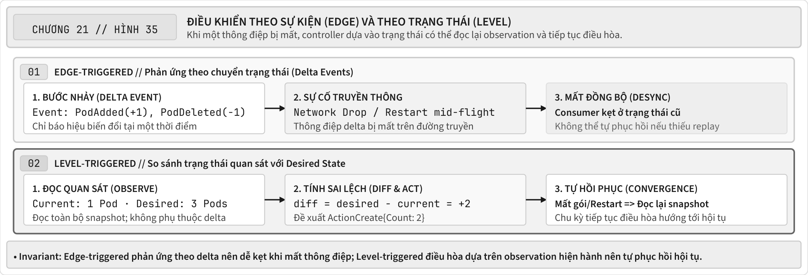

<!-- BOOK_ROLE: APPLICATION_SYSTEMS -->

# Chương 21 — Vòng lặp điều hòa và Controller Pattern

Trong Chương 20, dự án `opsprobe` đã trang bị cho ta một hệ thống thăm dò trạng thái hoàn chỉnh: kiểm tra định kỳ, phân loại kết quả rành mạch (`OutcomeSuccess`, `OutcomeFailure`, `OutcomeTimeout`), bảo toàn dữ liệu bằng giao dịch nguyên tử SQLite, và đo lường độ trễ qua Prometheus. Nhưng khi một dịch vụ phụ thuộc sập nguồn khiến dashboard chuyển màu đỏ rực, câu hỏi tiếp theo của một kỹ sư vận hành không còn là “làm sao để phát hiện?”, mà là: “làm sao để hệ thống tự khôi phục trạng thái lành lặn mà không cần con người thức dậy lúc nửa đêm bấm nút restart?”.

Chương này chuyển từ quan sát sang điều hòa: controller đọc trạng thái, tính sai lệch, thực hiện một thao tác rồi quan sát lại. Kubernetes dùng mẫu này cho nhiều controller; các công cụ khác có lịch chạy và mô hình quản lý state riêng, không nên gộp tất cả thành cùng một vòng lặp liên tục.

## Kích hoạt theo mức và Kích hoạt theo cạnh

Để hiểu vòng lặp điều hòa trong controller của chương này, ta phân biệt hai cách thiết kế: kích hoạt theo cạnh (edge-triggered) và kích hoạt theo mức (level-triggered). Đây không phải lựa chọn bắt buộc của mọi hệ thống phân tán đáng tin cậy.

@figure Khi một thông điệp bị mất, controller dựa vào trạng thái có thể đọc lại observation và tiếp tục điều hòa. Khả năng hội tụ vẫn phụ thuộc việc quan sát và điều chỉnh thành công.

Trong mô hình kích hoạt theo cạnh (edge-triggered), phía tiêu thụ phản ứng theo các lần chuyển đổi trạng thái. Nếu mất sự kiện mà không có cơ chế phát lại, đồng bộ lại hoặc quan sát bổ sung, bên tiêu thụ có thể không nhận biết được trạng thái đã thay đổi và giữ nguyên kết luận cũ. Đây là lý do bộ điều khiển cần khả năng phục hồi từ quan sát hiện tại, thay vì chỉ dựa vào một chuỗi sự kiện được giả định là không bao giờ thất lạc.

Trong mô hình hướng trạng thái của bài thực hành, bộ điều khiển so sánh quan sát hiện tại với trạng thái mong muốn thay vì thực thi từng sự kiện như một mệnh lệnh. Mức mong muốn là 3 trong khi hiện tại là 1 sẽ dẫn tới đề xuất tạo thêm 2. Bản quan sát có thể cũ hoặc thiếu sót, nên chưa đủ để kết luận có thể tạo ngay: bộ phận thực thi (`actuator`) vẫn cần định danh, tiền điều kiện và quyền hạn phù hợp.

Ngay cả khi bộ điều khiển bị tắt đột ngột lúc đang khởi động bản sao thứ hai, ở lần thức dậy kế tiếp, nó lại tiếp tục so sánh và nhận ra sai lệch còn tồn tại. Nó có thể yêu cầu hành động tiếp, nhưng chỉ một quan sát mới tiếp theo mới xác nhận được sự hội tụ. Đặc tính hướng về trạng thái mong muốn này gọi là sự hội tụ trạng thái (state convergence).

## Bốn pha của Vòng lặp điều hòa

Ta dùng bốn pha dưới đây làm mô hình đọc control loop của chương, không phải quy trình bắt buộc cho mọi controller:

| Bước | Tên gọi | Nhiệm vụ kỹ thuật trong Go |
| :--- | :--- | :--- |
| **1** | **Observe** | Đọc trạng thái thực tế từ hệ thống hoặc store. |
| **2** | **Diff** | So sánh trạng thái thực tế với trạng thái mong muốn. |
| **3** | **Act** | Thực thi hành động khắc phục để triệt tiêu sai lệch. |
| **4** | **Schedule / Observe again** | Chờ sự kiện, resync hoặc lịch thử lại để đọc một quan sát mới; không suy diễn trạng thái từ kết quả lời gọi. |

Trong Go, ta đóng gói hành vi này thành một interface nhỏ gọn:

~~~go
type Result struct {
	Requeue      bool
	RequeueAfter time.Duration
}

type Reconciler interface {
	Reconcile(
		ctx context.Context, key string,
	) (Result, error)
}
~~~

Quy ước này thể hiện rõ ranh giới trách nhiệm: `Reconciler` chỉ tập trung vào logic điều hòa của một tài nguyên duy nhất được định danh bởi `key`. Việc quản lý hàng đợi, phân phối worker và kiểm soát tần suất thử lại do tầng `Controller` bên ngoài đảm nhiệm.

## Hàng đợi công việc có kiểm soát tốc độ

Một sai lầm thường gặp của lập trình viên Go là sử dụng ngay một kênh không đệm (`chan string`) để làm hàng đợi cho bộ điều khiển. Trên môi trường vận hành thực tế, kênh truyền thô nhanh chóng bộc lộ ba lỗ hổng nghiêm trọng:

Một là, thiếu cơ chế gộp khóa trùng lặp: trong kịch bản một bên tiêu thụ nhận và xử lý đủ 50 phần tử cùng khóa từ kênh mà không gộp, nó sẽ gọi hàm điều hòa 50 lần. Đây là cách dựng hàng đợi sơ sài, không tận dụng được đặc tính của bộ điều khiển; các lượt xử lý cũng có thể đọc được các quan sát khác nhau. Hàng đợi có trạng thái đánh dấu cần xử lý (`dirty`) và đang xử lý (`processing`) giúp gộp lịch thực thi, chứ không biến mọi tác dụng phụ thành xử lý chính xác một lần (`exactly-once`).

Hai là, xử lý cùng khóa song song: hai tiến trình xử lý (`worker`) có thể cùng đọc một quan sát thấy thiếu bản sao rồi đều phát yêu cầu tạo thêm. Tuần tự hóa theo khóa trong cùng một tiến trình giúp giảm xung đột đó, nhưng không thể phối hợp giữa nhiều tiến trình khác nhau hay ngăn chặn quan sát cũ; hệ thống vẫn cần quyền sở hữu (`ownership`) và tiền điều kiện ở bộ thực thi. Tránh gọi mọi thao tác trùng lặp là hiện tượng phân đôi não (`split-brain`), vốn chỉ xảy ra khi nhiều bên cùng tự nhận mình giữ quyền điều phối tối cao.

Ba là, bão thử lại (`retry storm`): nếu thành phần phụ thuộc liên tục gặp lỗi mà khóa bị đẩy lại ngay mà không có ngân sách hay khoảng chờ giãn cách (`backoff`), tiến trình xử lý có thể tạo ra vòng lặp thử lại dồn dập, tiêu hao CPU và gia tăng áp lực lên dịch vụ phụ thuộc. Đây là hiện tượng bận thử lại (`busy retry`), khác với kỹ thuật khóa quay vòng (`spin-lock`). Chính sách thử lại luôn cần giới hạn tốc độ và hỗ trợ cơ chế hủy bỏ (`cancellation`).

Để nhìn rõ ba bài toán đó, lab dùng một `WorkQueue` tối giản. Nó mô phỏng các ý tưởng `dirty`, `processing` và đưa lại key sau `Done`, chứ không phải bản sao chính xác của `client-go/util/workqueue`.

~~~go
type WorkQueue struct {
	mu           sync.Mutex
	cond         *sync.Cond
	queue        []string
	dirty        map[string]struct{}
	processing   map[string]struct{}
	failures     map[string]int
	shuttingDown bool
	config       RateLimiterConfig
}
~~~

Cơ chế phối hợp giữa `dirty` và `processing` tạo nên tính năng then chốt của hàng đợi:

~~~go
func (q *WorkQueue) Add(item string) {
	q.mu.Lock()
	defer q.mu.Unlock()

	if q.shuttingDown {
		return
	}
	// 1. Deduplication: Nếu item đã nằm trong dirty, bỏ qua
	if _, exists := q.dirty[item]; exists {
		return
	}
	q.dirty[item] = struct{}{}

	// 2. Nếu item đang xử lý, không đẩy vào slice
	// để tránh hai worker cùng reconcile một key
	if _, isProcessing := q.processing[item]; isProcessing {
		return
	}

	q.queue = append(q.queue, item)
	q.cond.Signal()
}
~~~

Khi một worker hoàn tất lượt xử lý và gọi `Done(item)`:

~~~go
func (q *WorkQueue) Done(item string) {
	q.mu.Lock()
	defer q.mu.Unlock()

	delete(q.processing, item)

	// Nếu trong lúc worker đang chạy, có thêm sự kiện mới
	// cho cùng key này, item lập tức được đưa lại vào queue
	if _, exists := q.dirty[item]; exists {
		q.queue = append(q.queue, item)
		q.cond.Signal()
	}
}
~~~

Trong mô hình này, một key không được hai worker xử lý đồng thời. Nếu `Add` xuất hiện khi key đang xử lý, `dirty` ghi nhận rằng cần có một lượt sau `Done`. Đây là cơ chế gộp lịch xử lý, không phải cam kết exactly-once: worker có thể lỗi, tiến trình có thể dừng, và trạng thái có thẩm quyền vẫn phải được đọc lại ở lần reconcile sau.

> **Dừng để dự đoán:** Giả sử hàng đợi đang rỗng và Worker 1 vừa lấy key `"pod-1"` ra để chạy `Reconcile`. Trong lúc hàm reconcile đang thực thi dở dang, liên tiếp có hai sự kiện `Add("pod-1")` mới xuất hiện. Hàng đợi phối hợp `dirty` và `processing` như thế nào để đảm bảo worker thứ hai không nhảy vào can thiệp, và chuyện gì xảy ra khi Worker 1 gọi `Done("pod-1")`?

#### Gợi ý giải pháp (chỉ đọc sau khi đã tự làm)
Bảng dưới đây mô tả sự dịch chuyển trạng thái nội bộ của hàng đợi qua từng thời điểm:

| Thời điểm | Thao tác | `queue` | `dirty` | `processing` | Ý nghĩa vận hành |
| :--- | :--- | :---: | :---: | :---: | :--- |
| $T_0$ | Ban đầu | `[]` | `{}` | `{}` | Hàng đợi rỗng. |
| $T_1$ | `Add("pod-1")` | `["pod-1"]` | `{"pod-1"}` | `{}` | Đưa vào slice và đánh dấu dirty. |
| $T_1'$ | Worker 1 gọi `Get()` | `[]` | `{}` | `{"pod-1"}` | Lấy ra xử lý: xóa khỏi dirty, đưa vào processing. |
| $T_2$ | `Add("pod-1")` (lần 1) | `[]` | `{"pod-1"}` | `{"pod-1"}` | Thấy đang processing: chỉ đánh dấu dirty, không thêm vào slice. |
| $T_2'$ | `Add("pod-1")` (lần 2) | `[]` | `{"pod-1"}` | `{"pod-1"}` | Thấy đã trong dirty: gộp lại (deduplicate), bỏ qua. |
| $T_3$ | Worker 1 gọi `Done("pod-1")` | `["pod-1"]` | `{"pod-1"}` | `{}` | Xóa khỏi processing; thấy dirty còn key: đưa lại vào slice. |
| $T_4$ | Lượt `Get()` kế tiếp | `[]` | `{}` | `{"pod-1"}` | Reconcile lại để quan sát trạng thái mới nhất. |

Cơ chế này hiện thực hóa mô hình điều hòa dựa trên trạng thái (level-triggered), không phải một hệ thống hàng đợi tin nhắn đảm bảo chuyển phát từng sự kiện riêng lẻ. Việc gộp sự kiện (coalescing) bảo đảm rằng dù có bao nhiêu thay đổi dồn dập trong lúc xử lý, hàng đợi chỉ lên lịch thêm đúng một lượt điều hòa kế tiếp sau khi tiến trình xử lý hiện tại hoàn tất, đồng thời ngăn chặn việc hai tiến trình cùng xử lý một khóa song song. Quan trọng hơn, hàng đợi trong bộ nhớ không đưa ra cam kết xử lý chính xác một lần (exactly-once): nếu tiến trình bị dừng đột ngột, toàn bộ dữ liệu trong slice và map sẽ biến mất và bộ điều khiển phụ thuộc hoàn toàn vào chu kỳ quan sát kế tiếp để tái lập bức tranh trạng thái có thẩm quyền từ nguồn chân lý.

## Kiểm soát giãn cách lũy thừa khi có sự cố

Khi `Reconcile` thất bại, thay vì đưa key trở lại hàng đợi ngay lập tức, ta áp dụng thuật toán **Exponential Backoff** thông qua phương thức `AddRateLimited`:

~~~go
func (q *WorkQueue) AddRateLimited(item string) bool {
	q.mu.Lock()
	defer q.mu.Unlock()

	if q.shuttingDown {
		return false
	}
	failures := q.failures[item] + 1
	q.failures[item] = failures

	if failures > q.config.MaxRetries {
		return false // Vượt quá số lần thử lại tối đa
	}

	// Chờ tăng gấp đôi: base * 2^(failures-1)
	multiplier := 1 << (failures - 1)
	delay := q.config.BaseDelay * time.Duration(multiplier)
	if delay > q.config.MaxDelay {
		delay = q.config.MaxDelay
	}

	time.AfterFunc(delay, func() {
		q.Add(item)
	})
	return true
}
~~~

Với `BaseDelay=50ms`, lịch thử lại của mô hình này tăng theo 50ms, 100ms, 200ms, 400ms, rồi chạm trần `MaxDelay`. Khoảng giãn cách giúp giới hạn nhịp thử lại dồn dập khi hệ thống đích gặp lỗi; nó không loại bỏ mọi đợt thử lại đồng thời giữa nhiều khóa hay nhiều bộ điều khiển. Khi hàm điều hòa thành công, bộ điều khiển gọi `q.Forget(item)` để xóa bộ đếm thất bại.

## Tính lũy đẳng: hành động có thể thử lại, quan sát được đọc lại

Vì một tài nguyên có thể được đưa vào hàng đợi nhiều lần do sự kiện lặp lại, đồng bộ lại định kỳ hoặc thử lại sau lỗi, logic điều hòa phải được thiết kế để an toàn khi gọi lại nhiều lần. Công thức toán học `f(f(x)) = f(x)` chỉ là một trực giác về trạng thái thuần túy; nó không phản ánh trọn vẹn khế ước vận hành thực tế, nơi lời gọi ra bên ngoài có thể thành công nhưng gói phản hồi bị thất lạc trên đường truyền, còn bộ đệm nhớ tạm có thể mang dữ liệu cũ.

Khi quan sát mới đã khớp với trạng thái mong muốn, hàm điều hòa không cần thực hiện thêm thao tác nào (no-op). Khi cần can thiệp, bộ thực thi phải có tiền điều kiện hoặc khóa lũy đẳng phù hợp với hệ thống đích. Sau khi phương thức `Act` trả về `nil`, bộ điều khiển mới chỉ biết lời gọi đã kết thúc không có lỗi; nó chưa thể khẳng định hệ thống bên ngoài đã hội tụ hoàn toàn. Sự xác nhận chỉ đến từ lần quan sát kế tiếp.

Hãy xem xét một Reconciler tự chữa lành cụ thể:

~~~go
func (r *SelfHealingReconciler) Reconcile(
	ctx context.Context, key string,
) (Result, error) {
	state, exists := r.getObservedState(key)
	if !exists {
		return Result{}, nil // Không tồn tại: No-op
	}

	// 1. Phân tích sai lệch giữa thực tế và mong muốn
	isDegraded := !state.Healthy ||
		state.Replicas < r.desiredReplicas

	// 2. Đã đạt trạng thái mong muốn thì không đổi thêm
	if !isDegraded {
		return Result{}, nil
	}

	// 3. Thực thi hành động tự chữa lành (Act)
	if err := r.healTarget(ctx, key); err != nil {
		return Result{}, fmt.Errorf("heal %s: %w", key, err)
	}

	// 4. Không tự sửa actual state.
	// Event hoặc resync sẽ đưa key quay lại
	// khi lớp quan sát thấy trạng thái bên ngoài đã đổi.
	return Result{}, nil
}
~~~

Nếu `payment-service` đang có 1 bản sao trong khi yêu cầu là 3, hàm gọi bộ thực thi với `context.Context`. Một bài kiểm tra cố ý để bộ thực thi trả `nil` nhưng giữ quan sát cũ vẫn cho thấy mục tiêu chưa hoạt động bình thường; hàm điều hòa không được gán `Healthy=true` chỉ để làm bài kiểm thử đạt kết quả tốt. Khi quan sát sau đó phản ánh đủ 3 bản sao khỏe mạnh, lượt điều hòa kế tiếp mới không cần làm gì thêm (no-op). Bài thực hành cũng chặn bộ thực thi bằng kênh truyền rồi thay đổi quan sát trong lúc hành động đang chạy, để chứng minh một hành động cũ không được ghi đè quan sát mới.

## Dừng có kiểm soát cho bộ điều khiển

Bộ điều khiển quản lý nhiều goroutine xử lý công việc. Khi context bị hủy, bộ điều khiển đóng hàng đợi để đánh thức các worker rồi chờ chúng thoát. Công việc đang chạy có thể trả lỗi do việc hủy theo yêu cầu (cancellation), không nhất thiết hoàn tất nghiệp vụ; chính sách xả cạn hàng đợi (drain) đến khi hoàn tất cần được thiết kế riêng:

~~~go
func (c *Controller) Run(ctx context.Context) error {
	var wg sync.WaitGroup

	// Đánh thức và đóng hàng đợi khi context bị hủy
	go func() {
		<-ctx.Done()
		c.queue.ShutDown()
	}()

	for i := 0; i < c.concurrency; i++ {
		wg.Add(1)
		go func() {
			defer wg.Done()
			for c.processNextWorkItem(ctx) {
			}
		}()
	}

	wg.Wait()
	return ctx.Err()
}
~~~

Phương thức `queue.ShutDown()` giải phóng các goroutine đang bị nghẽn ở lệnh `cond.Wait()`. Vòng lặp `for c.processNextWorkItem(ctx)` nhận được tín hiệu `shutdown == true` khi hàng đợi đã cạn, kết thúc vòng lặp và thông báo qua `wg.Done()`. Việc đóng hàng đợi chỉ giúp các tiến trình thoát an toàn; nó không tự bảo đảm các thao tác ghi ra bên ngoài đã hoàn tất. Bộ thực thi phải tôn trọng `ctx`, và các tác dụng phụ đã gửi sang hệ thống khác đòi hỏi tính lũy đẳng hoặc quan sát lại riêng biệt.

### Bài thực hành: Kiểm chứng Controller và WorkQueue

Toàn bộ kiến trúc trên được đóng gói tại thư mục thực hành `labs/part21-reconciliation-controller`:

~~~powershell
cd labs/part21-reconciliation-controller
go test -v ./...     # Chạy toàn bộ test suite
go test -race ./...  # Kiểm tra race condition
go vet ./...        # Phân tích tĩnh cú pháp
~~~

Bộ kiểm thử dùng kênh truyền để xác nhận bộ thực thi nhận được tín hiệu hủy context, một hành động thành công không tự ý suy diễn quan sát, và quan sát mới xuất hiện khi hành động đang chạy không bị ghi đè. Bài kiểm tra giãn cách hiện chỉ xác nhận có nhiều lượt thử trong cửa sổ kiểm thử; nó chưa đo lường hoặc chứng minh chính xác các khoảng giãn cách tăng theo cấp số nhân.

## Bước phát triển tiếp theo

Chương này xây dựng mô hình điều hòa tối giản: quan sát, so sánh sai lệch, thực thi hành động, rồi quan sát lại. Kết hợp với tín hiệu từ `opsprobe` (Chương 20), nó cho ta một nơi để thấy rõ vì sao kết quả hành động và trạng thái quan sát thực tế là hai bằng chứng kỹ thuật hoàn toàn độc lập.

Đây là nền tảng trực tiếp cho Chương 22, nơi cùng các câu hỏi ấy gặp List/Watch, bộ nhớ đệm và hàng đợi công việc của `client-go`; Chương 23 mới thêm API riêng, trạng thái, quyền sở hữu và cơ chế dọn dẹp trước khi xóa (finalizer) của một operator. Hàng đợi trong chương này là mô hình tái lập để nắm bắt cơ chế, không phải bản thay thế cho mã nguồn chính thức của Kubernetes.

@references
1. Kubernetes Authors. Controller pattern and declarative state management. kubernetes.io/docs/concepts/architecture/controller/
2. B. Grant. Declarative application management in Kubernetes. github.com/kubernetes/community
3. Kubernetes Authors. Package `client-go/util/workqueue` reference and design. pkg.go.dev/k8s.io/client-go/util/workqueue
4. S. Newman. Building Microservices: Designing Fine-Grained Systems and Self-Healing Architecture. O'Reilly Media.
5. Go Team. Advanced Go Concurrency Patterns: Pipelines and cancellation. go.dev/blog/pipelines
