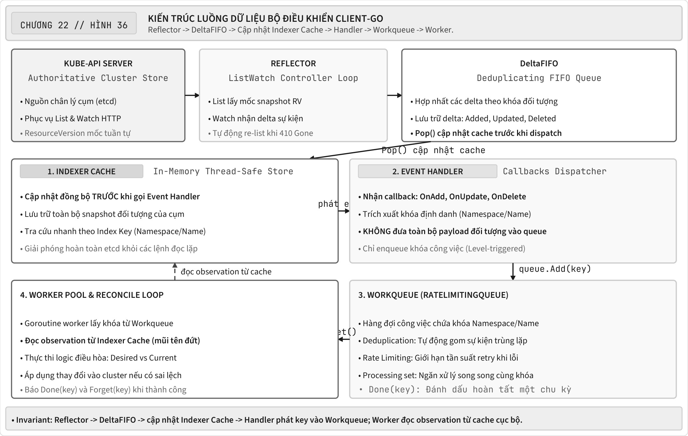
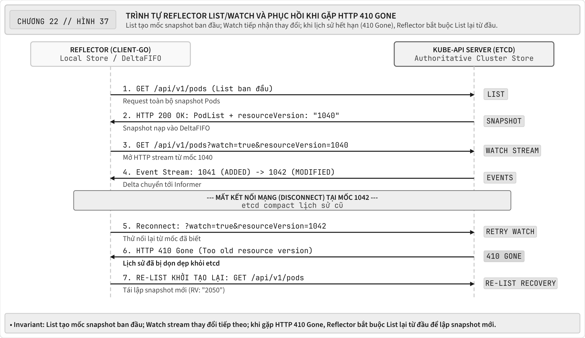

<!-- BOOK_ROLE: APPLICATION_SYSTEMS -->

# Chương 22 — Từ watch đến một controller Kubernetes thật

Chương 21 sử dụng một hàng đợi tối giản để làm rõ sự khác biệt giữa kết quả hành động và trạng thái quan sát thực tế. Khi kết nối tới Kubernetes API, ta phải bổ sung cơ chế phục hồi luồng dữ liệu, đồng bộ hóa bộ nhớ đệm, điều phối theo khóa và xử lý xung đột. Một kênh truyền có thể là một thành phần trong thiết kế, nhưng bản thân nó không tự cung cấp các khế ước đó.

Chẳng hạn, trong kịch bản có 500 bản cập nhật dồn đến trong một giây, việc lưu giữ toàn bộ dữ liệu cũ để xử lý có thể khiến tiến trình hành động theo quan sát đã lỗi thời. Tải thực tế và hậu quả phải được đo lường trong môi trường cụ thể; ví dụ này nhằm đặt ra bài toán gộp khóa và đọc lại trạng thái.

Chương này sử dụng thư viện `client-go` v0.37.0 để dựng một bộ điều khiển nhỏ và kiểm tra các ranh giới kỹ thuật đó. Bài thực hành không thay thế cho thiết kế phân quyền RBAC toàn diện, cơ chế phục hồi thảm họa hay kiểm chứng trên cụm máy chủ vận hành thực tế.

---

## 1. Bản chất: Tín hiệu thông báo không phải là Chân lý

Câu hỏi trung tâm của chương này là:
> *Khi nhận được một sự kiện từ Kubernetes API Server, ta có nên tin vào dữ liệu đính kèm bên trong sự kiện đó để ra quyết định điều hòa hay không?*

Theo chính sách của bộ điều khiển trong chương, sự kiện chỉ là tín hiệu nhắc nhở để xếp khóa vào hàng đợi, chứ không phải bản chụp trạng thái được lưu giữ tới lúc ra quyết định. Hàm xử lý sự kiện vẫn có thể dùng dữ liệu đính kèm để lọc hoặc trích xuất siêu dữ liệu; tiến trình xử lý luôn đọc lại quan sát thực tế trước khi điều hòa.

Trong các hệ thống phân tán quy mô lớn, sự kiện thông báo (notification hint) chỉ là một tín hiệu cho biết tài nguyên tại một namespace có thể vừa thay đổi. Bản thân sự kiện không phải là trạng thái thẩm quyền (authoritative state).

API Server là ranh giới thẩm quyền cho các đối tượng Kubernetes; bộ nhớ đệm của Informer chỉ là bản sao cục bộ giúp bộ điều khiển hoạt động hiệu quả, không phải nguồn chân lý duy nhất và có thể mang độ trễ. Tiến trình xử lý đọc bộ đệm để tránh bám vào dữ liệu sự kiện đã cũ, nhưng các thao tác ghi hoặc đọc ngay sau khi ghi luôn cần chính sách rõ ràng về việc đọc trực tiếp từ API hay từ bộ đệm.

### Bẫy tư duy: Xử lý theo payload của sự kiện

Xét kịch bản điều phối sau: tại thời điểm `t₀`, đối tượng `Pod` mang tên `web-app` có trạng thái `Pending` và API Server phát ra sự kiện `E₁(Pending)`. Đến thời điểm `t₁`, Kubelet khởi động xong container khiến Pod chuyển sang `Running`, và API Server phát sự kiện `E₂(Running)`. Do độ trễ mạng hoặc hàng đợi bận rộn, tiến trình trong bộ điều khiển nhận `E₁` chậm mất 3 giây. Nếu tiến trình dùng ngay dữ liệu bên trong `E₁`, nó sẽ lầm tưởng Pod vẫn đang ở trạng thái chờ và ra lệnh hủy Pod để tạo lại. Hành động này vô tình tiêu hủy một Pod đang vận hành ổn định.

Chính sách áp dụng trong bài thực hành:
> *Quy tắc hàng đợi:* Đẩy khóa `namespace/name` vào hàng đợi, sau đó đọc quan sát hiện hành trong bộ đệm của Informer khi tiến trình xử lý. Bộ đệm chỉ là quan sát cục bộ và có thể trễ so với API Server; không thể coi đó là trạng thái mới nhất tuyệt đối của toàn cụm.

---

## 2. Kiến trúc toàn cảnh của một client-go Controller

Luồng xử lý chính đi từ API Server qua `Reflector` và `DeltaFIFO` tới `SharedInformer`. Bộ đệm được cập nhật trước khi hàm xử lý đẩy khóa vào hàng đợi; khi thực thi, tiến trình đọc lại quan sát cục bộ thay vì lưu giữ dữ liệu sự kiện cũ.

@figure Luồng sự kiện của bộ điều khiển. Đường nét đứt biểu thị bộ đệm cục bộ: dữ liệu này có thể có độ trễ so với API Server.

### Bốn thành phần then chốt trong chuỗi cung ứng dữ liệu

| Thành phần Informer | Vai trò kỹ thuật | Tương tác trong hệ thống |
| :--- | :--- | :--- |
| `Reflector` | Mở kết nối List/Watch tới API Server | Đẩy các biến động tài nguyên vào bộ đệm `DeltaFIFO`. |
| `Indexer (Local Store)` | Bộ nhớ đệm in-memory có đồng bộ truy cập | Phục vụ lookup local và giảm read tới API server; chi phí cần đo theo index và workload. |
| `SharedInformer` | Phân phối sự kiện từ `DeltaFIFO` | Đảm bảo local cache cập nhật trước khi event handler kích hoạt. |
| `Typed Rate-Limited WorkQueue` | Hàng đợi công việc chuyên dụng | Gộp key trùng và kiểm soát thử lại; không thay thế đồng bộ dữ liệu dùng chung. |

---

## 3. Giao thức List/Watch và vai trò của resourceVersion

Thao tác `List` cung cấp bản chụp trạng thái (`snapshot`) kèm số phiên bản tài nguyên (`resourceVersion`); Watch tiếp nhận các thay đổi theo mốc được API hỗ trợ. Đây là khế ước kỹ thuật của Kubernetes API, không phải quy tắc cấm hệ thống thăm dò định kỳ hay sử dụng phương thức truyền tải khác.

@figure List tạo mốc quan sát cho Watch; khi nối lại không thể tiếp tục vì lịch sử đã hết, Reflector phải List lại.

### Cơ chế hoạt động

Thứ nhất là luồng List truyền thống: Reflector lấy danh sách đối tượng kèm số phiên bản tài nguyên không trong suốt (`resourceVersion opaque`). Nó đưa bản chụp vào kho lưu trữ `DeltaFIFO`; chu trình xử lý của Informer sẽ cập nhật Indexer, chứ không phải Reflector ghi thẳng vào Indexer. Sơ đồ minh họa đường đi này. Phiên bản client-go được ghim còn hỗ trợ cơ chế watch-list khi máy chủ và cấu hình cho phép; ta không nên suy diễn rằng mọi lần khởi tạo đều phải phát lệnh List riêng lẻ.

Thứ hai là luồng `Watch` từ mốc đã nhận, chẳng hạn `?watch=true&resourceVersion=1040`. API gửi luồng thay đổi phát sinh sau mốc đó chừng nào lịch sử sự kiện còn được lưu giữ. Với HTTP/1.1, kết nối có thể dùng kiểu truyền tải phân đoạn (`chunked transfer`); HTTP/2 không áp dụng cơ chế đóng khung đó. Lưu ý rằng `resourceVersion` không phải độ lệch (`offset`) của etcd mà client có quyền tự diễn giải.

Thứ ba là tự phục hồi sau sự cố mạng: Nếu đường truyền bị đứt ở sự kiện `1042`, Reflector thử kết nối lại từ phiên bản đã biết. Đây là cơ chế bắt kịp thay đổi khi lịch sử còn giữ được, không phải lời hứa rằng mọi lần nối lại đều không cần List.

Thứ tư là xử lý lỗi HTTP 410 Gone: Nếu kết nối bị gián đoạn quá lâu khiến etcd đã dọn dẹp các bản ghi lịch sử (compact log), API Server sẽ trả về mã lỗi `410 Gone (Too old resource version)`. Khi đó, Reflector hiểu rằng khoảng trống dữ liệu không thể bù đắp, nó sẽ tự động kích hoạt một chu kỳ `List` mới từ đầu để tái lập snapshot chuẩn.

---

## 4. Xử lý xóa và bí ẩn của Tombstone

Trong vòng đời của một tài nguyên, sự kiện xóa (`OnDelete`) ẩn chứa một cạm bẫy kỹ thuật kinh điển mà hầu hết kỹ sư mới tiếp cận `client-go` đều vấp phải: **Tombstone** (Bia mộ dữ liệu).

Khi không nhận được sự kiện xóa nhưng một lần `List` lại cho thấy khóa đã biến mất, `DeltaFIFO` có thể tạo đối tượng `DeletedFinalStateUnknown`. Trường `Obj` lưu giữ quan sát cuối cùng được ghi nhận, có thể đã cũ chứ không phải bản chụp tại thời điểm xóa thực tế. Hàm xử lý cần chấp nhận cả đối tượng thông thường lẫn bia mộ dữ liệu (`tombstone`), đồng thời không suy diễn định danh mới từ tên gọi cũ.

Nếu bạn ép kiểu trực tiếp:
~~~go
// CẢNH BÁO: Panic runtime nếu đối tượng rơi vào Tombstone!
pod := obj.(*corev1.Pod)
~~~
Chương trình sẽ văng lỗi `panic: interface conversion: interface {} is cache.DeletedFinalStateUnknown, not *v1.Pod`.

### Giải pháp an toàn tiêu chuẩn:

Thư viện `client-go` cung cấp hàm chuẩn hóa `cache.DeletionHandlingMetaNamespaceKeyFunc`:

~~~go
func (c *Controller) handleDelete(obj any) {
	key, err := cache.DeletionHandlingMetaNamespaceKeyFunc(obj)
	if err != nil {
		runtime.HandleError(err)
		return
	}
	c.queue.Add(key)
}
~~~

Hàm `DeletionHandlingMetaNamespaceKeyFunc` hỗ trợ trích xuất khóa cho cả đối tượng thông thường lẫn bia mộ dữ liệu `DeletedFinalStateUnknown`. Bên gọi vẫn phải xử lý lỗi nếu đối tượng thiếu siêu dữ liệu phù hợp; hàm trợ giúp này không tự đảm bảo mọi dữ liệu truyền vào đều an toàn.

Khóa định danh chỉ mang thông tin `namespace/name`, do đó không thể phân biệt một đối tượng cũ đã bị xóa với một đối tượng mới được tạo cùng tên. Nếu tác vụ dọn dẹp bên ngoài Kubernetes đòi hỏi định danh bền vững, hãy ghi nhận `metadata.uid` khi đối tượng còn tồn tại và ràng buộc tài nguyên ngoại vi với UID đó; tránh suy diễn UID từ một bia mộ chỉ còn sót lại khóa.

---

## 5. Hàng đợi WorkQueue: Ba tập hợp và Kiểm soát tốc độ

Kênh truyền chỉ cung cấp cơ chế gửi nhận và thứ tự theo ngữ nghĩa của ngôn ngữ Go; bản thân nó không có tập hợp đánh dấu chờ (`dirty set`), tập hợp đang xử lý (`processing set`) hay chính sách thử lại. Trong bản hiện thực của client-go v0.37.0, `workqueue.Typed[T]` phối hợp hàng đợi cùng hai tập hợp khóa sau:

| Tập hợp | Ý nghĩa kỹ thuật | Trách nhiệm |
| :--- | :--- | :--- |
| `queue []T` | Danh sách thứ tự chờ | Xác định key nào sẽ được worker lấy ra xử lý kế tiếp. |
| `dirty set[T]` | Tập hợp các key bị bẩn | Lưu các key có sự kiện phát sinh nhưng chưa hoàn tất điều hòa. Giúp **gộp trùng lặp (deduplication)**. |
| `processing set[T]` | Tập hợp key đang xử lý | Cơ chế queue để cùng key không được phân phối song song. Đây không thay thế race detector hay synchronization cho state do Reconciler sở hữu. |

### Quy trình điều phối của WorkQueue

`Add(key)` trước hết đánh dấu key trong `dirty`; key đã bẩn thì không được xếp thêm một bản sao. Nếu key đang ở `processing`, sự kiện mới chờ lượt xử lý hiện tại kết thúc. Nếu không, key được đưa vào `queue`. `Get()` lấy key ra, xóa dấu `dirty` và đánh dấu nó đang xử lý.

Khi worker xử lý xong, nó bắt buộc phải gọi `queue.Done(key)`. Lúc này WorkQueue sẽ xóa key khỏi tập `processing`. Nếu trong quá trình worker đang chạy mà có sự kiện mới tới (key đã được đánh dấu vào `dirty`), `Done()` sẽ tự động đưa key đó trở lại `queue` để xử lý tiếp!

### Cơ chế Rate Limiting: Quên hay Phạt?

Một tiến trình xử lý sau khi hoàn tất một lượt điều hòa (`reconcile`) sẽ đứng trước hai tình huống:

Thứ nhất, nếu thành công: Gọi `c.queue.Forget(key)` để xóa sạch lịch sử số lần thất bại, đưa bộ đếm backoff về mức 0, và gọi `c.queue.Done(key)`.

Thứ hai, nếu gặp thất bại tạm thời: Không gọi `Forget`, mà gọi `c.queue.AddRateLimited(key)`. Thời gian chờ do `RateLimiter` đã cấu hình quyết định. Bài thực hành sử dụng `DefaultTypedItemBasedRateLimiter` của client-go v0.37.0: giãn thời gian thử lại theo hàm mũ dựa theo khóa, có mức trần, không tự thêm biến thiên ngẫu nhiên (`jitter`) hay cơ chế thùng thẻ bài (`token bucket`) toàn cục. Đây là cơ chế kiểm soát tốc độ thử lại, không đảm bảo loại bỏ hoàn toàn mọi sự cố dây chuyền.

---

## 6. Hiện thực Controller hoàn chỉnh trong Go

Đoạn mã dưới đây trích xuất phần lõi của `labs/part22-client-go-controller/controller.go`, sử dụng API generic trong client-go v0.37.0. Phiên bản được ghim cố định để đối chiếu kỹ thuật, không bắt buộc dự án luôn phải chạy theo các gói phụ thuộc mới nhất.

~~~go
type Reconciler interface {
	Reconcile(ctx context.Context, key string) error
}

type Controller struct {
	indexer    cache.Indexer
	queue      workqueue.TypedRateLimitingInterface[string]
	informer   cache.SharedIndexInformer
	reconciler Reconciler
}
~~~

Hàm khởi chạy `Run` bảo đảm khế ước đồng bộ hóa bộ nhớ đệm trước khi phân phối công việc cho các worker:

~~~go
func (c *Controller) Run(
	ctx context.Context, workers int,
) error {
	defer runtime.HandleCrash()
	defer c.queue.ShutDown()

	// Khế ước bắt buộc: Đợi local cache đồng bộ hoàn tất
	if c.informer != nil {
		synced := cache.WaitForNamedCacheSyncWithContext(
			ctx, c.informer.HasSynced,
		)
		if !synced {
			return fmt.Errorf("hết hạn chờ sync cache")
		}
	}

	var wg sync.WaitGroup
	for i := 0; i < workers; i++ {
		wg.Add(1)
		go func() {
			defer wg.Done()
			for c.processNextItem(ctx) {
			}
		}()
	}

	<-ctx.Done()
	c.queue.ShutDown()
	wg.Wait()
	return nil
}
~~~

### Vòng lặp điều phối của từng Worker

Mỗi tiến trình xử lý (`worker`) lấy một khóa ra khỏi hàng đợi và bọc trong khối bảo vệ:

~~~go
func (c *Controller) processNextItem(ctx context.Context) bool {
	key, shutdown := c.queue.Get()
	if shutdown {
		return false
	}
	defer c.queue.Done(key)

	err := c.reconcileHandler(ctx, key)
	if err == nil {
		// Thành công: Xóa lịch sử retry để giải phóng bộ nhớ
		c.queue.Forget(key)
		return true
	}

	// Thất bại: Thử lại có kiểm soát tốc độ (tối đa 5 lần)
	if c.queue.NumRequeues(key) < 5 {
		c.queue.AddRateLimited(key)
		return true
	}

	// Đã vượt quá ngưỡng thử lại: Hủy bỏ và ghi log lỗi
	c.queue.Forget(key)
	runtime.HandleError(
		fmt.Errorf(
			"bỏ cuộc sau 5 lần thử key %q: %w", key, err,
		),
	)
	return true
}
~~~

### Logic hòa giải: Đọc từ Cache thay vì Payload sự kiện

~~~go
func (c *Controller) reconcileHandler(
	ctx context.Context, key string,
) error {
	// 1. Truy vấn snapshot quan sát hiện có từ local indexer
	obj, exists, err := c.indexer.GetByKey(key)
	if err != nil {
		return fmt.Errorf("lỗi đọc cache key %s: %w", key, err)
	}

	if !exists {
		// Không thấy tài nguyên trong cache cục bộ.
		return c.reconciler.Reconcile(ctx, key)
	}

	pod, ok := obj.(*corev1.Pod)
	if !ok {
		return fmt.Errorf("sai kiểu *corev1.Pod: %T", obj)
	}

	// Không xử lý pod đang trong tiến trình bị xóa dở
	if pod.DeletionTimestamp != nil {
		return nil
	}

	return c.reconciler.Reconcile(ctx, key)
}
~~~

---

## 7. Bằng chứng kiểm thử: Kiểm chứng 6 hành vi then chốt

Bộ kiểm thử tại `labs/part22-client-go-controller/controller_test.go` kiểm tra sáu khế ước kỹ thuật của bài thực hành. Các bài kiểm tra này không mô phỏng mọi điều kiện biên trên cụm máy chủ vận hành thực tế:

~~~
=== RUN   TestEventDeduplication
--- PASS: TestEventDeduplication (0.00s)
=== RUN   TestCacheNewerThanEvent
--- PASS: TestCacheNewerThanEvent (0.00s)
=== RUN   TestRateLimitedRetryDecoupledFromDomain
--- PASS: TestRateLimitedRetryDecoupledFromDomain (0.00s)
=== RUN   TestSafeDeletionAndTombstone
--- PASS: TestSafeDeletionAndTombstone (0.00s)
=== RUN   TestCleanCancellationShutdown
--- PASS: TestCleanCancellationShutdown (0.05s)
=== RUN   TestCacheNotSyncedGuard
--- PASS: TestCacheNotSyncedGuard (0.02s)
PASS
ok      part22-client-go-controller   3.829s
~~~

### 1. Bằng chứng gộp trùng sự kiện (TestEventDeduplication)
Bài kiểm tra thêm mười lần cùng khóa của đối tượng `Pod` mang tên `production/web-proxy` vào hàng đợi trước khi tiến trình xử lý bắt đầu. Hàng đợi chỉ chứa đúng một phần tử và sau một lần xử lý, bộ đếm số lần điều hòa bằng 1. Kết quả chứng minh khả năng gộp các khóa đang chờ trong lịch chạy này, chứ không hàm ý giảm 90% tải hay cam kết xử lý chính xác một lần khi sự kiện dồn đến trong lúc đang thực thi.

### 2. Đọc trạng thái mới từ Cache thay vì Payload cũ (TestCacheNewerThanEvent)
Bài kiểm tra đưa đối tượng `Pod` có `ResourceVersion: "1"` vào hàng đợi, rồi cập nhật bộ chỉ mục `Indexer` thành `"3"` trước khi tiến trình xử lý tiếp nhận. Kết quả quan sát ghi nhận giá trị `"3"`, xác nhận luồng xử lý luôn đọc lại bộ đệm thay vì giữ nguyên dữ liệu sự kiện cũ. Bài kiểm tra này không nhằm chứng minh bộ đệm luôn hoàn toàn đồng bộ với API Server.

### 3. Tách biệt lỗi tạm thời và Lũy thừa thử lại (TestRateLimitedRetry)
Bài kiểm tra `TestRateLimitedRetryDecoupledFromDomain` giả lập hai lần điều hòa thất bại và lần thứ ba thành công. Các câu khẳng định kiểm tra hai lượt thử lại, ba lượt triệu gọi và không làm rơi mất yêu cầu; nhánh thành công trong mã nguồn gọi `Forget(key)` để xóa lịch sử thử lại của khóa.

### 4. An toàn trước Tombstone (TestSafeDeletionAndTombstone)
Bài kiểm tra truyền đối tượng `cache.DeletedFinalStateUnknown` qua hàm đưa vào hàng đợi, xác nhận khóa `production/tombstone-pod` được tiếp nhận và ghi nhận hành động xóa trong kết quả. Bài thực hành không thực hiện cũng như không chứng minh việc dọn dẹp tài nguyên ngoại vi.

### 5. Dừng sạch tài nguyên (TestCleanCancellationShutdown)
Bài kiểm tra kích hoạt ba tiến trình xử lý, thêm năm khóa rồi phát tín hiệu `cancel()`. Câu khẳng định yêu cầu hàm `ctrl.Run` phải kết thúc trong vòng hai giây; khoảng dừng 50 ms là thời gian chờ trước khi hủy theo yêu cầu, không phải chỉ số đo lường tắt hệ thống. Mã nguồn chủ động đóng hàng đợi và chờ các tiến trình thoát, nhưng bài kiểm tra này không kiểm kê toàn bộ goroutine hay cam kết độ trễ dừng hệ thống trên môi trường sản xuất.

### 6. Khế ước bảo vệ Cache Chưa Đồng Bộ (TestCacheNotSyncedGuard)
Trong bài thực hành, nếu hàm `WaitForNamedCacheSyncWithContext` trả về `false`, bộ điều khiển sẽ từ chối khởi động các tiến trình xử lý và trả về lỗi đồng bộ hóa bộ đệm. Cổng kiểm soát này chặn luồng xử lý trước khi việc đồng bộ hoàn tất trong vòng đời hiện tại; việc đồng bộ xong không bảo đảm bộ đệm sẽ không bao giờ bị cũ hay phân quyền RBAC sẽ không đổi về sau.

---

## 8. Kiểm soát đồng thời lạc quan (OCC) và Lỗi 409 Conflict

Khi controller quyết định cập nhật trạng thái `Pod` lên máy chủ API, nó gửi một lệnh HTTP `PUT` hoặc `PATCH`. Trong môi trường phân tán, một controller khác hoặc người dùng thông qua `kubectl` có thể đã sửa đổi Pod đó trước bạn một phần nghìn giây.

Với thao tác `Update` dưới đây, `resourceVersion` được dùng làm tiền điều kiện kiểm tra: phiên bản cũ sẽ khiến máy chủ API trả về mã lỗi `409 Conflict`. Không phải mọi lệnh PATCH đều áp dụng cùng điều kiện; một bản vá có thể bỏ qua `resourceVersion` hoặc sử dụng cơ chế xử lý xung đột và quyền sở hữu trường khác. Hãy đọc kỹ khế ước của thao tác ghi đang áp dụng, tránh suy diễn cơ chế đồng thời lạc quan (OCC) chỉ thuần túy dựa vào phương thức HTTP.

~~~
Operation cannot be fulfilled on pods "payment-api":
the object has been modified; please apply your changes
to the latest version and try again
~~~

### Mẫu hình chuẩn: retry.RetryOnConflict

Tuyệt đối không coi 409 là một lỗi hệ thống nghiêm trọng khiến controller sập nguồn. Đây là một hiện tượng bình thường trong hệ phân tán. Cách xử lý chuẩn xác bằng `k8s.io/client-go/util/retry`:

~~~go
func updatePodAnnotation(
	ctx context.Context,
	client kubernetes.Interface,
	namespace, name string,
) error {
	return retry.RetryOnConflict(
		retry.DefaultRetry,
		func() error {
			// 1. Đọc lại bản ghi hiện tại từ API Server
			latest, err := client.CoreV1().Pods(namespace).Get(
				ctx, name, metav1.GetOptions{},
			)
			if err != nil {
				return err
			}

			// 2. Thực hiện sửa đổi trên bản sao mới
			if latest.Annotations == nil {
				latest.Annotations = make(map[string]string)
			}
			now := time.Now().UTC().Format(time.RFC3339)
			latest.Annotations["reconciled-at"] = now

			// 3. Ghi đè lại API Server
			_, err = client.CoreV1().Pods(namespace).Update(
				ctx, latest, metav1.UpdateOptions{},
			)
			return err
		},
	)
}
~~~

Mẫu hình này tự động thử lại với backoff ngắn, đọc lại snapshot hiện tại của đối tượng từ API Server, áp dụng thay đổi và lưu lại.

---

## 9. Các cạm bẫy người học thường gặp (Learner Pitfalls)

| Cạm bẫy thực tế | Hậu quả trên Production | Giải pháp phòng ngừa |
| :--- | :--- | :--- |
| **Đọc API trực tiếp ở mọi lượt mà không có budget.** | Tăng tải và độ trễ tùy workload. | Dùng cache khi freshness cho phép; dùng API reader có chủ đích cho precondition hay read-after-write. |
| **Quên Done(key).** | Key còn trong processing; Add mới có thể đánh dirty nhưng không được xếp lại cho tới Done. | Đặt defer Done sau Get thành công. |
| **Gọi Forget(key)** khi Reconcile gặp lỗi. | Làm mất lịch sử thử lại của key. Backoff bị xóa bỏ, dẫn đến bão thử lại liên tục. | Chỉ gọi `Forget(key)` khi điều hòa thành công hoặc khi quyết định từ bỏ sau nhiều lần thử. |
| **Chạy worker pool** trước khi đồng bộ xong cache. | Nếu diễn giải object chưa có trong cache thành đã bị xóa, worker có thể cleanup nhầm. | Gate worker bằng cache sync; ngay cả sau sync, cleanup vẫn cần bằng chứng identity/ownership riêng. |

---

### Bài thực hành: Thiết kế Controller và WorkQueue an toàn

### Thử thách 1: Tích hợp Metric đo đạc độ trễ và chiều sâu hàng đợi
Yêu cầu: Hãy thiết kế hai metric Prometheus để giám sát sức khỏe của controller: metric Gauge `controller_workqueue_depth` đo số lượng key đang chờ xử lý trong `queue`, và metric Histogram `controller_reconcile_duration_seconds` đo thời gian thực thi của một chu kỳ `Reconcile`.

*Chỉ dẫn triển khai:* Đặt điểm đo `time.Now()` trước khi gọi `c.reconciler.Reconcile` và cập nhật metric trong lệnh `defer`.

### Thử thách 2: Xử lý Pod bị cô lập (Orphaned Pod Cleanup)
Yêu cầu: Khi cache không còn object, key chỉ chứa namespace/name. Viết nhánh từ chối xóa file ngoài cụm nếu không có record durable ràng buộc UID và file. Chứng minh trường hợp object mới cùng tên không bị cleanup nhầm. Đây là bài tập nhận diện thiếu bằng chứng, không phải yêu cầu xóa cho bằng được.

---

#### Gợi ý giải pháp (chỉ đọc sau khi đã tự làm)

### Lời giải Thử thách 1: Đo lường quan sát controller

Khai báo các bộ đo Prometheus:

~~~go
var (
	queueDepth = prometheus.NewGaugeVec(
		prometheus.GaugeOpts{
			Name: "controller_workqueue_depth",
			Help: "Số lượng phần tử đang chờ trong workqueue",
		},
		[]string{"controller"},
	)
	reconcileDuration = prometheus.NewHistogramVec(
		prometheus.HistogramOpts{
			Name:    "controller_reconcile_duration_seconds",
			Help:    "Thời gian thực thi hàm Reconcile",
			Buckets: prometheus.DefBuckets,
		},
		[]string{"controller", "status"},
	)
)
~~~

Thu thập số liệu đo lường trong vòng lặp xử lý:

~~~go
func (c *Controller) processNextItemWithMetrics(
	ctx context.Context,
) bool {
	key, shutdown := c.queue.Get()
	if shutdown {
		return false
	}
	defer c.queue.Done(key)

	start := time.Now()
	err := c.reconcileHandler(ctx, key)
	duration := time.Since(start).Seconds()

	status := "success"
	if err != nil {
		status = "error"
	}
	reconcileDuration.WithLabelValues(
		"pod_controller", status,
	).Observe(duration)
	// ... xử lý retry tiếp theo
	return true
}
~~~

### Lời giải Thử thách 2: Xử lý dọn dẹp tài nguyên cô lập
~~~go
func (r *CleanUpReconciler) Reconcile(
	ctx context.Context, key string,
) error {
	namespace, name, err := cache.SplitMetaNamespaceKey(key)
	if err != nil {
		return fmt.Errorf("key sai %q: %w", key, err)
	}

	obj, exists, err := r.indexer.GetByKey(key)
	if err != nil {
		return err
	}

	if !exists {
		// Key chỉ có namespace/name, không có UID.
		// Không xóa ngoại vi theo tên.
		// Một Pod cùng tên có thể đã được tạo lại.
		return fmt.Errorf(
			"pod %s/%s absent: cleanup needs recorded UID",
			namespace, name,
		)
	}

	// Pod vẫn tồn tại -> Điều hòa trạng thái bình thường
	_ = obj.(*corev1.Pod)
	return nil
}
~~~

Vì thế, đừng bao giờ đặt các tác vụ dọn dẹp nguy hiểm bên ngoài hệ thống trong nhánh `!exists` chỉ dựa vào khóa định danh. Thiết kế trên môi trường vận hành thực tế nên dùng cơ chế dọn dẹp trước khi xóa (finalizer) khi đối tượng vẫn còn mang `metadata.uid`, hoặc sử dụng một bản ghi bền vững đã liên kết UID với tài nguyên ngoại vi. Khi chỉ còn lại `namespace/name`, lựa chọn an toàn là giữ nguyên và chuyển tình huống vào quy trình đối soát thủ công.

---

Cơ chế `List/Watch`, bộ đệm nhớ tạm và hàng đợi công việc cung cấp các khế ước kỹ thuật chuyên biệt cho bộ điều khiển. Chương 23 sẽ bổ sung API tùy biến, quyền sở hữu và cơ chế finalizer nhằm xác định chuẩn xác thời điểm tài nguyên ngoài cụm được phép dọn dẹp an toàn.
