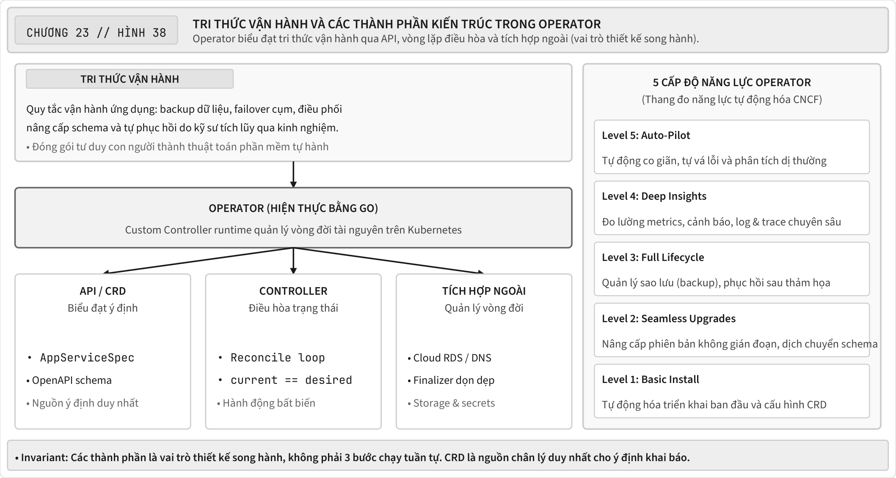
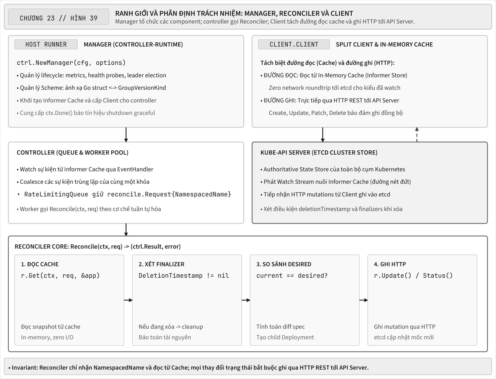
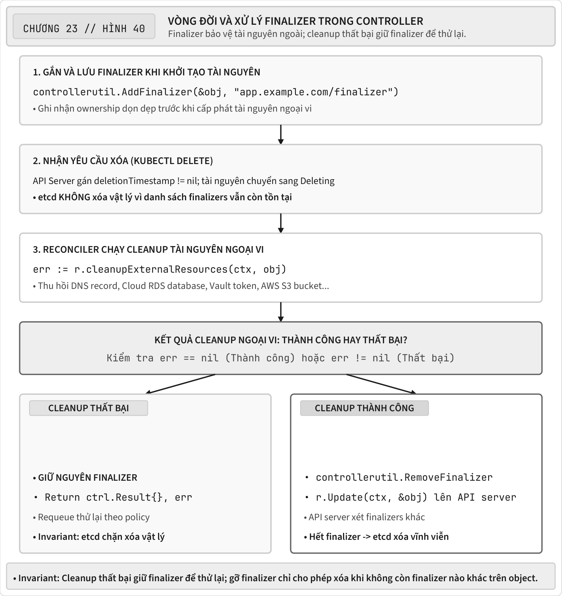

<!-- BOOK_ROLE: APPLICATION_SYSTEMS -->

# Chương 23 — Từ controller đến operator: API riêng và vòng đời tài nguyên

Chương 22 đã thiết lập nền tảng của một bộ điều khiển (`controller`) sử dụng `client-go`, `SharedInformer` và `TypedRateLimitingInterface` để điều hòa các tài nguyên lõi như Pod. Tuy nhiên, khi hệ thống mở rộng, nhu cầu quản trị hạ tầng vượt khỏi phạm vi các tài nguyên cơ bản có sẵn của Kubernetes.

Một hệ thống phức tạp thường bao gồm nhiều thành phần phụ thuộc lẫn nhau: cụm cơ sở dữ liệu phân tán có lịch sao lưu định kỳ, dịch vụ nghiệp vụ cần cấu hình ingress kèm chứng chỉ bảo mật và tài khoản IAM. Phương thức quản lý thủ công qua nhiều tệp cấu hình YAML tĩnh dễ gây sai lệch cấu hình và phụ thuộc vào thao tác can thiệp trực tiếp của con người. Mô hình Operator giải quyết hạn chế này bằng cách đóng gói các quy trình vận hành miền (domain operational knowledge) vào chính mã nguồn Go của bộ điều khiển, tự động hóa vòng đời tài nguyên thông qua định nghĩa tài nguyên tùy biến (Custom Resource Definition - CRD).

---

## 1. Operator là gì và Khi nào cần Operator?

Câu hỏi trung tâm của chương này là:
> *Sự khác biệt cốt lõi giữa một bộ điều khiển Kubernetes thông thường (`Controller`) và một bộ vận hành Kubernetes (`Operator`) là gì?*

Bộ vận hành (`Operator`) sử dụng bộ điều khiển để tự động hóa vòng đời của một ứng dụng hay nghiệp vụ chuyên biệt (`domain`), thường đi kèm một định nghĩa tài nguyên tùy biến (`CRD`). Bộ điều khiển nói chung cũng có thể làm việc với tài nguyên tùy biến; không có quy tắc nào bắt buộc nó chỉ được hiểu các tài nguyên có sẵn của hệ thống. Điểm khác biệt nằm ở tri thức vận hành mà logic điều hòa biểu đạt, chứ không phải một kiểu bộ điều khiển đặc biệt do Go hay Kubernetes nhận diện.

@figure Bộ vận hành (`Operator`) biểu đạt tri thức vận hành qua API, vòng lặp điều hòa và các tích hợp quản lý tài nguyên. Các thành phần này là vai trò thiết kế, không phải ba bước chạy tuần tự.

Thay vì bắt người dùng phải tự tạo `Deployment`, gắn `ConfigMap`, tạo `Secret` và mở `Service`, Operator cung cấp một tài nguyên duy nhất gọn gàng:

~~~yaml
apiVersion: apps.example.com/v1alpha1
kind: AppService
metadata:
  name: payment-api
spec:
  image: "payment:v2.4.0"
  replicas: 3
  port: 8080
~~~

Khi ta nộp khai báo trên, bộ vận hành (`Operator`) sẽ tự động sinh ra đối tượng `Deployment` tương ứng, gắn nhãn, cấu hình health check, theo dõi sức khỏe và cập nhật trạng thái thực tế.

---

## 2. Kiến trúc của controller-runtime

Xây dựng bộ vận hành (`Operator`) bằng `client-go` thuần túy đòi hỏi phải tự kết nối các thành phần quản lý bộ đệm, hàng đợi và vòng đời tài nguyên. Thư viện `sigs.k8s.io/controller-runtime` cung cấp lớp kiến trúc tổ chức chung cho các thành phần này; mức độ tinh gọn mã nguồn thực tế phụ thuộc vào yêu cầu của từng operator.

Sơ đồ dưới đây tách trách nhiệm quản lý tiến trình, xử lý khóa và truy cập tài nguyên:

@figure Manager tổ chức các thành phần kiến trúc; bộ điều khiển gọi bộ điều hòa (`Reconciler`) cho một khóa tài nguyên. Client sử dụng bộ nhớ đệm cho các luồng đọc được cấu hình và giao thức HTTP cho luồng ghi trực tiếp; sơ đồ lược bỏ các luồng đọc không thông qua bộ đệm.

### Bốn trụ cột của controller-runtime

| Trụ cột `controller-runtime` | Vai trò kiến trúc | Tương tác trong hệ thống |
| :--- | :--- | :--- |
| `Manager` | Quản lý vòng đời tiến trình Operator | Quản lý bộ đệm chung, leader election, server metrics và probe. |
| `Scheme` | Đăng ký ánh xạ kiểu dữ liệu | Ánh xạ giữa Go struct (`v1alpha1.AppService`) và `GroupVersionKind`. |
| `Client` với cache | Phân tách đường đọc và ghi theo cấu hình | Get/List có thể đọc cache; kiểu bị DisableFor, metadata discovery hay cache chưa khởi tạo vẫn có đường HTTP. Writes đi tới API. |
| `Reconciler` | Hiện thực logic điều hòa cốt lõi | Nhận `ctrl.Request` chứa `NamespacedName`, hội tụ trạng thái. |

---

## 3. Bản thiết kế CRD: Ranh giới rạch ròi giữa Spec và Status

Với API của bài thực hành, ta phân định rõ trường `Spec` (mô tả ý định người dùng) và trường `Status` (phản ánh quan sát thực tế của bộ điều khiển). Đây là hợp đồng của API; quyền ghi thực tế còn phụ thuộc vào RBAC và cấu hình subresource:

| Khối dữ liệu | Ý nghĩa | Ai có quyền ghi? | Trách nhiệm |
| :--- | :--- | :--- | :--- |
| **Spec** | Trạng thái mong muốn (Desired State). | Người dùng, Helm, CI/CD pipeline, GitOps (ArgoCD). | Khai báo hệ thống cần đạt được điều gì. |
| **Status** | Trạng thái quan sát được. | Controller được policy giao trách nhiệm; RBAC quyết định quyền ghi thực tế. | Báo observation và generation đã quan sát. |

### Quy tắc chống trượt (Anti-Drift Rule)

> **Chính sách của bài thực hành:** Hàm điều hòa không sửa `Spec` để ghi nhận kết quả quan sát hoặc tự ý ghi đè ý định của người dùng. Mọi quan sát phải được ghi vào `Status`; một bộ điều khiển chỉ can thiệp vào `Spec` khi đó là khế ước vận hành đã được quy định tường minh.

Nếu người dùng cấu hình `replicas: 3`, mà Reconciler thấy tải cao rồi tự ý sửa `spec.replicas = 5`, hệ thống sẽ rơi vào cuộc chiến bất tận giữa Operator và công cụ GitOps (ArgoCD liên tục kéo về 3, Operator liên tục đẩy lên 5).

Mọi kết quả quan sát (số replica đang sẵn sàng, phiên bản thực tế đang chạy, điều kiện lỗi) bắt buộc phải ghi vào trường `Status`.

### Phân lập Status Subresource

Để bảo vệ ranh giới này, Kubernetes cung cấp cơ chế tài nguyên phụ trạng thái (**Status Subresource** - `/status` endpoint). Khi cập nhật trạng thái, ta phải gọi:

~~~go
// ĐÚNG: Chỉ sửa Status, không đổi metadata.generation
if err := r.Status().Update(ctx, appService); err != nil {
	return ctrl.Result{}, err
}
~~~

Với định nghĩa `CRD` kích hoạt tài nguyên phụ trạng thái (`status subresource`), thao tác ghi vào tài nguyên chính sẽ bỏ qua các thay đổi trong Status. Giá trị Generation chỉ tăng lên khi phần dữ liệu thuộc quy tắc thế hệ của spec thay đổi, không phải cứ gọi Update là tăng. Một thao tác ghi tạo ra sự kiện cũng chưa chứng minh vòng lặp vô tận: bộ lọc predicate, nội dung thay đổi và logic điều hòa đều có ảnh hưởng. Luôn đọc trạng thái qua đường dẫn quy chuẩn và xử lý xung đột ghi một cách cẩn trọng.

---

## 4. Quản lý tài nguyên con: OwnerReferences và Garbage Collection

Khi `AppService` sinh ra một `Deployment`, làm sao để Kubernetes biết hai đối tượng này có quan hệ cha - con?

Câu trả lời là **OwnerReference** (Tham chiếu chủ sở hữu). Thư viện `controller-runtime` cung cấp hàm chuẩn hóa:

~~~go
if err := controllerutil.SetControllerReference(
	appService, newDeployment, r.Scheme,
); err != nil {
	return fmt.Errorf("không thể gán owner reference: %w", err)
}
~~~

### OwnerReference giúp quản lý vòng đời thế nào

Thứ nhất là xóa theo tầng bậc (`cascading deletion`) theo chính sách: bộ thu gom rác sử dụng các tham chiếu sở hữu (`ownerReferences`) hợp lệ để xác định tài nguyên phụ thuộc, nhưng chính sách lan truyền (`propagation policy`), quy tắc cùng không gian tên hoặc phạm vi toàn cụm sẽ quyết định cách thức xóa cụ thể. Tránh suy diễn rằng tài nguyên con luôn bị xóa ngay lập tức. Về ranh giới không gian tên, OwnerReference là siêu dữ liệu sở hữu có quy tắc phạm vi chặt chẽ chứ không phải liên kết cha con tùy ý. Đối với tài nguyên phụ thuộc nằm trong không gian tên, nó có thể tham chiếu chủ sở hữu trong cùng không gian tên hoặc chủ sở hữu cấp toàn cụm; nếu trỏ tới chủ sở hữu ở không gian tên khác, tham chiếu sẽ không hợp lệ và bị coi như không tồn tại, khiến tài nguyên con có thể bị thu hồi khi mọi chủ sở hữu hợp lệ khác không còn. Ngược lại, tài nguyên phụ thuộc cấp toàn cụm chỉ được phép tham chiếu chủ sở hữu cấp toàn cụm; nếu trỏ tới chủ sở hữu trong một không gian tên cụ thể, tham chiếu sẽ không thể phân giải, và từ Kubernetes v1.20+ bộ thu gom rác sẽ ghi nhận cảnh báo `OwnerRefInvalidNamespace`.

Thứ hai là khả năng theo dõi sự kiện ngược dòng (`Watch Events`): Bộ điều khiển (`Controller`) có thể cấu hình `Watches(&appsv1.Deployment{}, handler.EnqueueRequestForOwner(...))`. Bất cứ khi nào ai đó sửa đổi hoặc xóa Deployment con, sự kiện sẽ tự động ánh xạ ngược về `AppService` cha để Reconciler thức dậy sửa chữa.

---

## 5. Finalizer: Cổng gác vòng đời và Dọn dẹp tài nguyên ngoại vi

Nếu `OwnerReference` giải quyết xuất sắc việc dọn dẹp các tài nguyên nội bộ trong Kubernetes, thì điều gì sẽ xảy ra nếu ứng dụng tạo ra các tài nguyên bên ngoài cụm như một cơ sở dữ liệu Amazon RDS, một bản ghi DNS trên Cloudflare, hay một hàng đợi tin nhắn AWS SQS?

Nếu đối tượng tài nguyên tùy biến (`AppService`) bị xóa trước khi quá trình dọn dẹp hoàn tất, bộ điều khiển có thể mất dữ liệu cần thiết để xác định tài nguyên ngoài cụm. Trong kịch bản này, cơ chế finalizer sẽ chặn việc hoàn tất xóa cho tới khi tiến trình dọn dẹp xác nhận đã hoàn thành an toàn; hệ thống vẫn cần cơ chế điều tra hoặc đối soát độc lập để xử lý các sự cố phát sinh ngoài luồng chạy bình thường.

Đây chính là sứ mệnh của cơ chế chốt vòng đời (**Finalizer**).

@figure Việc dọn dẹp thất bại sẽ giữ lại finalizer để có thể thử lại. Dọn dẹp thành công chỉ cho phép gỡ bỏ finalizer của bộ điều khiển này; máy chủ API vẫn cần xem xét toàn bộ các điều kiện xóa khác.

Máy chủ API chỉ hoàn tất việc xóa khi mọi điều kiện trong vòng đời tài nguyên, bao gồm toàn bộ finalizer còn lại, đều đã thỏa mãn. Gỡ bỏ finalizer của bộ điều khiển này không đồng nghĩa với việc đối tượng sẽ biến mất ngay lập tức; bộ điều khiển không trực tiếp can thiệp vào etcd để xóa dữ liệu.

### Cạm bẫy Finalizer Deadlock

Tác vụ dọn dẹp luôn phải an toàn khi gọi lại nhiều lần. Một phản hồi báo không tìm thấy (404 Not Found) có thể được coi là đã hoàn tất nếu API và định danh chứng minh chính xác rằng tài nguyên đích thực sự không còn tồn tại; không tùy tiện bỏ qua mọi lỗi 404, vì nó cũng có thể xuất phát từ việc sai điểm cuối (`endpoint`), sai thẩm quyền hoặc sai định danh.

Nếu coi mọi mã lỗi 404 khi dọn dẹp đều là sự cố cần thử lại, bộ điều khiển có thể giữ mãi chốt `finalizer` dù tài nguyên bên ngoài đã biến mất. Đối tượng có thể bị kẹt ở trạng thái `Terminating` cho tới khi logic được sửa đổi hoặc có sự can thiệp thủ công. Chỉ coi việc không tìm thấy tài nguyên là dọn dẹp thành công khi đã xác nhận đúng định danh và khế ước API, không gộp mọi lỗi bên ngoài vào cùng một nhánh xử lý thô thiển.

---

## 6. Hiện thực Operator hoàn chỉnh trong Go

Dưới đây là phần lõi của bộ điều hòa (`Reconciler`) trong `labs/part23-controller-runtime-operator/`:

Định nghĩa cấu trúc điều hòa với khả năng tiêm phụ thuộc (Dependency Injection) cho bộ dọn dẹp ngoại vi:

~~~go
const AppServiceFinalizer = "apps.example.com/finalizer"

type ExternalCleaner interface {
	Cleanup(
		ctx context.Context, app *appsv1alpha1.AppService,
	) error
}

type AppServiceReconciler struct {
	client.Client
	Scheme          *runtime.Scheme
	ExternalCleaner ExternalCleaner
}
~~~

### Vòng lặp điều hòa trung tâm

Hàm `Reconcile` điều phối toàn bộ vòng đời: từ kiểm tra xóa, tạo tài nguyên con, đến sửa chữa sai lệch cấu hình:

~~~go
func (r *AppServiceReconciler) Reconcile(
	ctx context.Context, req ctrl.Request,
) (ctrl.Result, error) {
	appService := &appsv1alpha1.AppService{}
	err := r.Get(ctx, req.NamespacedName, appService)
	if err != nil {
		if errors.IsNotFound(err) {
			return ctrl.Result{}, nil
		}
		return ctrl.Result{}, err
	}

	// 1. Xử lý Finalizer: Kiểm soát vòng đời xóa
	if !appService.DeletionTimestamp.IsZero() {
		return r.handleDeletion(ctx, appService)
	}

	// Đảm bảo đối tượng luôn có Finalizer bảo vệ
	if !controllerutil.ContainsFinalizer(
		appService, AppServiceFinalizer,
	) {
		controllerutil.AddFinalizer(
			appService, AppServiceFinalizer,
		)
		return ctrl.Result{}, r.Update(ctx, appService)
	}

	// 2. Điều hòa Deployment con và sửa sai lệch (Drift)
	if err := r.reconcileDeployment(
		ctx, appService,
	); err != nil {
		return ctrl.Result{}, err
	}

	// 3. Cập nhật Status Subresource
	return ctrl.Result{}, r.updateStatus(ctx, appService)
}
~~~

### Ngữ nghĩa trả về của Result và Error trong controller-runtime

Trong `controller-runtime` v0.25.1, giá trị trả về của `Reconcile(ctx, req)` quyết định hành vi tiếp theo của hàng đợi theo bốn nhánh rành mạch:

Nhánh thứ nhất, trả về `(ctrl.Result{}, err)` với `err != nil`: Nếu lỗi không phải `reconcile.TerminalError`, bộ điều khiển ghi nhật ký lỗi và đưa lại yêu cầu vào hàng đợi với thuật toán kiểm soát tốc độ thử lại (`AddRateLimited`). Nếu vô tình trả về đồng thời `err != nil` và cờ `Requeue` hoặc `RequeueAfter`, bộ điều khiển sẽ ghi nhật ký cảnh báo và bỏ qua hai cờ thử lại để ưu tiên xử lý lỗi.

Nhánh thứ hai, trả về `(ctrl.Result{RequeueAfter: d}, nil)` với `d > 0`: Bộ điều khiển xóa lịch sử lỗi của yêu cầu (`Forget`) và lên lịch đưa yêu cầu trở lại hàng đợi sau khoảng thời gian `d` (`AddAfter`).

Nhánh thứ ba, trả về `(ctrl.Result{Requeue: true}, nil)`: Bộ điều khiển đưa yêu cầu trở lại hàng đợi có kiểm soát tốc độ qua bộ giới hạn tốc độ (rate limiter). Trong các phiên bản controller-runtime mới, cách trả về này dần được thay thế bằng lỗi hoặc `RequeueAfter` tường minh.

Nhánh thứ tư, trả về `(ctrl.Result{}, nil)`: lượt này không yêu cầu xếp lại và lịch sử lỗi được xóa (`Forget`). Key vẫn có thể đã được đánh dirty trong lúc xử lý, có lịch chờ từ trước hoặc được nguồn sự kiện khác đưa vào queue; không suy rằng chỉ watch mới mới đánh thức worker.

### Xử lý Xóa an toàn và Dọn dẹp ngoại vi

~~~go
func (r *AppServiceReconciler) handleDeletion(
	ctx context.Context, app *appsv1alpha1.AppService,
) (ctrl.Result, error) {
	hasFin := controllerutil.ContainsFinalizer(
		app, AppServiceFinalizer,
	)
	if hasFin {
		if r.ExternalCleaner == nil {
			return ctrl.Result{}, fmt.Errorf(
				"external cleaner is required",
			)
		}
		err := r.ExternalCleaner.Cleanup(ctx, app)
		if err != nil {
			return ctrl.Result{}, fmt.Errorf(
				"cleanup lỗi: %w", err,
			)
		}
		// Dọn dẹp xong: gỡ finalizer của controller này
		controllerutil.RemoveFinalizer(
			app, AppServiceFinalizer,
		)
		if err := r.Update(ctx, app); err != nil {
			return ctrl.Result{}, err
		}
	}
	return ctrl.Result{}, nil
}
~~~

### Tự động nhận diện và sửa chữa sai lệch (Drift Correction)

Nếu ai đó dùng `kubectl scale` để sửa số bản sao của đối tượng `Deployment` con từ 3 xuống 1, hàm điều hòa phát hiện sự không đồng nhất giữa `appService.Spec.Replicas` và `deployment.Spec.Replicas`, từ đó tự động ép trạng thái về đúng bản thiết kế ban đầu:

~~~go
func (r *AppServiceReconciler) syncDeploymentDrift(
	app *appsv1alpha1.AppService, dep *appsv1.Deployment,
) bool {
	drifted := false
	if dep.Spec.Replicas == nil ||
		*dep.Spec.Replicas != app.Spec.Replicas {
		dep.Spec.Replicas = &app.Spec.Replicas
		drifted = true
	}
	if len(dep.Spec.Template.Spec.Containers) > 0 {
		c := &dep.Spec.Template.Spec.Containers[0]
		if c.Image != app.Spec.Image {
			c.Image = app.Spec.Image
			drifted = true
		}
	}
	return drifted
}
~~~

---

## 7. Bằng chứng kiểm thử: Chứng minh 5 quy luật Operator

Bộ kiểm thử tại `labs/part23-controller-runtime-operator/controllers/appservice_controller_test.go` sử dụng `fake.NewClientBuilder()` để xác nhận khế ước logic của hàm điều hòa. Công cụ này không mô phỏng toàn diện máy chủ API: việc kiểm tra tính hợp lệ dữ liệu, thế hệ tài nguyên và ngữ nghĩa của tài nguyên phụ không hoàn toàn giống cụm máy chủ thật. Khi cần xác minh tương tác trực tiếp với máy chủ API, ta sử dụng `envtest` hoặc bài kiểm tra tích hợp cụm riêng biệt. Vì vậy bài thực hành ghi nhận `ObservedGeneration` vào trường status để bên tiêu thụ biết trạng thái đã phản ánh đúng bản spec nào, chứ không dùng fake client để tuyên bố đã kiểm chứng trọn vẹn vòng đời của generation.

~~~
=== RUN   TestReconcileCreateOwnedDeployment
--- PASS: TestReconcileCreateOwnedDeployment (0.51s)
=== RUN   TestReconcileDriftCorrection
--- PASS: TestReconcileDriftCorrection (0.01s)
=== RUN   TestReconcileFinalizerExecution
--- PASS: TestReconcileFinalizerExecution (0.01s)
=== RUN   TestReconcileStatusSubresource
--- PASS: TestReconcileStatusSubresource (0.01s)
=== RUN   TestNotFoundResourceNoOp
--- PASS: TestNotFoundResourceNoOp (0.01s)
PASS
ok      part23-controller-runtime-operator/controllers   1.875s
~~~

### 1. Khởi tạo tài nguyên con kèm OwnerReference (TestReconcileCreateOwnedDeployment)
Khi tạo mới một `AppService`, bộ điều hòa tự động sinh một đối tượng `Deployment` mang tên tương ứng. Bằng chứng kiểm thử xác nhận `dep.OwnerReferences[0].Name == "cache-service"`, và `app.Finalizers` lập tức được bổ sung khóa `apps.example.com/finalizer`.

### 2. Tự phục hồi sai lệch cấu hình (TestReconcileDriftCorrection)
Lab sửa desired deployment rồi gọi Reconcile để kiểm tra logic khôi phục những field controller sở hữu. Test không đo tốc độ hội tụ của cluster thật; cache, event delivery, retry và API error vẫn ảnh hưởng thời gian sửa drift.

### 3. Vòng đời Finalizer (TestReconcileFinalizerExecution)
Gán `DeletionTimestamp` vào đối tượng. Bộ điều hòa gọi `ExternalCleaner.Cleanup()` rồi mới gỡ `finalizer`; thiếu bộ dọn dẹp là lỗi và `finalizer` phải giữ lại. Test chỉ chứng minh contract của lab; việc object thực sự biến mất là trách nhiệm API server/garbage collection và không được suy ra từ fake client.

### 4. Cập nhật Status Subresource độc lập (TestReconcileStatusSubresource)
Test kiểm chính sách hẹp của lab: `AvailableReplicas: 3` với ba replica mong muốn dẫn tới `Phase = "Ready"`, cập nhật qua `r.Status().Update()` mà không đổi `Spec`. Chính sách này chưa kiểm `Deployment.Status.ObservedGeneration`, `UpdatedReplicas` hoặc rollout mới đã hoàn tất; nhãn Ready không đủ chứng minh ảnh mới đang phục vụ. `AppService.Status.ObservedGeneration` chỉ ghi thế hệ AppService được lượt này đọc. Test mới từ chối Deployment cùng tên nhưng không thuộc quyền điều khiển; hai fixture drift/status cũ được gắn owner reference để đúng tình huống child sở hữu, không coi name là ownership.

### 5. An toàn khi tài nguyên biến mất (TestNotFoundResourceNoOp)
Gửi yêu cầu điều hòa cho một tài nguyên không hề tồn tại. Hàm điều hòa trả về `(ctrl.Result{}, nil)` một cách nhẹ nhàng, không gây `panic` hay sinh lỗi rác trong log hệ thống.

---

### Đặt cùng assertion trước API server thật

Máy khách giả lập (`fake client`) ở trên cho phép kiểm tra hàm điều hòa đã gọi đúng luồng ghi và xử lý chính xác các đối tượng mẫu trong bộ kiểm thử. Nó không phải là một máy chủ API thu nhỏ. Bài kiểm tra `TestFakeDoesNotProveGeneration` trong thư mục `integration` thay đổi `spec` nhưng thế hệ tài nguyên (`generation`) vẫn giữ mức 1 trên bản giả lập của `controller-runtime` v0.25.1. Đừng tự ý nâng con số ấy lên 2 bằng hàm trợ giúp kiểm thử rồi ngộ nhận đó là bằng chứng Kubernetes tự động tăng thế hệ tài nguyên (`generation`).

Thử nghiệm một khế ước kỹ thuật cụ thể: tài nguyên phụ trạng thái (`status`) phải tách biệt rạch ròi luồng ghi mong muốn khỏi luồng ghi quan sát thực tế. Bài kiểm tra `TestRealAPIContract` nạp CRD có lược đồ cấu trúc và `subresources.status` vào một mặt phẳng điều khiển `envtest` độc lập. Nó không đọc tệp cấu hình kubeconfig cá nhân và không can thiệp vào cụm máy chủ từ Chương 17. Sau khi tạo, trạng thái tự khai bị loại bỏ; lệnh cập nhật gốc `Update` không thể ghi đè trường `status`; phương thức `Status().Update` không thể sửa đổi trường `spec`. Việc cập nhật `spec` sẽ nâng thế hệ tài nguyên (`generation`) từ 1 lên 2, trong khi `observedGeneration` vẫn giữ mức 1 cho tới khi bộ điều khiển báo cáo quan sát mới. Cuối cùng, bên ghi trạng thái dùng phiên bản tài nguyên cũ phải nhận mã lỗi xung đột thay vì ghi đè lên quan sát mới.

~~~bash
# Từ module labs/part23-controller-runtime-operator
export KUBEBUILDER_ASSETS=/path/to/k8s-1.37-assets
go test -tags integration -count=1 -v ./integration
~~~

Đường thực thi này cần Linux/WSL và các binary `kube-apiserver`, `etcd` tương thích Kubernetes 1.37.x; dependency của lab đã ghim API v0.37.0. Môi trường Windows hiện tại chưa có assets đó, nên kiểm định API thật là `NOT_RUN`, không phải PASS. Test fake chạy được và việc biên dịch test cho Linux chỉ kiểm tra mã dùng đúng API thư viện. Khi tái lập trên Linux đủ prerequisite, hãy đọc output của chính test, không dùng kết quả compile làm chứng nhận integration.

> **Dừng để dự đoán:** Nếu thay thế `Status().Update` bằng `Update`, bài kiểm tra nào sẽ bắt được lỗi dù yêu cầu không trả về mã lỗi? Chạy lại với cờ `RELIABILITY_MUTANT=root_status_write` trên môi trường có đủ tài nguyên nhị phân; câu khẳng định của luồng trạng thái sẽ chuyển sang báo lỗi. Đây là biến thể đột biến kiểm thử được chuẩn bị cho môi trường tích hợp.

#### Gợi ý giải pháp (chỉ đọc sau khi đã tự làm)

Điểm cuối gốc có thể chấp nhận yêu cầu nhưng lược bỏ trạng thái, đồng thời chấp nhận phần spec mà mã nguồn vô tình đính kèm. Bài kiểm tra đọc lại đối tượng bằng client không thông qua bộ đệm, đối soát toàn diện cả giai đoạn, ảnh container và thế hệ tài nguyên. Nếu chỉ kiểm tra `err == nil`, ta sẽ bỏ sót hoàn toàn việc ghi nhầm điểm cuối. Khi gặp xung đột thực tế, hàm điều hòa phải đọc lại quan sát mới rồi tính toán lại các thay đổi; việc lặp lại thao tác ghi trên cùng đối tượng cũ không phải là giải pháp xử lý xung đột.

Môi trường `envtest` chỉ kích hoạt máy chủ API và etcd, không chạy kubelet, bộ điều phối scheduler hay bộ thu gom rác. Do đó, bài kiểm tra này không chứng minh Pod đã sẵn sàng, tham chiếu sở hữu đã thu hồi tài nguyên con hay chốt chặn finalizer đã dọn dẹp hạ tầng đám mây. Việc bóc tách khế ước API khỏi vòng lặp điều hòa và khối lượng công việc thực tế giúp ta nhận diện chính xác các khoảng trống bằng chứng kỹ thuật.

## 8. Các cạm bẫy người học thường gặp (Learner Pitfalls)

| Cạm bẫy thực tế | Hậu quả trên Production | Giải pháp phòng ngừa |
| :--- | :--- | :--- |
| **Ghi observation vào Spec** dù API quy định user sở hữu Spec. | Có thể xung đột với GitOps và gây reconcile lặp. | Giữ observation ở Status; xác định field ownership khi có chức năng sửa Spec. |
| **Dùng `Update` cho Status khi CRD bật status subresource.** | Status có thể bị bỏ qua; generation không phải cứ Update là tăng. | Dùng `Status().Update` cho status và kiểm tra conflict/observedGeneration theo API. |
| **Cleanup coi mọi not-found là lỗi hoặc mọi 404 là thành công.** | Có thể giữ finalizer không cần thiết hoặc bỏ cleanup sai đích. | Xác minh resource identity và contract API trước khi coi not-found là hoàn tất. |
| **Không thiết kế ownership** cho tài nguyên con. | Garbage collector không suy ra quan hệ cha/con từ tên; tài nguyên có thể còn lại khi cha bị xóa. | Nếu policy giao cleanup cho garbage collector, gắn owner reference hợp lệ; kiểm tra scope và deletion policy, không gắn owner tùy tiện cho tài nguyên chia sẻ. |

---

## 9. Bài tập thực hành thiết kế Operator

### Thử thách 1: Tự động khởi tạo và đồng bộ ConfigMap đi kèm Deployment
*Yêu cầu kỹ thuật:* Mở rộng `AppServiceReconciler` để mỗi khi điều hòa một `AppService`, nó tự động tạo và đồng bộ một `ConfigMap` con (`<app-name>-config`) chứa file cấu hình ứng dụng `app.json` với nội dung `{"port": <Spec.Port>}`. `ConfigMap` này phải được gắn `OwnerReference` trỏ về `AppService`. Nếu `ConfigMap` đã tồn tại nhưng dữ liệu bị lệch (drift), reconciler phải cập nhật lại nội dung.

### Thử thách 2: Báo cáo Condition chuẩn mực trong Status
*Yêu cầu kỹ thuật:* Kubernetes khuyến nghị sử dụng slice `[]metav1.Condition` để thể hiện trạng thái chi tiết của tài nguyên. Hãy bổ sung hàm trợ giúp để cập nhật Condition `Type="DeploymentReady"` với `Status="True"` khi số lượng Pod sẵn sàng bằng số lượng replica mong muốn, hoặc `Status="False"` kèm Reason `"ReplicasUnavailable"` khi chưa đủ.

---

## 10. Hướng dẫn giải và Phân tích kiến trúc bài tập

### Lời giải Thử thách 1: Đồng bộ ConfigMap con và Xử lý Trôi cấu hình

~~~go
func (r *AppServiceReconciler) reconcileConfigMap(
	ctx context.Context, app *appsv1alpha1.AppService,
) error {
	desiredJSON := fmt.Sprintf(`{"port": %d}`, app.Spec.Port)
	cm := &corev1.ConfigMap{
		ObjectMeta: metav1.ObjectMeta{
			Name:      app.Name + "-config",
			Namespace: app.Namespace,
		},
		Data: map[string]string{
			"app.json": desiredJSON,
		},
	}

	// Gán quan hệ cha con để garbage collector tự động dọn dẹp
	if err := controllerutil.SetControllerReference(
		app, cm, r.Scheme,
	); err != nil {
		return err
	}

	found := &corev1.ConfigMap{}
	key := client.ObjectKeyFromObject(cm)
	err := r.Get(ctx, key, found)
	if errors.IsNotFound(err) {
		return r.Create(ctx, cm)
	}
	if err != nil {
		return err
	}

	// Kiểm tra quyền sở hữu, từ chối ghi đè nếu owner khác
	if !metav1.IsControlledBy(found, app) {
		return fmt.Errorf(
			"configmap %s exists but not owned by %s",
			found.Name, app.Name,
		)
	}

	// Phát hiện và sửa trôi cấu hình (configuration drift)
	if found.Data["app.json"] != cm.Data["app.json"] {
		found.Data = cm.Data
		return r.Update(ctx, found)
	}
	return nil
}
~~~

#### Phân tích ranh giới điều hòa (Reconcile Boundaries)

Trong một reconciler chuẩn mực, việc kiểm soát và bảo vệ ranh giới tài nguyên gồm ba kỷ luật cốt lõi:

Thứ nhất là kiểm tra quyền sở hữu (ownership verification). Khi `r.Get` tìm thấy `ConfigMap` đã tồn tại trên cụm, bộ điều hòa không được vội vàng cập nhật dữ liệu. Tài nguyên này có thể do một tiến trình khác tạo ra hoặc do người quản trị cấu hình thủ công. Hàm sử dụng `metav1.IsControlledBy(found, app)` để xác minh quyền điều khiển. Nếu `ConfigMap` không thuộc sở hữu của `AppService` hiện tại, chính sách an toàn nhất là từ chối can thiệp và trả về lỗi tường minh, tuyệt đối không ghi đè lên tài nguyên của chủ sở hữu khác.

Thứ hai là khắc phục hiện tượng trôi dạt cấu hình (drift correction). Với đối tượng `ConfigMap` đã xác thực đúng quyền sở hữu, việc chỉ kiểm tra trạng thái không tìm thấy khi khởi tạo ban đầu là chưa đủ. Nếu ai đó chỉnh sửa `ConfigMap` trực tiếp hoặc trường `Spec.Port` của `AppService` được cập nhật sau đó, luồng xử lý chỉ tạo mới sẽ bỏ sót sai lệch dữ liệu. Do đó, hàm điều hòa đối chiếu nội dung thực tế qua phép so sánh `found.Data["app.json"] != cm.Data["app.json"]`, rồi gọi `Update(ctx, found)` khi có khác biệt để bảo đảm tính nhất quán sau cùng (eventual consistency).

Thứ ba là tác động tới ứng dụng trong Pod. Cập nhật `ConfigMap` không tự restart Pod. Với volume thông thường, dữ liệu mới được chiếu xuống sau một khoảng trễ; ứng dụng có thể theo dõi và nạp lại cấu hình mà không restart. Biến môi trường `envFrom` và mount qua `subPath` không tự nhận dữ liệu mới theo cách đó. Nếu chọn policy rollout, Operator có thể gắn mã băm cấu hình vào annotation của Pod template rồi cập nhật Deployment; thay đổi template kích hoạt triển khai theo strategy đã cấu hình. Đây là một lựa chọn, không phải cơ chế duy nhất, và việc gửi update thành công chưa chứng minh rollout hoàn tất.

### Lời giải Thử thách 2: Quản lý Condition bằng meta.SetStatusCondition

Sử dụng thư viện chuẩn `k8s.io/apimachinery/pkg/api/meta`:

~~~go
import "k8s.io/apimachinery/pkg/api/meta"

func (r *AppServiceReconciler) updateConditions(
	app *appsv1alpha1.AppService, isReady bool,
) {
	condition := metav1.Condition{
		Type:               "DeploymentReady",
		Status:             metav1.ConditionFalse,
		Reason:             "ReplicasUnavailable",
		Message:            "Chưa đủ bản sao sẵn sàng",
		LastTransitionTime: metav1.Now(),
	}

	if isReady {
		condition.Status = metav1.ConditionTrue
		condition.Reason = "DeploymentAvailable"
		condition.Message = "Tất cả bản sao đều khỏe mạnh"
	}

	meta.SetStatusCondition(
		&app.Status.Conditions, condition,
	)
}
~~~

Hàm `meta.SetStatusCondition` tự động kiểm tra: nếu điều kiện đã tồn tại và không thay đổi trạng thái, nó sẽ giữ nguyên trường `LastTransitionTime` cũ, giúp hệ thống theo dõi chính xác thời điểm chuyển giao trạng thái.

---

Tài nguyên tùy biến, thư viện `controller-runtime` và cơ chế `finalizer` cung cấp cho ta các khối kiến trúc cốt lõi để xây dựng một operator hoàn chỉnh. Bài thực hành không nhằm chứng minh ta đã giải quyết mọi trường hợp phức tạp trên môi trường sản xuất; khối lượng công việc thực tế còn đòi hỏi tiến hóa lược đồ dữ liệu, quyền sở hữu, chính sách thử lại, phân quyền RBAC và cơ chế phục hồi riêng. Chương 24 sẽ chuyển các ranh giới này sang AWS SDK for Go v2 và thông tin xác thực tạm thời.
