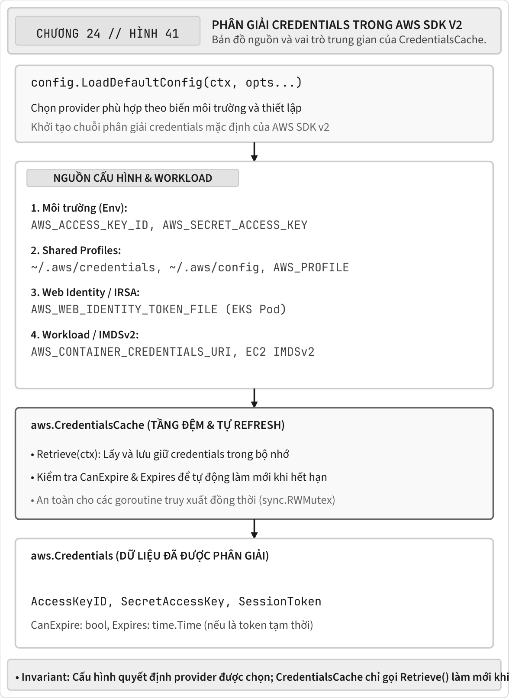
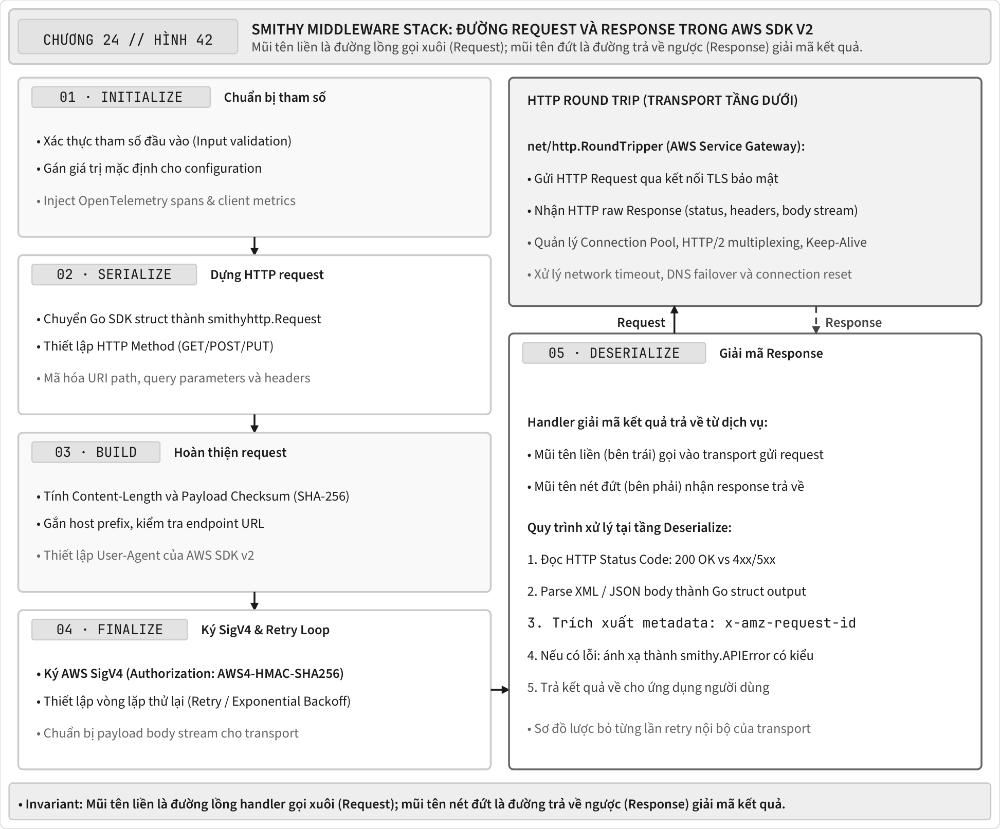

<!-- BOOK_ROLE: APPLICATION_SYSTEMS -->

# Chương 24 — Tự động hóa AWS bằng Go mà không biến credential thành bí mật dài hạn

Trong hành trình xây dựng các công cụ vận hành và nền tảng hạ tầng, giao tiếp với các dịch vụ điện toán đám mây là nhiệm vụ thiết yếu của kỹ sư DevOps/SRE. Cho dù kỹ sư viết công cụ dọn dẹp snapshot định kỳ, sao lưu cơ sở dữ liệu lên Amazon S3, hay điều phối máy chủ qua EC2, ta đều phải trả lời một câu hỏi bảo mật cốt lõi:

> *Làm thế nào để chương trình Go giao tiếp an toàn với AWS API mà không bao giờ nhúng Access Key dài hạn vào mã nguồn, file cấu hình hay biến môi trường?*

Để lộ cặp khóa `AWS_ACCESS_KEY_ID` và `AWS_SECRET_ACCESS_KEY` dài hạn trong repo hoặc log có thể cho phép sử dụng quyền của khóa cho đến khi bị thu hồi. Vì vậy chương này ưu tiên credential tạm thời và quyền tối thiểu; không gán thứ hạng nguyên nhân sự cố khi không có bộ dữ liệu tương ứng.

Chương 21 đến Chương 23 đã xây dựng mô hình điều hòa: quan sát trạng thái, tính sai lệch, hành động và quan sát lại để đảm bảo tính lũy đẳng trong Kubernetes. Khi mở rộng sang đám mây, các nguyên lý ấy vẫn giữ nguyên giá trị: việc tự động hóa AWS API (như dọn dẹp snapshot hay lưu trữ backup) cũng là một dạng điều hòa với hệ thống ngoại vi, nơi tính lũy đẳng nghiệp vụ, ranh giới lỗi và quyền hạn tạm thời quyết định độ tin cậy của hệ thống. Chương này trang bị cho kỹ sư tư duy thiết kế hệ thống tự động hóa đám mây dựa trên thư viện chính thức AWS SDK for Go v2: từ cơ chế cấp quyền động ngắn hạn (Temporary Credentials), xác định Region, ngăn xếp middleware Smithy, ký chữ ký số SigV4, đến duyệt dữ liệu lớn qua Paginator và phân loại lỗi chuẩn mực.

---

## 1. Chuỗi định danh ngầm định và Quyền tạm thời

Ưu tiên trên môi trường vận hành thực tế là sử dụng thông tin xác thực tạm thời từ vai trò IAM hoặc cơ chế OIDC; điều đó không biến mọi nguồn trong chuỗi phân giải mặc định thành thông tin xác thực tạm thời. Với `config.LoadDefaultConfig`, các nguồn nền tảng gồm thông tin xác thực tĩnh từ biến môi trường, tệp cấu hình chia sẻ, thông tin xác thực container (ECS) và vai trò IAM qua dịch vụ EC2 IMDS; cấu hình SSO hay danh tính web sẽ chọn nhà cung cấp tương ứng. Chuỗi phân giải vẫn có thể tiếp nhận thông tin xác thực tĩnh từ môi trường hoặc tệp chia sẻ, đặc biệt trên máy phát triển và trong các bài kiểm thử.

Các khóa tạm thời này có thời hạn hiệu lực hữu hạn: thời lượng phiên của IAM Role có thể cấu hình linh hoạt từ 15 phút tới 12 giờ tùy theo cấu hình vai trò, trong khi các cơ chế phiên liên kết (chained roles) hay `AssumeRoleWithWebIdentity` áp dụng giới hạn riêng. Mỗi bộ thông tin xác thực tạm thời luôn gắn liền với một Session Token (`AWS_SESSION_TOKEN`). Cần đặc biệt lưu ý: nếu khóa tạm thời bị rò rỉ trong thời gian còn hiệu lực, kẻ tấn công vẫn có thể sử dụng hợp lệ cho đến khi hết hạn hoặc cho đến khi quản trị viên chủ động thu hồi phiên (thông qua IAM revocation policy, cập nhật inline policy, hoặc vô hiệu hóa IAM role).

@figure Cấu hình quyết định provider được chọn; đây là bản đồ nguồn, không phải thứ tự ưu tiên bất biến. Credential có thể là static hoặc tạm thời. Cache lấy credential khi có lượt Retrieve cần dữ liệu hợp lệ.

### Cơ chế bộ đệm và xác thực đồng bộ của SDK (`aws.CredentialsCache`)

Trong mã nguồn SDK được ghim, quy trình phân giải thông tin xác thực rẽ nhánh linh hoạt theo cấu hình chứ không phải một danh sách ưu tiên bất biến: hồ sơ cấu hình (profile) được chọn tường minh qua biến môi trường hoặc tệp cấu hình, thông tin xác thực từ môi trường và Web Identity đều có điều kiện kích hoạt riêng; hồ sơ cấu hình có thể sử dụng hồ sơ nguồn, SSO hay quy trình xác thực trước khi chuyển tiếp tới container hoặc IMDS. Hãy tham khảo `config/resolve_credentials.go` cùng các tùy chọn của bên gọi khi cần giải thích nguyên nhân một nhà cung cấp được lựa chọn. Tránh suy diễn rằng thông tin xác thực luôn là loại tạm thời chỉ thuần túy dựa vào việc triệu gọi `LoadDefaultConfig`.

Đối với các khối lượng công việc container hóa và điều phối đám mây, SDK phân định rõ ba cơ chế cấp phát định danh độc lập thay vì gộp chung mọi môi trường:

Một là, cơ chế gắn vai trò IAM cho tài khoản dịch vụ Kubernetes (IRSA): Khối Pod được ánh xạ mã thông báo danh tính web OIDC (thông qua biến môi trường `AWS_WEB_IDENTITY_TOKEN_FILE` và `AWS_ROLE_ARN`), kích hoạt nhà cung cấp định danh gọi tới dịch vụ AWS STS thông qua giao diện lập trình `AssumeRoleWithWebIdentity`.

Hai là, cơ chế vai trò cho tác vụ ECS: Nhà cung cấp thông tin xác thực vùng chứa kết nối trực tiếp tới điểm cuối xác thực của tiến trình ECS Agent cục bộ thông qua biến môi trường `AWS_CONTAINER_CREDENTIALS_RELATIVE_URI`.

Ba là, cơ chế định danh Pod trên EKS: Nhà cung cấp thông tin xác thực vùng chứa tương tác trực tiếp với tiến trình hỗ trợ danh tính trên nút máy chủ thông qua biến môi trường `AWS_CONTAINER_CREDENTIALS_FULL_URI` và mã thông báo xác thực tại `AWS_CONTAINER_AUTHORIZATION_TOKEN_FILE`.

SDK bao bọc provider trong `aws.CredentialsCache` để tránh lấy khóa lặp lại trước mỗi request. Khi có lượt `Retrieve` cần dữ liệu và khóa chưa có hoặc đã hết hạn, cache mới gọi provider; nó không có vòng quét định kỳ tự làm mới khi không có người gọi. `ExpiryWindow > 0` điều chỉnh mốc hết hạn lưu trong cache để lần gọi sau làm mới sớm; window không dương được bỏ qua. Không hiểu “theo nhu cầu” thành “không tạo goroutine”: source SDK v1.36.3 dùng singleflight để các caller cùng chờ một lượt lấy khóa, chạy lượt đó trong goroutine ngắn hạn. Context bị hủy có thể kết thúc một caller mà không hủy lượt lấy khóa dùng chung. Test có điểm bắt tay kiểm caller đã trả lỗi hủy, provider vẫn chạy rồi hoàn tất cho caller khác; đây là hành vi của phiên bản được ghim, không phải bảo đảm không còn việc nền khi caller trả về.

### Xác định Region và Ranh giới Dịch vụ Vùng

Khi nạp qua `config.LoadDefaultConfig`, Region có thể đến từ `config.WithRegion("ap-southeast-1")`, `AWS_REGION`/`AWS_DEFAULT_REGION` hoặc profile trong `~/.aws/config`; giá trị tường minh có ưu tiên cao hơn. SDK không có Region mặc định. Lấy Region từ EC2 IMDS cần bật tùy chọn `config.WithEC2IMDSRegion()`; không nhầm việc credential provider tự dùng IMDS với việc Region tự được suy ra từ IMDS.

Khác với các dịch vụ mang tính toàn cầu (global services như IAM), hầu hết dịch vụ AWS (như Amazon S3, DynamoDB, EC2) đều vận hành theo từng region vật lý riêng biệt. Nếu không xác định được Region từ các nguồn cấu hình trên, SDK v2 sẽ trả về lỗi khi khởi tạo cuộc gọi đến dịch vụ vùng. Đặc biệt với Amazon S3, dù tên bucket là duy nhất trên phạm vi toàn cầu, mỗi bucket vẫn cư trú tại một region xác định; gửi request tới bucket ở region khác mà không cấu hình cross-region có thể dẫn đến lỗi điều hướng HTTP 301 hoặc lỗi ký chữ ký số SigV4.

---

## 2. Luồng thực thi của AWS SDK v2 và Smithy Middleware

AWS SDK for Go v2 sử dụng Smithy, một ngôn ngữ mô hình hóa dịch vụ và bộ công cụ sinh SDK. Smithy không phải là một giao thức truyền tải thay thế cho HTTP, và cũng không phải cơ chế ký SigV4 thay cho TLS; ngăn xếp trung gian (middleware stack) là phần tổ chức luồng triệu gọi của SDK.

Một thao tác như `s3.PutObject` đi qua năm bước của **Middleware Stack**. Mỗi bước triệu gọi hàm xử lý bên trong; kết quả phản hồi sau đó đi ngược trở ra ngoài. Vì vậy Deserialize xử lý gói phản hồi sau hàm xử lý, còn Initialize xử lý trước khi yêu cầu được phát đi:

@figure Mũi tên liền biểu diễn đường gọi vào handler, mũi tên đứt biểu diễn response trở về Deserialize. Middleware cụ thể và vị trí xử lý checksum phụ thuộc operation cùng cấu hình; sơ đồ không mô tả từng lần retry.

### Chữ ký số SigV4 (Signature Version 4)

Trong luồng triệu gọi chữ ký SigV4, phần mềm trung gian ký ở pha hoàn tất (**Finalize**) sẽ kiến tạo yêu cầu chuẩn hóa (`canonical request`) từ phương thức HTTP, đường dẫn, tham số truy vấn, các tiêu đề được ký và mã băm của nội dung tải trọng theo chế độ ký. Đây là đại diện của yêu cầu cho thuật toán xác thực, không phải chữ ký của từng gói tin mạng.

SDK sử dụng khóa ký suy dẫn từ khóa bí mật, ngày tháng, vùng và dịch vụ để tạo chữ ký SigV4 cho yêu cầu chuẩn hóa. Máy chủ sẽ đối soát toàn bộ các thành phần được ký; không phải mọi tiêu đề đều được đưa vào danh sách ký (`SignedHeaders`) và một số chế độ cho phép tải trọng không ký. Sửa đổi phần được bao phủ có thể gây lỗi xác minh, nhưng không suy ra một mã lỗi HTTP cố định cho mọi dịch vụ. Giao thức TLS vẫn luôn cần thiết để bảo vệ đường truyền; chữ ký SigV4 không thay thế cho TLS.

Cơ chế SigV4 xác thực yêu cầu gửi tới AWS và bảo vệ tính toàn vẹn của các thành phần được ký; nó không tự động mã hóa bí mật nội dung, không chống tấn công phát lại trong mọi ngữ cảnh, và không tự động ký toàn bộ tiêu đề. Giao thức TLS chịu trách nhiệm bảo vệ kênh truyền, còn bên gọi phải nắm rõ dịch vụ và tùy chọn ký của lời gọi mình sử dụng.

---

## 3. Quản lý dữ liệu lớn bằng Paginator

Nếu chỉ gọi một trang của API liệt kê, công cụ có thể bỏ sót object ở các trang sau:

~~~go
// CẢNH BÁO: Chỉ lấy tối đa 1.000 file đầu tiên!
resp, err := client.ListObjectsV2(ctx, &s3.ListObjectsV2Input{
	Bucket: aws.String("big-data-bucket"),
})
~~~

Một bucket trên S3 có thể chứa 10 triệu đối tượng. API `ListObjectsV2` mặc định chỉ trả về tối đa 1.000 file mỗi lần gọi và trả về mã thông báo tiếp tục (`NextContinuationToken`).

Nếu ta tự viết vòng lặp `for` với token thủ công, mã nguồn sẽ trở nên cồng kềnh và dễ gặp lỗi vòng lặp vô tận nếu xử lý sai điều kiện ngắt.

### Mẫu hình chuẩn: SDK Paginator

Hàm khởi tạo `NewListObjectsV2Paginator` quản lý mã đánh dấu tiếp tục (*continuation token*) và trả về từng trang dữ liệu riêng biệt. Nó không cam kết tổng mức sử dụng bộ nhớ sẽ luôn là $O(1)$ đối với mọi dữ liệu đầu vào: kích thước từng trang và cách thức bên gọi lưu giữ kết quả vẫn bắt buộc phải có định mức rõ ràng.

~~~go
paginator := s3.NewListObjectsV2Paginator(
	client, &s3.ListObjectsV2Input{
		Bucket: aws.String("big-data-bucket"),
	},
)

for paginator.HasMorePages() {
	page, err := paginator.NextPage(ctx)
	if err != nil {
		return fmt.Errorf("lỗi đọc trang: %w", err)
	}
	for _, obj := range page.Contents {
		// Xử lý từng file mà không làm đầy RAM
		processFile(*obj.Key)
	}
}
~~~

Bộ phân trang chỉ lưu giữ trang dữ liệu đang xử lý tại thời điểm tức thời; mức tiêu thụ bộ nhớ của bên gọi phụ thuộc hoàn toàn vào cách xử lý tiếp theo. Hàm `ListAllKeys` trong bài thực hành cố tình gom toàn bộ kết quả vào mảng chuỗi `[]string`, do đó sẽ tiêu tốn bộ nhớ ở mức $O(n)$ theo tổng số lượng khóa. Với các tác vụ quét dữ liệu quy mô lớn, hãy xử lý trực tiếp từng mảng `page.Contents` hoặc sử dụng hàm phản hồi (*callback*) thay vì tích lũy toàn bộ kết quả vào bộ nhớ.

---

## 4. Phân loại lỗi và Thử lại: smithy.APIError

Khi một lệnh gọi AWS thất bại, ta không thể chỉ so sánh chuỗi lỗi bằng `strings.Contains(err.Error(), "404")`. AWS trả về lỗi có cấu trúc chuẩn mực thông qua interface `smithy.APIError`.

Cơ chế thử lại ở tầng truyền vận của SDK (`aws.Retryer`, mặc định tối đa 3 lần với thuật toán lùi lũy thừa kèm độ trễ ngẫu nhiên cho các lỗi tạm thời) hoàn toàn không bảo đảm tính lũy đẳng nghiệp vụ (*business idempotency*). Nếu một yêu cầu ghi bị ngắt kết nối mạng sau khi máy chủ AWS đã tiếp nhận và thực thi thành công, việc SDK tự động thử lại có thể gây ra tác dụng phụ lặp lại ngoài ý muốn. Một số giao diện API của AWS cung cấp mã định danh lũy đẳng tường minh (như `ClientToken` trong EC2) để máy chủ nhận diện yêu cầu gửi lặp; tuy nhiên đối với thao tác `PutObject` trên Amazon S3, ngữ nghĩa phụ thuộc chặt chẽ vào cấu hình kho lưu trữ và các điều kiện tiên quyết. Khi kho lưu trữ bật tính năng quản lý phiên bản (*Versioning*), nhiều lượt gửi dữ liệu với cùng một khóa sẽ tạo ra các phiên bản độc lập chứ không ghi đè tại chỗ, do đó việc dùng chung một khóa không bảo đảm tạo ra một hiệu ứng phụ duy nhất. Khi bài toán đòi hỏi tạo mới mà không ghi đè, hệ thống có thể cần yêu cầu có điều kiện (như `If-None-Match: *` khi dịch vụ hỗ trợ), nhưng đây không phải giải pháp vạn năng cho mọi tình huống. Tính lũy đẳng nghiệp vụ bắt buộc phải được thiết kế dựa trên đúng khế ước kỹ thuật của từng thao tác và dịch vụ cụ thể. Trong chính sách của bài thực hành, lỗi từ chối truy cập `AccessDenied` tuyệt đối không được phép thử lại như lỗi tạm thời. Các lỗi điều tiết lưu lượng hoặc dịch vụ tạm thời không khả dụng có thể áp dụng thuật toán lùi lũy thừa, nhưng quyết định thử lại còn phụ thuộc vào bản chất thao tác, định mức tài nguyên và tính lũy đẳng. Đối với sự cố quá thời gian sau một thao tác ghi, máy chủ có thể đã hoàn tất hiệu ứng phụ; tuyệt đối không thử lại một cách mù quáng chỉ vì tên lỗi chứa chuỗi `RequestTimeout`. Hãy sử dụng bộ phân loại lỗi kết hợp chặt chẽ với khế ước dịch vụ và bộ thử lại đã được cấu hình cẩn trọng.

~~~go
func ClassifyError(err error) (bool, string) {
	if err == nil {
		return false, ""
	}

	// 1. Kiểm tra lỗi nghiệp vụ cụ thể của dịch vụ S3
	var noSuchKey *types.NoSuchKey
	if errors.As(err, &noSuchKey) {
		return false, "NoSuchKey"
	}
	var noSuchBucket *types.NoSuchBucket
	if errors.As(err, &noSuchBucket) {
		return false, "NoSuchBucket"
	}

	// 2. Kiểm tra lỗi giao tiếp chung qua smithy.APIError
	var apiErr smithy.APIError
	if errors.As(err, &apiErr) {
		code := apiErr.ErrorCode()
		switch code {
		case "SlowDown", "ThrottlingException",
			"TooManyRequestsException", "RequestTimeout",
			"ServiceUnavailable":
			return true, code
		default:
			return false, code
		}
	}
	return false, "UnknownError"
}
~~~

`true` ở đây chỉ đánh dấu ứng viên lỗi tạm thời, không phải quyền thử lại mọi thao tác ghi. Bộ thử lại tiêu chuẩn mặc định tối đa ba **attempt**, gồm lượt đầu và tối đa hai lượt thử lại, không phải ba lần thử lại ngoài lượt đầu. Cấu hình có thể thay đổi; ngân sách và khả năng lặp tác dụng phụ vẫn do từng thao tác quyết định.

---

## 5. Hiện thực Storage Client và Middleware tùy biến

Dưới đây là cấu trúc mã nguồn trích xuất từ dự án mẫu `labs/part24-aws-sdk-go-v2/`. Trong khi mã nguồn triển khai trên môi trường thực tế sẽ sử dụng `config.LoadDefaultConfig(ctx)` để gọi trực tiếp tới các điểm cuối dịch vụ đám mây, dự án thực hành minh họa kiến trúc bằng máy chủ kiểm thử `httptest.Server` giả lập giao thức Amazon S3 nhằm kiểm chứng hành vi nội tại của SDK (ngăn xếp trung gian, nhà cung cấp định danh, bộ phân trang, phân loại lỗi) hoàn toàn cô lập, không đòi hỏi tài khoản đám mây thật hay phát sinh chi phí vận hành:

### 1. Provider cấp khóa tạm thời tự xoay vòng

Nhà cung cấp định danh giả lập dưới đây trả về thông tin xác thực có thời hạn hiệu lực để kiểm tra cơ chế lưu đệm của SDK. Mã nguồn không gọi dịch vụ STS và không mô phỏng quy trình xác thực hay phân quyền của dịch vụ này:

~~~go
type DynamicCredentialProvider struct {
	retrieveCount atomic.Int64
	ttl           time.Duration
	roleArn       string
}

func (p *DynamicCredentialProvider) Retrieve(
	ctx context.Context,
) (aws.Credentials, error) {
	select {
	case <-ctx.Done():
		return aws.Credentials{}, ctx.Err()
	default:
	}
	count := p.retrieveCount.Add(1)
	now := time.Now()

	return aws.Credentials{
		AccessKeyID:     fmt.Sprintf("ASIA-TEMP-KEY-%d", count),
		SecretAccessKey: fmt.Sprintf("SECRET-TOKEN-%d", count),
		SessionToken:    fmt.Sprintf("SESSION-TOKEN-%d", count),
		Source:          "DynamicCredentialProvider",
		CanExpire:       true,
		Expires:         now.Add(p.ttl),
	}, nil
}
~~~

### 2. Can thiệp vào Smithy Middleware để thêm Header Audit

Để kiểm tra việc chèn một tiêu đề của ứng dụng vào yêu cầu gửi ra ngoài, chúng ta thiết lập phần mềm trung gian ở giai đoạn `Build`. Bài kiểm thử chỉ thẩm định tiêu đề tại máy chủ cục bộ; không suy diễn rằng dịch vụ nhật ký giám sát đám mây sẽ lưu trữ các tiêu đề tùy biến đó:

~~~go
type AuditHeaderMiddleware struct {
	Origin string
}

func (m *AuditHeaderMiddleware) ID() string {
	return "AuditHeaderMiddleware"
}

func (m *AuditHeaderMiddleware) HandleBuild(
	ctx context.Context,
	in middleware.BuildInput,
	next middleware.BuildHandler,
) (middleware.BuildOutput, middleware.Metadata, error) {
	req, ok := in.Request.(*smithyhttp.Request)
	if ok && req != nil {
		req.Header.Set("X-Audit-Origin", m.Origin)
	}
	return next.HandleBuild(ctx, in)
}
~~~

Khi khởi tạo client, ta đăng ký middleware này vào pipeline:

~~~go
s3Client := s3.NewFromConfig(cfg, func(o *s3.Options) {
	o.APIOptions = append(
		o.APIOptions,
		func(stack *middleware.Stack) error {
			return stack.Build.Add(
				&AuditHeaderMiddleware{
					Origin: "automated-backup-worker",
				},
				middleware.After,
			)
		},
	)
})
~~~

---

## 6. Bằng chứng kiểm thử: Kiểm chứng 5 hành vi then chốt

Toàn bộ tập kiểm thử tại `labs/part24-aws-sdk-go-v2/storage_test.go` vận hành độc lập bằng máy chủ giả lập `httptest.Server` (phân loại mức kiểm chứng: giả lập kiểm chứng đối với tầng truyền vận HTTP và kiểm thử đơn vị đối với logic nhà cung cấp, bộ phân trang và phần mềm trung gian), mô phỏng cấu trúc phản hồi XML của Amazon S3 và kiểm chứng 5 hành vi kiến trúc then chốt mà không cần tài nguyên đám mây thực tế:

~~~
=== RUN   TestCredentialsCacheReuseAndExpiredRefresh
--- PASS: TestCredentialsCacheReuseAndExpiredRefresh (0.11s)
=== RUN   TestCustomSmithyMiddlewareAuditHeader
--- PASS: TestCustomSmithyMiddlewareAuditHeader (0.01s)
=== RUN   TestS3OperationsPutAndGet
--- PASS: TestS3OperationsPutAndGet (0.00s)
=== RUN   TestPaginatorListAllKeys
--- PASS: TestPaginatorListAllKeys (0.00s)
=== RUN   TestErrorClassification
--- PASS: TestErrorClassification (0.00s)
PASS
ok      part24-aws-sdk-go-v2   2.054s
~~~

### 1. Tự động làm mới khóa hết hạn (TestCredentialsCacheReuseAndExpiredRefresh)
Test bọc provider giả lập có TTL 100 ms trong `aws.NewCredentialsCache` với cấu hình mặc định. Ở lần gọi thứ hai khi credential còn hạn, cache trả về ngay kết quả đã lưu mà không gọi lại provider. Chỉ sau khi credential hết hạn, lần gọi tiếp theo mới kích hoạt cache gọi lại provider để cấp phát credential mới. Đây là unit test cục bộ với fake provider nhằm kiểm chứng cơ chế bộ đệm của SDK; test không gửi request tới AWS STS thật và không chứng minh credential được refresh thành công khi mạng hay dịch vụ IAM từ xa gặp sự cố.

### 2. Tiêm Header qua Smithy Middleware (TestCustomSmithyMiddlewareAuditHeader)
Máy chủ HTTP cục bộ bắt gói tin `PutObject` và kiểm tra header `X-Audit-Origin`. Giá trị nhận được chính xác là `"automated-backup-worker"`, chứng minh middleware đã can thiệp thành công vào luồng gửi tin của SDK.

### 3. Đọc ghi luồng dữ liệu an toàn (TestS3OperationsPutAndGet)
Kiểm chứng tính toàn vẹn của chuỗi dữ liệu nhị phân khi upload và download qua S3 Client.

### 4. Thu thập toàn bộ danh sách file qua Paginator (TestPaginatorListAllKeys)
Máy chủ giả lập trả về trang 1 kèm `IsTruncated: true` và `NextContinuationToken`, sau đó trả về trang 2 với `IsTruncated: false`. Hàm `ListAllKeys` tự động gọi 2 lần HTTP và thu thập đầy đủ 3 file mà không cần người dùng tự quản lý token phân trang.

### 5. Phân loại lỗi chính xác (TestErrorClassification)
Kiểm chứng hàm phân loại bóc tách chính xác các lỗi nghiệp vụ mô hình hóa của S3 (`types.NoSuchKey` và `types.NoSuchBucket`) thông qua `errors.As` (đều xác định `isRetryable = false`), đồng thời phân biệt chính xác mã lỗi tạm thời `SlowDown` (đánh dấu `isRetryable = true`) và lỗi phân quyền `AccessDenied` (đánh dấu `isRetryable = false`) của interface `smithy.APIError`.

---

## 7. Các cạm bẫy người học thường gặp (Learner Pitfalls)

| Cạm bẫy thực tế | Hậu quả trên Production | Giải pháp phòng ngừa |
| :--- | :--- | :--- |
| Ghi cứng khóa truy cập trong mã nguồn hoặc ảnh AMI/container. | Nguy cơ lộ thông tin xác thực và toàn bộ đặc quyền liên quan. | Lựa chọn nhà cung cấp thông tin xác thực tạm thời phù hợp với môi trường; hàm `LoadDefaultConfig` vẫn có thể nạp khóa tĩnh nếu cấu hình yêu cầu. |
| Không đóng luồng phản hồi khi gọi `s3.GetObject`. | Phần thân và tài nguyên tầng truyền vận bị giữ lại, gây nghẽn tài nguyên khi lặp nhiều yêu cầu. | Khai báo `defer resp.Body.Close()` ngay sau khi gọi thành công; việc tái sử dụng kết nối đòi hỏi điều kiện riêng. |
| Tự viết vòng phân trang mà không quản trị mã thẻ và ngân sách. | Nguy cơ lặp trang vô hạn, thất thoát dữ liệu hoặc chiếm dụng bộ nhớ nghiêm trọng. | Ưu tiên bộ phân trang tích hợp của SDK; luôn thẩm định ngữ cảnh, lỗi, số trang và dung lượng dữ liệu lưu giữ. |
| Thử lại một cách mù quáng với lỗi từ chối truy cập `AccessDenied`. | Gây tắc nghẽn hàng đợi và kích hoạt các cảnh báo an ninh bất thường trong hệ thống giám sát. | Sử dụng `errors.As(err, &apiErr)` để chỉ thử lại các mã lỗi tạm thời (`SlowDown`, `5xx`). |

---

## 8. Bài tập thực hành thiết kế Cloud Tool

### Thử thách 1: Tích hợp Context Timeout chặt chẽ cho thao tác đám mây
Yêu cầu: Xây dựng hàm `PutObjectWithTimeout` tiếp nhận tham số `timeout time.Duration` và truyền ngữ cảnh có thời hạn kết thúc tới SDK. Kiểm thử với máy chủ giả lập có độ trễ cao để quan sát bên gọi chủ động dừng chờ. Thao tác hủy bỏ không chứng minh các hiệu ứng phụ phía máy chủ được đảo ngược hay tài nguyên được giải phóng tức thì ở mọi tầng.

### Thử thách 2: Thiết kế Waiter kiểm tra Bucket sẵn sàng
Yêu cầu: Sau khi tạo vùng lưu trữ, sử dụng `s3.NewBucketExistsWaiter` để chờ điều kiện tồn tại được quan sát qua lệnh `HeadBucket`. Thiết lập thời gian chờ tối đa 30 giây, khoảng lùi từ 2 đến 5 giây. Đây không phải là phép kiểm chứng phân giải tên miền toàn cầu hay mức độ sẵn sàng toàn diện của ứng dụng.

---

## 9. Hướng dẫn giải và Phân tích kiến trúc bài tập

### Lời giải Thử thách 1: Quản trị thời gian chết bằng Context

~~~go
func (s *CloudStorage) PutObjectWithTimeout(
	parentCtx context.Context,
	bucket, key string,
	body io.Reader,
	timeout time.Duration,
) error {
	ctx, cancel := context.WithTimeout(parentCtx, timeout)
	defer cancel()

	err := s.PutObject(ctx, bucket, key, body)
	if err != nil {
		if errors.Is(ctx.Err(), context.DeadlineExceeded) {
			return fmt.Errorf(
				"upload %s/%s quá hạn sau %v: %w",
				bucket, key, timeout, err,
			)
		}
		return err
	}
	return nil
}
~~~

### Lời giải Thử thách 2: Đồng bộ hóa bằng SDK Waiter

~~~go
func WaitForBucketReady(
	ctx context.Context,
	client *s3.Client,
	bucket string,
) error {
	waiter := s3.NewBucketExistsWaiter(
		client,
		func(o *s3.BucketExistsWaiterOptions) {
			o.MaxDelay = 5 * time.Second
			o.MinDelay = 2 * time.Second
		},
	)

	// Chờ tối đa 30 giây
	maxWait := 30 * time.Second
	return waiter.Wait(
		ctx,
		&s3.HeadBucketInput{Bucket: aws.String(bucket)},
		maxWait,
	)
}
~~~

Bộ chờ `BucketExistsWaiter` lặp lại lệnh `HeadBucket` theo chính sách của SDK cho đến khi đạt trạng thái chấp nhận được, gặp lỗi hoặc vượt quá thời gian chờ tối đa `maxWait`. Nó chỉ xác nhận điều kiện tồn tại của vùng lưu trữ; không chứng minh phân giải tên miền, chính sách IAM hay ứng dụng đã sẵn sàng cho một quy trình vận hành lớn hơn. Vì vậy thời hạn chờ và điều kiện chấp nhận phải bám sát thao tác đang chờ.

---

Nhà cung cấp thông tin xác thực, ngăn xếp trung gian và cơ chế phân trang giải quyết các ranh giới kỹ thuật chuyên biệt. Trước khi triển khai trên hạ tầng AWS thực tế, ta cần kiểm tra vai trò IAM, chính sách phân quyền, ngân sách thử lại và tác dụng phụ của từng thao tác. Chương 25 sẽ chuyển sang tìm hiểu webhook và GitHub API, nơi định danh của một lần gửi tin không đồng nghĩa với định danh của một thao tác nghiệp vụ.
