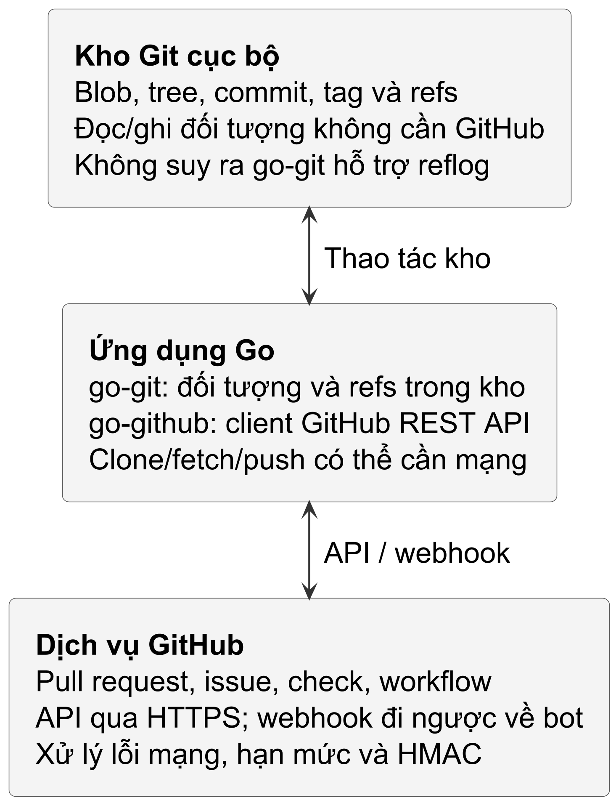
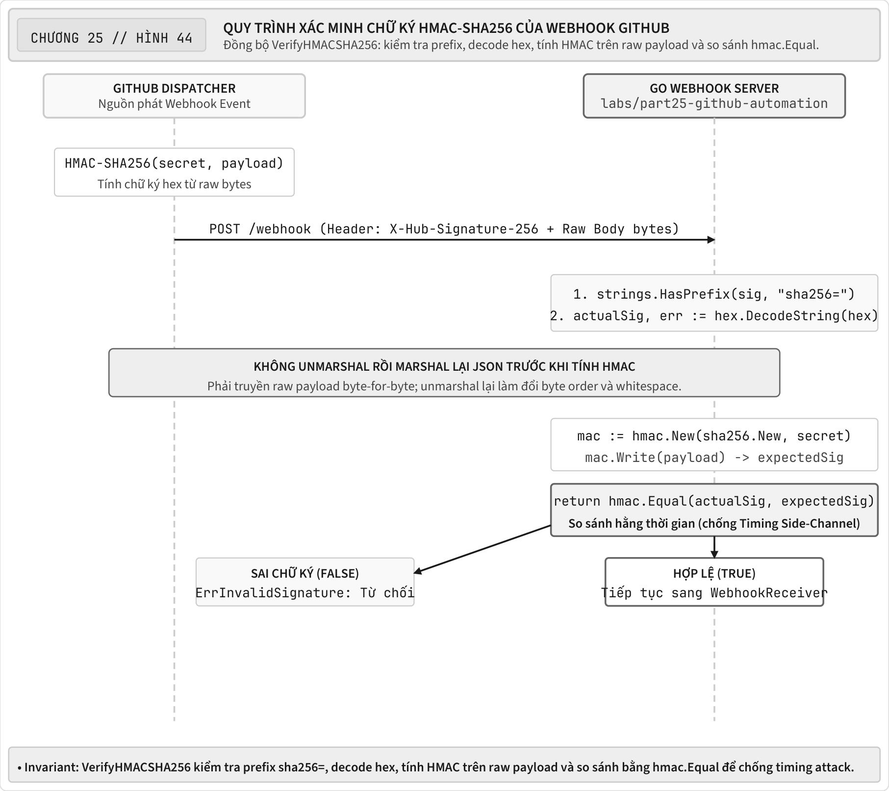
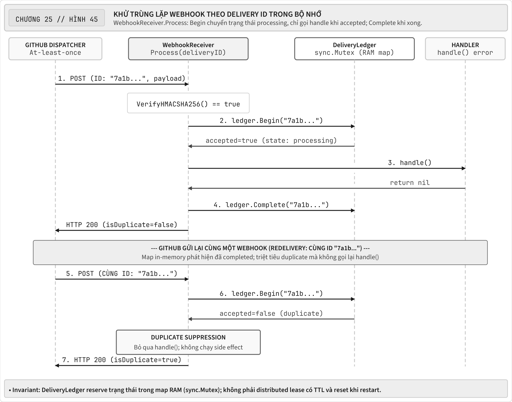

<!-- BOOK_ROLE: APPLICATION_SYSTEMS -->

# Chương 25 — Git và GitHub dưới góc nhìn của một hệ thống tự động hóa

Trong quy trình vận hành dựa trên Git (GitOps), Git là nguồn khai báo trạng thái mong muốn (*desired state*). Tuy nhiên, nó không bao quát toàn bộ trạng thái thực tế trên môi trường vận hành: cơ sở dữ liệu, các chuỗi bí mật nằm ngoài kho mã nguồn, trạng thái của bộ điều khiển và các dữ liệu quan sát đều có chủ thể quản lý riêng biệt. Chương này phân tích cách một chương trình tự động hóa (*bot*) tiếp nhận phiên bản mã nguồn và siêu dữ liệu từ nền tảng GitHub mà không nhầm lẫn giữa hai tầng dữ liệu đó.

Một cam kết mã nguồn được hợp nhất vào nhánh `main` có thể tự động kích hoạt công cụ điều phối triển khai ứng dụng lên cụm Kubernetes. Một nhãn phân loại được gắn vào yêu cầu kéo mã (*Pull Request*) có thể kích hoạt chương trình tự động cấp phát môi trường kiểm thử tạm thời trên hạ tầng đám mây.

Chương này phân tích hai khiếm khuyết thiết kế điển hình qua các ví dụ thực nghiệm: việc đánh đồng đối tượng Git cục bộ với dữ liệu GitHub qua giao diện lập trình, và việc xử lý thông điệp tự động (*webhook*) mà bỏ qua khâu xác thực, khử trùng lặp gửi tin hay khoảng thời gian gián đoạn do tiến trình bị sập đột ngột. Việc thẩm định các ranh giới kỹ thuật này giúp thiết kế hệ thống trở nên vững chắc và tin cậy hơn.

Nội dung chương đi sâu vào bản chất kỹ thuật của Git và nền tảng GitHub dưới lăng kính của một hệ thống hướng sự kiện, từ đó hướng dẫn xây dựng các công cụ tự động hóa chuẩn mực bằng Go.

---

## 1. Hai thế giới: Trạng thái Git cục bộ và Trạng thái GitHub

Câu hỏi trung tâm của chương này là:
> *Vì sao một hệ thống tự động hóa tin cậy phải tách bạch hoàn toàn giữa Trạng thái Git (Local Git State) và Trạng thái GitHub (GitHub Hosted State)?*

@figure Git quản lý object và lịch sử trong kho; GitHub bổ sung các dịch vụ cộng tác có API, quyền truy cập và giới hạn riêng.

### Hai mô hình dữ liệu song hành

Git lưu commit, cây thư mục (`tree`) và khối dữ liệu (`blob`) trong một đồ thị định danh theo nội dung. Đọc object đã có không đòi hỏi mạng. Clone/fetch cần truy cập kho nguồn nhưng nguồn có thể là đường dẫn cục bộ; chỉ transport qua mạng mới cần kết nối tới máy chủ. Siêu dữ liệu GitHub như Pull Request và review không nằm trong cây mã nguồn của commit.

Siêu dữ liệu về Pull Request, nhãn phân loại và đánh giá xét duyệt không nằm trong cây Git của commit. Bài thực hành sử dụng `go-github/v92` cho REST API và `go-git/v5` cho đối tượng Git cục bộ. Một bot chỉ cần dùng một trong hai thư viện cũng hoàn toàn hợp lệ; hãy lựa chọn dựa trên dữ liệu và thao tác thực tế cần xử lý.

---

## 2. Bảo mật Webhook: Phòng ngừa Timing Side-Channel bằng HMAC-SHA256

Khi GitHub gửi một sự kiện (ví dụ `pull_request.opened`) đến máy chủ qua HTTP Webhook, làm sao ta biết chắc chắn thông điệp này thực sự do GitHub phát ra chứ không phải do một kẻ xấu giả mạo?

GitHub thực hiện ký toàn bộ nội dung thô của gói tin (*raw payload*) bằng chuỗi khóa bí mật thông qua thuật toán HMAC-SHA256, sau đó đính kèm vào tiêu đề yêu cầu:
`X-Hub-Signature-256: sha256=<hex_digest>`

@figure Máy chủ tính toán chữ ký từ chính phần thân dữ liệu thô nhận được rồi so sánh với giá trị tiêu đề. Tuyệt đối không giải mã và tuần tự hóa lại dữ liệu JSON trước khi kiểm tra chữ ký.

### Rủi ro rò rỉ thông tin qua thời gian thực thi (Timing Side-Channel)

Nếu ta dùng toán tử thông thường để so sánh chữ ký:

~~~go
// CẢNH BÁO: Rò rỉ thông tin qua thời gian thực thi!
if actualSig == expectedSig { /* so sánh sai */ }
~~~

Toán tử so sánh chuỗi hoặc mảng byte mặc định trong hầu hết ngôn ngữ lập trình thường kết thúc sớm (early exit) ngay khi phát hiện byte không trùng khớp đầu tiên. Sự chênh lệch thời gian xử lý này vô tình tạo ra một kênh phụ (side-channel). Dù độ trễ biến thiên trên mạng Internet công cộng có thể làm nhiễu tín hiệu đo đạc, trong các môi trường nội bộ, mạng cục bộ tốc độ cao hoặc qua phương pháp phân tích thống kê trên lượng mẫu thử lớn, việc so sánh không hằng số thời gian vẫn có thể cung cấp manh mối để kẻ tấn công thu hẹp không gian tìm kiếm mã xác thực.

### So sánh chữ ký an toàn với crypto/hmac.Equal hoặc crypto/subtle

Trong Go, ta bắt buộc phải dùng hàm `hmac.Equal` hoặc `subtle.ConstantTimeCompare`:

~~~go
func VerifyHMACSHA256(
	payload []byte, signatureHeader string, secret []byte,
) bool {
	if len(secret) == 0 ||
		!strings.HasPrefix(signatureHeader, "sha256=") {
		return false
	}
	actualHex := strings.TrimPrefix(signatureHeader, "sha256=")
	actualSig, err := hex.DecodeString(actualHex)
	if err != nil {
		return false
	}

	mac := hmac.New(sha256.New, secret)
	mac.Write(payload)
	expectedSig := mac.Sum(nil)

	// So sánh hằng số thời gian (constant-time)
	return hmac.Equal(actualSig, expectedSig)
}
~~~

Hàm `hmac.Equal` thực hiện so sánh hai mã xác thực thông điệp mà không làm rò rỉ nội dung qua thời gian tính toán theo đúng khế ước kỹ thuật. Cơ chế này không chứng minh toàn bộ điểm cuối đạt thời gian thực thi hằng số hay loại bỏ mọi kênh rò rỉ phụ; bên gọi vẫn bắt buộc phải giới hạn kích thước tải trọng, xác thực chữ ký và bảo vệ chuỗi bí mật cẩn trọng.

---

## 3. Khế ước phân tán: Delivery ID và Tính Lũy Đẳng

Trong kiến trúc tích hợp webhook, một ngộ nhận phổ biến là cho rằng GitHub sẽ tự động thử lại mỗi khi máy chủ tiếp nhận trả về mã lỗi 5xx hoặc gặp sự cố quá thời gian chờ (timeout). Đối với các cấu hình webhook tiêu chuẩn, GitHub không tự động phát lại sự kiện khi điểm cuối tiếp nhận gặp lỗi. Việc gửi lại sự kiện chỉ diễn ra khi có thao tác kích hoạt thủ công từ người quản trị qua giao diện, lời gọi REST API từ mã nguồn tự động hóa, hoặc các công cụ nội bộ. Khi một lượt chuyển giao được kích hoạt lại, GitHub sẽ giữ nguyên giá trị định danh GUID trong tiêu đề `X-GitHub-Delivery`.

Mỗi lần phát sự kiện, GitHub đính kèm một mã UUID duy nhất tại header:
`X-GitHub-Delivery: 7a1b2c3d-4e5f-6a7b-8c9d-0e1f2a3b4c5d`

@figure Bài thực hành nhận diện cùng một mã Delivery ID để tránh lặp lại tác dụng phụ trong luồng chạy được kiểm thử. Việc lưu trữ bền vững, xử lý sự cố dừng đột ngột và các lượt gửi tin đồng thời đòi hỏi chính sách và cơ chế riêng biệt.

Mã Delivery ID giúp nhận diện cùng một lượt gửi tin khi được phát lại. Tiêu đề này không nằm trong nội dung tải trọng được thuật toán HMAC ký, do đó riêng việc lưu giữ ID chưa đủ để ngăn chặn tấn công phát lại nếu kẻ tấn công giữ tải trọng và chữ ký hợp lệ rồi thay đổi ID. Sau bước xác thực, hệ thống cần ràng buộc chặt chẽ sự kiện, kho lưu trữ và định danh thao tác nghiệp vụ; trạng thái xử lý phải được lưu trữ bền vững nếu muốn bảo toàn kết quả qua các lần khởi động lại.

Mã Delivery ID chỉ giúp khử trùng lặp một lần chuyển giao; nó không tự biến thành khóa lũy đẳng của nghiệp vụ (như thao tác “triển khai commit X vào môi trường Y”). Hệ thống cần một máy trạng thái tối thiểu `processing → completed`: các lượt gửi lại trong lúc đang xử lý phải được giữ lại, lượt thực thi thất bại phải được đánh dấu lỗi để cho phép thử lại, và chỉ lượt đã hoàn tất mới được ngăn chặn thực thi lặp lại. Các thao tác biến đổi trạng thái nghiệp vụ đòi hỏi khóa thao tác riêng biệt, và trên môi trường sản xuất, cần kho dữ liệu phân tán bền vững có thời hạn tồn tại (TTL). Bài thực hành lưu giữ sổ ghi nhận trong bộ nhớ tạm (RAM), do đó các cam kết chỉ có hiệu lực trong vòng đời của tiến trình.

Trên môi trường production thực tế, một hệ thống tự động hóa chịu lỗi đòi hỏi phải kết hợp một trong các cơ chế sau:

Một là, kho lưu trữ phân tán bền vững: Lưu trữ mã định danh chuyển giao vào kho dữ liệu phân tán có cơ chế hết hạn theo thời gian (như Redis hoặc DynamoDB).

Hai là, áp dụng ràng buộc duy nhất trong cơ sở dữ liệu: Ghi nhận mã định danh chuyển giao vào bảng sự kiện với ràng buộc khóa duy nhất trong cùng một giao dịch xử lý nghiệp vụ.

Ba là, thiết lập định danh thao tác nghiệp vụ: Tạo mã định danh lũy đẳng gắn chặt với trạng thái cụ thể của tài nguyên đích thay vì chỉ dựa vào sự kiện chuyển giao của giao thức mạng.

Bốn là, thiết kế các thao tác biến đổi trạng thái có tính lũy đẳng dựa trên định danh và trạng thái quan sát thực tế. Việc khai báo trạng thái mong muốn giúp xác định đích đến nhưng không tự động biến mọi thao tác tạo mới hay xóa bỏ thành lũy đẳng; các tiền điều kiện, quyền sở hữu và chính sách thử lại sau thất bại cục bộ vẫn cần được thiết kế chặt chẽ như đã phân tích ở các Chương 21 đến Chương 23.

Thiết kế bộ tiếp nhận có kiểm tra trùng lặp trong bộ nhớ:

~~~go
type WebhookReceiver struct {
	secret []byte
	ledger *DeliveryLedger
}

func (r *WebhookReceiver) Process(
	deliveryID, signature string,
	payload []byte,
	handle func() error,
) (bool, error) {
	if deliveryID == "" {
		return false, ErrMissingDelivery
	}
	if !VerifyHMACSHA256(payload, signature, r.secret) {
		return false, ErrInvalidSignature
	}
	if handle == nil {
		return false, errors.New("webhook handler is required")
	}
	if _, accepted := r.ledger.Begin(deliveryID); !accepted {
		return true, nil
	}
	if err := handle(); err != nil {
		r.ledger.Fail(deliveryID)
		return false, err
	}
	r.ledger.Complete(deliveryID)
	return false, nil
}
~~~

Thao tác `Complete` diễn ra sau khi hàm xử lý `handle` hoàn tất; nếu phát sinh lỗi, hệ thống sẽ giải phóng lượt đặt chỗ để cho phép thử lại. Khi tiến trình còn đang hoạt động, sổ ghi nhận của bài thực hành ngăn chặn việc chuyển giao đồng thời hoặc việc chạy lại hàm xử lý với các lượt đã hoàn thành. Môi trường thực tế đòi hỏi trạng thái lưu trữ bền vững, cơ chế giành quyền nguyên tử và quy trình phục hồi sự cố; một thời hạn thuê đơn lẻ không thể che lấp khoảng thời gian tiến trình bị sập đột ngột giữa lúc phát sinh hiệu ứng phụ ngoài cơ sở dữ liệu và thời điểm ghi nhận trạng thái hoàn tất.

---

### Sổ ghi nhận trong bộ nhớ không tồn tại qua lần khởi động lại

Giữ nguyên bài thực hành webhook ở trên để kiểm tra thuật toán HMAC và sự cạnh tranh trong một tiến trình duy nhất. Bây giờ hãy đưa tình huống này qua ranh giới lỗi từng phân tích ở Chương 13: hàm xử lý đã tạo ra một thay đổi, nhưng tiến trình đột ngột tắt trước khi kịp gọi `Complete`. Sau khi khởi động lại, sổ ghi nhận trong bộ nhớ hoàn toàn trống rỗng; một lượt chuyển giao giống hệt có thể vượt qua cổng kiểm soát thêm một lần nữa. Đây không phải là khiếm khuyết của khóa đồng bộ hay chữ ký số HMAC. Khóa bảo vệ trạng thái đang vận hành, còn chữ ký xác nhận tính toàn vẹn của gói tin; không công cụ nào có khả năng lưu giữ cam kết nghiệp vụ sau khi tiến trình biến mất.

Trong bài thực hành hàng đợi gửi đi của Chương 13, mã `credit-001` là định danh thao tác nghiệp vụ, không tự động kế thừa từ mã chuyển giao của tầng truyền vận. Khi tiếp nhận thông điệp, trước hết phải xác thực tải trọng và ánh xạ nó sang thao tác nghiệp vụ được ứng dụng cho phép. Một mã chuyển giao mới cho cùng một thao tác nghiệp vụ tuyệt đối không được phép sinh ra hiệu ứng phụ mới; ngược lại, hai thao tác khác nhau không được gộp chung chỉ vì vô tình có cùng nội dung dữ liệu. Việc ánh xạ này là chính sách xử lý của chương trình tự động, chưa được các bộ thử nghiệm cũ chứng minh.

Hãy tự thiết lập bảng gồm ba điểm kiểm tra trong `TestRecoveryWindows`, sau đó thực thi ca kiểm thử. Tại điểm kiểm tra sau khi gửi, phía tiếp nhận đã lưu giao dịch thành công trong khi phía gửi vẫn ở trạng thái chờ. Lượt gửi lại mới bắt buộc phải có khả năng xử lý việc gửi trùng lặp. Bài kiểm thử `TestSendRetryAndReceiverConflict` kiểm tra hai lượt gửi và xác nhận chỉ một hiệu ứng duy nhất được ghi nhận, đồng thời chủ động từ chối dữ liệu xung đột ở phía tiếp nhận. Bằng chứng này sử dụng hai cơ sở dữ liệu cục bộ và bên gửi gọi trực tiếp bên nhận; nó không khẳng định nền tảng GitHub cung cấp một khế ước lũy đẳng tương đương cho mọi điểm cuối API.

Một chương trình tự động hóa thực tế cần lựa chọn các hiệu ứng phụ có khả năng lặp lại an toàn, đọc lại trạng thái dựa trên định danh ổn định hoặc tận dụng cơ chế lũy đẳng của giao diện lập trình thực tế. Nếu một yêu cầu tạo bình luận gặp sự cố quá thời hạn sau khi máy chủ đã xử lý, không thể suy đoán ngây thơ rằng “gặp lỗi nên cứ gửi lại”. Hàng đợi gửi đi chỉ lưu giữ các công việc chưa được xác nhận, không thể biến kết nối mạng thành một giao dịch nguyên tử. Chính sách thử lại đòi hỏi ngân sách thời gian, độ trễ lùi, giới hạn số lần và phương án đối soát; bài thực hành này chỉ kích hoạt thử lại do người vận hành hoặc ca kiểm thử yêu cầu, tuyệt đối không bổ sung vòng lặp thử lại vô hạn chạy ngầm.

## 4. Quản trị Rate Limit: Primary và Secondary

Khi chương trình tự động gọi giao diện lập trình của GitHub, hạn ngạch tốc độ là một định mức tài nguyên bắt buộc phải quan sát. Nó không phải là rủi ro duy nhất trên môi trường thực tế và không phải lúc nào cũng là điểm nghẽn lớn nhất:

Tuyệt đối không xem “5.000 requests/giờ” là con số phổ quát cố định. GitHub áp dụng hạn mức phân cấp tùy theo loại định danh và ngữ cảnh ủy quyền:

| Loại định danh (Authentication Context) | Hạn mức Primary Quota | Dấu hiệu nhận diện |
| :--- | :--- | :--- |
| **Chưa xác thực (Unauthenticated)** | 60 requests/giờ (tính theo địa chỉ IP) | Dễ bị nghẽn trong môi trường NAT/CI chung |
| **PAT / OAuth User** | Mức cơ bản 5.000 request/giờ theo user; app Enterprise đủ điều kiện có mức cao hơn. | Đọc X-RateLimit-Limit của response. |
| **GitHub App user access token** | Chung quota theo user; app thuộc Enterprise Cloud đủ điều kiện có thể là 15.000/giờ. | Không coi mỗi app là một quota user độc lập. |
| **GitHub App: Installation (Non-Enterprise)** | Base 5.000 req/h; nếu repos > 20: +50/h/repo; nếu org users > 20: +50/h/user; trần tối đa 12.500 req/h | Phù hợp nhất cho bot tự động hóa cấp tổ chức |
| **GitHub App: Enterprise Cloud Installation** | Trần tối đa 15.000 requests/giờ | Áp dụng cho tổ chức trên GitHub Enterprise Cloud |
| **GITHUB_TOKEN trong GitHub Actions** | 1.000 requests/giờ cho mỗi repository (hoặc Enterprise rate nếu resource thuộc Enterprise Cloud) | Áp dụng cho runner tiêu chuẩn trong GitHub Actions |
| **GitHub Enterprise Server (On-Premises)** | Cấu hình độc lập bởi quản trị viên hệ thống | Tùy biến theo chính sách triển khai tự lưu trữ |

Bên cạnh hạn ngạch cơ bản, GitHub còn áp dụng hạn ngạch thứ cấp, ví dụ như giới hạn số yêu cầu đồng thời hoặc tốc độ tạo nội dung mới. Khi vượt quá ngưỡng này, phản hồi trả về có thể là mã `403` hoặc `429`. Nếu phản hồi có tiêu đề `Retry-After`, hệ thống bắt buộc phải chờ đợi ít nhất khoảng thời gian đó; tiêu đề này không được cam kết sẽ luôn hiện diện. Khi thiếu tiêu đề trên, cần phân tích thông báo lỗi cùng các tiêu đề hạn ngạch khác, sau đó áp dụng ngân sách chờ đợi và thử lại theo tài liệu hướng dẫn, tuyệt đối không lặp lại yêu cầu tức thì.

### Thuật toán bóc tách Rate Limit trong Go

~~~go
func ParseRateLimit(
	header http.Header, now time.Time,
) RateLimitStatus {
	status := RateLimitStatus{}
	if limit, err := strconv.Atoi(
		header.Get("X-RateLimit-Limit")); err == nil {
		status.Limit = limit
	}

	remStr := header.Get("X-RateLimit-Remaining")
	if remStr != "" {
		if rem, err := strconv.Atoi(remStr); err == nil {
			status.Remaining = rem
			if rem == 0 {
				status.IsExhausted = true
			}
		}
	}

	resetStr := header.Get("X-RateLimit-Reset")
	if resetStr != "" {
		epoch, err := strconv.ParseInt(resetStr, 10, 64)
		if err == nil {
			status.ResetAt = time.Unix(epoch, 0)
			if status.IsExhausted && status.ResetAt.After(now) {
				status.RetryAfter = status.ResetAt.Sub(now)
			}
		}
	}

	// Secondary rate limit dùng header Retry-After
	retryStr := header.Get("Retry-After")
	if retryStr != "" {
		sec, err := strconv.ParseInt(retryStr, 10, 64)
		if err == nil && sec >= 0 {
			delay := time.Duration(math.MaxInt64)
			if sec <= math.MaxInt64/int64(time.Second) {
				delay = time.Duration(sec) * time.Second
			}
			if delay > status.RetryAfter {
				status.RetryAfter = delay
			}
			status.IsExhausted = true
		}
	}
	return status
}
~~~

Lab đọc `Retry-After` dạng số giây theo hướng dẫn GitHub, bỏ qua giá trị âm/sai định dạng và bão hòa nếu duration không biểu diễn được. Khi đồng thời có primary reset và Retry-After, giữ khoảng chờ dài hơn; không ghi đè ngân sách một giờ thành một giây. Đây là parser metadata, không phải bộ cho phép retry: thiếu header không chứng minh còn quota, và dạng HTTP-date chưa được hỗ trợ. Caller vẫn phải đọc status/thông báo lỗi và chọn policy chờ theo API.

---

## 5. Tương tác GitHub API (`go-github/v92`) và Git trên bộ nhớ (`go-git/v5`)

Một công cụ tự động hóa toàn diện cần tương tác đồng thời với cả hai thế giới: giao tiếp với GitHub API thông qua thư viện `go-github/v92` do Google duy trì để truy xuất siêu dữ liệu, và thao tác cây thư mục Git cục bộ thông qua `go-git/v5`.

### Tích hợp GitHub Client

Trong gói `labs/part25-github-automation/github_client.go`, ta đóng gói `github.Client` để hỗ trợ cấu hình linh hoạt endpoint mạng (cho phép trỏ tới máy chủ kiểm thử cục bộ `httptest.Server` hoặc máy chủ GitHub Enterprise):

~~~go
type GitHubClient struct {
	client *github.Client
}

func NewGitHubClient(
	httpClient *http.Client, baseURL string,
) (*GitHubClient, error) {
	var opts []github.ClientOptionsFunc
	if httpClient != nil {
		opts = append(opts, github.WithHTTPClient(httpClient))
	}
	if baseURL != "" {
		if !strings.HasSuffix(baseURL, "/") {
			baseURL += "/"
		}
		opts = append(opts, github.WithURLs(&baseURL, nil))
	}
	gh, err := github.NewClient(opts...)
	if err != nil {
		return nil, fmt.Errorf("bad client options: %w", err)
	}
	return &GitHubClient{client: gh}, nil
}

func (c *GitHubClient) GetRepository(
	ctx context.Context, owner, repo string,
) (*github.Repository, *github.Rate, error) {
	repository, resp, err := c.client.Repositories.Get(
		ctx, owner, repo,
	)
	if err != nil {
		return nil, nil, err
	}
	var rate *github.Rate
	if resp != nil {
		rate = &resp.Rate
	}
	return repository, rate, nil
}
~~~

### Thao tác Git trên bộ nhớ (In-memory Git) với go-git

Việc gọi trực tiếp công cụ dòng lệnh Git tạo ra sự phụ thuộc vào tệp thực thi bên ngoài và vòng đời của tiến trình con; thư mục làm việc đòi hỏi quyền sở hữu riêng biệt nếu vận hành đồng thời. Thư viện `go-git` là một giải pháp thay thế: ví dụ này sử dụng `memory.NewStorage()` cho kho lưu trữ đối tượng và `memfs.New()` cho cây thư mục làm việc trong bộ nhớ, không khẳng định rằng mọi trường hợp sử dụng dòng lệnh đều phát sinh xung đột:

~~~go
func NewInMemGitRepository() (*InMemGitRepository, error) {
	fs := memfs.New()
	storer := memory.NewStorage()

	repo, err := git.Init(storer, fs)
	if err != nil {
		return nil, fmt.Errorf("lỗi init git mem: %w", err)
	}

	return &InMemGitRepository{repo: repo, fs: fs}, nil
}
~~~

Ghi file và tạo commit với chữ ký tác giả trong bộ nhớ:

~~~go
func (r *InMemGitRepository) WriteFileAndCommit(
	filePath string, content []byte, author, msg string,
) (string, error) {
	wt, err := r.repo.Worktree()
	if err != nil {
		return "", err
	}

	f, err := r.fs.Create(filePath)
	if err != nil {
		return "", err
	}
	n, err := f.Write(content)
	if err == nil && n != len(content) {
		err = io.ErrShortWrite
	}
	if err != nil {
		_ = f.Close()
		return "", err
	}
	if err := f.Close(); err != nil {
		return "", err
	}

	if _, err := wt.Add(filePath); err != nil {
		return "", err
	}

	hash, err := wt.Commit(msg, &git.CommitOptions{
		Author: &object.Signature{
			Name:  author,
			Email: author + "@bot.local",
			When:  time.Now(),
		},
	})
	if err != nil {
		return "", err
	}
	return hash.String(), nil
}
~~~

Với các cấu trúc `memory.NewStorage()` và `memfs` của ví dụ, đối tượng Git và cây làm việc không được chủ động ghi xuống hệ thống tệp đĩa cứng. Thao tác tính mã băm, cấp phát bộ nhớ và thu gom rác vẫn phát sinh chi phí nhất định; hệ điều hành vẫn có thể hoán đổi bộ nhớ ra đĩa, vì vậy không thể suy đoán rằng “không có một byte nào chạm tới đĩa vật lý” hay cam kết một mức độ trễ cố định chỉ từ cấu hình chạy trong bộ nhớ.

---

## 6. Bằng chứng kiểm thử: Chứng minh 5 quy luật tự động hóa

Các bài kiểm thử trong `labs/part25-github-automation/` kiểm tra các trường hợp xác thực HMAC, sổ ghi nhận, bộ phân tích hạn ngạch và thao tác Git trong bộ nhớ; bộ thử nghiệm HTTP kiểm tra luồng sử dụng thư viện `go-github`. Chúng không chứng minh nền tảng GitHub thật luôn chuyển giao thành công, không loại bỏ nguy cơ tấn công phát lại khi kẻ xấu thay đổi mã tiêu đề, và không cam kết mọi kịch bản sự cố tiến trình đều an toàn:

~~~
=== RUN   TestWebhookHMACVerification
--- PASS: TestWebhookHMACVerification (0.00s)
=== RUN   TestWebhookDeliveryIdempotency
--- PASS: TestWebhookDeliveryIdempotency (0.00s)
=== RUN   TestRateLimitParsingPrimaryAndSecondary
--- PASS: TestRateLimitParsingPrimaryAndSecondary (0.00s)
=== RUN   TestInMemGitCommitAndHead
--- PASS: TestInMemGitCommitAndHead (0.00s)
=== RUN   TestGitHubClientIntegrationWithMockServer
--- PASS: TestGitHubClientIntegrationWithMockServer (0.00s)
PASS
ok      part25-github-automation   0.263s
~~~

### 1. Xác thực chữ ký an toàn (TestWebhookHMACVerification)
Kiểm chứng 4 ca biên: chữ ký đúng định dạng `sha256=` với secret hợp lệ; từ chối khi sửa đổi 1 byte trong payload; từ chối khi dùng sai Webhook Secret; và từ chối khi header sai định dạng.

### 2. Khử trùng lặp sự kiện (TestWebhookDeliveryIdempotency)
Gửi 2 webhook mang cùng một `X-GitHub-Delivery`. Lần đầu tiên xử lý thành công (`isDuplicate = false`). Lần thứ hai được nhận diện chính xác là sự kiện gửi lặp (`isDuplicate = true`), bảo vệ hệ thống không bị kích hoạt kép khi có redelivery từ UI hoặc qua REST API.

### 3. Bóc tách Rate Limit hai tầng (TestRateLimitParsingPrimaryAndSecondary)
Kiểm chứng cả hai tình huống: khi chạm trần Primary Quota (`Remaining: 0`), tính đúng thời gian cần chờ đến mốc `ResetAt`; khi chạm trần Secondary Quota (`Retry-After: 120`), chuyển đổi chính xác thành khoảng chờ 120 giây.

### 4. Vận hành Git trên RAM (TestInMemGitCommitAndHead)
Tạo liên tiếp 2 commit trong bộ nhớ RAM, kiểm tra mã băm SHA của commit thứ nhất và thứ hai, xác nhận con trỏ HEAD dịch chuyển chuẩn xác theo đồ thị DAG.

### 5. Tương tác GitHub Client (TestGitHubClientIntegrationWithMockServer)
Kiểm chứng việc khởi tạo client `google/go-github/v92`, định tuyến qua máy chủ giả lập `httptest.Server`, trích xuất chính xác cấu trúc repository và thông tin hạn mức `Rate` từ tiêu đề phản hồi.

---

## 7. Các cạm bẫy người học thường gặp (Learner Pitfalls)

| Cạm bẫy thực tế | Hậu quả trên Production | Giải pháp phòng ngừa |
| :--- | :--- | :--- |
| **So sánh chữ ký bằng ==** thay vì `hmac.Equal`. | Rò rỉ thông tin qua thời gian thực thi (timing side-channel). | Dùng `crypto/hmac.Equal` hoặc `crypto/subtle.ConstantTimeCompare`. |
| **Bỏ qua X-GitHub-Delivery** và xử lý mù quáng mọi webhook. | Gây trùng lặp hành vi (tạo 2 PR, merge 2 lần) khi có redelivery từ UI hoặc qua REST API. | Lưu `X-GitHub-Delivery` vào bộ đệm và bỏ qua các sự kiện trùng lặp. |
| **Gọi API dồn mà không quan sát quota.** | Có thể cạn primary hoặc secondary budget theo token/endpoint thực tế. | Đọc rate-limit headers; chọn budget chờ/retry theo workload. Mốc Remaining dưới 50 chỉ là ví dụ policy, không phải ngưỡng an toàn chung. |
| **Dùng thư mục tạm chung không có ownership/cleanup.** | Có thể xung đột hoặc để lại dữ liệu nhạy cảm. | Dùng thư mục riêng và cleanup rõ, hoặc memory storage khi kích thước và lifecycle phù hợp; RAM không tự là ranh giới bảo mật. |

---

## 8. Bài tập thực hành thiết kế Bot Tự động hóa

### Thử thách 1: Lọc sự kiện theo nhánh (Branch Filtering Middleware)
*Yêu cầu kỹ thuật:* Một webhook `push` được gửi tới mỗi khi có commit mới. Hãy viết hàm lọc sự kiện chỉ cho phép xử lý nếu sự kiện nhắm vào nhánh `refs/heads/main`. Bỏ qua tất cả các sự kiện của nhánh tính năng (`feature/*`) mà không kích hoạt quy trình triển khai.

### Thử thách 2: Bộ điều tốc thông minh (Smart Backoff with Jitter)
*Yêu cầu kỹ thuật:* Với fixture `Retry-After: 30`, tính thời gian chờ ít nhất 30 giây rồi thêm jitter 10–25%. Nếu nhiều worker cùng chờ, jitter có thể giảm nhịp gửi đồng loạt, không bảo đảm tránh secondary limit. Các tỷ lệ này là cấu hình bài tập, không phải ngưỡng GitHub hay security policy production.

---

## 9. Hướng dẫn giải và Phân tích kiến trúc bài tập

### Lời giải Thử thách 1: Lọc sự kiện theo nhánh đích

~~~go
type PushPayload struct {
	Ref string `json:"ref"`
}

func ShouldDeployFromWebhook(payload []byte) bool {
	var push PushPayload
	if err := json.Unmarshal(payload, &push); err != nil {
		return false
	}

	// Chỉ kích hoạt tự động hóa trên nhánh chính (main)
	return push.Ref == "refs/heads/main"
}
~~~

Đây chỉ là bộ lọc tối thiểu phục vụ bài học đọc dữ liệu tải trọng, không phải chính sách áp dụng trên môi trường vận hành thực tế. Điểm cuối tiếp nhận thực tế bắt buộc phải xác thực chữ ký trước khi phân tích cú pháp, thiết lập danh sách cho phép cho cả tên sự kiện, hành động cụ thể, kho mã nguồn, chủ sở hữu, mã cài đặt ứng dụng và nhánh tham chiếu; sau đó liên kết chặt chẽ các giá trị đó với cấu hình triển khai. Việc chỉ kiểm tra nhánh `ref` đơn thuần sẽ tạo kẽ hở cho phép một kho lưu trữ hoặc lượt cài đặt nằm ngoài phạm vi kích hoạt các hành động nhạy cảm.

### Lời giải Thử thách 2: Tính toán Backoff kết hợp Jitter

~~~go
func CalculateBackoffWithJitter(
	baseDelay time.Duration,
	next func() float64,
) (time.Duration, error) {
	if baseDelay < 0 {
		return 0, errors.New("negative base backoff")
	}
	if next == nil {
		return 0, errors.New("jitter source is required")
	}
	value := next() // contract: 0 <= value < 1
	if math.IsNaN(value) || value < 0 || value >= 1 {
		return 0, errors.New("invalid jitter value")
	}
	fraction := 0.10 + value*0.15
	jitter := time.Duration(float64(baseDelay) * fraction)
	if baseDelay > time.Duration(math.MaxInt64)-jitter {
		return 0, errors.New("backoff duration overflows")
	}
	return baseDelay + jitter, nil
}
~~~

Độ trễ ngẫu nhiên chỉ làm giảm mức độ tương quan giữa các yêu cầu, không thể triệt tiêu hoàn toàn các đợt bùng nổ tải. Hàm xử lý tiếp nhận nguồn sinh số ngẫu nhiên qua cơ chế tiêm phụ thuộc; môi trường thực tế có thể sử dụng bộ sinh số ngẫu nhiên an toàn hoặc đối tượng sinh số có chủ thể quản lý riêng, trong khi bài kiểm thử truyền vào giá trị cố định để bảo đảm khả năng tái lập. Tuyệt đối không sử dụng bộ sinh số ngẫu nhiên toàn cục như một khế ước ngầm định.

---

Nắm vững cách vận hành kết hợp giữa xác thực HMAC-SHA256, tính lũy đẳng trong chuyển giao thông điệp, cơ chế gọi giao diện lập trình có kiểm soát hạn ngạch và thư viện Git vận hành trong bộ nhớ giúp xây dựng các hệ thống tự động hóa an toàn và vững chắc. Trong Chương 26, chúng ta sẽ mở rộng năng lực bảo vệ phần mềm lên cấp độ chuỗi cung ứng: thiết lập cổng kiểm soát chuỗi cung ứng phần mềm có thể kiểm chứng bằng Go với chữ ký số Cosign không cần khóa, mã băm bản kê OCI bất biến và công cụ quét lỗ hổng mã nguồn `govulncheck`.
