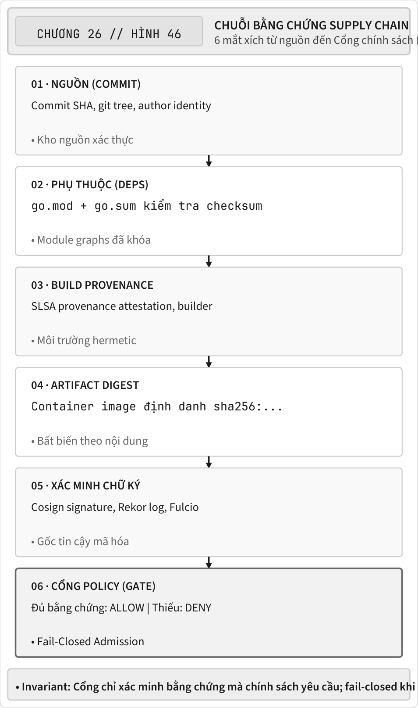
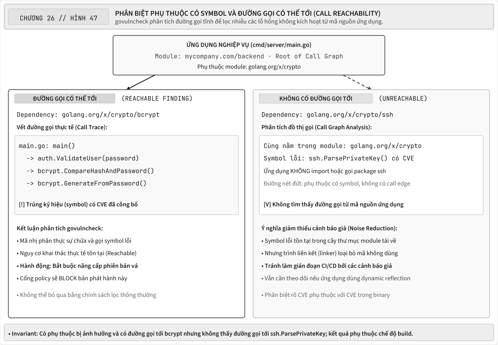
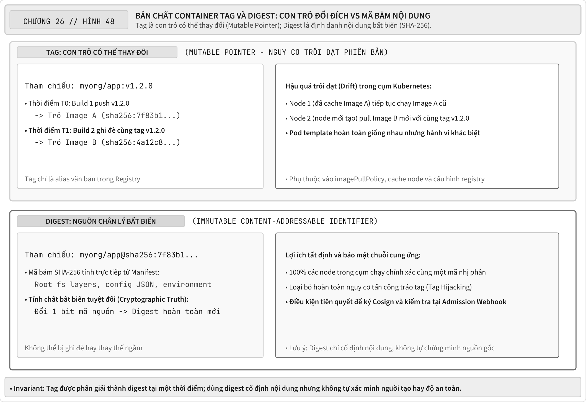

<!-- BOOK_ROLE: APPLICATION_SYSTEMS -->

# Chương 26 — Chuỗi cung ứng phần mềm có thể kiểm chứng

Một kịch bản chuỗi cung ứng phần mềm điển hình có thể bao gồm mã nguồn nghiệp vụ, nhiều module phụ thuộc gián tiếp và ảnh nền container (base image) chứa sẵn các gói cài đặt của hệ điều hành. Số lượng thành phần thực tế phụ thuộc vào phương thức đóng gói: một ảnh nền tối giản `scratch` và một ảnh nền hệ điều hành đầy đủ có tập hợp gói phần mềm hoàn toàn khác nhau. Vì vậy danh mục thành phần (inventory) phải được kết xuất trực tiếp từ artifact thực tế, không thể ước lượng cảm tính từ số dòng mã nguồn Go của ứng dụng.

Thực tế này mở rộng bề mặt rủi ro của chuỗi cung ứng phần mềm (software supply chain).

Các sự cố an ninh thực tế như SolarWinds, Codecov hay các cuộc tấn công nhầm lẫn phụ thuộc (dependency confusion) và giả mạo định danh gói (typosquatting) chứng minh một ranh giới bảo mật quan trọng:
> *Một kho mã nguồn sạch, được duyệt kỹ lưỡng và vượt qua mọi bài kiểm thử đơn vị, vẫn có thể tạo ra một container image độc hại nếu quy trình đóng gói, gói phụ thuộc hoặc kho lưu trữ artifact bị xâm phạm.*

Ta cần kiểm tra ảnh container nào đã được xét, bằng chứng nào gắn nó với bộ dựng hoặc nguồn mã được phép, và phát hiện lỗ hổng nào phải chặn theo chính sách kiểm soát. Chữ ký và việc quét mã không chứng minh gói phát hành hoàn toàn sạch mã độc hay lỗ hổng; từng bộ kiểm chứng chỉ đưa ra kết luận trong phạm vi dữ liệu và gốc tin cậy của nó.

Chương này dùng một cổng chính sách Go để học nguyên tắc fail-closed: từ chối khi không xác minh được bằng chứng mà chính sách yêu cầu. Lab kiểm tra định dạng digest, chữ ký ECDSA cục bộ và dữ liệu mẫu về xuất xứ, lỗ hổng. Nó không tích hợp xác minh Cosign, không chạy `govulncheck` và không chứng nhận một quy trình đạt SLSA Build L3. Cấp độ SLSA còn đòi bằng chứng về nền tảng dựng và cách bảo vệ provenance; một chuỗi `BuilderID` hay test xanh không đáp ứng những yêu cầu đó.

---

## 1. Mental Model: Chuỗi bảo chứng từ Mã nguồn đến Triển khai

Sơ đồ là thiết kế tham chiếu gồm sáu chặng, không phải những tích hợp lab đã chạy. Chữ ký cần gắn với khóa và định danh đã xác thực; provenance cần gắn với artifact thực. Cổng phải đối chiếu bằng chứng với chính sách của mình, không chỉ kiểm tra có một tệp mang tên “attestation”:

@figure Cổng chỉ xác minh các bằng chứng mà chính sách yêu cầu. Mã băm nội dung, chữ ký và dữ liệu xuất xứ có vai trò khác nhau; đủ bằng chứng theo chính sách không chứng minh gói phát hành sạch mọi lỗi hoặc lỗ hổng.

Mỗi mắt xích cần bằng chứng phù hợp, nhưng không một tệp hay nhãn nào tự chứng minh toàn bộ chuỗi. `go.sum` ghi mã băm kiểm tra (*checksum*) module mà bộ công cụ biên dịch đã biết và kiểm tra, chứ không khóa hoàn toàn đồ thị như tệp khóa phiên bản. Dữ liệu xuất xứ (*provenance*) chỉ hữu ích sau khi bộ kiểm chứng xác minh đối tượng, danh tính và kỳ vọng của chính sách. Mã băm nhận diện nội dung; cơ chế xác minh không khóa (*keyless verification*) của Cosign còn kiểm tra gốc tin cậy, định danh chứng chỉ và khẳng định mã băm. Bài lab dưới đây mô hình hóa chính sách đóng an toàn, không thực hiện các bước Cosign hoặc SLSA hoàn chỉnh đó.

---

## 2. Toàn vẹn Module: `go.sum` và Go Checksum Database

Trước khi ảnh container (`container image`) được đóng gói, chuỗi cung ứng bắt đầu ngay tại thời điểm Go tải các gói phụ thuộc về máy.

### Bản chất kỹ thuật của `go.sum`

Một ngộ nhận kinh điển trong cộng đồng là coi `go.sum` như một tệp khóa phiên bản tương tự `package-lock.json` hay `yarn.lock`. Theo thiết kế, tệp `go.mod` mới là nơi quyết định phiên bản mô-đun thông qua giải thuật lựa chọn phiên bản tối thiểu (Minimal Version Selection - MVS). Ngược lại, `go.sum` là cơ sở dữ liệu xác thực nội dung mật mã (Content Validation Database). Nó lưu trữ các mã băm SHA-256 của toàn bộ mã nguồn mô-đun và tệp `go.mod` tương ứng nhằm phát hiện mọi hành vi can thiệp trái phép hoặc thay đổi nội dung sau thời điểm phát hành chính thức.

Mỗi bản ghi trong `go.sum` được cấu trúc thành hai dòng thông tin bổ trợ:

~~~
github.com/gin-gonic/gin v1.9.1 h1:4A06lVSJ...
github.com/gin-gonic/gin v1.9.1/go.mod h1:h1hp...
~~~

Dòng định dạng `h1:<base64-hash>` chứa chuỗi băm chuẩn tắc của cây thư mục mô-đun (theo giải thuật `dirhash.Hash1`): danh sách đường dẫn tệp được sắp xếp thứ tự, băm SHA-256 từng tệp, ghép thành danh sách định dạng chuẩn tắc rồi băm SHA-256 tổng thể và mã hóa base64. Dòng có hậu tố `/go.mod` lưu trữ mã băm chỉ tính riêng trên nội dung tệp khai báo phụ thuộc của mô-đun đó, cho phép công cụ Go kiểm tra cây phụ thuộc một cách nhanh chóng mà không bắt buộc phải tải toàn bộ mã nguồn của các mô-đun gián tiếp về máy.

### Go Checksum Database (`sum.golang.org`)
Nếu một kẻ xấu xâm nhập được máy chủ Git của một thư viện bên thứ ba và tráo đổi nội dung của release tag `v1.2.0`, điều gì sẽ xảy ra?

Nếu máy cục bộ chưa từng tải bản release đó, làm sao Go biết mã băm `h1:` nào là chuẩn?

Với các mô-đun thuộc phạm vi kiểm tra của cơ sở dữ liệu mã băm và cấu hình mặc định phù hợp, bộ công cụ Go sẽ đối chiếu mã băm đã tải về với nhật ký minh bạch (*transparency log*) tại `sum.golang.org`. Nếu nội dung không trùng khớp, quá trình biên dịch sẽ lập tức báo lỗi kiểm tra mã băm. Cơ chế này bảo đảm tính toàn vẹn và nhất quán của nội dung tải về, hoàn toàn không chứng minh nội dung đó không chứa mã độc; các cấu hình như `GOPRIVATE`, `GONOSUMDB`, `GOSUMDB=off` và việc thay thế mã nguồn bằng chỉ thị `replace` sẽ tạo ra các ranh giới kiểm soát khác. Kỹ sư bắt buộc phải kiểm tra cấu hình biên dịch trước khi đưa ra kết luận rằng mô-đun đã đi qua cùng một quy trình thẩm định.

> Khuyến nghị: Luôn lưu trữ tệp `go.sum` cùng tệp `go.mod` vào hệ thống quản lý mã nguồn khi mô-đun có các gói phụ thuộc sinh ra tệp này. Tuyệt đối không xóa bỏ các mã băm đã được ghi nhận chỉ để tránh xung đột khi hợp nhất mã nguồn (*merge conflict*). Cơ sở dữ liệu mã băm vẫn có thể kiểm tra các mô-đun đủ điều kiện ngay cả khi chưa có mục ghi nhận cục bộ; do đó việc thiếu tệp `go.sum` không tự chứng minh rằng mã nguồn đã bị tráo đổi, nhưng sẽ làm mất đi bằng chứng mã băm độc lập mà dự án đã lưu giữ.

---

## 3. Quét lỗ hổng tĩnh vs Khả năng vươn tới ký hiệu (`govulncheck`)

Trong các đường ống tích hợp và triển khai liên tục (CI/CD) truyền thống, các công cụ quét vùng chứa (như Trivy, Grype, Snyk) thường đối chiếu danh sách gói phần mềm với cơ sở dữ liệu CVE. Cách tiếp cận này tạo ra một vấn nạn nghiêm trọng trong vận hành: hội chứng quá tải vì cảnh báo an ninh (*alert fatigue*).

Xét một tình huống: dự án dùng `golang.org/x/crypto`, và phiên bản đang dùng có cảnh báo lỗ hổng ở `ssh.ParsePrivateKey`, nhưng mã nguồn ứng dụng chỉ gọi `bcrypt.GenerateFromPassword`. Một công cụ quét chỉ nhìn danh mục gói phụ thuộc có thể báo lỗ hổng dù ký hiệu hàm không hề nằm trong đường dẫn gọi đã phân tích. Cảnh báo lỗ hổng và chặn phát hành là hai quyết định khác nhau; chính sách của đường ống CI/CD mới là nơi chọn điều kiện chặn. Đây không phải một CVE thật được gán cho phiên bản tùy ý.

### Cơ chế phân tích đồ thị cuộc gọi của `govulncheck`
Ở chế độ mã nguồn (`source`), `govulncheck` còn phân tích khả năng vươn tới của ký hiệu, thay vì chỉ báo mô-đun có lỗ hổng. Phải đọc chế độ scan và coverage của kết quả đang dùng.

@figure Có phụ thuộc bị ảnh hưởng và tìm thấy đường gọi tới ký hiệu bị ảnh hưởng là hai mức bằng chứng khác nhau. Khả năng vươn tới theo phân tích tĩnh không chứng minh khai thác thực tế; không tìm thấy đường gọi cũng không chứng minh an toàn tuyệt đối.

Dữ liệu JSON của `govulncheck` là một luồng thông điệp (*stream message*) tuân theo lược đồ (*schema*) của phiên bản sử dụng, chứa định danh OSV và phát hiện lỗ hổng kèm vết gọi (*trace*); không phải một đối tượng cố định chứa `Modules` và `Traces` viết hoa. Trong bài thực hành, `Severity` và `Reachable` là dữ liệu mẫu (*fixture*) đã được chuẩn hóa, không phải bóc tách trực tiếp từ đầu ra công cụ quét. Một phát hiện có vết gọi tới ký hiệu hàm chỉ là kết quả phân tích tĩnh về đường gọi có khả năng chạm tới, không chứng minh đường dẫn đó chắc chắn được kích hoạt hay khai thác thành công trong thực tế. Bộ tương thích (*adapter*) thực tế phải ghi rõ phiên bản/lược đồ, chế độ quét mã nguồn hay tệp nhị phân, độ bao phủ quét và quy tắc suy diễn chính sách từ các cảnh báo phát hiện.

### Giới hạn phân tích cần lưu ý

Khả năng phân tích tĩnh của `govulncheck` tập trung chủ yếu vào mã nguồn Go. Kỹ thuật xấp xỉ đồ thị cuộc gọi tĩnh có giới hạn trước reflection, hàm assembly hay điều phối động, không phân tích các phụ thuộc liên kết động qua CGO runtime, không lần vết trong plugin tải động (`plugin.Open`), và không quét các thư viện hệ thống nhị phân của ảnh nền container (như OpenSSL hay glibc; những thành phần này đòi hỏi công cụ quét ảnh container chuyên dụng).

### Thiết kế chính sách thông minh

`Reachable`, mức độ nghiêm trọng (*severity*), độ bao phủ của bộ quét và ngưỡng chấp nhận đều là dữ liệu đầu vào của chính sách. Một tổ chức có thể từ chối cảnh báo lỗ hổng mức cao hoặc nghiêm trọng nếu có thể vươn tới, tổ chức khác áp dụng ngoại lệ có thời hạn hoặc từ chối cả cảnh báo chưa chứng minh được đường gọi. Vì vậy `Reachable=false` không có nghĩa “an toàn”; trong bài thực hành nó chỉ dẫn tới trạng thái `WARN` theo chính sách minh họa và cần được xem xét lại trong chính sách thực tế.

---

## 4. Bất biến OCI: Mã băm Digest vs Nhãn Tag có thể biến đổi

Khi ảnh container được đóng gói và đẩy lên kho lưu trữ bản kê tiêu chuẩn OCI (như Docker Hub, AWS ECR, GitHub Packages), chúng ta thường gắn nhãn định danh phiên bản như `:latest` hoặc `:v1.2.3`.

Tuy nhiên, trong quy chuẩn đóng gói vùng chứa:
> Thẻ nhãn (`tag`) là con trỏ có thể thay đổi, trong khi chuỗi băm nội dung (`digest`) là định danh bất biến đại diện cho chính xác từng byte của hiện vật xuất phẩm (`artifact`).

@figure Thẻ nhãn (`tag`) được phân giải thành mã băm (`digest`) tại một thời điểm. Dùng mã băm cố định nội dung được tham chiếu, không tự xác minh người tạo hay độ an toàn của nội dung ấy.

Nếu thẻ nhãn (`tag`) bị trỏ sang ảnh khác, một thao tác kéo ảnh (*pull*) tiếp theo có thể nhận nội dung khác dù khuôn mẫu Pod vẫn giữ nguyên chuỗi thẻ nhãn đó. Kết quả còn phụ thuộc `imagePullPolicy`, bộ nhớ đệm của nút tính toán và chính sách của kho lưu trữ. Việc ghim mã băm nội dung giúp ràng buộc chính xác dữ liệu đã xét, nhưng không tự chứng minh bên tạo dựng hay bảo đảm gói phát hành vô hại.

Chính sách của bài thực hành chọn quy tắc đầu tiên:
Nguyên tắc cốt lõi: Từ chối mọi ảnh container không được định danh tường minh bằng mã băm SHA-256 dạng `sha256:<64_hex_chars>`.

---

## 5. Chữ ký số Sigstore/Cosign và Attestation SLSA

Làm sao chúng ta biết một ảnh container có mã băm `sha256:abc...` thực sự được tạo ra bởi quy trình CI chính thức của tổ chức chứ không phải do hacker tự biên dịch rồi đẩy lên?

Bộ công cụ Sigstore/Cosign là một lựa chọn cho việc ký và xác minh hiện vật xuất phẩm (`artifact`):

Một là, Ký không cần khóa tĩnh (*Keyless Signing*): Thay vì quản lý khóa bí mật dài hạn trên máy chủ CI, tiến trình thực thi tạo cặp khóa tạm thời cho mỗi lần ký và dùng mã xác thực OpenID Connect (OIDC) để xin chứng chỉ ngắn hạn từ Fulcio nhằm ràng buộc danh tính quy trình với khóa công khai.

Hai là, chứng chỉ ngắn hạn: Fulcio ràng buộc khóa công khai với danh tính OIDC theo chính sách của nhà cung cấp chứng chỉ (CA). `https://token.actions.githubusercontent.com` là bên phát hành (*issuer*), không phải danh tính riêng của quy trình. Bộ kiểm chứng phải xét cả danh tính chứng chỉ được phép, bên phát hành, thời hạn hiệu lực cùng bằng chứng xác minh tương ứng.

Ba là, Ký và xác minh khẳng định mã băm: Công cụ Cosign ký tải trọng chứa khẳng định (*claim*) về mã băm của ảnh; bộ kiểm chứng mặc định đối chiếu khẳng định đó cùng danh tính chứng chỉ theo chính sách. Quy trình này không đơn thuần chỉ là một lệnh gọi `ecdsa.VerifyASN1` trên chuỗi mã băm trong bài thực hành.

Bốn là, Bản chứng thực nguồn gốc `SLSA` (`SLSA Provenance`): Ngoài chữ ký số, đường ống CI còn tạo ra bản chứng thực xuất xứ (*provenance*) ghi rõ: mã băm commit nào, quy trình tự động nào (Builder ID) đã tạo ra gói phát hành.

---

## 6. Xây dựng Cổng chính sách Fail-Closed trong Go

Tại đây, toàn bộ các nguyên lý trên được hiện thực hóa vào một mô-đun Go theo mô hình chính sách kiểm chứng sư phạm.

Mô hình này không nhằm mục đích thay thế hay bao bọc toàn bộ mã nguồn của Cosign CLI hay SLSA verifier bên ngoài. Thay vào đó, nó tách bạch rõ ràng 3 khế ước giao tiếp (interfaces) cốt lõi của một hệ thống kiểm định chuỗi cung ứng hiện đại:

| Khế ước giao tiếp | Nhiệm vụ kỹ thuật |
| :--- | :--- |
| `SignatureVerifier` | Chịu trách nhiệm xác thực chữ ký số mật mã của image (Cosign / Notary). |
| `ProvenanceVerifier` | Chịu trách nhiệm kiểm chứng xuất xứ bản build (SLSA Provenance / in-toto). |
| `VulnerabilityProvider` | Chịu trách nhiệm cung cấp dữ liệu lỗ hổng (govulncheck / scanner). |

### Khai báo các Interface và Mô hình dữ liệu chính sách

~~~go
type Decision string

const (
	DecisionAllow Decision = "ALLOW"
	DecisionDeny  Decision = "DENY"
)

// 3 Interface cốt lõi của Cổng kiểm định chuỗi cung ứng:
type SignatureVerifier interface {
	VerifySignature(
		digest string, sig *SignatureVerification,
	) error
}

type ProvenanceVerifier interface {
	VerifyProvenance(
		digest string, att *Attestation,
	) error
}

type VulnerabilityProvider interface {
	GetVulnerabilities(
		digest string,
	) ([]Vulnerability, error)
}

// Trong lab, đây là dữ liệu mẫu do test cung cấp.
type Vulnerability struct {
	ID        string `json:"id"`
	Package   string `json:"package"`
	Symbol    string `json:"symbol"`
	Severity  string `json:"severity"`
	Reachable bool   `json:"reachable"`
}
~~~

### Metadata Xuất xứ, Chữ ký số và Bộ điều phối PolicyEngine

~~~go
// Attestation đại diện cho metadata xuất xứ SLSA.
type Attestation struct {
	BuilderID     string `json:"builderId"`
	SubjectDigest string `json:"subjectDigest"`
}

// SignatureVerification chứa thông tin chữ ký ECDSA
// và định danh OIDC Issuer.
type SignatureVerification struct {
	PublicKey *ecdsa.PublicKey
	Signature []byte
	Issuer    string
}

type EvaluationResult struct {
	Decision   Decision `json:"decision"`
	Violations []string `json:"violations,omitempty"`
	Warnings   []string `json:"warnings,omitempty"`
}

// PolicyEngine điều phối việc kiểm định fail-closed
type PolicyEngine struct {
	TrustedBuilders []string
	TrustedIssuers  []string
	SigVerifier     SignatureVerifier
	ProvVerifier    ProvenanceVerifier
}

func NewPolicyEngine(builders, issuers []string) *PolicyEngine {
	sigV := &DefaultSignatureVerifier{
		TrustedIssuers: issuers,
	}
	provV := &DefaultProvenanceVerifier{
		TrustedBuilders: builders,
	}
	return &PolicyEngine{
		TrustedBuilders: builders,
		TrustedIssuers:  issuers,
		SigVerifier:     sigV,
		ProvVerifier:    provV,
	}
}
~~~

### Kiểm tra định dạng OCI digest

~~~go
// VerifyDigest chỉ kiểm tra định dạng chuỗi digest.
func VerifyDigest(digest string) error {
	if !digestRegex.MatchString(digest) {
		return errors.New(
			"invalid or mutable OCI digest: " +
				"must be sha256:64hex",
		)
	}
	return nil
}
~~~

### Xác thực chữ ký mật mã ECDSA và OIDC Issuer

Đọc đoạn sau như một mô hình dùng dữ liệu mẫu đã tin cậy, không phải bộ xác minh danh tính thực thụ. Khóa công khai do bên gọi cung cấp; `Issuer` chỉ là chuỗi do bên gọi tự khai báo chứ chưa được ràng buộc với khóa bằng chứng chỉ số. `Attestation` cũng là cấu trúc chưa được xác thực. Một người tự tạo khóa, ký mã băm rồi sao chép bên phát hành/bên tạo dựng nằm trong danh sách trắng vẫn được mô hình chấp nhận. `TestModelAllowsSelfAssertedIdentity` giữ phản ví dụ này để ngăn việc hiểu nhầm kết quả kiểm thử đạt thành bằng chứng an toàn GitHub OIDC hay SLSA. Khi đưa vào cổng kiểm soát thực tế, phải thay các thành phần này bằng quy trình xác minh gốc tin cậy, định danh và xuất xứ đầy đủ; một phép so sánh chuỗi đơn thuần không thể lấp đầy lỗ hổng bảo mật này.

~~~go
func (v *DefaultSignatureVerifier) VerifySignature(
	digest string,
	sig *SignatureVerification,
) error {
	if sig == nil || sig.PublicKey == nil {
		return errors.New(
			"missing cryptographic signature or public key",
		)
	}

	// So nhãn issuer trong fixture, chưa xác thực danh tính.
	trustedIssuer := false
	for _, ti := range v.TrustedIssuers {
		if sig.Issuer == ti {
			trustedIssuer = true
			break
		}
	}
	if !trustedIssuer {
		return fmt.Errorf(
			"untrusted OIDC signature issuer: %s",
			sig.Issuer,
		)
	}

	// Kiểm tra chữ ký bằng khóa được cung cấp.
	hash := sha256.Sum256([]byte(digest))
	if len(sig.Signature) == 0 {
		return errors.New("empty signature payload")
	}

	valid := ecdsa.VerifyASN1(
		sig.PublicKey, hash[:], sig.Signature,
	)
	if !valid {
		return errors.New(
			"signature verification failed: " +
				"cryptographic signature mismatch",
		)
	}
	return nil
}
~~~

### Thực thi đánh giá toàn diện (Fail-Closed Evaluation)

`PolicyEngine` gọi verifier đã cấu hình, không tự bỏ qua interface để kiểm tra lại một cách khác. Thiếu verifier là lỗi, không phải dấu hiệu được phép đi tiếp. Phương thức chữ ký trong source có dạng:

~~~go
func (e *PolicyEngine) VerifySignature(
	digest string,
	sig *SignatureVerification,
) error {
	if e.SigVerifier == nil {
		return errors.New("no signature verifier configured")
	}
	return e.SigVerifier.VerifySignature(digest, sig)
}
~~~

`VerifyProvenance` cũng ủy quyền và từ chối nếu chưa cấu hình verifier. `DefaultProvenanceVerifier` của lab chỉ so các trường fixture; các thông báo lỗi thật là `missing SLSA provenance attestation`, `provenance subject digest does not match artifact digest` và `untrusted builder identity: %s`. Không dịch các chuỗi này khi đối chiếu output.

Hàm `Evaluate` dưới đây giữ đúng thứ tự và các nhánh trả về của `policy.go`. Hãy dự đoán: nếu chữ ký thất bại, provenance verifier có được gọi không? Tại sao một lần xác minh provenance thành công không thể bù cho chữ ký đã thất bại?

~~~go
func (e *PolicyEngine) Evaluate(
	artifactDigest string,
	sig *SignatureVerification,
	att *Attestation,
	vulns []Vulnerability,
) EvaluationResult {
	res := EvaluationResult{Decision: DecisionAllow}
	if err := VerifyDigest(artifactDigest); err != nil {
		res.Decision = DecisionDeny
		res.Violations = append(res.Violations, err.Error())
		return res
	}
	err := e.VerifySignature(artifactDigest, sig)
	if err != nil {
		res.Decision = DecisionDeny
		res.Violations = append(res.Violations, err.Error())
		return res
	}
	err = e.VerifyProvenance(artifactDigest, att)
	if err != nil {
		res.Decision = DecisionDeny
		res.Violations = append(res.Violations, err.Error())
		return res
	}
	for _, v := range vulns {
		isCrit := strings.EqualFold(v.Severity, "CRITICAL")
		isHigh := strings.EqualFold(v.Severity, "HIGH")

		if isCrit || isHigh {
			if v.Reachable {
				// Fixture reachable: từ chối.
				res.Decision = DecisionDeny
				res.Violations = append(
					res.Violations,
					fmt.Sprintf(
						"reachable %s vulnerability %s " +
							"in %s (symbol: %s)",
						v.Severity, v.ID, v.Package, v.Symbol,
					),
				)
			} else {
				// Fixture không reachable: cảnh báo.
				res.Warnings = append(
					res.Warnings,
					fmt.Sprintf(
						"uncalled %s vulnerability %s " +
							"in %s: tolerated under policy",
						v.Severity, v.ID, v.Package,
					),
				)
			}
		}
	}
	return res
}
~~~

`TestPolicyGateStopsOnSignatureFailure` dùng verifier chữ ký trả lỗi và một provenance verifier ghi nhận việc được gọi. Test yêu cầu `DENY` và không được gọi verifier sau. Tạm bỏ `return res` ở nhánh lỗi chữ ký rồi chạy test: kết quả cuối có thể vẫn là `DENY`, nhưng contract dừng tuần tự đã bị phá. Chỉ assert quyết định cuối không bắt được lỗi đó.

---

## 7. Kiểm chứng Lab thực tế (`labs/part26-supply-chain-gate`)

Mã nguồn hoàn chỉnh của bài thực hành nằm tại thư mục `labs/part26-supply-chain-gate` (phân loại mức kiểm chứng: kiểm thử đơn vị đối với logic chính sách cổng đóng an toàn khi lỗi và chữ ký số ECDSA P-256 nội bộ, chứng minh khế ước an ninh của 7 kịch bản kiểm định mà không phụ thuộc vào hạ tầng mạng Sigstore bên ngoài). Khi chạy kiểm thử với cờ kiểm tra xung đột dữ liệu:

~~~bash
go test -v -race ./...
~~~

Transcript lịch sử sau ghi tên bảy test gốc; thời lượng không phải số đo cho lần chạy hiện tại và không chứng minh Sigstore hay SLSA đã được kiểm chứng trực tiếp:

~~~
=== RUN   TestPolicyGateAllowedWithValidSignature
--- PASS: TestPolicyGateAllowedWithValidSignature (0.00s)
=== RUN   TestModelAllowsSelfAssertedIdentity
--- PASS: TestModelAllowsSelfAssertedIdentity (0.00s)
=== RUN   TestPolicyGateDenyUnsignedImage
--- PASS: TestPolicyGateDenyUnsignedImage (0.00s)
=== RUN   TestPolicyGateDenyReachableVulnerability
--- PASS: TestPolicyGateDenyReachableVulnerability (0.00s)
=== RUN   TestPolicyGateAllowUncalledVulnerability
--- PASS: TestPolicyGateAllowUncalledVulnerability (0.00s)
=== RUN   TestPolicyGateFailClosedOnMutableTag
--- PASS: TestPolicyGateFailClosedOnMutableTag (0.00s)
=== RUN   TestPolicyGateStopsOnSignatureFailure
--- PASS: TestPolicyGateStopsOnSignatureFailure (0.00s)
PASS
ok      part26-supply-chain-gate   2.128s
~~~

### Phân tích các kịch bản kiểm thử

| Kịch bản fixture | Điều kiểm tra trong model | Quyết định (`Decision`) |
| :--- | :--- | :--- |
| Input được model chấp nhận | ECDSA tự tạo trong test; chuỗi issuer/builder khớp; không truyền finding. Không gọi GitHub OIDC hay scanner. | **ALLOW** theo policy model |
| Phản ví dụ tự khai danh tính (`TestModel...`) | Model chấp nhận key tự tạo và issuer/builder tự khai; chứng minh model chưa xác thực `OIDC` | **`ALLOW`** (nhấn mạnh ranh giới model) |
| Image không có chữ ký | Bị chặn đứng ngay tại Cửa 2 | **`DENY`** |
| Lỗ hổng nghiêm trọng được fixture đánh dấu `Reachable = true` | Test cung cấp cờ này với tên `ssh.ParsePrivateKey`; không chạy scanner hay chứng minh ứng dụng gọi hàm | **`DENY`** theo policy model |
| Finding không được fixture đánh dấu reachable (`Reachable = false`) | `http2.Server.ServeConn` là tên symbol minh họa, không phải bằng chứng quan sát mọi đường chạy | **`ALLOW`** (kèm cảnh báo trong `Warnings`, theo policy lab) |
| Cố tình dùng tag thay vì digest | Truyền vào chuỗi `my-registry.io/app:v1.2.0` | Bị chặn ngay từ Cửa 1 → **`DENY`** |
| Dừng trước provenance sau lỗi chữ ký | Khi chữ ký sai, cổng dừng ngay tại Cửa 2 và không kiểm tra tiếp Cửa 3 | **`DENY`** (fail-closed tuần tự) |

---

## 8. Các cạm bẫy người học thường gặp (Learner Pitfalls)

| Cạm bẫy thực tế | Hậu quả trên Production | Giải pháp phòng ngừa |
| :--- | :--- | :--- |
| **Triển khai bằng Docker tag** (`:latest` hoặc `:v1.0.0`) thay vì sha256 digest. | Bị tấn công tráo đổi container image khi registry bị thỏa hiệp; pod scale up chạy phiên bản khác nhau. | Ghim (pin) mã băm bất biến `sha256:<hex>` trong Kubernetes Pod Spec. |
| **Nhận public key và issuer do caller tự khai mà coi là identity đã xác thực.** | Caller tự ký rồi khai issuer được phép; model vẫn có thể chấp nhận. | Dùng verifier thật kiểm tra trust roots, certificate identity/issuer và claim digest; so chuỗi không đủ. |
| **Thiết kế Cổng dạng Fail-Open:** Bỏ qua kiểm tra khi mạng tới OIDC/Registry bị timeout. | Khi mạng gặp sự cố, hệ thống tự động cho phép mọi image chưa được kiểm chứng đi thẳng vào production. | Luôn áp dụng nguyên tắc Fail-Closed: Bất kỳ lỗi mạng hay timeout nào cũng phải quy về `DENY`. |
| **Bỏ `go.sum` vì xem nó là file rác.** | Mất checksum đã ghi nhận trong project; không tự đồng nghĩa checksum database bị tắt. | Commit checksum khi có dependency; hiểu `GOSUMDB`/`GOPRIVATE`/`replace`. `go mod verify` kiểm tra cache, không quét mã độc. |

---

## 9. Bài tập thực hành thiết kế Cổng bảo vệ

### Thử thách 1: Ghim Base Image chuẩn (Golden Image Pinning)
Yêu cầu: Viết hàm kiểm tra một tham chiếu ảnh đã được tách từ lệnh `FROM`, chẳng hạn `registry.example/base@sha256:...`. Chỉ chấp nhận repository có trong catalog và digest hợp lệ khớp giá trị đã duyệt. Test phải từ chối tag, digest sai định dạng, repository lạ và chuỗi có nhiều dấu `@`. Bài tập không yêu cầu viết parser Dockerfile: stage alias, `ARG`, `--platform` và ảnh `scratch` cần chính sách riêng khi tích hợp thực tế.

### Thử thách 2: Cơ chế Timeout Fail-Closed (Network Timeout Fallback)
Yêu cầu: Nhận một callback xác minh có hỗ trợ context. Thiếu callback, context đã hủy, lỗi xác minh hoặc callback trả `nil` sau khi context bị hủy đều phải dẫn tới `DENY`. Đặt ngân sách 2 giây cho callback; không tuyên bố context có thể cưỡng chế dừng một hàm không hợp tác. Viết test bằng callback cục bộ trước; các test này không gọi Rekor hay Fulcio.

---

## 10. Hướng dẫn giải và Phân tích kiến trúc bài tập

### Lời giải Thử thách 1: Xác thực Golden Base Image

~~~go
type GoldenCatalog map[string]string

func VerifyBaseImage(
	imageRef string,
	catalog GoldenCatalog,
) (bool, error) {
	parts := strings.Split(imageRef, "@")
	if len(parts) != 2 || parts[0] == "" {
		return false, fmt.Errorf(
			"image must be pinned with digest: repo@sha256:hex",
		)
	}

	repo := parts[0]
	digest := parts[1]
	if err := VerifyDigest(digest); err != nil {
		return false, err
	}

	expectedDigest, exists := catalog[repo]
	if !exists {
		return false, fmt.Errorf(
			"untrusted base image repository: %s", repo,
		)
	}

	if digest != expectedDigest {
		return false, fmt.Errorf(
			"base image digest mismatch: expected %s, got %s",
			expectedDigest, digest,
		)
	}

	return true, nil
}
~~~

### Lời giải Thử thách 2: Xử lý Timeout theo nguyên tắc Fail-Closed

~~~go
func SafeRemoteVerify(
	ctx context.Context,
	verifyFunc func(context.Context) error,
) EvaluationResult {
	// Callback phải hợp tác với cancellation.
	timeoutCtx, cancel := context.WithTimeout(
		ctx, 2*time.Second,
	)
	defer cancel()

	if verifyFunc == nil {
		return deniedRemoteVerification(
			fmt.Errorf("no remote verifier configured"),
		)
	}
	if err := timeoutCtx.Err(); err != nil {
		return deniedRemoteVerification(err)
	}
	err := verifyFunc(timeoutCtx)
	if err == nil {
		err = timeoutCtx.Err()
	}
	if err != nil {
		return deniedRemoteVerification(err)
	}

	return EvaluationResult{Decision: DecisionAllow}
}

func deniedRemoteVerification(err error) EvaluationResult {
	return EvaluationResult{
		Decision: DecisionDeny,
		Violations: []string{
			fmt.Sprintf("fail-closed: aborted: %v", err),
		},
	}
}
~~~

Hai lời giải có source chạy được trong `contract_examples.go`. `TestBaseImageContract` kiểm tra cả catalog có digest sai; `TestRemoteVerificationRejectsNilAfterCancellation` cố tình cho callback trả `nil` sau cancellation để bắt đường cho phép sai. Không assert một thời lượng cố định và không dùng goroutine bỏ mặc callback để tạo ảo giác có thể cưỡng chế timeout. Context chỉ thông báo hạn chót; nếu callback không trả về, wrapper này cũng không trả về. Kiểm tra `Err()` sau callback loại kết quả thành công khi cancellation đã được quan sát tại điểm kiểm tra, không tạo một thao tác nguyên tử với mọi cancellation xảy ra về sau.

Nguyên tắc đóng an toàn từ chối gói phát hành khi thiếu chứng cứ mà chính sách yêu cầu, kể cả lúc bộ kiểm chứng gặp sự cố gián đoạn dịch vụ. Cơ chế này không bảo đảm mọi gói phát hành được chấp nhận đều vô hại: gốc tin cậy, bên ký được phép, nội dung và chính quy tắc kiểm soát vẫn có thể sai sót hoặc bị xâm phạm. Tính an toàn và tính sẵn sàng của cổng kiểm soát là hai bài toán cần được kiểm chứng độc lập.

---

Quy trình kiểm soát chuỗi cung ứng phần mềm giúp đối chiếu tính toàn vẹn của mã nguồn, xuất xứ bản dựng và chữ ký số của ảnh container với chính sách đã chọn. Bằng chứng đó không chứng minh tệp nhị phân hoàn toàn vô hại: mã nguồn, bên ký hay gốc tin cậy vẫn có thể bị xâm phạm.

Khi vùng chứa thực sự vận hành, hệ thống cần bổ sung bằng chứng về hành vi lúc chạy: tiến trình nào mở kết nối mạng, đọc tệp cấu hình hay thực hiện các thao tác bất thường trong nhân hệ điều hành? Trong Chương 27, chúng ta sử dụng công nghệ eBPF kết hợp với Go để quan sát các sự kiện tại những điểm móc nối được chỉ định trong nhân hệ điều hành Linux. Đây không phải là khả năng bắt trọn mọi hành vi hay cơ chế quan sát miễn phí. Phạm vi điểm móc nối, cửa sổ thu thập, sự kiện bị đánh rơi và chi phí xử lý đều giới hạn phạm vi kết luận; kỹ sư bắt buộc phải đo lường độ trễ phụ trội với khối lượng tải thực tế trước khi triển khai trên môi trường vận hành.
