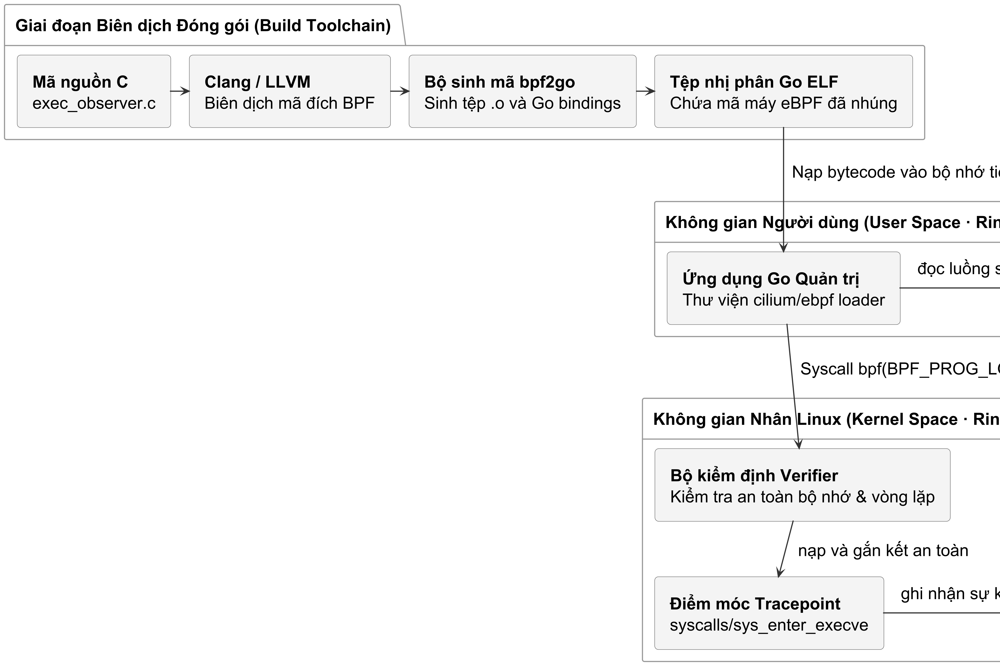

<!-- BOOK_ROLE: APPLICATION_SYSTEMS -->

# Chương 27 — Quan sát Linux từ kernel bằng eBPF và Go

Cho đến thời điểm này của cuốn sách, chúng ta đã xây dựng các công cụ giám sát dựa trên ba trụ cột Observability truyền thống: Metrics (Prometheus), Logs và Tracing (OpenTelemetry).

Cơ chế thu thập dữ liệu quan sát (*instrumentation*) đặt trực tiếp trong ứng dụng đòi hỏi mã nguồn ứng dụng chủ động tạo chỉ số đo lường (*metrics*) và đoạn vết (*spans*) mang ngữ nghĩa nghiệp vụ. Nhưng chỉ số, nhật ký (*logs*) và vết thực thi (*traces*) không chỉ đến từ một nguồn: hệ điều hành, máy chủ ủy quyền (*proxy*) và các tầng hạ tầng cũng cung cấp tín hiệu độc lập. Câu hỏi đặt ra là: điểm quan sát nào vẫn phát hiện được hành vi bất thường khi bản thân ứng dụng không chủ động báo cáo?

Xét một kịch bản giả định: một tiến trình web bị khai thác lỗ hổng thực thi mã từ xa (RCE), mở vỏ lệnh `/bin/sh`, tải dữ liệu độc hại vào thư mục `/tmp` rồi thực thi mà hoàn toàn không phát sinh đoạn vết hay chỉ số nghiệp vụ nào từ mã ứng dụng. Cơ chế quan sát nội tại của ứng dụng sẽ bỏ lọt dấu vết đó; trong khi nhật ký hệ điều hành, máy chủ ủy quyền hoặc nhật ký kiểm toán (*audit log*) vẫn có thể ghi nhận. Do đó, chúng ta bổ sung một điểm quan sát ở tầng nhân (*kernel*) tại các điểm móc (*hooks*) được chỉ định, thay vì ngộ nhận eBPF có thể thấu suốt mọi hành vi của toàn hệ thống.

eBPF cho phép đặt điểm quan sát trực tiếp ở tầng nhân cho các điểm móc mà chính sách an ninh và phiên bản nhân Linux hỗ trợ; công nghệ này không nhìn thấy toàn bộ mọi hành vi và không thể thay thế nhật ký kiểm toán hay các cơ chế kiểm soát truy cập. Trước đây, việc can thiệp vào nhân hệ điều hành thường đòi hỏi mô-đun nhân Linux (LKM) viết bằng C, với bán kính ảnh hưởng sự cố (*blast radius*) rất lớn khi xảy ra lỗi nghiêm trọng. eBPF kết hợp với thư viện `cilium/ebpf` cho phép nạp mã trung gian (*bytecode*) thông qua bộ thẩm định nhân (*kernel verifier*), tuy nhiên khả năng gắn kết, đặc quyền thực thi và chi phí tài nguyên phụ trội (*overhead*) vẫn bắt buộc phải được kiểm chứng trên môi trường thực tế.

---

## 1. Mental Model: Chuỗi luân chuyển sự kiện Kernel - Go Userspace

Mô hình trung tâm cần tách hai thời điểm. Verifier kiểm tra chương trình khi nạp, không chạy lại như một bước trong đường đi của từng sự kiện:

| Thời điểm | Đường xử lý của lab | Ranh giới |
| :--- | :--- | :--- |
| Nạp và gắn chương trình | Trình nạp nạp tệp đối tượng; bộ kiểm định nhân kiểm tra mã bytecode; trình nạp gắn chương trình vào điểm vết (`tracepoint`). | Chấp nhận chương trình không chứng minh policy quan sát đầy đủ hoặc overhead phù hợp. |
| Một lời gọi `execve` đi qua hook | Chương trình lấy trường sự kiện, reserve/submit record vào ring buffer; Go đọc record, giải mã ABI rồi áp dụng heuristic. | Record có thể mất; sự kiện đầu vào syscall không chứng minh exec thành công. |

Với điểm móc `sys_enter_execve` trong bài lab, bản ghi dữ liệu chứa định danh tiến trình (PID), định danh người dùng (UID), định danh nhóm (GID), tên tiến trình gọi và đường dẫn tệp thực thi đọc từ đối số. Bộ đọc của `cilium/ebpf` ở phiên bản được ghim có thể lấy dữ liệu đã sẵn sàng mà không cần chờ qua cơ chế `epoll`. Thứ tự byte nhỏ (*little-endian*) là quy ước giao diện nhị phân (ABI) của tệp đối tượng `bpfel` đang biên dịch, không phải quy tắc cố định cho mọi nhân hệ điều hành hay chương trình eBPF. Ứng dụng Go chỉ phân tích những bản ghi thực sự nhận được; việc không nhận được bản ghi không đồng nghĩa hệ thống hoàn toàn không có hành vi khả nghi.

---

## 2. Kernel Verifier: Kiểm tra trước khi nạp

Tại sao nhân Linux (`Linux Kernel`) lại cho phép mã do người dùng viết chạy trực tiếp bên trong không gian bộ nhớ của nhân?

Câu trả lời nằm ở bộ kiểm định nhân (`kernel verifier`). Trước khi bất kỳ chương trình eBPF nào được nạp vào nhân Linux thông qua lời gọi hệ thống `SYS_BPF`, bộ kiểm định (`Verifier`) sẽ phân tích tĩnh toàn bộ mã trung gian bytecode và thực thi các quy tắc kiểm tra nghiêm ngặt:

| Tiêu chuẩn an toàn Verifier | Cơ chế kiểm tra | Mục đích bảo vệ Kernel |
| :--- | :--- | :--- |
| **Kiểm tra đường thực thi hữu hạn** | Phân tích CFG, state và các loop mà kernel/version cho phép chứng minh an toàn. | Hạn chế đường chạy không an toàn; không biến mọi program được nạp thành không có overhead. |
| **Kiểm soát truy cập bộ nhớ** | Bắt buộc kiểm tra biên; truy cập userspace qua `bpf_probe_read_user_str()`. | Chống rò rỉ hoặc ghi đè trái phép lên không gian nhớ kernel. |
| **Giới hạn stack của mô hình BPF đang xét** | Tài liệu verifier mô tả frame 512 byte; call chain, program type và tính năng kernel còn có kiểm tra riêng. | Không dùng số này làm tổng stack budget cho mọi call chain hay version. |
| **Theo dõi thanh ghi BPF và FP** | `R10` là frame pointer chỉ đọc; verifier theo dõi kiểu và trạng thái thanh ghi BPF. | Đây là thanh ghi của máy BPF, không phải lời hứa giữ nguyên mọi thanh ghi vật lý của CPU. |

> **Dừng để dự đoán:** Ranh giới giữa trình biên dịch C và bộ kiểm định nhân (*Kernel Verifier*):
> Xét một đoạn mã C eBPF minh họa việc tra cứu và cập nhật bộ đếm trong bảng ánh xạ (*map*):
> ~~~c
> struct event *val = bpf_map_lookup_elem(&counters, &key);
> val->count++;
> ~~~
> Xét riêng cú pháp ngôn ngữ C thuần túy, trình biên dịch Clang có thể coi việc truy cập `val->count` là hợp lệ và biên dịch thành mã thực thi nhị phân. Tuy nhiên, khi chương trình Go nạp mã thực thi này vào nhân hệ điều hành, bộ kiểm định sẽ từ chối chương trình ngay tại thời điểm nạp. Vì sao bộ kiểm định nhân lại nghiêm ngặt hơn trình biên dịch ngôn ngữ, và lập trình viên eBPF bắt buộc phải điều chỉnh cú pháp như thế nào?

#### Gợi ý giải pháp (chỉ đọc sau khi đã tự làm)

Với các khai báo kiểu và map phù hợp, đoạn C có thể biên dịch dù chưa kiểm tra kết quả tra cứu. Clang kiểm tra và tối ưu mã theo mô hình ngôn ngữ C; việc biên dịch thành công không cung cấp bằng chứng mà BPF verifier yêu cầu về con trỏ trả về từ helper. `bpf_map_lookup_elem` có thể trả `NULL` khi không tìm thấy phần tử. Verifier theo dõi kết quả này dưới dạng `PTR_TO_MAP_VALUE_OR_NULL`, chưa cho phép truy cập như một con trỏ map value chắc chắn hợp lệ.

Do đó, bộ kiểm định nhân (`Kernel Verifier`) thực hiện phân tích đường đi trừu tượng và theo dõi trạng thái thanh ghi BPF chứa kết quả trả về dưới dạng con trỏ có thể mang giá trị `NULL`. Khi thanh ghi chưa được chứng minh an toàn, mọi chỉ thị đọc hoặc ghi bộ nhớ thông qua thanh ghi đó đều bị Verifier chặn đứng và từ chối nạp vì lỗi truy cập bộ nhớ không hợp lệ. Để vượt qua rào cản này, lập trình viên bắt buộc phải chèn một nhánh kiểm tra điều kiện tường minh ngay sau khi tra cứu:

~~~c
struct event *val = bpf_map_lookup_elem(&counters, &key);
if (!val) {
    return 0; // Thoát an toàn nếu không tìm thấy key
}
val->count++;
~~~

Nhánh kiểm tra `if (!val)` cung cấp cho Verifier bằng chứng cần thiết để chứng minh rằng trên mọi nhánh thực thi đi tới câu lệnh `val->count++`, con trỏ trong thanh ghi chắc chắn khác `NULL`. Tuy nhiên, việc vượt qua kiểm tra con trỏ `NULL` chỉ giải quyết riêng lỗi truy cập con trỏ chưa kiểm chứng; nó hoàn toàn không bảo đảm chương trình sẽ vượt qua tất cả các tiêu chuẩn kiểm định khác của bộ kiểm định (`Verifier`), chẳng hạn như giới hạn kích thước ngăn xếp (`stack`), tính hữu hạn của vòng lặp hay tính hợp lệ của các vùng đệm bộ nhớ truyền vào hàm trợ giúp.

---

## 3. Kiến trúc CGO-Free và Trình sinh mã `bpf2go`

Khi lập trình eBPF với Go, nhiều người lầm tưởng rằng bắt buộc phải cài đặt trình biên dịch Clang/LLVM cồng kềnh trên máy chủ sản xuất hoặc phải kích hoạt CGO.

Thư viện **`github.com/cilium/ebpf`** cung cấp đường nạp và quản lý object eBPF từ Go không phụ thuộc cgo ở phía userspace:

@figure Clang và bpf2go thuộc bộ công cụ biên dịch. Tệp nhị phân Go mang tệp đối tượng BPF đến môi trường chạy; nhân hệ điều hành vẫn thẩm định chương trình, quyền hạn và tính năng hỗ trợ trước khi nạp hoặc gắn kết thành công.

Quy trình biên dịch dưới đây đòi hỏi hệ điều hành Linux hỗ trợ định dạng BTF, công cụ `bpftool`, trình biên dịch Clang hỗ trợ đích biên dịch BPF cùng các tệp tiêu đề của thư viện `libbpf`. Thực thi lệnh từ thư mục bài thực hành; tệp tiêu đề `vmlinux.h` cung cấp các kiểu điểm theo dõi (*tracepoint*) mà tệp tiêu đề chuẩn của nhân không khai báo sẵn. Tệp tiêu đề này được trích xuất trực tiếp từ nhân hệ điều hành mục tiêu, hoàn toàn không phải mã nguồn Go viết thủ công:

~~~bash
bpftool btf dump file /sys/kernel/btf/vmlinux \
    format c > bpf/vmlinux.h
~~~

Chỉ thị trong `gen.go` dùng `bpf2go` của module đã ghim:

~~~bash
go run github.com/cilium/ebpf/cmd/bpf2go \
    -target bpfel -cc clang \
    bpf bpf/exec_observer.c -- \
    -I./bpf -O2 -g
~~~

Một là, giai đoạn phát triển: Kỹ sư viết mã C eBPF, sau đó chạy `go generate` với `bpf2go` và Clang trên máy phát triển để biên dịch mã nguồn C thành bytecode eBPF (định dạng ELF) cùng các tệp Go bindings tương ứng.

Hai là, tự động nhúng Bytecode: Công cụ `bpf2go` tự động sinh ra tệp Go chứa mã trung gian bytecode ELF đã được nhúng thẳng vào binary thông qua tính năng `//go:embed`.

Ba là, phía Go có thể nạp tệp đối tượng eBPF đã biên dịch sẵn thông qua các lời gọi hệ thống (*syscall*) của Linux mà không phụ thuộc cgo. Điều đó không xóa bỏ sự phụ thuộc vào môi trường máy chủ: nhân Linux phải hỗ trợ tính năng và điểm móc cần dùng, bên gọi phải có đặc quyền phù hợp, đồng thời dữ liệu BTF cùng các tài nguyên lúc biên dịch phải khớp với cách ứng dụng được đóng gói. Việc không cần môi trường thực thi C cho bộ nạp thuần Go không đồng nghĩa ứng dụng chạy được mà không cần các điều kiện tiên quyết trên máy chủ.

Bốn là, bài kiểm thử Go dùng nguồn đọc giả lập (`RecordReader`) để kiểm tra logic giải mã và điều phối kênh truyền mà không cần đặc quyền nạp BPF vào nhân. Bài lab mang tính mô hình hóa; việc tích hợp tệp đối tượng thực tế, bộ tương thích vùng đệm vòng và phân quyền trên máy chủ cần được cấu hình và kiểm chứng độc lập. Đối tượng `CollectionSpec` dựng trong kiểm thử không thay thế cho tệp ELF do trình biên dịch sinh ra.

---

## 4. Kênh truyền dữ liệu tốc độ cao: BPF Ring Buffer

Để chuyển dữ liệu từ tầng nhân lên không gian người dùng (*userspace*) trong Go, eBPF cung cấp cấu trúc vùng đệm vòng BPF (`BPF_MAP_TYPE_RINGBUF`, tức *BPF ring buffer*). Khác với mảng sự kiện hiệu năng (*perf event array*) thường phân chia vùng đệm riêng theo từng lõi CPU, vùng đệm vòng sử dụng vùng nhớ chia sẻ và bảo toàn thứ tự giữ chỗ bộ nhớ giữa các tiến trình tạo sự kiện. Cơ chế này đặc biệt hiệu quả cho các sự kiện mang tính tuần tự như fork, exec hay exit; tuy nhiên nó không biến bản ghi thành một đồng hồ toàn cục chính xác, cũng như không tự động xác định được toàn bộ trật tự nhân quả giữa các sự kiện xảy ra đồng thời trên nhiều lõi CPU.

Bộ đọc tại không gian người dùng ánh xạ vùng đệm vòng bằng lời gọi `mmap` để lấy các bản ghi; không cần một lời gọi hệ thống riêng lẻ cho từng bản ghi, nhưng vẫn phát sinh chi phí đồng bộ hóa, cơ chế đánh thức (*polling/wakeup*) và giải mã dữ liệu. Trong bài lab, chương trình giữ chỗ trước bộ nhớ trong vùng đệm rồi mới xác nhận ghi. Thao tác giữ chỗ có thể thất bại nếu vùng đệm bị đầy hoặc gặp nghẽn luồng xử lý; khi đó chương trình sẽ hủy bản ghi. Cần chủ động đếm số lượng bản ghi bị thất thoát nếu chính sách giám sát đòi hỏi phát hiện tín hiệu bị mất, tránh ngộ nhận việc bỏ qua bản ghi là hệ thống hoàn toàn ổn định.

---

## 5. Viết mã Kernel: Bắt sự kiện `sys_enter_execve`

Dưới đây là phần khai báo cấu trúc sự kiện và bản đồ Ring Buffer trong C eBPF (`labs/part27-ebpf-observer/bpf/exec_observer.c`):

~~~c
// +build ignore
#include "vmlinux.h"
#include <bpf/bpf_helpers.h>
#include <bpf/bpf_tracing.h>

char __license[] SEC("license") = "Dual MIT/GPL";

struct exec_event {
    __u32 pid;
    __u32 uid;
    __u32 gid;
    char  comm[16];
    char  filename[128];
};

_Static_assert(sizeof(struct exec_event) == 156,
               "event ABI mismatch");

struct {
    __uint(type, BPF_MAP_TYPE_RINGBUF);
    __uint(max_entries, 256 * 1024); // 256KB buffer
} events SEC(".maps");
~~~

Tiếp theo là hàm móc vào tracepoint `sys_enter_execve` để bắt thông tin mỗi khi có lời gọi thực thi nhị phân:

~~~c
SEC("tracepoint/syscalls/sys_enter_execve")
int trace_execve(struct trace_event_raw_sys_enter *ctx) {
    struct exec_event *event;

    // Cấp phát trực tiếp trong ringbuffer
    event = bpf_ringbuf_reserve(
        &events, sizeof(struct exec_event), 0
    );
    if (!event) {
        return 0; // Buffer đầy hoặc bộ nhớ bận
    }

    // Xóa toàn record, kể cả phần đuôi chuỗi chưa được ghi
    __builtin_memset(event, 0, sizeof(*event));
    __u64 pid_tgid = bpf_get_current_pid_tgid();
    event->pid = (__u32)(pid_tgid >> 32);

    __u64 uid_gid = bpf_get_current_uid_gid();
    event->uid = (__u32)(uid_gid);
    event->gid = (__u32)(uid_gid >> 32);

    // Đọc tên của tiến trình gọi (calling task)
    if (bpf_get_current_comm(
        &event->comm, sizeof(event->comm)
    ) < 0) {
        bpf_ringbuf_discard(event, 0);
        return 0;
    }

    // Đọc đường dẫn file nhị phân đích từ tham số syscall
    const char *fn = (const char *)ctx->args[0];
    if (bpf_probe_read_user_str(
        &event->filename, sizeof(event->filename), fn
    ) < 0) {
        bpf_ringbuf_discard(event, 0);
        return 0;
    }

    // Gửi sự kiện lên Userspace
    bpf_ringbuf_submit(event, 0);
    return 0;
}
~~~

### Đặc điểm kỹ thuật trong mã nguồn C eBPF

Điểm móc `sys_enter_execve` chỉ ghi nhận thời điểm lệnh gọi hệ thống bắt đầu được phát đi, hoàn toàn không chứng minh tiến trình thực thi thành công sau đó. Các lỗi không tìm thấy tệp hoặc thiếu quyền truy cập hoàn toàn có thể phát sinh ở những bước tiếp theo. Chương trình tại điểm móc có cơ hội khởi tạo bản ghi, nhưng các thao tác đặt chỗ bộ nhớ, đọc đối số và chuyển giao bản ghi vẫn có thể thất bại; hệ thống không cam kết mọi nỗ lực thực thi đều được ghi nhận trọn vẹn.

Bản ghi được cấp phát bộ nhớ toàn phần trước khi điền dữ liệu vào từng trường. Nếu hàm trợ giúp gặp lỗi khi đọc tên hoặc đường dẫn, chương trình sẽ chủ động hủy bỏ bản ghi thay vì xuất bản dữ liệu khiếm khuyết; nếu bộ đệm chuỗi quá ngắn, hàm trợ giúp có thể trả về chuỗi ký tự bị cắt ngắn. Bài thực hành hiện chưa thiết lập bộ đếm thất thoát hoặc cờ báo cắt ngắn. Định danh tiến trình ở đây là giá trị do hàm trợ giúp của nhân trả về, không bảo đảm trùng khớp với định danh nhìn thấy từ bên trong mọi không gian tên của vùng chứa. Mốc thời gian của Go là thời điểm giải mã dữ liệu, không phải thời điểm nhân bắt đầu thực thi lệnh gọi hệ thống.

Hàm trợ giúp `bpf_get_current_comm` tại thời điểm này phản ánh tên của tiến trình đang phát lệnh gọi (như `bash`, `python` hoặc `containerd`), trong khi đường dẫn tệp nhị phân đích phải được trích xuất từ tham số đầu vào. Để phân giải định danh tiến trình tương thích với không gian người dùng, mã nguồn thực hiện dịch phải 32 bit từ giá trị 64-bit của hàm `bpf_get_current_pid_tgid()`, bởi trong nhân Linux định danh nhóm tiểu trình mới tương ứng với định danh tiến trình của người dùng. Cuối cùng, việc đọc đường dẫn chuỗi ký tự của người dùng bắt buộc phải thông qua hàm trợ giúp `bpf_probe_read_user_str` nhằm ngăn ngừa lỗi vi phạm trang nhớ khi con trỏ tham chiếu tới vùng địa chỉ chưa hợp lệ.

---

## 6. Xây dựng Trình giải mã nhị phân và Thu thập trong Go

Khi sự kiện từ nhân Linux được đẩy vào vùng đệm vòng (`Ring Buffer`), ứng dụng Go nhận được một mảng byte nhị phân thô (`[]byte`). Nhiệm vụ của chúng ta là giải mã mảng byte này thành struct Go với hiệu năng tối đa.

### Mô hình dữ liệu và giải mã ABI (`event.go`)

~~~go
package ebpfobserver

import (
	"bytes"
	"encoding/binary"
	"errors"
	"fmt"
	"time"
)

// EventPayloadSize đại diện cho kích thước struct C (156B).
const EventPayloadSize = 156

type ExecEvent struct {
	PID       uint32    `json:"pid"`
	UID       uint32    `json:"uid"`
	GID       uint32    `json:"gid"`
	Comm      string    `json:"comm"`
	Filename  string    `json:"filename"`
	Timestamp time.Time `json:"timestamp"`
}
~~~

Hàm giải mã bóc tách từng trường dữ liệu theo chuẩn little-endian:

~~~go
// DecodeExecEvent giải mã mảng byte thô từ Ring Buffer.
func DecodeExecEvent(data []byte) (*ExecEvent, error) {
	if len(data) < EventPayloadSize {
		return nil, fmt.Errorf(
			"truncated event: want %d bytes, got %d",
			EventPayloadSize, len(data),
		)
	}

	pid := binary.LittleEndian.Uint32(data[0:4])
	uid := binary.LittleEndian.Uint32(data[4:8])
	gid := binary.LittleEndian.Uint32(data[8:12])

	commBytes := data[12:28]
	fileBytes := data[28:156]

	return &ExecEvent{
		PID:       pid,
		UID:       uid,
		GID:       gid,
		Comm:      parseCString(commBytes),
		Filename:  parseCString(fileBytes),
		Timestamp: time.Now().UTC(),
	}, nil
}

// parseCString cắt bỏ các byte null kết thúc chuỗi của C.
func parseCString(b []byte) string {
	idx := bytes.IndexByte(b, 0)
	if idx >= 0 {
		return string(b[:idx])
	}
	return string(b)
}
~~~

---

## 7. Điều phối luồng sự kiện và Phát hiện Bất thường An ninh (`observer.go`)

Để kiểm thử được trên mọi nền tảng mà không phụ thuộc vào quyền root Linux khi chạy unit test, chúng ta trừu tượng hóa nguồn đọc bằng interface `RecordReader`:

~~~go
// RecordReader trừu tượng hóa nguồn đọc từ BPF Ring Buffer.
type RecordReader interface {
	Read() ([]byte, error)
	Close() error
}

type Observer struct {
	reader    RecordReader
	events    chan *ExecEvent
	errs      chan error
	done      chan struct{}
	closeOnce sync.Once
}

func NewObserver(
	reader RecordReader, bufferSize int,
) *Observer {
	if bufferSize <= 0 {
		bufferSize = 128
	}
	return &Observer{
		reader: reader,
		events: make(chan *ExecEvent, bufferSize),
		errs:   make(chan error, 16),
		done:   make(chan struct{}),
	}
}
~~~

Đoạn mã rút gọn dưới đây minh họa tiến trình goroutine xử lý; các hàm `readLoop`, `sendErr` và `sendEvent` biểu diễn các nhánh xử lý tương ứng trong bài thực hành, không phải các phương thức được khai báo độc lập trong mã nguồn chính. Khi chạy thử chương trình, hãy sử dụng tệp `observer.go` hoàn chỉnh, bao gồm cả tiến trình goroutine gọi `Close` khi ngữ cảnh bị hủy bỏ. Phương thức `Start` chỉ được phép gọi duy nhất một lần cho mỗi đối tượng quan sát:

~~~go
func (o *Observer) Start(
	ctx context.Context,
) (<-chan *ExecEvent, <-chan error) {
	go func() {
		defer close(o.events)
		defer close(o.errs)
		o.readLoop(ctx)
	}()
	return o.events, o.errs
}
~~~

Vòng lặp đọc dữ liệu từ Ring Buffer và đẩy vào channel với khả năng hủy qua context:

~~~go
func (o *Observer) readLoop(ctx context.Context) {
	for {
		select {
		case <-ctx.Done():
			return
		case <-o.done:
			return
		default:
			data, err := o.reader.Read()
			if err != nil {
				if errors.Is(err, io.EOF) ||
					errors.Is(err, ErrObserverClosed) {
					return
				}
				o.sendErr(ctx, err)
				continue
			}

			event, decodeErr := DecodeExecEvent(data)
			if decodeErr != nil {
				o.sendErr(ctx, decodeErr)
				continue
			}
			o.sendEvent(ctx, event)
		}
	}
}
~~~

Ngữ cảnh chỉ mở ra lối thoát tại cấu trúc `select`; nó không thể tự động can thiệp vào phương thức đọc dữ liệu của bộ đọc. Do đó, bài thực hành thiết lập một nhánh hủy bỏ chuyên biệt gọi `reader.Close()`. Khế ước kỹ thuật bắt buộc phải có là thao tác `Close` phải khiến một lệnh đọc đang bị tắc nghẽn lập tức trả về; bộ đọc giả lập trong bài kiểm thử mô phỏng chính xác trạng thái tắc nghẽn này và được giải phóng an toàn khi đóng. Nếu nguồn đọc dữ liệu khác không đáp ứng khế ước đó, chúng ta bắt buộc phải bao bọc hoặc thay đổi giao diện lập trình thay vì đưa ra lời hứa hão huyền về việc hủy bỏ tức thì.

### Động cơ phát hiện bất thường an ninh (Heuristic Security Rules)
Khi nhận được sự kiện, chúng ta đối chiếu với các quy tắc an ninh phỏng đoán. Cần lưu ý: Đây là các quy tắc phỏng đoán (*heuristics*) hỗ trợ giám sát, không phải lá chắn bảo mật tuyệt đối, bởi kẻ tấn công nâng cao có thể lẩn tránh bằng cách gọi `execveat`, nạp nhị phân từ RAM qua `memfd_create`, hoặc dùng symlink:

~~~go
type SecurityAlert struct {
	Event  *ExecEvent
	Rule   string
	Reason string
}

func checkBasicRules(e *ExecEvent) *SecurityAlert {
	fn := strings.ToLower(e.Filename)
	comm := strings.ToLower(e.Comm)

	// Luật 1: Đường dẫn nằm dưới thư mục tạm.
	if strings.HasPrefix(fn, "/tmp/") ||
		strings.HasPrefix(fn, "/dev/shm/") ||
		strings.HasPrefix(fn, "/var/tmp/") {
		return &SecurityAlert{
			Event:  e,
			Rule:   "SEC01_EXEC_FROM_TEMP_DIRECTORY",
			Reason: "process execution originated from " +
				"world-writable temporary directory",
		}
	}

	// Luật 2: Tên caller và đích khớp mẫu đáng điều tra.
	isShell := fn == "/bin/sh" || fn == "/bin/bash" ||
		fn == "/usr/bin/bash" || fn == "/bin/dash"
	isWeb := comm == "nginx" || comm == "node" ||
		comm == "python" || comm == "redis-server"
	if isShell && isWeb {
		return &SecurityAlert{
			Event:  e,
			Rule:   "SEC02_SHELL_FROM_WEBSERVER",
			Reason: "interactive shell spawned directly " +
				"from web service daemon process",
		}
	}
	return nil
}
~~~

Tiếp theo là quy tắc phát hiện các tiện ích mạng chạy bằng quyền root:

~~~go
func DetectSecurityAnomalies(e *ExecEvent) *SecurityAlert {
	if e == nil {
		return nil
	}
	if alert := checkBasicRules(e); alert != nil {
		return alert
	}

	// Luật 3: Tiện ích dò quét mạng chạy với quyền root (UID 0)
	fn := strings.ToLower(e.Filename)
	isNet := strings.HasSuffix(fn, "/nc") ||
		strings.HasSuffix(fn, "/ncat") ||
		strings.HasSuffix(fn, "/nmap")
	if isNet && e.UID == 0 {
		return &SecurityAlert{
			Event:  e,
			Rule:   "SEC03_ROOT_NETWORK_RECON",
			Reason: "network exploration utility " +
				"executed with root privileges",
		}
	}
	return nil
}
~~~

`checkBasicRules` là cách tách đoạn trích cho dễ đọc, không phải hàm có sẵn trong lab; hai đoạn trên giữ các đường dẫn và chuỗi `Reason` của `DetectSecurityAnomalies` thật. Dù tên thông báo có chữ “executed” hay “interactive”, dữ liệu hook chỉ cho biết một exec attempt. Lab không thu argv, không xác minh quyền ghi thực tế của thư mục, không chứng minh shell tương tác hay RCE. `Comm` là tên task có giới hạn và có thể thay đổi, không phải danh tính đã xác thực. Cảnh báo chỉ là đầu mối điều tra; đừng biến tên rule thành kết luận pháp chứng.

---

## 8. Kiểm chứng Lab thực tế (`labs/part27-ebpf-observer`)

Bộ kiểm thử tại `labs/part27-ebpf-observer/observer_test.go` vận hành độc lập (phân loại kiểm chứng: kiểm thử đơn vị và mô hình hóa đối với mô hình luồng kênh dữ liệu, giải mã giao diện nhị phân 156 byte, phát hiện bất thường theo suy nghiệm và kiểm tra cấu trúc đặc tả BPF mà không đòi hỏi đặc quyền quản trị của Linux). Chạy bộ kiểm thử hoàn chỉnh với cờ kiểm tra tương tranh dữ liệu:

~~~bash
go test -v -race ./...
~~~

Một transcript lịch sử của sáu test dưới đây chỉ minh họa tên test; thời gian không phải số đo cho lần chạy hiện tại hay cho kernel thật:

~~~
=== RUN   TestEncodeDecodeExecEvent
--- PASS: TestEncodeDecodeExecEvent (0.00s)
=== RUN   TestDecodeExecEventTruncated
--- PASS: TestDecodeExecEventTruncated (0.00s)
=== RUN   TestObserverStreaming
--- PASS: TestObserverStreaming (0.00s)
=== RUN   TestObserverContextCancellation
--- PASS: TestObserverContextCancellation (0.00s)
=== RUN   TestDetectSecurityAnomalies
--- PASS: TestDetectSecurityAnomalies (0.00s)
=== RUN   TestModeledCollectionSpec
--- PASS: TestModeledCollectionSpec (0.00s)
PASS
ok      part27-ebpf-observer   0.742s
~~~

### Phân tích kết quả kiểm thử và Ranh giới kiểm chứng:

Bộ kiểm thử được phân loại ở cấp độ kiểm thử đơn vị kết hợp mô hình hóa. Biên dịch tệp đối tượng nhị phân là công đoạn đóng gói, đòi hỏi trình biên dịch và các tệp tiêu đề mà mã nguồn C sử dụng; công đoạn này không tự đòi hỏi đặc quyền nạp vào nhân hệ điều hành. Thao tác nạp và gắn điểm theo dõi đòi hỏi nhân Linux hỗ trợ điểm móc nối và đặc quyền phù hợp với phiên bản nhân, chủng loại chương trình cùng chính sách an ninh. Bài thực hành này chủ động bỏ qua bước nạp nhân thực tế khi chạy trên môi trường không hỗ trợ; việc thiếu tệp tiêu đề của nhân không phải là nguyên nhân phổ quát khiến tệp đối tượng đã biên dịch không thể nạp thành công.

Các test gốc kiểm tra decoder little-endian của ABI 156 byte, record thiếu dữ liệu, channel, cancellation, heuristic và `CollectionSpec` mô hình. Test cancellation nay chờ reader báo đã vào `Read` rồi mới hủy context; nếu hủy trước khi đọc, test có thể xanh mà chưa thử khả năng giải phóng lệnh đọc bị chặn. `TestSecurityRulesMatchDocumentedFixtureScope` kiểm tra thêm các nhánh `/var/tmp`, `/usr/bin/bash`, `/bin/dash` và `nmap` để đoạn trích không vô tình thu hẹp source thật. Không phát hiện race trên các đường đã chạy không chứng minh mọi lịch trình đều đúng. Không test nào ở đây chứng minh ELF đã được nạp, hook đã gắn, mọi sự kiện được thu đủ hoặc overhead phù hợp production.

---

## 9. Các cạm bẫy người học thường gặp (Learner Pitfalls)

| Cạm bẫy thực tế | Hậu quả trên Production | Giải pháp phòng ngừa |
| :--- | :--- | :--- |
| **Dùng stack vượt giới hạn của kernel/program type.** | Verifier có thể từ chối khi compiler hiện thực dữ liệu trên stack quá lớn; một khai báo bị tối ưu bỏ không tự tạo stack use. | Kiểm tra bytecode và verifier log; với event ring buffer của lab, reserve/submit tránh đặt toàn bộ event trên stack. |
| **Lấy nhầm 32 bit thấp** của `bpf_get_current_pid_tgid()`. | Thu được Thread ID (TID) thay vì Process ID (PID), khiến log hiển thị PID sai lệch hoàn toàn. | Luôn dịch bit phải 32 bit: `(__u32)(pid_tgid >> 32)` để lấy đúng PID của tiến trình. |
| **Userspace xử lý chậm hơn tốc độ tạo record.** | Ring buffer có thể hết chỗ, record bị mất. | Queue và worker có giới hạn chỉ hấp thụ tải trong một phạm vi; đo tốc độ, đếm mất record và chọn chính sách khi quá tải. Thêm buffer không bảo đảm hết mất dữ liệu. |
| **Chạy ứng dụng thiếu quyền** Linux capabilities. | Load/attach có thể trả `EPERM`. | Quyền cần thiết phụ thuộc kernel version, cấu hình LSM và loại program; kiểm tra policy của node. Không copy một bộ capability như công thức chung. |

---

## 10. Bài tập thực hành thiết kế Observer eBPF

### Thử thách 1: Bộ đếm tần suất thực thi tiến trình (Exec Rate Limiter)
Yêu cầu: Với fixture này, đếm exec attempt theo tên `Comm` trong cửa sổ cố định khoảng 1 giây, cảnh báo khi vượt 50. Đây là nhóm theo tên, không phải identity của một process; nhiều task có thể cùng Comm. Muốn đếm theo process cần PID/TGID cùng lifecycle và namespace phù hợp. Test phải phân biệt cửa sổ cố định với trượt; ngưỡng 50 chỉ là cấu hình bài tập.

### Thử thách 2: Bóc tách tham số dòng lệnh từ Syscall (Argv Extraction)
Yêu cầu: `ctx->args[1]` trỏ tới mảng pointer `argv`. Thiết kế việc đọc có giới hạn từng pointer/chuỗi ở phía kernel và wire format với delimiter NUL. Ở Go, decode record thành `Args []string` mà không split hay trim khoảng trắng. Hook hiện tại chưa thu argv; đây là bài tập thiết kế thêm, không phải khả năng đã có.

---

## 11. Hướng dẫn giải và Phân tích kiến trúc bài tập

### Lời giải Thử thách 1: Bộ phát hiện tần suất thực thi

~~~go
type ForkBombDetector struct {
	mu       sync.Mutex
	counts   map[string]int
	lastTick time.Time
}

func NewForkBombDetector() *ForkBombDetector {
	return &ForkBombDetector{
		counts:   make(map[string]int),
		lastTick: time.Now(),
	}
}

func (d *ForkBombDetector) Check(
	e *ExecEvent, threshold int,
) bool {
	d.mu.Lock()
	defer d.mu.Unlock()

	now := time.Now()
	if now.Sub(d.lastTick) >= time.Second {
		// Reset bộ đếm mỗi giây
		d.counts = make(map[string]int)
		d.lastTick = now
	}

	d.counts[e.Comm]++
	return d.counts[e.Comm] > threshold
}
~~~

### Lời giải Thử thách 2: Bóc tách đối số dòng lệnh

~~~go
type ExecEventExtended struct {
	ExecEvent
	Args []string `json:"args"`
}

func ParseNULSeparatedArgs(raw []byte) []string {
	if len(raw) == 0 {
		return nil
	}
	// Payload đã được validate, không gồm padding cuối buffer.
	if raw[len(raw)-1] == 0 {
		raw = raw[:len(raw)-1]
	}
	tokens := bytes.Split(raw, []byte{0})
	args := make([]string, len(tokens))
	for i, tok := range tokens {
		args[i] = string(tok) // Giữ cả argument rỗng.
	}
	return args
}
~~~

`argv` là mảng con trỏ tới các chuỗi C. Wire format phải ghi số đối số, số byte thực dùng, giới hạn thu thập và cờ cắt ngắn. Hàm trên giả định payload đã hợp lệ, mỗi đối số có byte NUL kết thúc và không kèm padding thừa. Chẳng hạn `a\x00\x00` biểu diễn hai đối số `"a"` và `""`; bỏ phần tử rỗng sẽ mất dữ liệu. Khoảng trắng cũng là dữ liệu, không dùng để split hay trim. Hook hiện tại chỉ lấy filename; lời giải decode không chứng minh kernel đã thu được argv.

---

eBPF bổ sung một điểm quan sát mạnh mẽ nhưng có giới hạn rõ ràng và cần được đo lường cẩn trọng; phương pháp suy nghiệm (*heuristic*) trong bài lab chỉ tạo tín hiệu cảnh báo phục vụ điều tra, không phải cơ chế ngăn chặn xâm nhập tuyệt đối. Trước khi áp dụng trên các máy chủ thực tế, hãy thẩm định kỹ phiên bản nhân hệ điều hành, đặc quyền hệ thống (*capabilities*), điểm móc được hỗ trợ, tỷ lệ thất thoát bản ghi và chính sách bảo mật dữ liệu của chính môi trường đó.

Chương 28 chuyển từ điểm quan sát kernel sang boundary công cụ Agent: ai được gọi, target nào được phép và bằng chứng nào cho phép một thay đổi. MCP chuẩn hóa giao tiếp, không thay thế authorization hay trách nhiệm vận hành. Chương 29 tiếp tục xét bằng chứng và giới hạn của tự động hóa.
