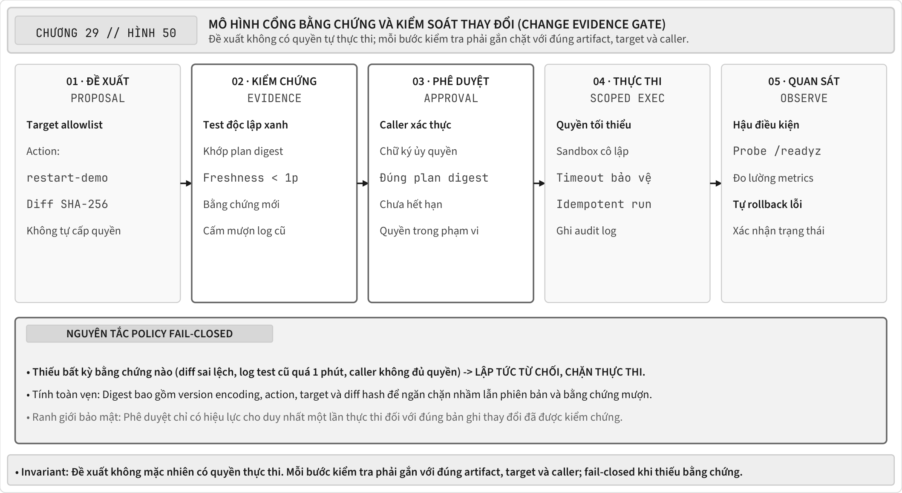

<!-- BOOK_ROLE: APPLICATION_SYSTEMS -->

# Chương 29 — Kỹ sư và bằng chứng trong kỷ nguyên Agent

Một tác tử AI (Agent) vừa đề xuất thay đổi thời gian chờ (*timeout*), tăng số lượng bản sao (*replicas*) và khởi động lại một dịch vụ (*restart service*). Nó đưa ra một đoạn giải thích mạch lạc, một bản vá mã nguồn hợp lệ và dòng thông báo “toàn bộ kiểm thử đều đạt”. Nếu ta bấm đồng ý phê duyệt, điều gì đã thực sự được chứng minh? Rất có thể chỉ là bài kiểm thử trên một nhánh làm việc khác đã chạy thành công; có thể bản vá đang áp dụng cấu hình khác với môi trường thực tế; hoặc cũng có thể quyền khởi động lại chưa từng được cấp phát cho bên gọi này. Chất lượng của câu trả lời do AI sinh ra và quyền hạn tác động trực tiếp vào hệ thống hoàn toàn không phải là cùng một đại lượng.

Chương 28 đã hướng dẫn cách trao một công cụ có giới hạn rõ ràng. Chương này chuyển dịch góc nhìn từ phạm vi công cụ sang bản chất công việc của người kỹ sư: chuỗi kiểm chứng *đề xuất → bằng chứng → quyền hạn → hành động giới hạn → hậu điều kiện*. Tác tử AI có thể hỗ trợ đắc lực ở nhiều bước, nhưng một bước hoàn tất không tự động thay thế cho bước kế tiếp. Một mã băm đúng không chứng minh mã nguồn đúng; một ca kiểm thử đạt không tự cấp quyền triển khai; và một đợt triển khai thành công không chứng minh người dùng đã được phục vụ tốt hơn. Đây là mô hình tư duy cốt lõi để thiết kế quy trình kiểm soát và đánh giá khách quan những lời hứa hẹn về tương lai nghề nghiệp, chứ không phải một lời dự đoán xem chức danh nào sẽ trường tồn mãi mãi.

## Đọc số liệu theo câu hỏi nó thực sự trả lời

Ngày đối chiếu lại nguồn của chương là 08/10/2026. “AI giúp lập trình nhanh hơn” thiếu ít nhất ba đối tượng: ai làm, làm việc gì, và nhanh hơn theo phép đo nào. Dữ liệu sau không dùng chung mẫu hay cùng loại outcome, nên không được lấy trung bình các phần trăm để tạo một con số về “năng suất AI”.

Nghiên cứu của Peng và cộng sự, công bố tháng 02/2023 trên arXiv, phân nhóm ngẫu nhiên 95 lập trình viên tuyển qua Upwork từ ngày 15/05 đến ngày 20/06/2022. Công việc là viết HTTP server JavaScript. Có 70 người hoàn thành task và survey, 35 ở mỗi nhóm; phân tích thời gian trên nhóm hoàn thành cho mức giảm 55,8% khi được dùng GitHub Copilot, khoảng tin cậy 95% 21–89%. Mẫu phần lớn từ Ấn Độ và Pakistan. Kết quả thuộc nhiệm vụ chuẩn hóa và công cụ năm 2022, không đại diện toàn vòng đời service hay incident production. Tác giả có liên hệ Microsoft/GitHub; nghiên cứu không đo đầy đủ chất lượng bảo trì dài hạn.

METR công bố ngày 10/07/2025 một RCT với 16 người đóng góp giàu kinh nghiệm, hoàn thành 246 tác vụ trên kho mã nguồn mở quen thuộc. Mỗi tác vụ được phân ngẫu nhiên vào điều kiện cho phép hoặc không cho phép AI; công cụ thuộc giai đoạn tháng 02 đến tháng 06/2025, chủ yếu Cursor Pro với Claude 3.5/3.7 Sonnet. Ước lượng có điều chỉnh của nghiên cứu là thời gian tăng 19%, khoảng tin cậy 95% 2–39%; không phải chỉ lấy tỷ số hai thời gian trung bình thô. Đối tượng đo là contributor và task được tuyển, không đại diện lao động quốc gia. Kết quả không chứng minh AI vô dụng ở mọi bối cảnh.

Bản cập nhật METR ngày 24/02/2026 nêu vấn đề chọn người, chọn task và đo thời gian khi người tham gia dùng công cụ mới hoặc làm nhiều việc song song. Tác giả coi các ước lượng mới là không đáng tin để định lượng hiệu ứng hiện tại. Vì vậy cũng không được dùng con số chậm 19% của năm 2025 như định luật cho Agent năm 2026. “Chưa đo chắc” là một kết luận có ích: nó ngăn cả quảng cáo lẫn phản đối AI dựa trên một thí nghiệm đã đổi bối cảnh.

Go Developer Survey 2025 do Go team công bố ngày 21/01/2026, thu thập từ ngày 09/09 đến ngày 30/09/2025, dùng 5.379 phản hồi sau làm sạch. Mời qua kênh công khai và lời mời ngẫu nhiên trong VS Code/GoLand; đây không phải mẫu ngẫu nhiên của toàn thị trường lao động. Phản hồi chủ yếu từ Bắc Mỹ và châu Âu. CLI và API service là nhóm use case nổi bật, và có người dùng Go cho hạ tầng cloud. Điều đó cho bối cảnh ecosystem, không cho số việc làm Go ở Việt Nam. Nhận xét về AI là tự báo cáo, không phải phép đo tốc độ có nhóm đối chứng.

Ở lớp thị trường, BLS cập nhật Occupational Outlook Handbook ngày 27/08/2026, dự báo việc làm tại Mỹ của nhóm software developers, quality assurance analysts và testers tăng 10% trong 2025–2035. Đây là dự báo nghề nghiệp từ chương trình Employment Projections, không phải quan sát rằng việc làm đã tăng từng ấy, không tách Go, DevOps hay SRE và không mô tả Việt Nam. Openings còn gồm nhu cầu thay người rời nghề, không chỉ vị trí mới. Sách không có dữ liệu đủ mạnh để suy ra lương hay nhu cầu Go tại Việt Nam từ nhóm nghề rộng này.

Báo cáo DORA 2025 xem xét AI trong mối tương quan với năng lực của tổ chức: một công cụ có thể khuếch đại cả điểm mạnh lẫn điểm yếu đang có. Trang công bố thuộc chương trình nghiên cứu do Google Cloud dẫn dắt, có đối tác ngành. Ta dùng framing này như một gợi ý kiểm tra quy trình, không lấy nó làm bằng chứng nhân quả rằng mua công cụ sẽ làm SLO tốt hơn. Khi cần một con số từ survey, phải đọc mẫu, câu hỏi và phương pháp của chính số đó; chương không đưa phần trăm từ một báo cáo chỉ đọc phần giới thiệu.

## Tự động hóa tác vụ không đồng nghĩa xóa bỏ một nghề nghiệp

Một chức danh là một tập hợp công việc, quyền hạn và trách nhiệm trong một tổ chức. Tạo tệp cấu hình YAML, tra cứu cú pháp API, viết mã kiểm thử mẫu lặp lại (*boilerplate test*), phân loại nhật ký, điều tra nguyên nhân gốc rễ và quyết định chấp nhận rủi ro là những tác vụ hoàn toàn khác nhau. Tự động hóa được một tác vụ có thể giảm bớt công gõ phím, tăng số lượng thay đổi được đề xuất, hoặc chuyển dịch quỹ thời gian sang khâu đánh giá (*review*). Điều đó không tự động đồng nghĩa tổ chức sẽ tăng hay giảm nhân sự; bài toán còn phụ thuộc vào chi phí công cụ, nhu cầu sản phẩm, chi phí phối hợp nội bộ, quy định tuân thủ và mô hình tổ chức doanh nghiệp. Phần này là góc nhìn suy luận về thiết kế công việc, không phải số liệu thống kê tuyển dụng.

Sự thật khó chịu là việc ghi nhớ nhiều lệnh CLI và cấu trúc YAML không tạo nên một lợi thế bền vững nếu tác vụ chỉ đơn thuần là chuyển một yêu cầu đã rõ ràng thành cú pháp quen thuộc. Khi công cụ tự động làm tốt phần việc đó, người kỹ sư buộc phải cạnh tranh ở những tầng năng lực sâu hơn: xác lập khế ước kỹ thuật (*contract*), nhận diện dữ liệu bị thiếu hụt, giới hạn bán kính ảnh hưởng sự cố (*blast radius*), hiểu vì sao một phản ví dụ (*counterexample*) có thể bác bỏ một phương án giải quyết và kiểm chứng thay đổi trong môi trường vận hành thực tế. Không phải ai cũng tự nhiên chuyển dịch được sang phần việc phức tạp hơn; rèn luyện những năng lực đó đòi hỏi thực hành độc lập, chứ không chỉ dừng lại ở kỹ năng viết câu lệnh gợi ý (*prompt*).

Cơ hội phát triển cũng không chỉ gói gọn trong việc “viết mã nhanh hơn”. Một nền tảng phát triển nội bộ (*internal developer platform*) có thể cắt giảm các thao tác trùng lặp thông qua API chuẩn hóa, khế ước triển khai và chính sách kiểm soát có thể tự động kiểm tra. Kỹ nghệ độ tin cậy hệ thống (SRE) có thể ứng dụng tự động hóa để thu thập vết thực thi (*traces*), đối chiếu cấu hình và khoanh vùng sự cố. Hạ tầng tính toán cho AI đòi hỏi kỹ sư am hiểu mạng truyền thông, hạn ngạch tài nguyên, định danh bảo mật, chi phí hạ tầng và luồng luân chuyển dữ liệu. An ninh thông tin và ứng phó sự cố đòi hỏi phân biệt rõ giữa một đề xuất hữu ích với một hành vi làm xóa dấu vết kiểm toán hoặc leo thang đặc quyền trái phép. Những định hướng đó mang lại giá trị thực khi tổ chức thực sự có bài toán cần giải quyết, chứ không bảo đảm cứ biết Go là mặc nhiên có việc làm.

Ở cấp độ khởi đầu (*entry-level*), chúng ta có thể đặt một kịch bản giả định: nếu phần lớn tác vụ đầu vào dành cho người mới từng là viết mã mẫu lặp lại (*boilerplate*), thì nay người học sẽ có ít cơ hội cọ xát qua việc tự tay viết từng dòng mã. Đây là rủi ro trong đào tạo cần được thiết kế lại phương pháp học, chứ không phải một khẳng định rằng toàn bộ vị trí cho kỹ sư mới vào nghề (*junior*) đã hoàn toàn biến mất. Một cách ứng phó hiệu quả là duy trì các bài tập thực hành cá nhân độc lập ở quy mô vừa phải, yêu cầu dự đoán hành vi trước khi chạy, tự đánh giá mã nguồn do AI sinh ra bằng các phản ví dụ và tự điều tra các tình huống lỗi chưa có lời giải sẵn. Một hồ sơ năng lực (*portfolio*) chất lượng nên chứng minh được khả năng phản biện và bác bỏ phương án sai, thay vì chỉ trưng bày nhiều kho mã nguồn do AI tạo dựng.

## Go nằm ở đâu trong bó công việc ấy?

Các chương trước đã cho ví dụ kiểm chứng được: CLI gom dữ liệu vận hành, HTTP service, controller Kubernetes, cloud SDK, GitHub automation và tool server MCP. Go có static types, build/test tooling thống nhất và standard library phù hợp với nhiều bài toán I/O. Chúng giúp tạo vòng phản hồi cho cả người lẫn Agent: compiler bắt một lớp lỗi, test bắt những contract đã được mô tả, race detector tìm access racy trên đường chạy được thực thi. Không công cụ nào thay bài toán chọn contract.

Đây là lựa chọn theo workload. Một CLI thuần Go có thể giảm phụ thuộc runtime khi phân phối, nhưng cgo, chứng chỉ, timezone, file config và quyền OS vẫn có thể tạo dependency ngoài binary. Service có GC cần budget memory và latency. Interface nhỏ giúp thay implementation, nhưng không diễn đạt tự động ownership, deadline hoặc retry semantics. Simplicity làm một số bước review dễ hơn; nó cũng để lại công việc thiết kế bằng convention và test thay vì một hệ kiểu kiểm tra mọi invariant.

Nếu task chủ yếu là khám phá dữ liệu và notebook với library ML sẵn có, Python có thể hợp lý hơn. Nếu cần một subsystem có yêu cầu ownership hoặc kiểm soát memory rất chặt, Rust hay C/C++ có thể đáng cân nhắc tùy hệ thống và năng lực team. Browser UI có ecosystem khác. Một hệ thống có thể dùng Go ở control plane và ngôn ngữ khác ở data plane; boundary protocol và lifecycle quan trọng hơn tranh luận một ngôn ngữ phải làm tất cả. Chương 14 đã cho một ví dụ nhỏ về chi phí interop, không một bảng xếp hạng ngôn ngữ.

## Khi nút thắt chuyển từ viết sang kiểm chứng

Phần này là góc nhìn suy luận thiết kế của tác giả, không phải một kết luận đo lường từ các nghiên cứu thực nghiệm trên. Xét một kịch bản giả định: tác tử AI tạo ra nhiều bản vá mã nguồn (*patches*) hơn trong cùng một khoảng thời gian, nhưng người đánh giá (*reviewer*) vẫn phải kiểm tra khế ước kỹ thuật, gói phụ thuộc, ca kiểm thử bị bỏ sót, quyền triển khai và tác động trực tiếp đến người dùng cuối. Nếu hàng đợi chờ duyệt phình to, việc rút ngắn thời gian gõ phím chưa chắc đã giúp rút ngắn tổng thời gian từ lúc nhận yêu cầu đến khi thay đổi được phê chuẩn vào nhánh chính. Việc chỉ đếm số lượng bản vá hay số dòng mã ở đầu vào sẽ bỏ sót hoàn toàn điểm nghẽn cốt lõi đó.

Muốn kiểm chứng lợi ích thực tế, hãy định nghĩa rõ tiêu chí hoàn thành trước: thay đổi đã qua khâu duyệt của đúng gói phát hành (*artifact*), chạy trên đúng mục tiêu (*target*) được phép và thỏa mãn đầy đủ hậu điều kiện. Hãy đo lường riêng biệt thời gian chờ duyệt, thời gian kiểm thử, khối lượng công việc phải làm lại sau khi bị từ chối (*rework*), chi phí bản quyền công cụ và số lượng sự cố phát sinh; đồng thời so sánh giữa các tác vụ có cùng độ phức tạp và yêu cầu chất lượng. Tuyệt đối không dùng cờ “kiểm thử thành công” do chính bên tạo bản vá tự khai báo làm thước đo độc lập. Một đề xuất sai bị bác bỏ kịp thời ngay từ đầu là một kết quả hữu ích cho hệ thống, không phải lỗi hao phí năng suất cần giấu giếm.

Bản triển khai báo xanh trên giao diện CI/CD chưa đồng nghĩa với kết quả mong đợi (*outcome*) đối với người dùng. Ví dụ: quá trình phát hành (*rollout*) không gây sập ứng dụng (*crash*), nhưng lại làm các yêu cầu phản hồi chậm hơn đáng kể hoặc trả về kết quả nghiệp vụ sai lệch: hậu điều kiện bắt buộc phải đánh giá đúng trải nghiệm người dùng thực tế, thay vì chỉ nhìn vào việc tiến trình có đang sống hay không. Chương 16 đã phân biệt các góc nhìn về khả năng quan sát; Chương 18 ràng buộc gói phát hành với quy trình thăng hạng môi trường. Tại đây, chúng ta đặt thêm câu hỏi về chi phí và điểm hoàn tất thực thụ của công việc, thay vì lặp lại một danh mục kiểm tra phát hành thuần túy.

### Bài thực hành: Đánh giá phản biện ngắn

Một nhóm kỹ sư báo cáo: “Tác tử AI giúp tăng gấp đôi số lượng yêu cầu hợp nhất mã (Pull Request, tức PR) mỗi tuần”, nhưng hoàn toàn không có số liệu về tỷ lệ PR được chấp thuận, thời gian chờ duyệt hay sự cố phát sinh sau khi phát hành. Hãy chỉ ra ba chỉ số dữ liệu cần thu thập thêm trước khi đưa ra kết luận năng suất thực tế đã tăng. Không cần phủ nhận con số PR tăng lên; ta cần chỉ rõ con số đó chỉ đo lường nỗ lực đầu vào chứ chưa đo lường kết quả giá trị thực tế đầu ra.

## Một cuộc điều tra trước khi cho phép restart

Xét một tình huống mô phỏng cục bộ dưới đây, không phải một sự cố xảy ra trên môi trường thực tế. Tác tử đọc nhật ký thấy lỗi quá thời gian chờ (*timeout*) rồi đề xuất khởi động lại dịch vụ `local-demo`. Nó viện dẫn bằng chứng kiểm thử đạt từ một phút trước đó. Nhưng trong chính phút đó, nội dung thay đổi (*diff*) đã bị sửa từ A sang B. Một chính sách kiểm soát chỉ kiểm tra hai cờ `testsPassed` và `approved` sẽ để phiên bản B đi qua bằng chính chứng cứ của phiên bản A. Khiếm khuyết ở đây không nằm ở việc mô hình AI viết sai câu lệnh; nó nằm ở chỗ hệ thống quản trị không ràng buộc bằng chứng kiểm định với đúng đối tượng đang được phê chuẩn.

@figure Đề xuất không mặc nhiên có quyền thực thi. Mỗi bước kiểm tra bắt buộc phải gắn chặt với đúng gói phát hành, mục tiêu áp dụng và danh tính bên gọi; các mũi tên diễn tả chính sách kiểm soát của kịch bản, không phải một giao thức mặc định bảo đảm an toàn tự động.

Hãy review policy lỗi này trước khi đọc lab:

~~~go
if evidence.Passed && approved {
	return nil
}
return ErrDenied
~~~

Quy tắc đó thiếu mất định danh của bản thay đổi, thời hạn hiệu lực của bằng chứng, danh tính bên gọi (*caller*), mục tiêu tác động (*target*) và hành động cụ thể (*action*). Một cờ `Passed` do tác tử tự khai báo hoàn toàn không có giá trị như một bằng chứng độc lập. Việc thêm mã băm vào cùng gói dữ liệu tải trọng (*payload*) cũng không giải quyết được bài toán tin cậy: bên không đáng tin có thể ngụy tạo cả mã băm lẫn trạng thái kiểm thử thành công. Bộ kiểm chứng và kho lưu trữ phê duyệt bắt buộc phải nằm ngoài phạm vi ghi dữ liệu của tác tử. Chương 26 đã tách biệt định danh gói phát hành khỏi dữ liệu xuất xứ; Chương 28 đã tách biệt danh tính đã xác thực khỏi các tham số của công cụ. Ở đây chúng ta kết hợp hai ranh giới đó lại với nhau, chứ không xây dựng thêm một bộ khung công tác (*framework*) mới.

## Lab: viết rào chắn từ contract, không từ lời giải

Mở tệp `labs/part29-change-evidence/gate_test.go` trước khi xem `gate.go`. Trong một bản sao thử nghiệm, tạm lược bỏ phần mã hiện thực tham chiếu rồi tự dựng giao diện lập trình (API) dựa theo ca kiểm thử. Một yêu cầu hợp lệ đòi hỏi: người vận hành (*operator*) đã được xác thực danh tính, hành động duy nhất được phép là `restart-demo`, mục tiêu cục bộ nằm trong danh sách cho phép (*allowlist*), mã băm SHA-256 hợp lệ của phần mã thay đổi, bằng chứng kiểm thử còn mới và đạt gắn liền với mã băm của kế hoạch thực thi, cùng một phê duyệt chưa hết hạn gắn với đúng bên gọi và kế hoạch đó. Thiếu bất kỳ điều kiện nào trong số này, cổng kiểm soát bắt buộc phải từ chối. Đây là chính sách mang tính sư phạm: giới hạn thời gian một phút chỉ là quy ước mẫu thử nghiệm, không phải tiêu chuẩn an ninh cứng nhắc cho môi trường sản xuất.

Mã băm tổng hợp (*digest*) bao gồm phiên bản mã hóa, hành động, mục tiêu tác động và mã băm của phần thay đổi mã nguồn. Phiên bản mã hóa bảo toàn ngữ nghĩa khi định dạng thay đổi; thuật toán SHA-256 chỉ giúp so khớp định danh chứ không tự kiểm tra tác động thực tế của mã thay đổi. Không thể lấy một chuỗi JSON có thứ tự khóa tùy ý rồi giả định mọi bên tạo dữ liệu đều sinh ra cùng một giá trị băm; bài lab sử dụng một cấu trúc dữ liệu với quy cách mã hóa cố định trong Go và duy trì khế ước đó xuyên suốt trong các bài kiểm thử. Trong hệ thống đa ngôn ngữ, việc định nghĩa một quy chuẩn mã hóa chuẩn tắc (*canonical encoding*) cần được xem như một giao thức kỹ thuật riêng biệt.

Chạy từ thư mục lab:

~~~powershell
go test -v ./...
go vet ./...
go test -race ./...
~~~

Test phải từ chối diff đổi, target khác, action khác, caller khác, viewer, thiếu evidence, test lỗi, evidence cũ hoặc ở tương lai và approval hết hạn. Test deterministic kiểm tra cùng plan cho cùng digest và target đổi thì digest đổi. Nó không chứng minh thuật toán hash không có collision; đó không phải điều một unit test nhỏ đo được.

Bản hiện thực tham chiếu trong bài lab không gọi vỏ lệnh hệ thống (*shell*), không thực sự khởi động lại dịch vụ và không nhận thông tin định danh xác thực (*credentials*) của môi trường sản xuất. Bằng chứng kiểm thử và phê duyệt ở đây là dữ liệu mẫu đáng tin cậy; trong hệ thống thực tế, nguồn gốc của chúng đòi hỏi cơ chế xác thực danh tính và chính sách lưu trữ bền vững. Việc phương thức `Check` trả về `nil` cũng chưa tự động ngăn việc một phê duyệt bị sử dụng lại hai lần, chưa khóa cứng gói phát hành để tránh bị tráo đổi giữa khâu kiểm tra và khâu thực thi, và chưa xác nhận trạng thái mục tiêu sau thay đổi hay cơ chế phục hồi (*rollback*). Những giới hạn này là chủ đích thiết kế: bài lab chỉ chứng minh khế ước kiểm tra cục bộ, không cấu thành một dịch vụ ủy quyền hoàn chỉnh sẵn sàng cho môi trường thực tế.

### Bài thực hành: Khế ước phê duyệt dùng một lần

Một phê duyệt chỉ được phép sử dụng đúng một lần duy nhất. Hai tiến trình thực thi (*executors*) có thể đồng thời đọc được một phê duyệt hợp lệ. Hãy viết ca kiểm thử thất bại (*failing test*) cho hai tiến trình cùng tiêu thụ trước khi quyết định dùng khóa loại trừ tương hỗ (*mutex*) hay giao dịch cơ sở dữ liệu (*transaction*); chỉ duy nhất một bên được xác nhận quyền sử dụng thành công, bên còn lại phải bị từ chối. Nếu tiến trình thực thi bị sập sau khi đã giữ chỗ phê duyệt nhưng trước khi kịp hoàn tất hành động, chính sách hệ thống có cho phép thử lại không, và hành động đó có tính lũy kế an toàn (*idempotent*) hay không? Câu trả lời bắt buộc phải dựa trên phân tích hành vi thực tế của hệ thống, chứ không chỉ dựa vào việc đã đặt một khóa đồng bộ trong mã nguồn.

---

#### Gợi ý giải pháp (chỉ đọc sau khi đã tự làm)

Một cờ đánh dấu đã sử dụng lưu trong bộ nhớ RAM không giải quyết được bài toán giữa hai tiến trình độc lập. Khâu kiểm tra và khâu xác nhận quyền (*check and claim*) đòi hỏi một ranh giới nguyên tử (*atomic boundary*) trong kho lưu trữ dữ liệu đáng tin cậy; hành động diễn ra bên ngoài kho lưu trữ vẫn có thể để lại khoảng trống rủi ro khi tiến trình bị sập đột ngột. Hệ thống có thể cần máy trạng thái (*state machine*) với các pha rõ ràng, khóa định danh chống trùng lặp (*idempotency key*) hoặc quy trình điều tra hiện trạng trước khi cho phép thử lại. Mỗi quyết định thiết kế sẽ làm thay đổi kiểu hình lỗi (*failure mode*). Đây chính là tinh thần trách nhiệm của giao dịch ở Chương 13 và quy trình điều hòa trạng thái ở Chương 21, nay được áp dụng cho tự động hóa có sự tham gia của tác tử AI.

## Năng lực nào cần luyện nếu không muốn chỉ làm người bấm duyệt?

Sự khác biệt giữa việc đánh giá mã nguồn (*code review*) thực thụ và việc chỉ đọc lướt qua nằm ở chỗ kỹ sư có khả năng thiết kế một phép thử phản biện để bác bỏ giả định. Với mã đồng thời (*concurrency*), hãy vẽ sơ đồ truy cập bộ nhớ và các cạnh quan hệ diễn ra trước (*happens-before*) thay vì mù quáng tin vào nhãn an toàn đa luồng (*thread-safe*). Với mạng máy tính, hãy theo dõi thời gian chờ qua từng chặng: phân giải DNS, thiết lập kết nối TCP, bắt tay mã hóa TLS, truyền nhận thân phản hồi; một mã trạng thái HTTP đơn thuần không thể phản ánh toàn bộ đường dẫn của một yêu cầu. Với Linux, hãy phân biệt rành mạch giữa tiến trình, bộ mô tả tệp, không gian tên (*namespaces*), hạn ngạch tài nguyên và dung lượng bộ nhớ được hoạch toán. Với hệ thống phân tán, hãy luôn đặt câu hỏi: trùng lặp dữ liệu, quan sát cũ kỹ, cơ chế thử lại và tác dụng phụ (*side effects*) xảy ra tại ranh giới nào. Đây là những năng lực kỹ thuật cốt lõi có thể chuyển giao giữa các công cụ, không hề phụ thuộc vào bất kỳ mô hình AI cụ thể nào.

Khả năng quan sát (*observability*) cũng không đơn thuần là dựng các bảng điều khiển đồ họa (*dashboards*). Một vết thực thi có đủ dữ liệu tương quan để phân biệt giữa thời gian chờ trong hàng đợi và thời gian chờ dịch vụ phụ thuộc hay không? Một chỉ số biến động do sự thay đổi của cơ cấu lưu lượng mạng hay do thay đổi trong mã nguồn? Tác tử AI có thể hỗ trợ viết câu truy vấn và tóm tắt nhật ký; nhưng người kỹ sư vẫn là bên quyết định khế ước đo lường và bảo vệ dữ liệu nhạy cảm. Trong xử lý sự cố, tự động hóa tác vụ chỉ đọc dữ liệu có mức độ rủi ro hoàn toàn khác so với tự động hóa tác vụ xóa Pod hay chỉnh sửa tường lửa. Một hành động “khắc phục nhanh” thiếu kiểm soát có thể xóa sạch hiện trạng hiện trường cần phục vụ điều tra. Quyền hạn và chứng cứ bắt buộc phải tương xứng với mức độ tác động của hành động, không dựa trên vẻ tự tin trong văn bản của mô hình ngôn ngữ.

Một bài thực hành độc lập có thể đọng lại bằng một bộ hồ sơ kỹ thuật cô đọng: yêu cầu ta tự tay xác lập, phản ví dụ ta tìm ra, gói phát hành đúng phiên bản, ca kiểm thử ta đã chạy, phép đo lường có ranh giới rõ ràng, quyết định phân quyền và các hậu điều kiện ta trực tiếp quan sát. Đừng chỉ lưu lại những đoạn hội thoại dài với AI. Một hồ sơ kỹ thuật vững chắc cho phép người khác kiểm chứng lại toàn bộ lý do đằng sau mỗi quyết định, kể cả khi tác tử AI hay các thư viện đã thay đổi phiên bản. Đó chính là năng lực kiểm chứng có thể rèn luyện được, chứ không phải một ảo tưởng về sự miễn nhiễm trước những biến động của thị trường.

## Kết thúc ở một quyết định có thể bảo vệ

Không có bất kỳ kết luận chắc chắn nào khẳng định “AI sẽ cướp mất nghề nghiệp” hay “kỹ sư giỏi sẽ hoàn toàn không bị ảnh hưởng” từ các tài liệu nghiên cứu hiện có. Các bằng chứng thực nghiệm cho thấy công cụ AI hỗ trợ tăng tốc một số tác vụ nhất định, nhưng lại làm chậm các tác vụ khác trong môi trường phức tạp, đồng thời việc đo lường năng suất khi công cụ liên tục thay đổi là bài toán nhiều thách thức phức tạp. Các dự báo việc làm chỉ mang tính diện rộng tại thị trường Hoa Kỳ, hoàn toàn không có một dự báo chuyên biệt nào đủ căn cứ khoa học cho thị trường kỹ sư Go hay SRE tại Việt Nam. Do đó, thông điệp cốt lõi của cuốn sách là một khuyến nghị có điều kiện: hãy tập trung học cách xây dựng và kiểm chứng hệ thống, tận dụng AI để mở rộng năng lực cá nhân nhưng luôn giữ quyền hạn, gói phát hành và kết quả đầu ra thành những đối tượng có thể kiểm toán minh bạch.

Khi có ai đó hỏi vì sao ta phê chuẩn một thay đổi trong hệ thống, câu trả lời thuyết phục không bao giờ là “tác tử AI đề xuất như thế” hay “toàn bộ kiểm thử đều báo xanh”. Câu trả lời đó phải là: dựa trên khế ước kỹ thuật nào, bằng chứng gắn liền với gói phát hành nào, trong điều kiện môi trường nào, do ai có thẩm quyền phê duyệt, và trạng thái hệ thống sau khi thực thi đã được quan sát, đo lường ra sao. Một cuốn bách khoa kỹ thuật thực chiến không dừng lại ở việc học thuộc thêm một thư viện. Nó dừng lại ở năng lực thấu suốt: biết rõ mình đang chứng minh điều gì, và điều gì vẫn còn là ẩn số chưa được kiểm chứng.
